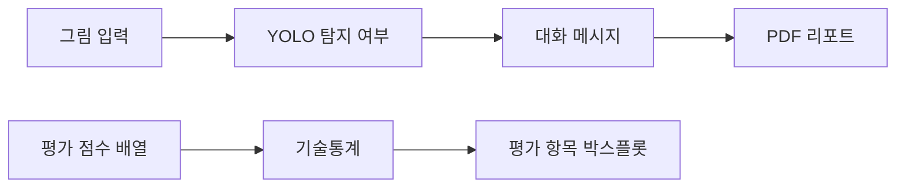

<div align="center">

<a name="그림-객체-탐지와-미술치료-대화-프로토타입"></a>
<a name="yolo-탐지-요약--gpt-4o-mini-대화--pdf-리포트"></a>

# 🗨️ Art Therapy Dialogue Project

그림 탐지 요약으로 대화를 구성하고 평가 결과를 시각화한 프로토타입입니다.

**기술 분류:** 컴퓨터 비전·자연어 처리 › 검출·언어 모델 연결 › 그림 대화 원고·평가 시각화

`Python`
`Gradio`
`Matplotlib`

[빠른 시작](#quick-start) · [저장소 구성](#repository-structure) · [평가 데이터](#data-settings)

[핵심 구성](#input-processing-output)

</div>

## 📄 내 논문 PDF

[현재 원문 PDF·공식 링크 교체 위치](docs/PAPERS.md) · [모든 실제 차수·최종본·전체 비교](docs/REVISION_INDEX.md)

- **5차 · 최종 수정 원고**: [PDF 원문](%EB%85%BC%EB%AC%B8/5%EC%B0%A8/%EC%9B%90%EB%AC%B8_%EB%85%BC%EB%AC%B8.pdf) · [편집 원본](%EB%85%BC%EB%AC%B8/5%EC%B0%A8/%EC%9B%90%EB%AC%B8_%EB%85%BC%EB%AC%B8.hwp)

공식 공개 URL은 아직 등록하지 않았습니다. 추후 [논문 전용 표](docs/PAPERS.md)의 교체 칸과 이 항목을 함께 갱신합니다.

## 🗂️ 모든 실제 차수와 최종본

| 단계 | 설명 | 파일 종류 | 전체 차이 |
|---|---|---|---|
| [1차 원고](docs/revisions/paper-1.md) | 우울증 환자 대상 미술치료라는 초기 제목 아래 YOLOv8·GPT-4o-mini·FPDF의 네 모듈 구조와 합성 데이터 학습, 시뮬레이션 평가를 서술한 4쪽 원고입니다. | hwp·pdf | [직전 단계 비교](docs/revision-diffs/paper-1.diff) |
| [2차 원고](docs/revisions/paper-2.md) | 1차 대비 초록·기여·네 모듈 설명을 다시 쓰고, 32명 성인 사용자의 세 평가 평균 4.6·4.8·4.5와 표를 명시하며 참고문헌을 확장한 4쪽 원고입니다. | hwp·pdf | [직전 단계 비교](docs/revision-diffs/paper-2.diff) |
| [3차 원고](docs/revisions/paper-3.md) | 제목을 객체 검출·생성형 언어모델 기반 그림 심리분석 시스템으로 바꾸고, 33클래스·330,000장 합성 데이터와 성인 32명 시뮬레이션 평가, 관련 연구와 PDF 보고서 설명을 확장한 6쪽 원고입니다. | drawio·hwp·pdf·png | [직전 단계 비교](docs/revision-diffs/paper-3.diff) |
| [4차 원고](docs/revisions/paper-4.md) | 객체 탐지 결과를 성공 여부로 요약하는 구현 경로, 학습 데이터 기준 mAP50 0.92·mAP50-95 0.78의 해석과 한계를 구체화한 8쪽 원고입니다. 점수 배열의 기술통계·박스플롯 노트북이 함께 있습니다. | drawio·hwp·ipynb·pdf·png·txt | [직전 단계 비교](docs/revision-diffs/paper-4.diff) |
| [5차 · 최종 수정 원고](docs/revisions/paper-5.md) | 4차의 연구 내용을 유지하면서 소속을 석사과정으로 정리하고, 접수 2026-09-03·수정 09-23·채택 09-26 및 권24·호10·2026-10-31 표기를 넣은 최종 수정 원고입니다. IITP 표기·저자 영문 표기·소개 문구 등의 차이도 있습니다. 원고 표기만으로 외부 게재 사실을 추가 확정하지 않습니다. | hwp·pdf | [직전 단계 비교](docs/revision-diffs/paper-5.diff) |
| [그림 자료 · 기본 앱](docs/revisions/app.md) | 그림 분석과 텍스트 질문이 별도 호출인 Gradio 대화·PDF 프로토타입입니다. 원고의 통합 대화 설계와 실제 앱 호출 구성을 구분합니다. | drawio·ipynb·png | [직전 단계 비교](docs/revision-diffs/app.diff) |

<a name="overview"></a>

## ✨ 연구 핵심

객체 탐지·대화 연계 설계와 탐지 지표·사용자 평가를 정리한 8쪽 원고입니다.

학습·검증에 같은 자료를 사용했으며 mAP50 약 0.92와 mAP50-95 약 0.78을 기록했습니다. 앱의 그림 분석과 텍스트 질문은 별도 호출로 구성했습니다. 독립 자료와 임상 환경의 평가는 후속 과제입니다.

- 5쪽에는 동일 자료로 학습·검증한 mAP50 약 0.92와 mAP50-95 약 0.78을 정리했습니다.
- 6쪽의 대화 설계와 평가를 앱의 실제 두 호출 경로와 구분합니다. 4차 노트북은 이 연구의 평가 도표를 구성하는 별도 자료입니다.

**자료별 안내:** [기본 앱](docs/versions/base.md) · [4차](docs/versions/first.md) · [최종 원고](docs/versions/latest.md) · [전체 기록](docs/VERSIONS.md)

<a name="preview"></a>

<details>
<summary>📎 논문 도표와 출처</summary>

[📊 원고 도표 보기](assets/previews/paper-architecture.png)

**논문 그림** — 공개 원고 3쪽 그림 1: 그림 입력·객체 탐지·대화·PDF 리포트를 연결한 연구 구조입니다.

[근거 파일 보기](%EB%85%BC%EB%AC%B8/%EC%B5%9C%EC%A2%85_%EB%85%BC%EB%AC%B8.pdf)

</details>

<a name="input-processing-output"></a>

## 🔄 입력·처리·출력

| 단계 | 이 프로젝트에서 다루는 내용 |
| :--- | :--- |
| 📥 입력 | 그림 이미지·텍스트 질문·코드의 점수 배열 |
| ⚙️ 처리 | YOLO 탐지 요약·LLM 대화·PDF, 점수 기술통계 |
| 📤 출력 | 대화 앱·논문·평가 그래프 |


---

<a name="introduction"></a>

## ✨ 프로젝트 소개

연구용 앱과 점수 시각화 노트북을 서로 구분하여 구성합니다. 앱은 그림 입력, 탐지 여부 요약, 대화형 메시지, PDF 다운로드를 연결합니다. 평가 노트북은 정서 적절성·언어 자연스러움·공감 항목의 값과 분포를 계산합니다.

| 기능 | 구현 내용 |
| :--- | :--- |
| 그림 입력 | Gradio에서 이미지를 받아 YOLO 추론 |
| 대화형 메시지 | 탐지 여부 요약을 언어 모델에 전달 |
| PDF 리포트 | 입력 그림·분석 요약·생성 메시지 저장 |
| 평가 통계 | 평균·중앙값·표본 표준편차·사분위수 계산 |
| 평가 시각화 | 세 평가 항목의 박스플롯과 PNG 출력 |



<a name="repository-structure"></a>

## 📁 저장소 구성

```text
.
├── 그림 자료/
│   └── app.ipynb
├── 4차/
│   └── 그림 5.ipynb
├── docs/
│   ├── VERSIONS.md
│   └── SANITIZATION.md
└── CHANGELOG.md
```

- [그림 분석 앱](%EA%B7%B8%EB%A6%BC%20%EC%9E%90%EB%A3%8C/app.ipynb): YOLO·Gradio·PDF·대화 처리.
- [평가 그림](4%EC%B0%A8/%EA%B7%B8%EB%A6%BC%205.ipynb): 점수 분포와 통계·그래프 생성.
- [버전 기록](docs/VERSIONS.md): 포함 코드의 차수별 구성.

<a name="최종-논문"></a>

### 📄 최종 논문

[5차 최종 원문 전체](%EB%85%BC%EB%AC%B8/5%EC%B0%A8/%EC%9B%90%EB%AC%B8_%EB%85%BC%EB%AC%B8.pdf)와 1~4차 원문을 함께 보존합니다. 기존 `논문/최종_논문.pdf`는 4차의 과거 정제 사본이며 5차 최종 원고와 구분합니다. 현재 원문은 본문·도표·저자소개·전화·사진을 보존합니다. 논문에 실린 연구 그림과 별개로 사용자 원본 자료·의료 원데이터 폴더는 포함하지 않습니다.

<a name="논문과-구현의-관계"></a>

### 📄 논문과 구현의 관계

[Python 구현 저장소](https://github.com/PUVKID/Drawing-Analysis-Project)에는 그림 생성·학습·미세조정·API 진입점을 보관합니다. 이 저장소는 최종 원고와 대화 앱·점수 시각화 노트북을 함께 읽는 구성입니다.

최종 8쪽 원고는 YOLO 객체 탐지와 대화·리포트의 연결을 설명합니다. 학습·검증을 같은 자료로 수행한 적합도 지표(mAP50 약 0.92·mAP50-95 약 0.78)를 제시합니다. 독립된 사용자 그림과 임상 효과에 대한 평가는 후속 과제입니다. 이전 4쪽 원고는 정성평가를, 최종 원고는 모델·프롬프트 구성을 구체적으로 설명합니다.

원고 제목은 <strong>「객체 검출과 생성형 언어모델을 결합한 상호작용 기반 그림 심리분석 시스템의 설계 및 구현」</strong>이며 저자는 곽윤석·김남기입니다. 이전 4차에는 권·호·접수일 자리표시자가 남지만 5차에는 구체 날짜와 권24·호10 표기가 있습니다. 이 원고 표기와 공식 게재 URL 확인은 구분합니다.

| 원고의 학습 구성 | 내용 |
| :--- | :--- |
| 데이터 | 중앙에 단일 객체를 놓고 색상을 바꾼 33개 클래스, 클래스당 10,000장, 총 330,000장의 합성 이미지 |
| 모델·학습 | YOLOv8n 사전학습 가중치, 50 epoch × 100단계의 누적 학습으로 기술 |
| 보고 지표 | box loss 0.38, classification loss 0.28, distribution focal loss 0.81, mAP50 0.92, mAP50-95 0.78 |
| 평가 범위 | 학습 자료에 대한 적합도이며 실제 사용자 그림·임상 효과의 독립 검증은 후속 과제 |

연결된 Python 저장소의 `train_yolo_dataset.py`는 30단계로 설정되어 있고, 계산한 `resume_flag`를 학습 호출에 전달하지 않습니다. 원고의 100단계 누적 학습과는 학습 단계와 재개 연결이 다릅니다.

실제 앱의 언어 모델 입력은 탐지 성공·실패와 시각을 요약한 텍스트입니다. 객체의 상세 좌표·공간 관계나 원본 그림 바이트를 보내는 멀티모달 분석으로 설명하지 않습니다. `그림 5.ipynb`의 32개 점수 배열은 원응답 파일과 연결되지 않은 코드 입력이므로 치료 효과의 근거로 확대하지 않습니다.

<a name="implementation"></a>

## 🧩 주요 기술

앱은 `analyze_and_suggest()`에서 입력을 저장하고 YOLO를 호출합니다. 언어 모델로 전달하는 요약은 분석 시각과 탐지 성공·실패이며, 상세 객체 좌표나 그림 자체를 전송하는 구성은 아닙니다. `ask_gpt()`는 텍스트 질문에 대한 별도 호출을 담당합니다. 원고 6쪽은 탐지 요약과 사용자 상담 입력을 한 요청에 묶는 설계를 설명하지만, 공개 앱은 그림 분석 버튼과 텍스트 질문 버튼의 요청을 따로 보냅니다. 이전 대화 이력도 자동으로 전달하지 않습니다.

평가 노트북은 NumPy와 Matplotlib를 사용하고, `ddof=1`의 표본 표준편차를 계산합니다. Google Colab의 폰트 설치·파일 다운로드 기능을 사용하므로 일반 로컬 Jupyter에서는 해당 셀의 실행 환경을 따로 맞춰야 합니다.

<a name="quick-start"></a>

## 🚀 빠른 시작

저장소 루트에서 노트북을 엽니다.

```powershell
python -m pip install jupyterlab
python -m jupyter lab
```

1. 평가 그림만 확인하려면 `4차/그림 5.ipynb`를 Google Colab에서 엽니다. 폰트 설치 셀부터 순서대로 실행합니다.
2. 앱을 실행하려면 `그림 자료/app.ipynb`의 패키지 설치 셀을 확인하고, `OPENAI_API_KEY`를 자신의 실행 환경에 준비합니다.
3. `YOLO_MODEL_PATH`, `PROJECT_DIR`, `FONT_PATH`를 실제 모델·작업·폰트 경로에 맞춥니다.
4. 입력 폴더를 준비한 뒤 앱 초기화와 Gradio 셀을 실행합니다.

입력 그림과 리포트는 `input/temp.jpg`, `result/report.pdf`에 저장됩니다. 다음 실행에서 같은 파일을 사용하므로 보관할 결과는 따로 저장하세요.

학습 가중치, 사용자 원본 그림과 개별 평가 응답지는 공개 사본에 포함하지 않습니다. API 사용은 실행자의 서비스 설정과 이용 조건에 따릅니다.

<a name="data-settings"></a>

## 📊 데이터 구성과 평가 항목

| 배열 | 평가 항목 | 코드의 데이터 구성 |
| :--- | :--- | :--- |
| `emotional_appropriateness` | 정서 적절성 | 3점 2개, 4점 10개, 5점 20개 |
| `language_naturalness` | 언어 자연스러움 | 3점 1개, 4점 5개, 5점 26개 |
| `empathy` | 공감 | 3점 2개, 4점 12개, 5점 18개 |

각 배열에는 32개의 점수를 직접 구성해 그래프와 기술통계를 계산합니다. 개인별 원응답 파일을 읽는 구조는 아니며, 치료 효과의 평가에는 수집·평가 절차와 원응답 자료가 필요합니다.

<a name="troubleshooting"></a>

## 🛠️ 문제 해결

| 증상 | 확인할 내용 |
| :--- | :--- |
| `google.colab`을 찾지 못함 | 평가 노트북은 Colab 전용 다운로드 기능을 사용함 |
| 한글 그래프가 깨짐 | 나눔고딕 설치 셀과 폰트 경로 |
| 앱 초기화 실패 | API 환경변수와 YOLO 가중치 경로 |
| PDF 생성 실패 | 입력 폴더·출력 폴더·한글 폰트 파일 |
| 평가 수치 해석이 불명확함 | 코드의 점수 배열과 실제 연구 수집 절차를 구분 |

---

<div align="center">

**대화형 프로토타입과 평가 자료를 함께 살펴봅니다.**

</div>
