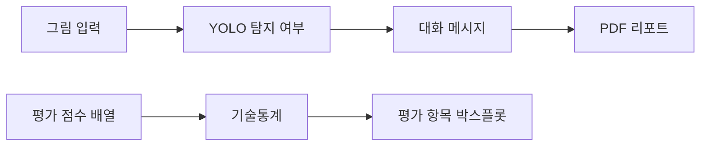

<div align="center">

<a name="그림-객체-탐지와-미술치료-대화-프로토타입"></a>
<a name="yolo-탐지-요약--gpt-4o-mini-대화--pdf-리포트"></a>

# 🗨️ Art Therapy Dialogue Project

그림 탐지 요약으로 대화를 구성하고 평가 결과를 시각화한 프로토타입입니다.

**기술 분류:** 컴퓨터 비전·자연어 처리 › 검출·언어 모델 연결 › 그림 대화 원고·평가 시각화

`Python`
`Gradio`
`Matplotlib`

[빠른 시작](#quick-start) · [저장소 구성](#repository-structure) · [평가 데이터](#data-settings)

[핵심 구성](#input-processing-output)

</div>

<a name="overview"></a>

## ✨ 보관 자료에서 살펴볼 점

객체 탐지·대화 연계 설계와 탐지 지표·사용자 평가를 정리한 8쪽 원고입니다.

같은 자료로 학습·검증한 mAP50 약 0.92와 mAP50-95 약 0.78은 독립 임상 성능이 아닙니다. 공개 앱의 그림 분석과 텍스트 질문은 별도 호출입니다. 학회 양식만으로 게재 완료를 뜻하지 않습니다.

- 5쪽은 mAP50 약 0.92와 mAP50-95 약 0.78을 보고합니다. 동일 자료의 학습·검증이라는 조건을 함께 읽어야 합니다.
- 6쪽의 대화 설계와 평가를 앱의 실제 두 호출 경로와 구분합니다. 4차 노트북은 이 연구의 평가 도표를 구성하는 별도 자료입니다.

**자료별 안내:** [기본 앱](docs/versions/base.md) · [4차](docs/versions/first.md) · [최종 원고](docs/versions/latest.md) · [전체 기록](docs/VERSIONS.md)

<a name="preview"></a>

<details>
<summary>📎 논문 도표와 출처</summary>

[📊 원고 도표 보기](assets/previews/paper-architecture.png)

**논문 그림** — 공개 원고 3쪽 그림 1: 그림 입력·객체 탐지·대화·PDF 리포트를 연결한 연구 구조입니다.

[근거 파일 보기](%EB%85%BC%EB%AC%B8/%EC%B5%9C%EC%A2%85_%EB%85%BC%EB%AC%B8.pdf)

</details>

<a name="input-processing-output"></a>

## 🔄 입력·처리·출력

| 단계 | 이 프로젝트에서 다루는 내용 |
| :--- | :--- |
| 📥 입력 | 그림 이미지·텍스트 질문·코드의 점수 배열 |
| ⚙️ 처리 | YOLO 탐지 요약·LLM 대화·PDF, 점수 기술통계 |
| 📤 출력 | 대화 앱·논문·평가 그래프 |


---

<a name="introduction"></a>

## ✨ 프로젝트 소개

연구용 앱과 점수 시각화 노트북을 서로 구분하여 구성합니다. 앱은 그림 입력, 탐지 여부 요약, 대화형 메시지, PDF 다운로드를 연결합니다. 평가 노트북은 정서 적절성·언어 자연스러움·공감 항목의 값과 분포를 계산합니다.

| 기능 | 구현 내용 |
| :--- | :--- |
| 그림 입력 | Gradio에서 이미지를 받아 YOLO 추론 |
| 대화형 메시지 | 탐지 여부 요약을 언어 모델에 전달 |
| PDF 리포트 | 입력 그림·분석 요약·생성 메시지 저장 |
| 평가 통계 | 평균·중앙값·표본 표준편차·사분위수 계산 |
| 평가 시각화 | 세 평가 항목의 박스플롯과 PNG 출력 |



<a name="repository-structure"></a>

## 📁 저장소 구성

```text
.
├── 그림 자료/
│   └── app.ipynb
├── 4차/
│   └── 그림 5.ipynb
├── docs/
│   ├── VERSIONS.md
│   └── SANITIZATION.md
└── CHANGELOG.md
```

- [그림 분석 앱](그림%20자료/app.ipynb): YOLO·Gradio·PDF·대화 처리.
- [평가 그림](4차/그림%205.ipynb): 점수 분포와 통계·그래프 생성.
- [버전 기록](docs/VERSIONS.md): 포함 코드의 차수별 구성.

<a name="최종-논문"></a>

### 📄 최종 논문

[최종 논문 전체 원고](논문/최종_논문.pdf)를 한 개 포함했습니다. 개인 전화번호와 바로 뒤 구분기호, 저자 개인사진만 제거하고 기술 본문·연구 도표·저자명·업무 이메일·ORCID를 보존한 공개 사본입니다. 이전 제출 차수와 통합 논문집은 함께 넣지 않았습니다. 논문에 실린 연구 그림과 별개로 사용자 원본 자료·의료 원데이터 폴더는 포함하지 않습니다.

<a name="논문과-구현의-관계"></a>

### 📄 논문과 구현의 관계

[Python 구현 저장소](https://github.com/PUVKID/Drawing-Analysis-Project)에는 그림 생성·학습·미세조정·API 진입점을 보관합니다. 이 저장소는 최종 원고와 대화 앱·점수 시각화 노트북을 함께 읽는 구성입니다.

최종 8쪽 원고는 YOLO 객체 탐지와 대화·리포트의 연결을 설명합니다. 학습·검증을 같은 자료로 수행한 적합도 지표(mAP50 약 0.92·mAP50-95 약 0.78)를 제시하며, 이를 독립된 사용자 그림이나 임상 효과에 대한 성능으로 해석하지 않습니다. 이전 4쪽 원고의 정성평가 설명과 최종 원고의 모델·프롬프트 설명도 구분합니다.

원고 제목은 <strong>「객체 검출과 생성형 언어모델을 결합한 상호작용 기반 그림 심리분석 시스템의 설계 및 구현」</strong>이며 저자는 곽윤석·김남기입니다. 한국정보기술학회 논문 양식의 권·호·접수일에 자리표시자가 남아 있어, 양식만으로 게재 완료를 판단하지 않습니다.

| 원고의 학습 구성 | 내용 |
| :--- | :--- |
| 데이터 | 중앙에 단일 객체를 놓고 색상을 바꾼 33개 클래스, 클래스당 10,000장, 총 330,000장의 합성 이미지 |
| 모델·학습 | YOLOv8n 사전학습 가중치, 50 epoch × 100단계의 누적 학습으로 기술 |
| 보고 지표 | box loss 0.38, classification loss 0.28, distribution focal loss 0.81, mAP50 0.92, mAP50-95 0.78 |
| 평가 범위 | 학습 자료에 대한 적합도이며 실제 사용자 그림·임상 효과의 독립 검증은 후속 과제 |

연결된 Python 저장소의 `train_yolo_dataset.py`는 30단계로 설정되어 있고, 계산한 `resume_flag`를 학습 호출에 전달하지 않습니다. 따라서 현재 공개 코드의 설정을 원고의 100단계 누적 학습과 같은 것으로 읽으면 안 됩니다.

실제 앱의 언어 모델 입력은 탐지 성공·실패와 시각을 요약한 텍스트입니다. 객체의 상세 좌표·공간 관계나 원본 그림 바이트를 보내는 멀티모달 분석으로 설명하지 않습니다. `그림 5.ipynb`의 32개 점수 배열은 원응답 파일과 연결되지 않은 코드 입력이므로 치료 효과의 근거로 확대하지 않습니다.

<a name="implementation"></a>

## 🧩 주요 기술

앱은 `analyze_and_suggest()`에서 입력을 저장하고 YOLO를 호출합니다. 언어 모델로 전달하는 요약은 분석 시각과 탐지 성공·실패이며, 상세 객체 좌표나 그림 자체를 전송하는 구성은 아닙니다. `ask_gpt()`는 텍스트 질문에 대한 별도 호출을 담당합니다. 원고 6쪽은 탐지 요약과 사용자 상담 입력을 한 요청에 묶는 설계를 설명하지만, 공개 앱은 그림 분석 버튼과 텍스트 질문 버튼의 요청을 따로 보냅니다. 이전 대화 이력도 자동으로 전달하지 않습니다.

평가 노트북은 NumPy와 Matplotlib를 사용하고, `ddof=1`의 표본 표준편차를 계산합니다. Google Colab의 폰트 설치·파일 다운로드 기능을 사용하므로 일반 로컬 Jupyter에서는 해당 셀의 실행 환경을 따로 맞춰야 합니다.

<a name="quick-start"></a>

## 🚀 빠른 시작

저장소 루트에서 노트북을 엽니다.

```powershell
python -m pip install jupyterlab
python -m jupyter lab
```

1. 평가 그림만 확인하려면 `4차/그림 5.ipynb`를 Google Colab에서 엽니다. 폰트 설치 셀부터 순서대로 실행합니다.
2. 앱을 실행하려면 `그림 자료/app.ipynb`의 패키지 설치 셀을 확인하고, `OPENAI_API_KEY`를 자신의 실행 환경에 준비합니다.
3. `YOLO_MODEL_PATH`, `PROJECT_DIR`, `FONT_PATH`를 실제 모델·작업·폰트 경로에 맞춥니다.
4. 입력 폴더를 준비한 뒤 앱 초기화와 Gradio 셀을 실행합니다.

입력 그림과 리포트는 `input/temp.jpg`, `result/report.pdf`에 저장됩니다. 다음 실행에서 같은 파일을 사용하므로 보관할 결과는 따로 저장하세요.

학습 가중치, 사용자 원본 그림과 개별 평가 응답지는 공개 사본에 포함하지 않습니다. API 사용은 실행자의 서비스 설정과 이용 조건에 따릅니다.

<a name="data-settings"></a>

## 📊 데이터 구성과 평가 항목

| 배열 | 평가 항목 | 코드의 데이터 구성 |
| :--- | :--- | :--- |
| `emotional_appropriateness` | 정서 적절성 | 3점 2개, 4점 10개, 5점 20개 |
| `language_naturalness` | 언어 자연스러움 | 3점 1개, 4점 5개, 5점 26개 |
| `empathy` | 공감 | 3점 2개, 4점 12개, 5점 18개 |

각 배열에는 32개의 점수가 코드에 직접 구성되어 있습니다. 이는 그래프를 재현하는 입력이며, 개인별 원응답 데이터나 치료 효과의 검증 자료와 동일하지 않습니다. 연구 해석에는 수집·평가 절차와 원문에서 정의한 범위를 함께 확인해야 합니다.

<a name="troubleshooting"></a>

## 🛠️ 문제 해결

| 증상 | 확인할 내용 |
| :--- | :--- |
| `google.colab`을 찾지 못함 | 평가 노트북은 Colab 전용 다운로드 기능을 사용함 |
| 한글 그래프가 깨짐 | 나눔고딕 설치 셀과 폰트 경로 |
| 앱 초기화 실패 | API 환경변수와 YOLO 가중치 경로 |
| PDF 생성 실패 | 입력 폴더·출력 폴더·한글 폰트 파일 |
| 평가 수치 해석이 불명확함 | 코드의 점수 배열과 실제 연구 수집 절차를 구분 |

---

<div align="center">

**대화형 프로토타입과 평가 자료를 함께 살펴봅니다.**

</div>
