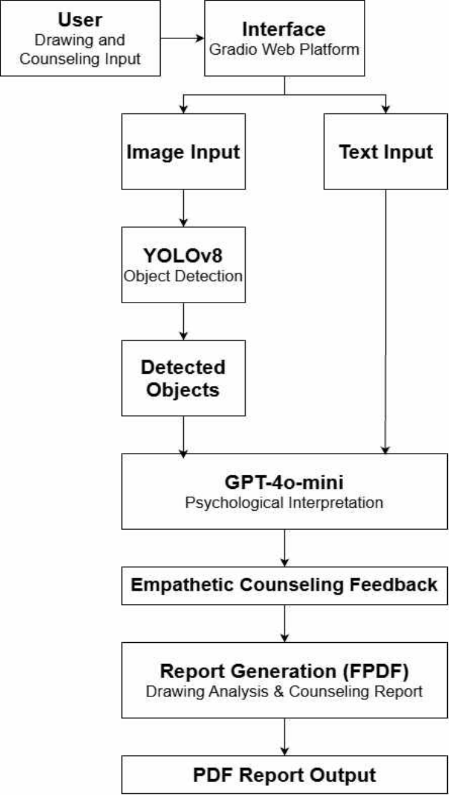
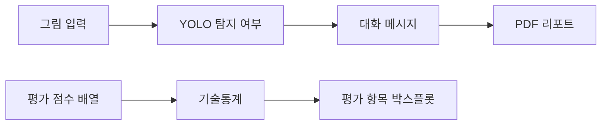

<div align="center">

# 그림 객체 탐지와 미술치료 대화 프로토타입

**Art-Therapy-Dialogue-Project**

**기술 분류:** 컴퓨터 비전·자연어 처리 › 검출·언어 모델 연결 › 그림 대화 원고·평가 시각화


### YOLO 탐지 요약 · GPT-4o-mini 대화 · PDF 리포트

그림에서 객체 탐지 여부를 확인하고, 요약 텍스트를 대화형 메시지와 PDF로 연결하는 연구입니다.<br>
최종 논문의 설계·제약과 앱 구현을 함께 읽고, 별도로 보존한 평가 그림의 입력 자료도 구분합니다.


[빠른 시작](#quick-start) · [저장소 구성](#repository-structure) · [평가 데이터](#data-settings)

[예시 이미지](#preview)

</div>

<a name="preview"></a>

## 🖼️ 예시로 보기

<p align="center"></p>

**논문 그림** — 공개 원고 3쪽 그림 1: 그림 입력·객체 탐지·대화·PDF 리포트를 연결한 연구 구조입니다.

[근거 파일 보기](%EB%85%BC%EB%AC%B8/%EC%B5%9C%EC%A2%85_%EB%85%BC%EB%AC%B8.pdf)


<a name="input-processing-output"></a>

## 🔄 입력·처리·출력

| 단계 | 이 프로젝트에서 다루는 내용 |
| :--- | :--- |
| 입력 | 그림 이미지·텍스트 질문·코드의 점수 배열 |
| 처리 | YOLO 탐지 요약·LLM 대화·PDF, 점수 기술통계 |
| 출력 | 대화 앱·논문·평가 그래프 |


---

<a name="introduction"></a>

## ✨ 프로젝트 소개

연구용 앱과 점수 시각화 노트북을 서로 구분하여 구성합니다. 앱은 그림 입력, 탐지 여부 요약, 대화형 메시지, PDF 다운로드를 연결합니다. 평가 노트북은 정서 적절성·언어 자연스러움·공감 항목의 값과 분포를 계산합니다.

| 기능 | 구현 내용 |
| :--- | :--- |
| 그림 입력 | Gradio에서 이미지를 받아 YOLO 추론 |
| 대화형 메시지 | 탐지 여부 요약을 언어 모델에 전달 |
| PDF 리포트 | 입력 그림·분석 요약·생성 메시지 저장 |
| 평가 통계 | 평균·중앙값·표본 표준편차·사분위수 계산 |
| 평가 시각화 | 세 평가 항목의 박스플롯과 PNG 출력 |



<a name="repository-structure"></a>

## 📁 저장소 구성

```text
.
├── 그림 자료/
│   └── app.ipynb
├── 4차/
│   └── 그림 5.ipynb
├── docs/
│   ├── VERSIONS.md
│   └── SANITIZATION.md
└── CHANGELOG.md
```

- [그림 분석 앱](그림%20자료/app.ipynb): YOLO·Gradio·PDF·대화 처리.
- [평가 그림](4차/그림%205.ipynb): 점수 분포와 통계·그래프 생성.
- [버전 기록](docs/VERSIONS.md): 포함 코드의 차수별 구성.

### 최종 논문

[최종 논문 전체 원고](논문/최종_논문.pdf)를 한 개 포함했습니다. 개인 전화번호와 바로 뒤 구분기호, 저자 개인사진만 제거하고 기술 본문·연구 도표·저자명·업무 이메일·ORCID를 보존한 공개 사본입니다. 이전 제출 차수와 통합 논문집은 함께 넣지 않았습니다. 논문에 실린 연구 그림과 별개로 사용자 원본 자료·의료 원데이터 폴더는 포함하지 않습니다.

### 논문과 구현의 관계

[Python 구현 저장소](https://github.com/PUVKID/Drawing-Analysis-Project)에는 그림 생성·학습·미세조정·API 진입점을 보관합니다. 이 저장소는 최종 원고와 대화 앱·점수 시각화 노트북을 함께 읽는 구성입니다.

최종 8쪽 원고는 YOLO 객체 탐지와 대화·리포트의 연결을 설명합니다. 학습·검증을 같은 자료로 수행한 적합도 지표(정밀도 0.92·재현율 0.78)를 제시하며, 이를 독립된 사용자 그림이나 임상 효과에 대한 성능으로 해석하지 않습니다. 이전 4쪽 원고의 정성평가 설명과 최종 원고의 모델·프롬프트 설명도 구분합니다.

실제 앱의 언어 모델 입력은 탐지 성공·실패와 시각을 요약한 텍스트입니다. 객체의 상세 좌표·공간 관계나 원본 그림 바이트를 보내는 멀티모달 분석으로 설명하지 않습니다. `그림 5.ipynb`의 32개 점수 배열은 원응답 파일과 연결되지 않은 코드 입력이므로 치료 효과의 근거로 확대하지 않습니다.

<a name="implementation"></a>

## 🧩 주요 기술

앱은 `analyze_and_suggest()`에서 입력을 저장하고 YOLO를 호출합니다. 언어 모델로 전달하는 요약은 분석 시각과 탐지 성공·실패이며, 상세 객체 좌표나 그림 자체를 전송하는 구성은 아닙니다. `ask_gpt()`는 텍스트 질문에 대한 별도 호출을 담당합니다.

평가 노트북은 NumPy와 Matplotlib를 사용하고, `ddof=1`의 표본 표준편차를 계산합니다. Google Colab의 폰트 설치·파일 다운로드 기능을 사용하므로 일반 로컬 Jupyter에서는 해당 셀의 실행 환경을 따로 맞춰야 합니다.

<a name="quick-start"></a>

## 🚀 빠른 시작

저장소 루트에서 노트북을 엽니다.

```powershell
python -m pip install jupyterlab
python -m jupyter lab
```

1. 평가 그림만 확인하려면 `4차/그림 5.ipynb`를 Google Colab에서 엽니다. 폰트 설치 셀부터 순서대로 실행합니다.
2. 앱을 실행하려면 `그림 자료/app.ipynb`의 패키지 설치 셀을 확인하고, `OPENAI_API_KEY`를 자신의 실행 환경에 준비합니다.
3. `YOLO_MODEL_PATH`, `PROJECT_DIR`, `FONT_PATH`를 실제 모델·작업·폰트 경로에 맞춥니다.
4. 입력 폴더를 준비한 뒤 앱 초기화와 Gradio 셀을 실행합니다.

학습 가중치, 사용자 원본 그림과 개별 평가 응답지는 공개 사본에 포함하지 않습니다. API 사용은 실행자의 서비스 설정과 이용 조건에 따릅니다.

<a name="data-settings"></a>

## 📊 데이터 구성과 평가 항목

| 배열 | 평가 항목 | 코드의 데이터 구성 |
| :--- | :--- | :--- |
| `emotional_appropriateness` | 정서 적절성 | 3점 2개, 4점 10개, 5점 20개 |
| `language_naturalness` | 언어 자연스러움 | 3점 1개, 4점 5개, 5점 26개 |
| `empathy` | 공감 | 3점 2개, 4점 12개, 5점 18개 |

각 배열에는 32개의 점수가 코드에 직접 구성되어 있습니다. 이는 그래프를 재현하는 입력이며, 개인별 원응답 데이터나 치료 효과의 검증 자료와 동일하지 않습니다. 연구 해석에는 수집·평가 절차와 원문에서 정의한 범위를 함께 확인해야 합니다.

<a name="troubleshooting"></a>

## 🛠️ 문제 해결

| 증상 | 확인할 내용 |
| :--- | :--- |
| `google.colab`을 찾지 못함 | 평가 노트북은 Colab 전용 다운로드 기능을 사용함 |
| 한글 그래프가 깨짐 | 나눔고딕 설치 셀과 폰트 경로 |
| 앱 초기화 실패 | API 환경변수와 YOLO 가중치 경로 |
| PDF 생성 실패 | 입력 폴더·출력 폴더·한글 폰트 파일 |
| 평가 수치 해석이 불명확함 | 코드의 점수 배열과 실제 연구 수집 절차를 구분 |

---

<div align="center">

**대화형 프로토타입과 평가 자료를 함께 살펴봅니다.**

</div>
