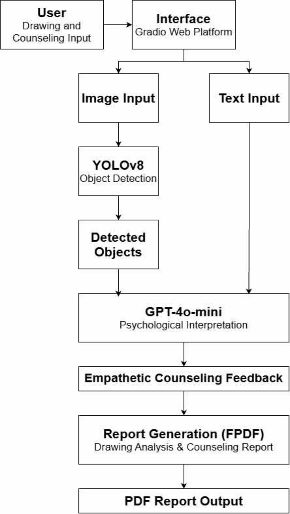

# 문서 읽기 레벨 구성 전체 비교

기준 커밋: `e48dfc0977b9b406e4504cf91fb99fc4ceb08ec3`

기존 Markdown의 모든 수정 줄과 새 수준별 안내 전문을 비교합니다. 줄바꿈·공백 차이는 원문 Git 비교로도 확인할 수 있습니다. 새 변경 기록과 이 비교 문서 자체는 비교 대상에서 제외했습니다. 아래에 명시한 논문 PDF 삭제와 공식 게재 링크 대체 외의 코드·데이터·논문·이미지는 기준 커밋과 같습니다.

````````````diff
--- a/4차/README.md
+++ b/4차/README.md
@@ -1,6 +1,12 @@
 <a id="-4차"></a>
 
 # 4차
+
+<!-- reading-levels17:start -->
+**읽기 수준 선택** · [LEVEL 1 - Beginner](../docs/%EC%9D%BD%EA%B8%B0%EC%95%88%EB%82%B4/%EB%A0%88%EB%B2%A81.md) · [LEVEL 2 - Explorer](../docs/%EC%9D%BD%EA%B8%B0%EC%95%88%EB%82%B4/%EB%A0%88%EB%B2%A82.md) · [LEVEL 3 - Practitioner](../docs/%EC%9D%BD%EA%B8%B0%EC%95%88%EB%82%B4/%EB%A0%88%EB%B2%A83.md) · [LEVEL 4 - Advanced](../docs/%EC%9D%BD%EA%B8%B0%EC%95%88%EB%82%B4/%EB%A0%88%EB%B2%A84.md) · [LEVEL 5 - Expert](../docs/%EC%9D%BD%EA%B8%B0%EC%95%88%EB%82%B4/%EB%A0%88%EB%B2%A85.md)
+
+**논문 읽기:** 곽윤석·김남기의 논문은 Journal of KIIT 24(10), 77–84쪽, 2026-10-31에 게재되었습니다. 전체 8쪽 게재본은 [공식 DOI 페이지](https://doi.org/10.14801/jkiit.2026.24.10.77)에서 읽을 수 있습니다. **HWP는 기존 투고 원고**입니다. 게재본 PDF는 저장소에 첨부하지 않습니다. 과거 차수의 파일 구성도·해시·쪽수는 해당 투고 자료의 이력으로 읽어 주세요.
+<!-- reading-levels17:end -->
 
 정서적 적절성·언어 자연스러움·공감의 32개 점수 배열을 기술통계와 박스플롯으로 정리한 평가 시각화 단계입니다.
 

--- a/README.md
+++ b/README.md
@@ -6,6 +6,18 @@
 # Art Therapy Dialogue Project
 
 그림 탐지 요약으로 대화를 구성하고 평가 결과를 시각화한 프로토타입입니다.
+
+<!-- reading-levels17:start -->
+| 읽기 수준 | 안내 내용 |
+| --- | --- |
+| [LEVEL 1 - Beginner](docs/%EC%9D%BD%EA%B8%B0%EC%95%88%EB%82%B4/%EB%A0%88%EB%B2%A81.md) | 낯선 용어를 풀고 입력부터 결과까지 구체적인 예로 읽기 |
+| [LEVEL 2 - Explorer](docs/%EC%9D%BD%EA%B8%B0%EC%95%88%EB%82%B4/%EB%A0%88%EB%B2%A82.md) | 핵심 개념과 처리 흐름의 관계 이해 |
+| [LEVEL 3 - Practitioner](docs/%EC%9D%BD%EA%B8%B0%EC%95%88%EB%82%B4/%EB%A0%88%EB%B2%A83.md) | 실험·사용 절차와 결과 해석 따라가기 |
+| [LEVEL 4 - Advanced](docs/%EC%9D%BD%EA%B8%B0%EC%95%88%EB%82%B4/%EB%A0%88%EB%B2%A84.md) | 코드 구조·설정·설계 선택과 제약 검토 |
+| [LEVEL 5 - Expert](docs/%EC%9D%BD%EA%B8%B0%EC%95%88%EB%82%B4/%EB%A0%88%EB%B2%A85.md) | 논문·프로토콜·분모·누수·미검증 범위 대조 |
+
+**논문 읽기:** 곽윤석·김남기의 논문은 Journal of KIIT 24(10), 77–84쪽, 2026-10-31에 게재되었습니다. 전체 8쪽 게재본은 [공식 DOI 페이지](https://doi.org/10.14801/jkiit.2026.24.10.77)에서 읽을 수 있습니다. **HWP는 기존 투고 원고**입니다. 게재본 PDF는 저장소에 첨부하지 않습니다. 과거 차수의 파일 구성도·해시·쪽수는 해당 투고 자료의 이력으로 읽어 주세요.
+<!-- reading-levels17:end -->
 
 분야: 컴퓨터 비전·자연어 처리 › 검출·언어 모델 연결 › 그림 대화 원고·평가 시각화
 
@@ -36,7 +48,7 @@
 
 **논문 그림** — 공개 원고 3쪽 그림 1: 그림 입력·객체 탐지·대화·PDF 리포트를 연결한 연구 구조입니다.
 
-[근거 파일 보기](%EB%85%BC%EB%AC%B8/%EC%B5%9C%EC%A2%85_%EB%85%BC%EB%AC%B8.pdf)
+[근거 파일 보기](https://doi.org/10.14801/jkiit.2026.24.10.77)
 
 <a name="input-processing-output"></a>
 
@@ -59,7 +71,7 @@
 
 | 자료 | 원문 파일 |
 |---|---|
-| 최종 논문 · 그림 심리분석 | [PDF 다운로드](%EB%85%BC%EB%AC%B8/%EC%B5%9C%EC%A2%85_%EB%85%BC%EB%AC%B8.pdf) |
+| 최종 논문 · 그림 심리분석 | [공식 게재 페이지](https://doi.org/10.14801/jkiit.2026.24.10.77) |
 | 최종 논문 · 그림 심리분석 | [HWP 다운로드](%EB%85%BC%EB%AC%B8/%EC%B5%9C%EC%A2%85_%EB%85%BC%EB%AC%B8.hwp) |
 
 [자료별 설명](docs/PAPERS.md) · [코드 차수와 변경 이력](docs/REVISION_INDEX.md)
@@ -83,7 +95,7 @@
 
 ## 연구 방법
 
-앱은 그림 입력, 탐지 여부 요약, 대화형 메시지, PDF 다운로드를 연결합니다. 평가 노트북은 정서 적절성·언어 자연스러움·공감 항목의 값과 분포를 계산합니다.
+앱은 그림 입력, 탐지 여부 요약, 대화형 메시지, 공식 게재 페이지를 연결합니다. 평가 노트북은 정서 적절성·언어 자연스러움·공감 항목의 값과 분포를 계산합니다.
 
 | 기능 | 구현 내용 |
 | :--- | :--- |
@@ -130,7 +142,7 @@
 
 ### 최종 논문
 
-현재 첨부는 5차 최종 수정 원고의 전체 PDF와 같은 판의 HWP로 통일했습니다. 이전 원고의 변화는 차수별 설명과 비교 이력에서 확인할 수 있습니다.
+현재 게재본은 공식 DOI 페이지로 안내하고, 기존 HWP는 투고 원고로 보존합니다. 이전 원고의 변화는 차수별 설명과 비교 이력에서 확인할 수 있습니다.
 
 현재 원문은 본문·도표·저자소개·전화·사진을 보존합니다. 논문에 실린 연구 그림과 별개로 사용자 원본 자료·의료 원데이터 폴더는 포함하지 않습니다.
 

--- a/docs/PAPERS.md
+++ b/docs/PAPERS.md
@@ -1,12 +1,18 @@
 <a id="-논문과-최신-자료"></a>
 
 # 논문과 최신 자료
+
+<!-- reading-levels17:start -->
+**읽기 수준 선택** · [LEVEL 1 - Beginner](%EC%9D%BD%EA%B8%B0%EC%95%88%EB%82%B4/%EB%A0%88%EB%B2%A81.md) · [LEVEL 2 - Explorer](%EC%9D%BD%EA%B8%B0%EC%95%88%EB%82%B4/%EB%A0%88%EB%B2%A82.md) · [LEVEL 3 - Practitioner](%EC%9D%BD%EA%B8%B0%EC%95%88%EB%82%B4/%EB%A0%88%EB%B2%A83.md) · [LEVEL 4 - Advanced](%EC%9D%BD%EA%B8%B0%EC%95%88%EB%82%B4/%EB%A0%88%EB%B2%A84.md) · [LEVEL 5 - Expert](%EC%9D%BD%EA%B8%B0%EC%95%88%EB%82%B4/%EB%A0%88%EB%B2%A85.md)
+
+**논문 읽기:** 곽윤석·김남기의 논문은 Journal of KIIT 24(10), 77–84쪽, 2026-10-31에 게재되었습니다. 전체 8쪽 게재본은 [공식 DOI 페이지](https://doi.org/10.14801/jkiit.2026.24.10.77)에서 읽을 수 있습니다. **HWP는 기존 투고 원고**입니다. 게재본 PDF는 저장소에 첨부하지 않습니다. 과거 차수의 파일 구성도·해시·쪽수는 해당 투고 자료의 이력으로 읽어 주세요.
+<!-- reading-levels17:end -->
 
 논문은 각 연구의 최종 전체본을 수록했습니다. 발표·대본·연구노트는 문서 목적을 구분해 연결합니다. 원문의 저자·소속·이메일·사진과 본문을 그대로 보존했습니다.
 
 | 자료 | 원문 파일 |
 |---|---|
-| 최종 논문 · 그림 심리분석 | [PDF 다운로드](../%EB%85%BC%EB%AC%B8/%EC%B5%9C%EC%A2%85_%EB%85%BC%EB%AC%B8.pdf) |
+| 최종 논문 · 그림 심리분석 | [공식 게재 페이지](https://doi.org/10.14801/jkiit.2026.24.10.77) |
 | 최종 논문 · 그림 심리분석 | [HWP 다운로드](../%EB%85%BC%EB%AC%B8/%EC%B5%9C%EC%A2%85_%EB%85%BC%EB%AC%B8.hwp) |
 
 공식 논문 URL은 확인 후 이 안내와 첫 화면에 함께 연결합니다. [코드 차수와 이전 원고의 변경 설명](REVISION_INDEX.md)을 확인할 수 있습니다.

--- a/docs/REVISION_INDEX.md
+++ b/docs/REVISION_INDEX.md
@@ -1,6 +1,12 @@
 <a id="️-차수별-프로젝트-안내"></a>
 
 # 전체 차수
+
+<!-- reading-levels17:start -->
+**읽기 수준 선택** · [LEVEL 1 - Beginner](%EC%9D%BD%EA%B8%B0%EC%95%88%EB%82%B4/%EB%A0%88%EB%B2%A81.md) · [LEVEL 2 - Explorer](%EC%9D%BD%EA%B8%B0%EC%95%88%EB%82%B4/%EB%A0%88%EB%B2%A82.md) · [LEVEL 3 - Practitioner](%EC%9D%BD%EA%B8%B0%EC%95%88%EB%82%B4/%EB%A0%88%EB%B2%A83.md) · [LEVEL 4 - Advanced](%EC%9D%BD%EA%B8%B0%EC%95%88%EB%82%B4/%EB%A0%88%EB%B2%A84.md) · [LEVEL 5 - Expert](%EC%9D%BD%EA%B8%B0%EC%95%88%EB%82%B4/%EB%A0%88%EB%B2%A85.md)
+
+**논문 읽기:** 곽윤석·김남기의 논문은 Journal of KIIT 24(10), 77–84쪽, 2026-10-31에 게재되었습니다. 전체 8쪽 게재본은 [공식 DOI 페이지](https://doi.org/10.14801/jkiit.2026.24.10.77)에서 읽을 수 있습니다. **HWP는 기존 투고 원고**입니다. 게재본 PDF는 저장소에 첨부하지 않습니다. 과거 차수의 파일 구성도·해시·쪽수는 해당 투고 자료의 이력으로 읽어 주세요.
+<!-- reading-levels17:end -->
 
 연구 원고·실험 코드·발표 자료의 목적과 사용 순서를 단계별로 살펴봅니다.
 

--- a/docs/VERSIONS.md
+++ b/docs/VERSIONS.md
@@ -2,6 +2,12 @@
 
 # 차수별 연구 자료
 
+<!-- reading-levels17:start -->
+**읽기 수준 선택** · [LEVEL 1 - Beginner](%EC%9D%BD%EA%B8%B0%EC%95%88%EB%82%B4/%EB%A0%88%EB%B2%A81.md) · [LEVEL 2 - Explorer](%EC%9D%BD%EA%B8%B0%EC%95%88%EB%82%B4/%EB%A0%88%EB%B2%A82.md) · [LEVEL 3 - Practitioner](%EC%9D%BD%EA%B8%B0%EC%95%88%EB%82%B4/%EB%A0%88%EB%B2%A83.md) · [LEVEL 4 - Advanced](%EC%9D%BD%EA%B8%B0%EC%95%88%EB%82%B4/%EB%A0%88%EB%B2%A84.md) · [LEVEL 5 - Expert](%EC%9D%BD%EA%B8%B0%EC%95%88%EB%82%B4/%EB%A0%88%EB%B2%A85.md)
+
+**논문 읽기:** 곽윤석·김남기의 논문은 Journal of KIIT 24(10), 77–84쪽, 2026-10-31에 게재되었습니다. 전체 8쪽 게재본은 [공식 DOI 페이지](https://doi.org/10.14801/jkiit.2026.24.10.77)에서 읽을 수 있습니다. **HWP는 기존 투고 원고**입니다. 게재본 PDF는 저장소에 첨부하지 않습니다. 과거 차수의 파일 구성도·해시·쪽수는 해당 투고 자료의 이력으로 읽어 주세요.
+<!-- reading-levels17:end -->
+
 [모든 실제 차수·원고·발표·최종본과 직전 차수 전체 비교](REVISION_INDEX.md)를 확인하실 수 있습니다.
 
 기존 `versions/`의 주제별 설명은 남겨 두고, 현재의 전체 파일·차수 목록은 새 색인으로 관리합니다.

--- a/docs/changes/2026-10-30-자료와차수정리.md
+++ b/docs/changes/2026-10-30-자료와차수정리.md
@@ -60,26 +60,26 @@
 | [최신 편집 원문](../../%EB%85%BC%EB%AC%B8/%EC%B5%9C%EC%A2%85_%EB%85%BC%EB%AC%B8.hwp) |
 | [논문/1차/관련문서/투고신청서.hwp](../../%EB%85%BC%EB%AC%B8/1%EC%B0%A8/%EA%B4%80%EB%A0%A8%EB%AC%B8%EC%84%9C/%ED%88%AC%EA%B3%A0%EC%8B%A0%EC%B2%AD%EC%84%9C.hwp.md) |
 | [최신 편집 원문](../../%EB%85%BC%EB%AC%B8/%EC%B5%9C%EC%A2%85_%EB%85%BC%EB%AC%B8.hwp) |
-| [최신 PDF](../../%EB%85%BC%EB%AC%B8/%EC%B5%9C%EC%A2%85_%EB%85%BC%EB%AC%B8.pdf) |
+| [최신 PDF](https://doi.org/10.14801/jkiit.2026.24.10.77) |
 | [최신 편집 원문](../../%EB%85%BC%EB%AC%B8/%EC%B5%9C%EC%A2%85_%EB%85%BC%EB%AC%B8.hwp) |
 | [논문/2차/관련문서/2차_투고신청서.hwp](../../%EB%85%BC%EB%AC%B8/2%EC%B0%A8/%EA%B4%80%EB%A0%A8%EB%AC%B8%EC%84%9C/2%EC%B0%A8_%ED%88%AC%EA%B3%A0%EC%8B%A0%EC%B2%AD%EC%84%9C.hwp.md) |
 | [최신 편집 원문](../../%EB%85%BC%EB%AC%B8/%EC%B5%9C%EC%A2%85_%EB%85%BC%EB%AC%B8.hwp) |
 | [최신 편집 원문](../../%EB%85%BC%EB%AC%B8/%EC%B5%9C%EC%A2%85_%EB%85%BC%EB%AC%B8.hwp) |
 | [최신 편집 원문](../../%EB%85%BC%EB%AC%B8/%EC%B5%9C%EC%A2%85_%EB%85%BC%EB%AC%B8.hwp) |
 | [최신 편집 원문](../../%EB%85%BC%EB%AC%B8/%EC%B5%9C%EC%A2%85_%EB%85%BC%EB%AC%B8.hwp) |
-| [최신 PDF](../../%EB%85%BC%EB%AC%B8/%EC%B5%9C%EC%A2%85_%EB%85%BC%EB%AC%B8.pdf) |
+| [최신 PDF](https://doi.org/10.14801/jkiit.2026.24.10.77) |
 | [최신 편집 원문](../../%EB%85%BC%EB%AC%B8/%EC%B5%9C%EC%A2%85_%EB%85%BC%EB%AC%B8.hwp) |
 | [논문/3차/관련문서/3차_투고신청서.hwp](../../%EB%85%BC%EB%AC%B8/3%EC%B0%A8/%EA%B4%80%EB%A0%A8%EB%AC%B8%EC%84%9C/3%EC%B0%A8_%ED%88%AC%EA%B3%A0%EC%8B%A0%EC%B2%AD%EC%84%9C.hwp.md) |
 | [최신 편집 원문](../../%EB%85%BC%EB%AC%B8/%EC%B5%9C%EC%A2%85_%EB%85%BC%EB%AC%B8.hwp) |
-| [최신 PDF](../../%EB%85%BC%EB%AC%B8/%EC%B5%9C%EC%A2%85_%EB%85%BC%EB%AC%B8.pdf) |
+| [최신 PDF](https://doi.org/10.14801/jkiit.2026.24.10.77) |
 | [최신 편집 원문](../../%EB%85%BC%EB%AC%B8/%EC%B5%9C%EC%A2%85_%EB%85%BC%EB%AC%B8.hwp) |
 | [최신 편집 원문](../../%EB%85%BC%EB%AC%B8/%EC%B5%9C%EC%A2%85_%EB%85%BC%EB%AC%B8.hwp) |
 | [최신 편집 원문](../../%EB%85%BC%EB%AC%B8/%EC%B5%9C%EC%A2%85_%EB%85%BC%EB%AC%B8.hwp) |
 | [최신 편집 원문](../../%EB%85%BC%EB%AC%B8/%EC%B5%9C%EC%A2%85_%EB%85%BC%EB%AC%B8.hwp) |
 | [최신 편집 원문](../../%EB%85%BC%EB%AC%B8/%EC%B5%9C%EC%A2%85_%EB%85%BC%EB%AC%B8.hwp) |
-| [최신 PDF](../../%EB%85%BC%EB%AC%B8/%EC%B5%9C%EC%A2%85_%EB%85%BC%EB%AC%B8.pdf) |
+| [최신 PDF](https://doi.org/10.14801/jkiit.2026.24.10.77) |
 | [최신 편집 원문](../../%EB%85%BC%EB%AC%B8/%EC%B5%9C%EC%A2%85_%EB%85%BC%EB%AC%B8.hwp) |
-| [최신 PDF](../../%EB%85%BC%EB%AC%B8/%EC%B5%9C%EC%A2%85_%EB%85%BC%EB%AC%B8.pdf) |
+| [최신 PDF](https://doi.org/10.14801/jkiit.2026.24.10.77) |
 | [자료/3차/미술치료 논문 그림 3.drawio](../../%EC%9E%90%EB%A3%8C/3%EC%B0%A8/%EB%AF%B8%EC%88%A0%EC%B9%98%EB%A3%8C%20%EB%85%BC%EB%AC%B8%20%EA%B7%B8%EB%A6%BC%203.drawio) |
 | [자료/3차/미술치료 논문 그림 3.png](../../%EC%9E%90%EB%A3%8C/3%EC%B0%A8/%EB%AF%B8%EC%88%A0%EC%B9%98%EB%A3%8C%20%EB%85%BC%EB%AC%B8%20%EA%B7%B8%EB%A6%BC%203.png) |
 | [자료/4차/그림 5_원본.ipynb](../../%EC%9E%90%EB%A3%8C/4%EC%B0%A8/%EA%B7%B8%EB%A6%BC%205_%EC%9B%90%EB%B3%B8.ipynb) |

--- a/docs/changes/2026-11-02-최신문서-전체비교.md
+++ b/docs/changes/2026-11-02-최신문서-전체비교.md
@@ -1375,5 +1375,5 @@
 | 이전 | 417845 | `591bfeb6ef2502b0d3450b90b139e40d4a050b174c7ee0b590cc97acb53931e1` |
 | 현재 | 466330 | `ae4c9ec2feb7daaef6f1a52ff85dc37432c7f6eafe153a338876c743a2e4a4de` |
 
-[현재 원문 파일](../../%EB%85%BC%EB%AC%B8/%EC%B5%9C%EC%A2%85_%EB%85%BC%EB%AC%B8.pdf)
-
+[현재 원문 파일](https://doi.org/10.14801/jkiit.2026.24.10.77)
+

--- a/docs/changes/2026-11-02-최신문서.md
+++ b/docs/changes/2026-11-02-최신문서.md
@@ -6,7 +6,7 @@
 
 | 자료 | 원문 파일 |
 |---|---|
-| 최종 논문 · 그림 심리분석 | [PDF 다운로드](../../%EB%85%BC%EB%AC%B8/%EC%B5%9C%EC%A2%85_%EB%85%BC%EB%AC%B8.pdf) |
+| 최종 논문 · 그림 심리분석 | [PDF 다운로드](https://doi.org/10.14801/jkiit.2026.24.10.77) |
 | 최종 논문 · 그림 심리분석 | [HWP 다운로드](../../%EB%85%BC%EB%AC%B8/%EC%B5%9C%EC%A2%85_%EB%85%BC%EB%AC%B8.hwp) |
 
 코드와 실험 차수·그래프·결과표는 유지했습니다. 이전 원고의 실제 변화는 기존 차수 설명과 비교에서 확인할 수 있습니다. 논문에 기록된 성능·평가 수치는 이번에 새로 실행한 결과가 아닙니다.

--- a/docs/latest/art-interactive-drawing-system.md
+++ b/docs/latest/art-interactive-drawing-system.md
@@ -1,6 +1,12 @@
 <a id="-객체-검출과-생성형-언어모델을-결합한-상호작용-기반-그림-심리분석-시스템의-설계-및-구현"></a>
 
 # 객체 검출과 생성형 언어모델을 결합한 상호작용 기반 그림 심리분석 시스템의 설계 및 구현
+
+<!-- reading-levels17:start -->
+**읽기 수준 선택** · [LEVEL 1 - Beginner](../%EC%9D%BD%EA%B8%B0%EC%95%88%EB%82%B4/%EB%A0%88%EB%B2%A81.md) · [LEVEL 2 - Explorer](../%EC%9D%BD%EA%B8%B0%EC%95%88%EB%82%B4/%EB%A0%88%EB%B2%A82.md) · [LEVEL 3 - Practitioner](../%EC%9D%BD%EA%B8%B0%EC%95%88%EB%82%B4/%EB%A0%88%EB%B2%A83.md) · [LEVEL 4 - Advanced](../%EC%9D%BD%EA%B8%B0%EC%95%88%EB%82%B4/%EB%A0%88%EB%B2%A84.md) · [LEVEL 5 - Expert](../%EC%9D%BD%EA%B8%B0%EC%95%88%EB%82%B4/%EB%A0%88%EB%B2%A85.md)
+
+**논문 읽기:** 곽윤석·김남기의 논문은 Journal of KIIT 24(10), 77–84쪽, 2026-10-31에 게재되었습니다. 전체 8쪽 게재본은 [공식 DOI 페이지](https://doi.org/10.14801/jkiit.2026.24.10.77)에서 읽을 수 있습니다. **HWP는 기존 투고 원고**입니다. 게재본 PDF는 저장소에 첨부하지 않습니다. 과거 차수의 파일 구성도·해시·쪽수는 해당 투고 자료의 이력으로 읽어 주세요.
+<!-- reading-levels17:end -->
 
 객체 검출·생성형 언어모델 기반 그림 심리분석의 연구 본문을 유지하면서 소속·서지·저자소개를 정리한 8쪽 최종 수정 원고입니다.
 
@@ -11,7 +17,7 @@
 ## 이 자료를 읽는 순서
 
 1. 원고의 해당 단계 설명과 직전 비교를 먼저 읽어 변경한 부분을 확인합니다.
-2. 현재 첨부된 최종 전체 PDF에서 객체 탐지·대화·보고서의 연결을 읽습니다.
+2. 현재 첨부된 공식 게재 페이지에서 객체 탐지·대화·보고서의 연결을 읽습니다.
 3. 구현을 보려면 그림 자료/app.ipynb의 설정과 analyze_and_suggest·ask_gpt를 나누어 살펴봅니다.
 4. 평가 수치를 읽을 때 학습 자료 기준 지표, 점수 배열과 실제 원응답의 범위를 구분합니다.
 
@@ -38,7 +44,7 @@
 
 | 원문 파일 | 바이트 | SHA-256 |
 |---|---:|---|
-| [최종_논문.pdf](../../%EB%85%BC%EB%AC%B8/%EC%B5%9C%EC%A2%85_%EB%85%BC%EB%AC%B8.pdf) | 466330 | `ae4c9ec2feb7daaef6f1a52ff85dc37432c7f6eafe153a338876c743a2e4a4de` |
+| [공식 게재 페이지](https://doi.org/10.14801/jkiit.2026.24.10.77) | 466330 | `ae4c9ec2feb7daaef6f1a52ff85dc37432c7f6eafe153a338876c743a2e4a4de` |
 | [최종_논문.hwp](../../%EB%85%BC%EB%AC%B8/%EC%B5%9C%EC%A2%85_%EB%85%BC%EB%AC%B8.hwp) | 872960 | `32ed87bde6355bae939df74394be3ededb110472fa97e72f7898d81736293803` |
 
 </details>

--- a/docs/revisions/app.md
+++ b/docs/revisions/app.md
@@ -1,6 +1,320 @@
 <a id="-그림-자료--대화와-pdf를-연결하는-기본-앱"></a>
 
 # 그림 자료 · 대화와 PDF를 연결하는 기본 앱
+
+<!-- reading-levels17:start -->
+**읽기 수준 선택** · [LEVEL 1 - Beginner](#reading-level-1) · [LEVEL 2 - Explorer](#reading-level-2) · [LEVEL 3 - Practitioner](#reading-level-3) · [LEVEL 4 - Advanced](#reading-level-4) · [LEVEL 5 - Expert](#reading-level-5)
+
+**논문 읽기:** 곽윤석·김남기의 논문은 Journal of KIIT 24(10), 77–84쪽, 2026-10-31에 게재되었습니다. 전체 8쪽 게재본은 [공식 DOI 페이지](https://doi.org/10.14801/jkiit.2026.24.10.77)에서 읽을 수 있습니다. **HWP는 기존 투고 원고**입니다. 게재본 PDF는 저장소에 첨부하지 않습니다. 과거 차수의 파일 구성도·해시·쪽수는 해당 투고 자료의 이력으로 읽어 주세요.
+
+<a id="reading-level-1"></a>
+
+## LEVEL 1 - Beginner
+
+[이 수준의 프로젝트 전체 안내](../%EC%9D%BD%EA%B8%B0%EC%95%88%EB%82%B4/%EB%A0%88%EB%B2%A81.md) · [같은 수준 프로필](https://github.com/PUVKID/PUVKID/blob/main/docs/읽기안내/레벨1.md)
+
+### LEVEL 1 · 목적과 대상
+
+**이 차수의 목적과 실제 구성**
+
+그림 업로드→YOLO 탐지 여부→상담형 메시지→PDF를 Gradio 화면에서 연결하는 노트북 앱입니다. 텍스트 질문 버튼은 별도 요청을 처리합니다.
+
+| 구성 | 실제 역할 |
+| --- | --- |
+| 그림 분석 | analyze_and_suggest가 RGB를 BGR로 바꾸어 저장하고 YOLO를 호출합니다. |
+| 탐지 조건 | conf0.05·imgsz640으로 검출한 상자의 존재를 요약합니다. |
+| 별도 질문 | ask_gpt는 질문 한 건만 보내며 이전 그림·대화 이력을 자동결합하지 않습니다. |
+| PDF | build_pdf가 분석 요약·생성 메시지·입력 그림을 A4에 저장합니다. |
+
+그림을 올려 객체가 탐지됐는지 확인하고, 그 요약을 바탕으로 공감형 메시지와 PDF 보고서를 만드는 연구입니다. 여기서 PDF 보고서는 앱의 출력이며 논문 파일과 다릅니다. **현재 게재 논문은 공식 DOI로 읽고 GitHub에 게재PDF를 다시 올리지 않습니다.**
+
+### LEVEL 1 · 달라진 내용과 차수 관계
+
+원고의 그림 분석 구조를 읽을 수 있는 기본 앱입니다. 평가 그림을 그리는 4차 노트북과 입력·출력 및 실행 목적이 다릅니다.
+
+[직전 단계 전체 비교·구성](../revision-diffs/app.diff) · [전체 파일 크기·해시](../revision-manifests/app.json)
+
+그림을 계기로 사용자가 질문과 코멘트를 받아보도록 연결합니다. 물체를 찾는 모델과 문장을 만드는 모델의 역할이 다릅니다. 자연스러운 문장이 나와도 심리 상태를 맞췄거나 치료가 됐다는 뜻은 아닙니다.
+
+### LEVEL 1 · 입력과 실행 조건
+
+| 입력 | 처리 | 출력 |
+| --- | --- | --- |
+| 그림 업로드 | 임시 JPEG 저장·YOLO추론 | 탐지 여부와시각 |
+| 탐지 요약 | gpt-4o-mini 텍스트 요청 | 상담형 메시지 |
+| 그림·요약·메시지 | FPDF 문서 생성 | 입력 그림 표시와 PDF다운로드 |
+
+| 항목 | 조건·기본값 |
+| --- | --- |
+| 패키지 | Gradio·Ultralytics·FPDF2·OpenAI·OpenCV |
+| 경로 | YOLO_MODEL_PATH·PROJECT_DIR·FONT_PATH |
+| 인증 | 본인 환경의 OPENAI_API_KEY |
+| 입출력 | input/temp.jpg·result/report.pdf |
+
+그림을 저장하고 탐지가 됐는지 요약한 뒤 문장을 요청합니다. 그림·요약·문장을 보고서로 묶습니다. 오른쪽 질문 버튼은 별도 질문 한 건을 보내며 이전 그림과 대화가 자동으로 이어지는 구조는 아닙니다.
+
+### LEVEL 1 · 처리 절차
+
+1. 노트북 설정셀에서 모델·작업·폰트 경로를 본인 환경에 맞춥니다.
+2. 입력 폴더와 모델 가중치를 준비한 뒤 초기화셀을 확인합니다.
+3. Gradio 화면에서 그림을 올려 분석 버튼을 누르고 메시지와 PDF를 확인합니다.
+4. 오른쪽 질문은 독립 요청으로 사용하고 필요한 결과는 다음 실행 전에 별도로 보관합니다.
+
+공식 논문에서 그림과 방법을 읽고 앱 노트북에서 버튼별 동작을 확인합니다. API 키·가중치·입력 폴더·폰트가 필요합니다. 점수 그림 노트북은 앱 실행과 다른 목적입니다.
+
+### LEVEL 1 · 결과를 확인하는 방법
+
+화면의 탐지 성공은 검출 상자가 한 개 이상 있다는 뜻입니다. 그림 전체에 대한 이해나 심리 진단 정확도를 의미하지 않습니다.
+
+출력 이미지는 상자를 새로 그린 것이 아니라 입력 RGB입니다. API 예외 문자열이 메시지와 PDF에 들어갈 수 있으므로 정상 응답인지 확인합니다.
+
+원고는 mAP50 약0.92·mAP50-95 약0.78을 보고합니다. mAP는 물체 상자를 얼마나 잘 찾는지 보는 값입니다. 이 값은 이미 학습한 자료로 확인한 적합도이며 새로운 사용자 그림이나 치료 효과의 정확도가 아닙니다.
+
+### LEVEL 1 · 주의할 범위
+
+| 상황 | 확인할 내용 |
+| --- | --- |
+| 고정 파일명 | 여러 요청의 그림·PDF 저장이 분리돼 있지 않습니다. |
+| 초기화 | API 키·가중치·입력 폴더·폰트가 필요합니다. |
+| 연구범위 | 원고의 통합 상담 설계와 실제 두 호출 구성을 구분하며 치료 효과로 판정하지 않습니다. |
+
+문장이 친절해도 진단이나 치료 효과가 확인된 것은 아닙니다. 실제 사용자 원그림과 의료 원데이터는 공개하지 않습니다. **점수 그림·탐지 지표·임상 효과를 구분합니다.**
+
+[표·코드·실행 설정·파일 전체 비교를 포함한 공통 상세](#reading-level-5)
+
+<a id="reading-level-2"></a>
+
+## LEVEL 2 - Explorer
+
+[이 수준의 프로젝트 전체 안내](../%EC%9D%BD%EA%B8%B0%EC%95%88%EB%82%B4/%EB%A0%88%EB%B2%A82.md) · [같은 수준 프로필](https://github.com/PUVKID/PUVKID/blob/main/docs/읽기안내/레벨2.md)
+
+### LEVEL 2 · 목적과 대상
+
+**이 차수의 목적과 실제 구성**
+
+그림 업로드→YOLO 탐지 여부→상담형 메시지→PDF를 Gradio 화면에서 연결하는 노트북 앱입니다. 텍스트 질문 버튼은 별도 요청을 처리합니다.
+
+| 구성 | 실제 역할 |
+| --- | --- |
+| 그림 분석 | analyze_and_suggest가 RGB를 BGR로 바꾸어 저장하고 YOLO를 호출합니다. |
+| 탐지 조건 | conf0.05·imgsz640으로 검출한 상자의 존재를 요약합니다. |
+| 별도 질문 | ask_gpt는 질문 한 건만 보내며 이전 그림·대화 이력을 자동결합하지 않습니다. |
+| PDF | build_pdf가 분석 요약·생성 메시지·입력 그림을 A4에 저장합니다. |
+
+YOLO 객체 탐지와 GPT-4o-mini의 텍스트 생성을 Gradio 화면·보고서에 연결합니다. 논문 설계와 공개 앱의 실제 두 호출, 점수 시각화 노트북은 구분해야 합니다. 객체 요약이 언어 모델에 전달되는 범위를 먼저 읽습니다.
+
+### LEVEL 2 · 달라진 내용과 차수 관계
+
+원고의 그림 분석 구조를 읽을 수 있는 기본 앱입니다. 평가 그림을 그리는 4차 노트북과 입력·출력 및 실행 목적이 다릅니다.
+
+[직전 단계 전체 비교·구성](../revision-diffs/app.diff) · [전체 파일 크기·해시](../revision-manifests/app.json)
+
+입력·탐지·대화·보고서 네 모듈을 연결합니다. 평가에서는 정서적 적절성·언어 자연스러움·공감을 따로 봅니다. 합성 객체 탐지 지표와 생성 문장의 평가, 치료 효과를 같은 결과로 합치지 않습니다.
+
+### LEVEL 2 · 입력과 실행 조건
+
+| 입력 | 처리 | 출력 |
+| --- | --- | --- |
+| 그림 업로드 | 임시 JPEG 저장·YOLO추론 | 탐지 여부와시각 |
+| 탐지 요약 | gpt-4o-mini 텍스트 요청 | 상담형 메시지 |
+| 그림·요약·메시지 | FPDF 문서 생성 | 입력 그림 표시와 PDF다운로드 |
+
+| 항목 | 조건·기본값 |
+| --- | --- |
+| 패키지 | Gradio·Ultralytics·FPDF2·OpenAI·OpenCV |
+| 경로 | YOLO_MODEL_PATH·PROJECT_DIR·FONT_PATH |
+| 인증 | 본인 환경의 OPENAI_API_KEY |
+| 입출력 | input/temp.jpg·result/report.pdf |
+
+analyze_and_suggest는 그림 저장·YOLO·요약·생성을 연결합니다. ask_gpt는 별도 텍스트 요청입니다. build_pdf는 입력 그림과 메시지를 A4 보고서로 저장합니다. 출력 그림에는 검출 상자를 새로 그리지 않고 입력 RGB를 씁니다.
+
+### LEVEL 2 · 처리 절차
+
+1. 노트북 설정셀에서 모델·작업·폰트 경로를 본인 환경에 맞춥니다.
+2. 입력 폴더와 모델 가중치를 준비한 뒤 초기화셀을 확인합니다.
+3. Gradio 화면에서 그림을 올려 분석 버튼을 누르고 메시지와 PDF를 확인합니다.
+4. 오른쪽 질문은 독립 요청으로 사용하고 필요한 결과는 다음 실행 전에 별도로 보관합니다.
+
+1~3차는 원고 질문·설명·자료 규모를 다듬고 4차는 점수 통계·박스플롯, 5차는 최종 수정 원고의 서지·소속을 정리합니다. 그림 자료 기본 앱은 별도 실행물입니다. 차수별 현재 자료와 과거 비교를 함께 읽습니다.
+
+### LEVEL 2 · 결과를 확인하는 방법
+
+화면의 탐지 성공은 검출 상자가 한 개 이상 있다는 뜻입니다. 그림 전체에 대한 이해나 심리 진단 정확도를 의미하지 않습니다.
+
+출력 이미지는 상자를 새로 그린 것이 아니라 입력 RGB입니다. API 예외 문자열이 메시지와 PDF에 들어갈 수 있으므로 정상 응답인지 확인합니다.
+
+합성33클래스·총330,000장 조건에서 학습자료 기준 탐지 지표를 제시합니다. 정성 점수와 mAP는 다른 평가입니다. 독립 사용자 그림과 임상 효과 평가는 후속 과제로 남습니다.
+
+### LEVEL 2 · 주의할 범위
+
+| 상황 | 확인할 내용 |
+| --- | --- |
+| 고정 파일명 | 여러 요청의 그림·PDF 저장이 분리돼 있지 않습니다. |
+| 초기화 | API 키·가중치·입력 폴더·폰트가 필요합니다. |
+| 연구범위 | 원고의 통합 상담 설계와 실제 두 호출 구성을 구분하며 치료 효과로 판정하지 않습니다. |
+
+언어 모델의 입력 정보가 제한적이고 이전 대화가 자동으로 이어지지 않습니다. 탐지 지표는 같은 학습 자료 기준이며 점수 배열은 원응답과 연결되지 않습니다. 별도 실증이 필요한 상태를 유지합니다.
+
+[표·코드·실행 설정·파일 전체 비교를 포함한 공통 상세](#reading-level-5)
+
+<a id="reading-level-3"></a>
+
+## LEVEL 3 - Practitioner
+
+[이 수준의 프로젝트 전체 안내](../%EC%9D%BD%EA%B8%B0%EC%95%88%EB%82%B4/%EB%A0%88%EB%B2%A83.md) · [같은 수준 프로필](https://github.com/PUVKID/PUVKID/blob/main/docs/읽기안내/레벨3.md)
+
+### LEVEL 3 · 목적과 대상
+
+**이 차수의 목적과 실제 구성**
+
+그림 업로드→YOLO 탐지 여부→상담형 메시지→PDF를 Gradio 화면에서 연결하는 노트북 앱입니다. 텍스트 질문 버튼은 별도 요청을 처리합니다.
+
+| 구성 | 실제 역할 |
+| --- | --- |
+| 그림 분석 | analyze_and_suggest가 RGB를 BGR로 바꾸어 저장하고 YOLO를 호출합니다. |
+| 탐지 조건 | conf0.05·imgsz640으로 검출한 상자의 존재를 요약합니다. |
+| 별도 질문 | ask_gpt는 질문 한 건만 보내며 이전 그림·대화 이력을 자동결합하지 않습니다. |
+| PDF | build_pdf가 분석 요약·생성 메시지·입력 그림을 A4에 저장합니다. |
+
+게재본·기존 투고 원고·앱·평가 노트북을 대응해 읽는 자료입니다. 논문 보고값과 실제 구현 입력·출력의 범위를 확인합니다. 현재 게재본의 공식 링크와 과거 원고 개정 이력은 다른 자료입니다.
+
+### LEVEL 3 · 달라진 내용과 차수 관계
+
+원고의 그림 분석 구조를 읽을 수 있는 기본 앱입니다. 평가 그림을 그리는 4차 노트북과 입력·출력 및 실행 목적이 다릅니다.
+
+[직전 단계 전체 비교·구성](../revision-diffs/app.diff) · [전체 파일 크기·해시](../revision-manifests/app.json)
+
+원고 단계별 질문·제목·평가 설명의 변화를 대조합니다. 1차의 우울증 대상 구상에서 3차의 그림 심리분석 시스템 설계·구현으로 범위가 정리됩니다. 제목·서술 개정이 독립 임상 실험의 추가를 뜻하지 않습니다.
+
+### LEVEL 3 · 입력과 실행 조건
+
+| 입력 | 처리 | 출력 |
+| --- | --- | --- |
+| 그림 업로드 | 임시 JPEG 저장·YOLO추론 | 탐지 여부와시각 |
+| 탐지 요약 | gpt-4o-mini 텍스트 요청 | 상담형 메시지 |
+| 그림·요약·메시지 | FPDF 문서 생성 | 입력 그림 표시와 PDF다운로드 |
+
+| 항목 | 조건·기본값 |
+| --- | --- |
+| 패키지 | Gradio·Ultralytics·FPDF2·OpenAI·OpenCV |
+| 경로 | YOLO_MODEL_PATH·PROJECT_DIR·FONT_PATH |
+| 인증 | 본인 환경의 OPENAI_API_KEY |
+| 입출력 | input/temp.jpg·result/report.pdf |
+
+공개 앱의 conf0.05·imgsz640, RGB→BGR 저장과 모델 요청 본문을 확인합니다. 실제 언어 모델 입력은 탐지 성공·실패와 시각의 요약입니다. 원고의 상담 문맥 결합 설계와 같은 호출이라고 가정하지 않습니다.
+
+### LEVEL 3 · 처리 절차
+
+1. 노트북 설정셀에서 모델·작업·폰트 경로를 본인 환경에 맞춥니다.
+2. 입력 폴더와 모델 가중치를 준비한 뒤 초기화셀을 확인합니다.
+3. Gradio 화면에서 그림을 올려 분석 버튼을 누르고 메시지와 PDF를 확인합니다.
+4. 오른쪽 질문은 독립 요청으로 사용하고 필요한 결과는 다음 실행 전에 별도로 보관합니다.
+
+원고의 방법→공개 앱 함수→점수 배열·통계→실제 결과의 한계 순으로 대조합니다. 그림5 노트북은 응답자 파일을 읽지 않고 항목별32점 분포를 코드에서 만듭니다. Colab용 폰트·다운로드와 로컬 저장 경로도 구분합니다.
+
+### LEVEL 3 · 결과를 확인하는 방법
+
+화면의 탐지 성공은 검출 상자가 한 개 이상 있다는 뜻입니다. 그림 전체에 대한 이해나 심리 진단 정확도를 의미하지 않습니다.
+
+출력 이미지는 상자를 새로 그린 것이 아니라 입력 RGB입니다. API 예외 문자열이 메시지와 PDF에 들어갈 수 있으므로 정상 응답인지 확인합니다.
+
+게재본5쪽 표의 box loss0.38·classification loss0.28·distribution focal loss0.81·mAP50 0.92·mAP50-95 0.78을 원문 위치와 함께 읽습니다. 그림5의 평균 약4.6·4.8·4.5는 코드 배열에서 나오는 값입니다.
+
+### LEVEL 3 · 주의할 범위
+
+| 상황 | 확인할 내용 |
+| --- | --- |
+| 고정 파일명 | 여러 요청의 그림·PDF 저장이 분리돼 있지 않습니다. |
+| 초기화 | API 키·가중치·입력 폴더·폰트가 필요합니다. |
+| 연구범위 | 원고의 통합 상담 설계와 실제 두 호출 구성을 구분하며 치료 효과로 판정하지 않습니다. |
+
+독립 그림 검증·원응답 대응·임상 평가가 없는 점을 결과 옆에서 확인합니다. 현재 공식 게재본과 과거 투고 원고를 구분하고 없는 외부 평가 성능을 채워 넣지 않습니다.
+
+[표·코드·실행 설정·파일 전체 비교를 포함한 공통 상세](#reading-level-5)
+
+<a id="reading-level-4"></a>
+
+## LEVEL 4 - Advanced
+
+[이 수준의 프로젝트 전체 안내](../%EC%9D%BD%EA%B8%B0%EC%95%88%EB%82%B4/%EB%A0%88%EB%B2%A84.md) · [같은 수준 프로필](https://github.com/PUVKID/PUVKID/blob/main/docs/읽기안내/레벨4.md)
+
+### LEVEL 4 · 목적과 대상
+
+**이 차수의 목적과 실제 구성**
+
+그림 업로드→YOLO 탐지 여부→상담형 메시지→PDF를 Gradio 화면에서 연결하는 노트북 앱입니다. 텍스트 질문 버튼은 별도 요청을 처리합니다.
+
+| 구성 | 실제 역할 |
+| --- | --- |
+| 그림 분석 | analyze_and_suggest가 RGB를 BGR로 바꾸어 저장하고 YOLO를 호출합니다. |
+| 탐지 조건 | conf0.05·imgsz640으로 검출한 상자의 존재를 요약합니다. |
+| 별도 질문 | ask_gpt는 질문 한 건만 보내며 이전 그림·대화 이력을 자동결합하지 않습니다. |
+| PDF | build_pdf가 분석 요약·생성 메시지·입력 그림을 A4에 저장합니다. |
+
+시각 모델과 언어 모델을 탐지 요약 인터페이스로 연결한 설계입니다. 원고의 상담 입력 결합과 공개 앱의 독립 그림·질문 호출은 차이가 있습니다. 통합 보고서가 생긴다는 사실과 임상적 타당성은 별도 문제입니다.
+
+### LEVEL 4 · 달라진 내용과 차수 관계
+
+원고의 그림 분석 구조를 읽을 수 있는 기본 앱입니다. 평가 그림을 그리는 4차 노트북과 입력·출력 및 실행 목적이 다릅니다.
+
+[직전 단계 전체 비교·구성](../revision-diffs/app.diff) · [전체 파일 크기·해시](../revision-manifests/app.json)
+
+탐지 결과를 제한된 텍스트로 넘기면 객체의 공간 관계와 상세 의미가 손실됩니다. 이 연결 방식에서 언어 모델은 그림의 픽셀·세부 좌표를 직접 보지 않습니다. 생성 피드백의 설명을 실제 입력 정보에 맞춰 제한해야 합니다.
+
+### LEVEL 4 · 입력과 실행 조건
+
+| 입력 | 처리 | 출력 |
+| --- | --- | --- |
+| 그림 업로드 | 임시 JPEG 저장·YOLO추론 | 탐지 여부와시각 |
+| 탐지 요약 | gpt-4o-mini 텍스트 요청 | 상담형 메시지 |
+| 그림·요약·메시지 | FPDF 문서 생성 | 입력 그림 표시와 PDF다운로드 |
+
+| 항목 | 조건·기본값 |
+| --- | --- |
+| 패키지 | Gradio·Ultralytics·FPDF2·OpenAI·OpenCV |
+| 경로 | YOLO_MODEL_PATH·PROJECT_DIR·FONT_PATH |
+| 인증 | 본인 환경의 OPENAI_API_KEY |
+| 입출력 | input/temp.jpg·result/report.pdf |
+
+두 콜백의 문맥·파일 저장·오류 전달을 따로 추적합니다. 고정 파일명은 요청 분리의 제약이며 API 예외 문자열이 메시지·PDF에 들어갈 수 있습니다. 출력 문서가 생성됐다는 사실로 정상 응답을 판정하지 않습니다.
+
+### LEVEL 4 · 처리 절차
+
+1. 노트북 설정셀에서 모델·작업·폰트 경로를 본인 환경에 맞춥니다.
+2. 입력 폴더와 모델 가중치를 준비한 뒤 초기화셀을 확인합니다.
+3. Gradio 화면에서 그림을 올려 분석 버튼을 누르고 메시지와 PDF를 확인합니다.
+4. 오른쪽 질문은 독립 요청으로 사용하고 필요한 결과는 다음 실행 전에 별도로 보관합니다.
+
+탐지 학습과 앱 추론, 텍스트 호출, 기술통계는 실행 예산과 의존성이 다릅니다. 원고의50epoch씩100단계·총5,000epoch 누적 resume 학습을 앱 버튼 추론과 혼동하지 않습니다. 원문 보고 설정을 모든 공개 실행의 공통값으로 만들지 않습니다.
+
+### LEVEL 4 · 결과를 확인하는 방법
+
+화면의 탐지 성공은 검출 상자가 한 개 이상 있다는 뜻입니다. 그림 전체에 대한 이해나 심리 진단 정확도를 의미하지 않습니다.
+
+출력 이미지는 상자를 새로 그린 것이 아니라 입력 RGB입니다. API 예외 문자열이 메시지와 PDF에 들어갈 수 있으므로 정상 응답인지 확인합니다.
+
+학습 세트를 검증에 재사용한 적합도와 독립 일반화는 다릅니다. 점수표의 개별 행과 하단 분포·요약 불일치도 유지합니다. 표본32라는 숫자가 실제 원응답 파일 대응을 입증하지 않습니다.
+
+### LEVEL 4 · 주의할 범위
+
+| 상황 | 확인할 내용 |
+| --- | --- |
+| 고정 파일명 | 여러 요청의 그림·PDF 저장이 분리돼 있지 않습니다. |
+| 초기화 | API 키·가중치·입력 폴더·폰트가 필요합니다. |
+| 연구범위 | 원고의 통합 상담 설계와 실제 두 호출 구성을 구분하며 치료 효과로 판정하지 않습니다. |
+
+정보 요약 손실·자료 재사용·점수 출처·동시 저장·API 오류가 설계와 평가의 제약입니다. 독립 사용자·임상 검증 없이 치료 효능을 추정하지 않습니다. 출판 여부와 이런 방법론적 제한은 별개입니다.
+
+[표·코드·실행 설정·파일 전체 비교를 포함한 공통 상세](#reading-level-5)
+
+<a id="reading-level-5"></a>
+
+## LEVEL 5 - Expert
+
+[전문가 수준 프로젝트 안내](../%EC%9D%BD%EA%B8%B0%EC%95%88%EB%82%B4/%EB%A0%88%EB%B2%A85.md) · [같은 수준 프로필](https://github.com/PUVKID/PUVKID/blob/main/docs/읽기안내/레벨5.md)
+
+**기존 전체 상세** — 다음 본문은 이 차수의 원래 방법·조건·결과·실패·한계와 전체 비교입니다. 위 수준의 설명에 필요한 공통 근거도 모두 여기서 확인할 수 있습니다.
+<!-- reading-levels17:end -->
 
 그림 업로드→YOLO 탐지 여부→상담형 메시지→PDF를 Gradio 화면에서 연결하는 노트북 앱입니다. 텍스트 질문 버튼은 별도 요청을 처리합니다.
 

--- a/docs/revisions/paper-1.md
+++ b/docs/revisions/paper-1.md
@@ -2,27 +2,22 @@
 
 # 1차 원고 · 그림 탐지와 상담형 대화의 설계
 
+<!-- reading-levels17:start -->
+**읽기 수준 선택** · [LEVEL 1 - Beginner](#reading-level-1) · [LEVEL 2 - Explorer](#reading-level-2) · [LEVEL 3 - Practitioner](#reading-level-3) · [LEVEL 4 - Advanced](#reading-level-4) · [LEVEL 5 - Expert](#reading-level-5)
+
+**논문 읽기:** 곽윤석·김남기의 논문은 Journal of KIIT 24(10), 77–84쪽, 2026-10-31에 게재되었습니다. 전체 8쪽 게재본은 [공식 DOI 페이지](https://doi.org/10.14801/jkiit.2026.24.10.77)에서 읽을 수 있습니다. **HWP는 기존 투고 원고**입니다. 게재본 PDF는 저장소에 첨부하지 않습니다. 과거 차수의 파일 구성도·해시·쪽수는 해당 투고 자료의 이력으로 읽어 주세요.
+
+<a id="reading-level-1"></a>
+
+## LEVEL 1 - Beginner
+
+[이 수준의 프로젝트 전체 안내](../%EC%9D%BD%EA%B8%B0%EC%95%88%EB%82%B4/%EB%A0%88%EB%B2%A81.md) · [같은 수준 프로필](https://github.com/PUVKID/PUVKID/blob/main/docs/읽기안내/레벨1.md)
+
+### LEVEL 1 · 목적과 대상
+
+**이 차수의 목적과 실제 구성**
+
 우울증 환자 대상 미술치료라는 초기 연구 질문에서 그림 입력·객체 탐지·언어 모델·PDF의 네 모듈을 연결한 4쪽 원고 단계입니다.
-
-분야: 컴퓨터 비전·자연어 처리 › 객체 탐지·언어 모델 연결 › 그림 심리분석 원고
-
-[목적](#purpose) · [기능](#features) · [입출력](#flow) · [구성](#files) · [준비](#setup) · [사용법](#usage) · [결과](#results) · [제약](#limits) · [변경](#changes)
-
-<a name="purpose"></a>
-
-<a id="-이-단계에서-하는-일"></a>
-
-## 연구 목적
-
-이 안내는 해당 원고 단계에서 연구의 어떤 부분을 다듬었는지 설명합니다.
-
-현재 첨부는 5차 최종 전체 PDF와 같은 판의 HWP로 연결하며, 이전 단계의 실제 문장 차이는 아래 전체 비교에서 읽을 수 있습니다.
-
-<a name="features"></a>
-
-<a id="-주요-기능과-처리-방식"></a>
-
-## 방법과 구현
 
 | 구성 | 실제 역할 |
 | --- | --- |
@@ -32,11 +27,17 @@
 | 그림 입력 | 그림 객체를 탐지하고 결과를 텍스트로 요약하는 경로를 설명합니다. |
 | 대화 생성 | YOLO 요약을 GPT-4o-mini 요청의 문맥으로 이용합니다. |
 
-<a name="flow"></a>
-
-<a id="-입력--처리--출력"></a>
-
-## 입력·처리·출력
+그림을 올려 객체가 탐지됐는지 확인하고, 그 요약을 바탕으로 공감형 메시지와 PDF 보고서를 만드는 연구입니다. 여기서 PDF 보고서는 앱의 출력이며 논문 파일과 다릅니다. **현재 게재 논문은 공식 DOI로 읽고 GitHub에 게재PDF를 다시 올리지 않습니다.**
+
+### LEVEL 1 · 달라진 내용과 차수 관계
+
+초기 연구 질문과 네 모듈 연결을 정리했습니다. 뒤 단계에서 평가항목·관련 연구·구현 경로를 구체화합니다.
+
+[직전 단계 전체 비교·구성](../revision-diffs/paper-1.diff) · [전체 파일 크기·해시](../revision-manifests/paper-1.json)
+
+그림을 계기로 사용자가 질문과 코멘트를 받아보도록 연결합니다. 물체를 찾는 모델과 문장을 만드는 모델의 역할이 다릅니다. 자연스러운 문장이 나와도 심리 상태를 맞췄거나 치료가 됐다는 뜻은 아닙니다.
+
+### LEVEL 1 · 입력과 실행 조건
 
 | 입력 | 처리 | 출력 |
 | --- | --- | --- |
@@ -44,40 +45,353 @@
 | 요약과 사용자 문맥 | 언어 모델 응답 생성 | 질문·상담형 메시지 |
 | 입력 그림·요약·응답 | 화면과 문서로 구성 | 상호작용 및 PDF 보고서 |
 
-<a name="files"></a>
-
-<a id="-파일과-핵심-처리"></a>
-
-## 파일별 역할
-
-| 파일 | 이용 방법 |
-| --- | --- |
-| [그림 자료/app.ipynb](../../%EA%B7%B8%EB%A6%BC%20%EC%9E%90%EB%A3%8C/app.ipynb) | 설정·함수·실행 셀 |
-| [논문/최종_논문.pdf](../../%EB%85%BC%EB%AC%B8/%EC%B5%9C%EC%A2%85_%EB%85%BC%EB%AC%B8.pdf) | 전체 원문·도표 읽기 |
-| [논문/최종_논문.hwp](../../%EB%85%BC%EB%AC%B8/%EC%B5%9C%EC%A2%85_%EB%85%BC%EB%AC%B8.hwp) | 같은 판의 편집 원본 |
-
-<a id="-함수셀로-찾아가기"></a>
-
-### 관련 함수와 셀
-
-관련 함수와 셀을 파일별로 정리했습니다. 실행 전 설정과 호출 순서, 출력 경로를 확인하세요.
-
-| 파일 | 핵심 정의 |
-| --- | --- |
-| [그림 자료/app.ipynb](../../%EA%B7%B8%EB%A6%BC%20%EC%9E%90%EB%A3%8C/app.ipynb) | 셀 4: `build_pdf`<br>셀 5: `analyze_and_suggest`<br>셀 6: `ask_gpt` |
-
-<a name="setup"></a>
-
-<a id="️-환경과-설정"></a>
-
-## 실행 환경과 설정
-
 | 항목 | 조건·기본값 |
 | --- | --- |
 | 자료 역할 | 설계·구현·평가를 설명하는 연구 원고 |
 | 구현 대응 | Gradio 앱의 그림 분석·질문 두 호출 |
 | 데이터 해석 | 합성 객체의 탐지 지표와 대화 평가를 구분 |
 
+그림을 저장하고 탐지가 됐는지 요약한 뒤 문장을 요청합니다. 그림·요약·문장을 보고서로 묶습니다. 오른쪽 질문 버튼은 별도 질문 한 건을 보내며 이전 그림과 대화가 자동으로 이어지는 구조는 아닙니다.
+
+### LEVEL 1 · 처리 절차
+
+1. 원고의 해당 단계 설명과 직전 비교를 먼저 읽어 변경한 부분을 확인합니다.
+2. 현재 첨부된 공식 게재 페이지에서 객체 탐지·대화·보고서의 연결을 읽습니다.
+3. 구현을 보려면 그림 자료/app.ipynb의 설정과 analyze_and_suggest·ask_gpt를 나누어 살펴봅니다.
+4. 평가 수치를 읽을 때 학습 자료 기준 지표, 점수 배열과 실제 원응답의 범위를 구분합니다.
+
+공식 논문에서 그림과 방법을 읽고 앱 노트북에서 버튼별 동작을 확인합니다. API 키·가중치·입력 폴더·폰트가 필요합니다. 점수 그림 노트북은 앱 실행과 다른 목적입니다.
+
+### LEVEL 1 · 결과를 확인하는 방법
+
+원고는 객체 탐지와 언어 모델을 연결하는 시스템을 설명합니다. 실제 그림을 언어 모델이 직접 보는 것과 탐지 요약을 텍스트로 전달하는 것은 구분해 읽습니다.
+
+평가의 의미는 각 단계의 서술 범위에 따릅니다. 최종 원고의 지표를 이전 단계에서 독립적으로 새로 얻은 결과처럼 소급하지 않습니다.
+
+원고는 mAP50 약0.92·mAP50-95 약0.78을 보고합니다. mAP는 물체 상자를 얼마나 잘 찾는지 보는 값입니다. 이 값은 이미 학습한 자료로 확인한 적합도이며 새로운 사용자 그림이나 치료 효과의 정확도가 아닙니다.
+
+### LEVEL 1 · 주의할 범위
+
+| 상황 | 확인할 내용 |
+| --- | --- |
+| 탐지 지표 | 학습 자료와 검증 자료가 같은 구성에서 얻은 적합도 지표이며 독립 사용자 그림의 성능과 구분합니다. |
+| 구현과 원고 | 공개 앱의 그림 분석과 텍스트 질문은 별도 호출이며 원고의 통합 대화 설계와 구분합니다. |
+| 효과 평가 | 점수·시뮬레이션 평가를 실제 임상 치료 효과로 확대하지 않습니다. |
+
+문장이 친절해도 진단이나 치료 효과가 확인된 것은 아닙니다. 실제 사용자 원그림과 의료 원데이터는 공개하지 않습니다. **점수 그림·탐지 지표·임상 효과를 구분합니다.**
+
+[표·코드·실행 설정·파일 전체 비교를 포함한 공통 상세](#reading-level-5)
+
+<a id="reading-level-2"></a>
+
+## LEVEL 2 - Explorer
+
+[이 수준의 프로젝트 전체 안내](../%EC%9D%BD%EA%B8%B0%EC%95%88%EB%82%B4/%EB%A0%88%EB%B2%A82.md) · [같은 수준 프로필](https://github.com/PUVKID/PUVKID/blob/main/docs/읽기안내/레벨2.md)
+
+### LEVEL 2 · 목적과 대상
+
+**이 차수의 목적과 실제 구성**
+
+우울증 환자 대상 미술치료라는 초기 연구 질문에서 그림 입력·객체 탐지·언어 모델·PDF의 네 모듈을 연결한 4쪽 원고 단계입니다.
+
+| 구성 | 실제 역할 |
+| --- | --- |
+| 네 모듈 구조 | 입력·객체 탐지·메시지 생성·보고서가 연결되는 전체 구조를 제시합니다. |
+| 합성 학습 구상 | 합성 그림으로 탐지 모델을 준비하고 상담형 메시지로 이어지는 방법을 서술합니다. |
+| 평가의 출발점 | 시뮬레이션과 정성 평가로 시스템의 출력 특성을 살피는 초기 구성입니다. |
+| 그림 입력 | 그림 객체를 탐지하고 결과를 텍스트로 요약하는 경로를 설명합니다. |
+| 대화 생성 | YOLO 요약을 GPT-4o-mini 요청의 문맥으로 이용합니다. |
+
+YOLO 객체 탐지와 GPT-4o-mini의 텍스트 생성을 Gradio 화면·보고서에 연결합니다. 논문 설계와 공개 앱의 실제 두 호출, 점수 시각화 노트북은 구분해야 합니다. 객체 요약이 언어 모델에 전달되는 범위를 먼저 읽습니다.
+
+### LEVEL 2 · 달라진 내용과 차수 관계
+
+초기 연구 질문과 네 모듈 연결을 정리했습니다. 뒤 단계에서 평가항목·관련 연구·구현 경로를 구체화합니다.
+
+[직전 단계 전체 비교·구성](../revision-diffs/paper-1.diff) · [전체 파일 크기·해시](../revision-manifests/paper-1.json)
+
+입력·탐지·대화·보고서 네 모듈을 연결합니다. 평가에서는 정서적 적절성·언어 자연스러움·공감을 따로 봅니다. 합성 객체 탐지 지표와 생성 문장의 평가, 치료 효과를 같은 결과로 합치지 않습니다.
+
+### LEVEL 2 · 입력과 실행 조건
+
+| 입력 | 처리 | 출력 |
+| --- | --- | --- |
+| 그림과 상담 입력 | 객체 탐지·탐지 요약 | 대화 요청에 이용할 정보 |
+| 요약과 사용자 문맥 | 언어 모델 응답 생성 | 질문·상담형 메시지 |
+| 입력 그림·요약·응답 | 화면과 문서로 구성 | 상호작용 및 PDF 보고서 |
+
+| 항목 | 조건·기본값 |
+| --- | --- |
+| 자료 역할 | 설계·구현·평가를 설명하는 연구 원고 |
+| 구현 대응 | Gradio 앱의 그림 분석·질문 두 호출 |
+| 데이터 해석 | 합성 객체의 탐지 지표와 대화 평가를 구분 |
+
+analyze_and_suggest는 그림 저장·YOLO·요약·생성을 연결합니다. ask_gpt는 별도 텍스트 요청입니다. build_pdf는 입력 그림과 메시지를 A4 보고서로 저장합니다. 출력 그림에는 검출 상자를 새로 그리지 않고 입력 RGB를 씁니다.
+
+### LEVEL 2 · 처리 절차
+
+1. 원고의 해당 단계 설명과 직전 비교를 먼저 읽어 변경한 부분을 확인합니다.
+2. 현재 첨부된 공식 게재 페이지에서 객체 탐지·대화·보고서의 연결을 읽습니다.
+3. 구현을 보려면 그림 자료/app.ipynb의 설정과 analyze_and_suggest·ask_gpt를 나누어 살펴봅니다.
+4. 평가 수치를 읽을 때 학습 자료 기준 지표, 점수 배열과 실제 원응답의 범위를 구분합니다.
+
+1~3차는 원고 질문·설명·자료 규모를 다듬고 4차는 점수 통계·박스플롯, 5차는 최종 수정 원고의 서지·소속을 정리합니다. 그림 자료 기본 앱은 별도 실행물입니다. 차수별 현재 자료와 과거 비교를 함께 읽습니다.
+
+### LEVEL 2 · 결과를 확인하는 방법
+
+원고는 객체 탐지와 언어 모델을 연결하는 시스템을 설명합니다. 실제 그림을 언어 모델이 직접 보는 것과 탐지 요약을 텍스트로 전달하는 것은 구분해 읽습니다.
+
+평가의 의미는 각 단계의 서술 범위에 따릅니다. 최종 원고의 지표를 이전 단계에서 독립적으로 새로 얻은 결과처럼 소급하지 않습니다.
+
+합성33클래스·총330,000장 조건에서 학습자료 기준 탐지 지표를 제시합니다. 정성 점수와 mAP는 다른 평가입니다. 독립 사용자 그림과 임상 효과 평가는 후속 과제로 남습니다.
+
+### LEVEL 2 · 주의할 범위
+
+| 상황 | 확인할 내용 |
+| --- | --- |
+| 탐지 지표 | 학습 자료와 검증 자료가 같은 구성에서 얻은 적합도 지표이며 독립 사용자 그림의 성능과 구분합니다. |
+| 구현과 원고 | 공개 앱의 그림 분석과 텍스트 질문은 별도 호출이며 원고의 통합 대화 설계와 구분합니다. |
+| 효과 평가 | 점수·시뮬레이션 평가를 실제 임상 치료 효과로 확대하지 않습니다. |
+
+언어 모델의 입력 정보가 제한적이고 이전 대화가 자동으로 이어지지 않습니다. 탐지 지표는 같은 학습 자료 기준이며 점수 배열은 원응답과 연결되지 않습니다. 별도 실증이 필요한 상태를 유지합니다.
+
+[표·코드·실행 설정·파일 전체 비교를 포함한 공통 상세](#reading-level-5)
+
+<a id="reading-level-3"></a>
+
+## LEVEL 3 - Practitioner
+
+[이 수준의 프로젝트 전체 안내](../%EC%9D%BD%EA%B8%B0%EC%95%88%EB%82%B4/%EB%A0%88%EB%B2%A83.md) · [같은 수준 프로필](https://github.com/PUVKID/PUVKID/blob/main/docs/읽기안내/레벨3.md)
+
+### LEVEL 3 · 목적과 대상
+
+**이 차수의 목적과 실제 구성**
+
+우울증 환자 대상 미술치료라는 초기 연구 질문에서 그림 입력·객체 탐지·언어 모델·PDF의 네 모듈을 연결한 4쪽 원고 단계입니다.
+
+| 구성 | 실제 역할 |
+| --- | --- |
+| 네 모듈 구조 | 입력·객체 탐지·메시지 생성·보고서가 연결되는 전체 구조를 제시합니다. |
+| 합성 학습 구상 | 합성 그림으로 탐지 모델을 준비하고 상담형 메시지로 이어지는 방법을 서술합니다. |
+| 평가의 출발점 | 시뮬레이션과 정성 평가로 시스템의 출력 특성을 살피는 초기 구성입니다. |
+| 그림 입력 | 그림 객체를 탐지하고 결과를 텍스트로 요약하는 경로를 설명합니다. |
+| 대화 생성 | YOLO 요약을 GPT-4o-mini 요청의 문맥으로 이용합니다. |
+
+게재본·기존 투고 원고·앱·평가 노트북을 대응해 읽는 자료입니다. 논문 보고값과 실제 구현 입력·출력의 범위를 확인합니다. 현재 게재본의 공식 링크와 과거 원고 개정 이력은 다른 자료입니다.
+
+### LEVEL 3 · 달라진 내용과 차수 관계
+
+초기 연구 질문과 네 모듈 연결을 정리했습니다. 뒤 단계에서 평가항목·관련 연구·구현 경로를 구체화합니다.
+
+[직전 단계 전체 비교·구성](../revision-diffs/paper-1.diff) · [전체 파일 크기·해시](../revision-manifests/paper-1.json)
+
+원고 단계별 질문·제목·평가 설명의 변화를 대조합니다. 1차의 우울증 대상 구상에서 3차의 그림 심리분석 시스템 설계·구현으로 범위가 정리됩니다. 제목·서술 개정이 독립 임상 실험의 추가를 뜻하지 않습니다.
+
+### LEVEL 3 · 입력과 실행 조건
+
+| 입력 | 처리 | 출력 |
+| --- | --- | --- |
+| 그림과 상담 입력 | 객체 탐지·탐지 요약 | 대화 요청에 이용할 정보 |
+| 요약과 사용자 문맥 | 언어 모델 응답 생성 | 질문·상담형 메시지 |
+| 입력 그림·요약·응답 | 화면과 문서로 구성 | 상호작용 및 PDF 보고서 |
+
+| 항목 | 조건·기본값 |
+| --- | --- |
+| 자료 역할 | 설계·구현·평가를 설명하는 연구 원고 |
+| 구현 대응 | Gradio 앱의 그림 분석·질문 두 호출 |
+| 데이터 해석 | 합성 객체의 탐지 지표와 대화 평가를 구분 |
+
+공개 앱의 conf0.05·imgsz640, RGB→BGR 저장과 모델 요청 본문을 확인합니다. 실제 언어 모델 입력은 탐지 성공·실패와 시각의 요약입니다. 원고의 상담 문맥 결합 설계와 같은 호출이라고 가정하지 않습니다.
+
+### LEVEL 3 · 처리 절차
+
+1. 원고의 해당 단계 설명과 직전 비교를 먼저 읽어 변경한 부분을 확인합니다.
+2. 현재 첨부된 공식 게재 페이지에서 객체 탐지·대화·보고서의 연결을 읽습니다.
+3. 구현을 보려면 그림 자료/app.ipynb의 설정과 analyze_and_suggest·ask_gpt를 나누어 살펴봅니다.
+4. 평가 수치를 읽을 때 학습 자료 기준 지표, 점수 배열과 실제 원응답의 범위를 구분합니다.
+
+원고의 방법→공개 앱 함수→점수 배열·통계→실제 결과의 한계 순으로 대조합니다. 그림5 노트북은 응답자 파일을 읽지 않고 항목별32점 분포를 코드에서 만듭니다. Colab용 폰트·다운로드와 로컬 저장 경로도 구분합니다.
+
+### LEVEL 3 · 결과를 확인하는 방법
+
+원고는 객체 탐지와 언어 모델을 연결하는 시스템을 설명합니다. 실제 그림을 언어 모델이 직접 보는 것과 탐지 요약을 텍스트로 전달하는 것은 구분해 읽습니다.
+
+평가의 의미는 각 단계의 서술 범위에 따릅니다. 최종 원고의 지표를 이전 단계에서 독립적으로 새로 얻은 결과처럼 소급하지 않습니다.
+
+게재본5쪽 표의 box loss0.38·classification loss0.28·distribution focal loss0.81·mAP50 0.92·mAP50-95 0.78을 원문 위치와 함께 읽습니다. 그림5의 평균 약4.6·4.8·4.5는 코드 배열에서 나오는 값입니다.
+
+### LEVEL 3 · 주의할 범위
+
+| 상황 | 확인할 내용 |
+| --- | --- |
+| 탐지 지표 | 학습 자료와 검증 자료가 같은 구성에서 얻은 적합도 지표이며 독립 사용자 그림의 성능과 구분합니다. |
+| 구현과 원고 | 공개 앱의 그림 분석과 텍스트 질문은 별도 호출이며 원고의 통합 대화 설계와 구분합니다. |
+| 효과 평가 | 점수·시뮬레이션 평가를 실제 임상 치료 효과로 확대하지 않습니다. |
+
+독립 그림 검증·원응답 대응·임상 평가가 없는 점을 결과 옆에서 확인합니다. 현재 공식 게재본과 과거 투고 원고를 구분하고 없는 외부 평가 성능을 채워 넣지 않습니다.
+
+[표·코드·실행 설정·파일 전체 비교를 포함한 공통 상세](#reading-level-5)
+
+<a id="reading-level-4"></a>
+
+## LEVEL 4 - Advanced
+
+[이 수준의 프로젝트 전체 안내](../%EC%9D%BD%EA%B8%B0%EC%95%88%EB%82%B4/%EB%A0%88%EB%B2%A84.md) · [같은 수준 프로필](https://github.com/PUVKID/PUVKID/blob/main/docs/읽기안내/레벨4.md)
+
+### LEVEL 4 · 목적과 대상
+
+**이 차수의 목적과 실제 구성**
+
+우울증 환자 대상 미술치료라는 초기 연구 질문에서 그림 입력·객체 탐지·언어 모델·PDF의 네 모듈을 연결한 4쪽 원고 단계입니다.
+
+| 구성 | 실제 역할 |
+| --- | --- |
+| 네 모듈 구조 | 입력·객체 탐지·메시지 생성·보고서가 연결되는 전체 구조를 제시합니다. |
+| 합성 학습 구상 | 합성 그림으로 탐지 모델을 준비하고 상담형 메시지로 이어지는 방법을 서술합니다. |
+| 평가의 출발점 | 시뮬레이션과 정성 평가로 시스템의 출력 특성을 살피는 초기 구성입니다. |
+| 그림 입력 | 그림 객체를 탐지하고 결과를 텍스트로 요약하는 경로를 설명합니다. |
+| 대화 생성 | YOLO 요약을 GPT-4o-mini 요청의 문맥으로 이용합니다. |
+
+시각 모델과 언어 모델을 탐지 요약 인터페이스로 연결한 설계입니다. 원고의 상담 입력 결합과 공개 앱의 독립 그림·질문 호출은 차이가 있습니다. 통합 보고서가 생긴다는 사실과 임상적 타당성은 별도 문제입니다.
+
+### LEVEL 4 · 달라진 내용과 차수 관계
+
+초기 연구 질문과 네 모듈 연결을 정리했습니다. 뒤 단계에서 평가항목·관련 연구·구현 경로를 구체화합니다.
+
+[직전 단계 전체 비교·구성](../revision-diffs/paper-1.diff) · [전체 파일 크기·해시](../revision-manifests/paper-1.json)
+
+탐지 결과를 제한된 텍스트로 넘기면 객체의 공간 관계와 상세 의미가 손실됩니다. 이 연결 방식에서 언어 모델은 그림의 픽셀·세부 좌표를 직접 보지 않습니다. 생성 피드백의 설명을 실제 입력 정보에 맞춰 제한해야 합니다.
+
+### LEVEL 4 · 입력과 실행 조건
+
+| 입력 | 처리 | 출력 |
+| --- | --- | --- |
+| 그림과 상담 입력 | 객체 탐지·탐지 요약 | 대화 요청에 이용할 정보 |
+| 요약과 사용자 문맥 | 언어 모델 응답 생성 | 질문·상담형 메시지 |
+| 입력 그림·요약·응답 | 화면과 문서로 구성 | 상호작용 및 PDF 보고서 |
+
+| 항목 | 조건·기본값 |
+| --- | --- |
+| 자료 역할 | 설계·구현·평가를 설명하는 연구 원고 |
+| 구현 대응 | Gradio 앱의 그림 분석·질문 두 호출 |
+| 데이터 해석 | 합성 객체의 탐지 지표와 대화 평가를 구분 |
+
+두 콜백의 문맥·파일 저장·오류 전달을 따로 추적합니다. 고정 파일명은 요청 분리의 제약이며 API 예외 문자열이 메시지·PDF에 들어갈 수 있습니다. 출력 문서가 생성됐다는 사실로 정상 응답을 판정하지 않습니다.
+
+### LEVEL 4 · 처리 절차
+
+1. 원고의 해당 단계 설명과 직전 비교를 먼저 읽어 변경한 부분을 확인합니다.
+2. 현재 첨부된 공식 게재 페이지에서 객체 탐지·대화·보고서의 연결을 읽습니다.
+3. 구현을 보려면 그림 자료/app.ipynb의 설정과 analyze_and_suggest·ask_gpt를 나누어 살펴봅니다.
+4. 평가 수치를 읽을 때 학습 자료 기준 지표, 점수 배열과 실제 원응답의 범위를 구분합니다.
+
+탐지 학습과 앱 추론, 텍스트 호출, 기술통계는 실행 예산과 의존성이 다릅니다. 원고의50epoch씩100단계·총5,000epoch 누적 resume 학습을 앱 버튼 추론과 혼동하지 않습니다. 원문 보고 설정을 모든 공개 실행의 공통값으로 만들지 않습니다.
+
+### LEVEL 4 · 결과를 확인하는 방법
+
+원고는 객체 탐지와 언어 모델을 연결하는 시스템을 설명합니다. 실제 그림을 언어 모델이 직접 보는 것과 탐지 요약을 텍스트로 전달하는 것은 구분해 읽습니다.
+
+평가의 의미는 각 단계의 서술 범위에 따릅니다. 최종 원고의 지표를 이전 단계에서 독립적으로 새로 얻은 결과처럼 소급하지 않습니다.
+
+학습 세트를 검증에 재사용한 적합도와 독립 일반화는 다릅니다. 점수표의 개별 행과 하단 분포·요약 불일치도 유지합니다. 표본32라는 숫자가 실제 원응답 파일 대응을 입증하지 않습니다.
+
+### LEVEL 4 · 주의할 범위
+
+| 상황 | 확인할 내용 |
+| --- | --- |
+| 탐지 지표 | 학습 자료와 검증 자료가 같은 구성에서 얻은 적합도 지표이며 독립 사용자 그림의 성능과 구분합니다. |
+| 구현과 원고 | 공개 앱의 그림 분석과 텍스트 질문은 별도 호출이며 원고의 통합 대화 설계와 구분합니다. |
+| 효과 평가 | 점수·시뮬레이션 평가를 실제 임상 치료 효과로 확대하지 않습니다. |
+
+정보 요약 손실·자료 재사용·점수 출처·동시 저장·API 오류가 설계와 평가의 제약입니다. 독립 사용자·임상 검증 없이 치료 효능을 추정하지 않습니다. 출판 여부와 이런 방법론적 제한은 별개입니다.
+
+[표·코드·실행 설정·파일 전체 비교를 포함한 공통 상세](#reading-level-5)
+
+<a id="reading-level-5"></a>
+
+## LEVEL 5 - Expert
+
+[전문가 수준 프로젝트 안내](../%EC%9D%BD%EA%B8%B0%EC%95%88%EB%82%B4/%EB%A0%88%EB%B2%A85.md) · [같은 수준 프로필](https://github.com/PUVKID/PUVKID/blob/main/docs/읽기안내/레벨5.md)
+
+**기존 전체 상세** — 다음 본문은 이 차수의 원래 방법·조건·결과·실패·한계와 전체 비교입니다. 위 수준의 설명에 필요한 공통 근거도 모두 여기서 확인할 수 있습니다.
+<!-- reading-levels17:end -->
+
+우울증 환자 대상 미술치료라는 초기 연구 질문에서 그림 입력·객체 탐지·언어 모델·PDF의 네 모듈을 연결한 4쪽 원고 단계입니다.
+
+분야: 컴퓨터 비전·자연어 처리 › 객체 탐지·언어 모델 연결 › 그림 심리분석 원고
+
+[목적](#purpose) · [기능](#features) · [입출력](#flow) · [구성](#files) · [준비](#setup) · [사용법](#usage) · [결과](#results) · [제약](#limits) · [변경](#changes)
+
+<a name="purpose"></a>
+
+<a id="-이-단계에서-하는-일"></a>
+
+## 연구 목적
+
+이 안내는 해당 원고 단계에서 연구의 어떤 부분을 다듬었는지 설명합니다.
+
+현재 게재본은 공식 DOI로 연결하고 HWP는 기존 투고 원고로 보존하며, 이전 단계의 실제 문장 차이는 아래 전체 비교에서 읽을 수 있습니다.
+
+<a name="features"></a>
+
+<a id="-주요-기능과-처리-방식"></a>
+
+## 방법과 구현
+
+| 구성 | 실제 역할 |
+| --- | --- |
+| 네 모듈 구조 | 입력·객체 탐지·메시지 생성·보고서가 연결되는 전체 구조를 제시합니다. |
+| 합성 학습 구상 | 합성 그림으로 탐지 모델을 준비하고 상담형 메시지로 이어지는 방법을 서술합니다. |
+| 평가의 출발점 | 시뮬레이션과 정성 평가로 시스템의 출력 특성을 살피는 초기 구성입니다. |
+| 그림 입력 | 그림 객체를 탐지하고 결과를 텍스트로 요약하는 경로를 설명합니다. |
+| 대화 생성 | YOLO 요약을 GPT-4o-mini 요청의 문맥으로 이용합니다. |
+
+<a name="flow"></a>
+
+<a id="-입력--처리--출력"></a>
+
+## 입력·처리·출력
+
+| 입력 | 처리 | 출력 |
+| --- | --- | --- |
+| 그림과 상담 입력 | 객체 탐지·탐지 요약 | 대화 요청에 이용할 정보 |
+| 요약과 사용자 문맥 | 언어 모델 응답 생성 | 질문·상담형 메시지 |
+| 입력 그림·요약·응답 | 화면과 문서로 구성 | 상호작용 및 PDF 보고서 |
+
+<a name="files"></a>
+
+<a id="-파일과-핵심-처리"></a>
+
+## 파일별 역할
+
+| 파일 | 이용 방법 |
+| --- | --- |
+| [그림 자료/app.ipynb](../../%EA%B7%B8%EB%A6%BC%20%EC%9E%90%EB%A3%8C/app.ipynb) | 설정·함수·실행 셀 |
+| [공식 게재 페이지](https://doi.org/10.14801/jkiit.2026.24.10.77) | 전체 원문·도표 읽기 |
+| [논문/최종_논문.hwp](../../%EB%85%BC%EB%AC%B8/%EC%B5%9C%EC%A2%85_%EB%85%BC%EB%AC%B8.hwp) | 기존 투고 원고 편집본 |
+
+<a id="-함수셀로-찾아가기"></a>
+
+### 관련 함수와 셀
+
+관련 함수와 셀을 파일별로 정리했습니다. 실행 전 설정과 호출 순서, 출력 경로를 확인하세요.
+
+| 파일 | 핵심 정의 |
+| --- | --- |
+| [그림 자료/app.ipynb](../../%EA%B7%B8%EB%A6%BC%20%EC%9E%90%EB%A3%8C/app.ipynb) | 셀 4: `build_pdf`<br>셀 5: `analyze_and_suggest`<br>셀 6: `ask_gpt` |
+
+<a name="setup"></a>
+
+<a id="️-환경과-설정"></a>
+
+## 실행 환경과 설정
+
+| 항목 | 조건·기본값 |
+| --- | --- |
+| 자료 역할 | 설계·구현·평가를 설명하는 연구 원고 |
+| 구현 대응 | Gradio 앱의 그림 분석·질문 두 호출 |
+| 데이터 해석 | 합성 객체의 탐지 지표와 대화 평가를 구분 |
+
 <a name="usage"></a>
 
 <a id="-읽고-활용하는-순서"></a>
@@ -85,7 +399,7 @@
 ## 원고 읽기
 
 1. 원고의 해당 단계 설명과 직전 비교를 먼저 읽어 변경한 부분을 확인합니다.
-2. 현재 첨부된 최종 전체 PDF에서 객체 탐지·대화·보고서의 연결을 읽습니다.
+2. 현재 첨부된 공식 게재 페이지에서 객체 탐지·대화·보고서의 연결을 읽습니다.
 3. 구현을 보려면 그림 자료/app.ipynb의 설정과 analyze_and_suggest·ask_gpt를 나누어 살펴봅니다.
 4. 평가 수치를 읽을 때 학습 자료 기준 지표, 점수 배열과 실제 원응답의 범위를 구분합니다.
 

--- a/docs/revisions/paper-2.md
+++ b/docs/revisions/paper-2.md
@@ -2,27 +2,22 @@
 
 # 2차 원고 · 대화 평가 항목과 결과표 정리
 
+<!-- reading-levels17:start -->
+**읽기 수준 선택** · [LEVEL 1 - Beginner](#reading-level-1) · [LEVEL 2 - Explorer](#reading-level-2) · [LEVEL 3 - Practitioner](#reading-level-3) · [LEVEL 4 - Advanced](#reading-level-4) · [LEVEL 5 - Expert](#reading-level-5)
+
+**논문 읽기:** 곽윤석·김남기의 논문은 Journal of KIIT 24(10), 77–84쪽, 2026-10-31에 게재되었습니다. 전체 8쪽 게재본은 [공식 DOI 페이지](https://doi.org/10.14801/jkiit.2026.24.10.77)에서 읽을 수 있습니다. **HWP는 기존 투고 원고**입니다. 게재본 PDF는 저장소에 첨부하지 않습니다. 과거 차수의 파일 구성도·해시·쪽수는 해당 투고 자료의 이력으로 읽어 주세요.
+
+<a id="reading-level-1"></a>
+
+## LEVEL 1 - Beginner
+
+[이 수준의 프로젝트 전체 안내](../%EC%9D%BD%EA%B8%B0%EC%95%88%EB%82%B4/%EB%A0%88%EB%B2%A81.md) · [같은 수준 프로필](https://github.com/PUVKID/PUVKID/blob/main/docs/읽기안내/레벨1.md)
+
+### LEVEL 1 · 목적과 대상
+
+**이 차수의 목적과 실제 구성**
+
 1차의 시스템 구조를 유지하면서 초록·기여·각 모듈 설명을 다듬고 평가 항목과 결과표를 구체화한 4쪽 원고 단계입니다.
-
-분야: 컴퓨터 비전·자연어 처리 › 객체 탐지·언어 모델 연결 › 그림 심리분석 원고
-
-[목적](#purpose) · [기능](#features) · [입출력](#flow) · [구성](#files) · [준비](#setup) · [사용법](#usage) · [결과](#results) · [제약](#limits) · [변경](#changes)
-
-<a name="purpose"></a>
-
-<a id="-이-단계에서-하는-일"></a>
-
-## 연구 목적
-
-이 안내는 해당 원고 단계에서 연구의 어떤 부분을 다듬었는지 설명합니다.
-
-현재 첨부는 5차 최종 전체 PDF와 같은 판의 HWP로 연결하며, 이전 단계의 실제 문장 차이는 아래 전체 비교에서 읽을 수 있습니다.
-
-<a name="features"></a>
-
-<a id="-주요-기능과-처리-방식"></a>
-
-## 방법과 구현
 
 | 구성 | 실제 역할 |
 | --- | --- |
@@ -32,11 +27,17 @@
 | 그림 입력 | 그림 객체를 탐지하고 결과를 텍스트로 요약하는 경로를 설명합니다. |
 | 대화 생성 | YOLO 요약을 GPT-4o-mini 요청의 문맥으로 이용합니다. |
 
-<a name="flow"></a>
-
-<a id="-입력--처리--출력"></a>
-
-## 입력·처리·출력
+그림을 올려 객체가 탐지됐는지 확인하고, 그 요약을 바탕으로 공감형 메시지와 PDF 보고서를 만드는 연구입니다. 여기서 PDF 보고서는 앱의 출력이며 논문 파일과 다릅니다. **현재 게재 논문은 공식 DOI로 읽고 GitHub에 게재PDF를 다시 올리지 않습니다.**
+
+### LEVEL 1 · 달라진 내용과 차수 관계
+
+1차보다 초록·기여·평가표와 참고문헌의 설명을 구체화했습니다. 문장 개정과 새 실험 실행을 구분합니다.
+
+[직전 단계 전체 비교·구성](../revision-diffs/paper-2.diff) · [전체 파일 크기·해시](../revision-manifests/paper-2.json)
+
+그림을 계기로 사용자가 질문과 코멘트를 받아보도록 연결합니다. 물체를 찾는 모델과 문장을 만드는 모델의 역할이 다릅니다. 자연스러운 문장이 나와도 심리 상태를 맞췄거나 치료가 됐다는 뜻은 아닙니다.
+
+### LEVEL 1 · 입력과 실행 조건
 
 | 입력 | 처리 | 출력 |
 | --- | --- | --- |
@@ -44,40 +45,353 @@
 | 요약과 사용자 문맥 | 언어 모델 응답 생성 | 질문·상담형 메시지 |
 | 입력 그림·요약·응답 | 화면과 문서로 구성 | 상호작용 및 PDF 보고서 |
 
-<a name="files"></a>
-
-<a id="-파일과-핵심-처리"></a>
-
-## 파일별 역할
-
-| 파일 | 이용 방법 |
-| --- | --- |
-| [그림 자료/app.ipynb](../../%EA%B7%B8%EB%A6%BC%20%EC%9E%90%EB%A3%8C/app.ipynb) | 설정·함수·실행 셀 |
-| [논문/최종_논문.pdf](../../%EB%85%BC%EB%AC%B8/%EC%B5%9C%EC%A2%85_%EB%85%BC%EB%AC%B8.pdf) | 전체 원문·도표 읽기 |
-| [논문/최종_논문.hwp](../../%EB%85%BC%EB%AC%B8/%EC%B5%9C%EC%A2%85_%EB%85%BC%EB%AC%B8.hwp) | 같은 판의 편집 원본 |
-
-<a id="-함수셀로-찾아가기"></a>
-
-### 관련 함수와 셀
-
-관련 함수와 셀을 파일별로 정리했습니다. 실행 전 설정과 호출 순서, 출력 경로를 확인하세요.
-
-| 파일 | 핵심 정의 |
-| --- | --- |
-| [그림 자료/app.ipynb](../../%EA%B7%B8%EB%A6%BC%20%EC%9E%90%EB%A3%8C/app.ipynb) | 셀 4: `build_pdf`<br>셀 5: `analyze_and_suggest`<br>셀 6: `ask_gpt` |
-
-<a name="setup"></a>
-
-<a id="️-환경과-설정"></a>
-
-## 실행 환경과 설정
-
 | 항목 | 조건·기본값 |
 | --- | --- |
 | 자료 역할 | 설계·구현·평가를 설명하는 연구 원고 |
 | 구현 대응 | Gradio 앱의 그림 분석·질문 두 호출 |
 | 데이터 해석 | 합성 객체의 탐지 지표와 대화 평가를 구분 |
 
+그림을 저장하고 탐지가 됐는지 요약한 뒤 문장을 요청합니다. 그림·요약·문장을 보고서로 묶습니다. 오른쪽 질문 버튼은 별도 질문 한 건을 보내며 이전 그림과 대화가 자동으로 이어지는 구조는 아닙니다.
+
+### LEVEL 1 · 처리 절차
+
+1. 원고의 해당 단계 설명과 직전 비교를 먼저 읽어 변경한 부분을 확인합니다.
+2. 현재 첨부된 공식 게재 페이지에서 객체 탐지·대화·보고서의 연결을 읽습니다.
+3. 구현을 보려면 그림 자료/app.ipynb의 설정과 analyze_and_suggest·ask_gpt를 나누어 살펴봅니다.
+4. 평가 수치를 읽을 때 학습 자료 기준 지표, 점수 배열과 실제 원응답의 범위를 구분합니다.
+
+공식 논문에서 그림과 방법을 읽고 앱 노트북에서 버튼별 동작을 확인합니다. API 키·가중치·입력 폴더·폰트가 필요합니다. 점수 그림 노트북은 앱 실행과 다른 목적입니다.
+
+### LEVEL 1 · 결과를 확인하는 방법
+
+원고는 객체 탐지와 언어 모델을 연결하는 시스템을 설명합니다. 실제 그림을 언어 모델이 직접 보는 것과 탐지 요약을 텍스트로 전달하는 것은 구분해 읽습니다.
+
+평가의 의미는 각 단계의 서술 범위에 따릅니다. 최종 원고의 지표를 이전 단계에서 독립적으로 새로 얻은 결과처럼 소급하지 않습니다.
+
+원고는 mAP50 약0.92·mAP50-95 약0.78을 보고합니다. mAP는 물체 상자를 얼마나 잘 찾는지 보는 값입니다. 이 값은 이미 학습한 자료로 확인한 적합도이며 새로운 사용자 그림이나 치료 효과의 정확도가 아닙니다.
+
+### LEVEL 1 · 주의할 범위
+
+| 상황 | 확인할 내용 |
+| --- | --- |
+| 탐지 지표 | 학습 자료와 검증 자료가 같은 구성에서 얻은 적합도 지표이며 독립 사용자 그림의 성능과 구분합니다. |
+| 구현과 원고 | 공개 앱의 그림 분석과 텍스트 질문은 별도 호출이며 원고의 통합 대화 설계와 구분합니다. |
+| 효과 평가 | 점수·시뮬레이션 평가를 실제 임상 치료 효과로 확대하지 않습니다. |
+
+문장이 친절해도 진단이나 치료 효과가 확인된 것은 아닙니다. 실제 사용자 원그림과 의료 원데이터는 공개하지 않습니다. **점수 그림·탐지 지표·임상 효과를 구분합니다.**
+
+[표·코드·실행 설정·파일 전체 비교를 포함한 공통 상세](#reading-level-5)
+
+<a id="reading-level-2"></a>
+
+## LEVEL 2 - Explorer
+
+[이 수준의 프로젝트 전체 안내](../%EC%9D%BD%EA%B8%B0%EC%95%88%EB%82%B4/%EB%A0%88%EB%B2%A82.md) · [같은 수준 프로필](https://github.com/PUVKID/PUVKID/blob/main/docs/읽기안내/레벨2.md)
+
+### LEVEL 2 · 목적과 대상
+
+**이 차수의 목적과 실제 구성**
+
+1차의 시스템 구조를 유지하면서 초록·기여·각 모듈 설명을 다듬고 평가 항목과 결과표를 구체화한 4쪽 원고 단계입니다.
+
+| 구성 | 실제 역할 |
+| --- | --- |
+| 세 평가 항목 | 정서적 적절성·언어 자연스러움·공감을 구분합니다. |
+| 원고의 평가 서술 | 성인 32명과 세 항목 평균 4.6·4.8·4.5를 원고에 명시합니다. |
+| 문헌과 기여 | 참고문헌과 시스템 기여의 서술을 확장합니다. |
+| 그림 입력 | 그림 객체를 탐지하고 결과를 텍스트로 요약하는 경로를 설명합니다. |
+| 대화 생성 | YOLO 요약을 GPT-4o-mini 요청의 문맥으로 이용합니다. |
+
+YOLO 객체 탐지와 GPT-4o-mini의 텍스트 생성을 Gradio 화면·보고서에 연결합니다. 논문 설계와 공개 앱의 실제 두 호출, 점수 시각화 노트북은 구분해야 합니다. 객체 요약이 언어 모델에 전달되는 범위를 먼저 읽습니다.
+
+### LEVEL 2 · 달라진 내용과 차수 관계
+
+1차보다 초록·기여·평가표와 참고문헌의 설명을 구체화했습니다. 문장 개정과 새 실험 실행을 구분합니다.
+
+[직전 단계 전체 비교·구성](../revision-diffs/paper-2.diff) · [전체 파일 크기·해시](../revision-manifests/paper-2.json)
+
+입력·탐지·대화·보고서 네 모듈을 연결합니다. 평가에서는 정서적 적절성·언어 자연스러움·공감을 따로 봅니다. 합성 객체 탐지 지표와 생성 문장의 평가, 치료 효과를 같은 결과로 합치지 않습니다.
+
+### LEVEL 2 · 입력과 실행 조건
+
+| 입력 | 처리 | 출력 |
+| --- | --- | --- |
+| 그림과 상담 입력 | 객체 탐지·탐지 요약 | 대화 요청에 이용할 정보 |
+| 요약과 사용자 문맥 | 언어 모델 응답 생성 | 질문·상담형 메시지 |
+| 입력 그림·요약·응답 | 화면과 문서로 구성 | 상호작용 및 PDF 보고서 |
+
+| 항목 | 조건·기본값 |
+| --- | --- |
+| 자료 역할 | 설계·구현·평가를 설명하는 연구 원고 |
+| 구현 대응 | Gradio 앱의 그림 분석·질문 두 호출 |
+| 데이터 해석 | 합성 객체의 탐지 지표와 대화 평가를 구분 |
+
+analyze_and_suggest는 그림 저장·YOLO·요약·생성을 연결합니다. ask_gpt는 별도 텍스트 요청입니다. build_pdf는 입력 그림과 메시지를 A4 보고서로 저장합니다. 출력 그림에는 검출 상자를 새로 그리지 않고 입력 RGB를 씁니다.
+
+### LEVEL 2 · 처리 절차
+
+1. 원고의 해당 단계 설명과 직전 비교를 먼저 읽어 변경한 부분을 확인합니다.
+2. 현재 첨부된 공식 게재 페이지에서 객체 탐지·대화·보고서의 연결을 읽습니다.
+3. 구현을 보려면 그림 자료/app.ipynb의 설정과 analyze_and_suggest·ask_gpt를 나누어 살펴봅니다.
+4. 평가 수치를 읽을 때 학습 자료 기준 지표, 점수 배열과 실제 원응답의 범위를 구분합니다.
+
+1~3차는 원고 질문·설명·자료 규모를 다듬고 4차는 점수 통계·박스플롯, 5차는 최종 수정 원고의 서지·소속을 정리합니다. 그림 자료 기본 앱은 별도 실행물입니다. 차수별 현재 자료와 과거 비교를 함께 읽습니다.
+
+### LEVEL 2 · 결과를 확인하는 방법
+
+원고는 객체 탐지와 언어 모델을 연결하는 시스템을 설명합니다. 실제 그림을 언어 모델이 직접 보는 것과 탐지 요약을 텍스트로 전달하는 것은 구분해 읽습니다.
+
+평가의 의미는 각 단계의 서술 범위에 따릅니다. 최종 원고의 지표를 이전 단계에서 독립적으로 새로 얻은 결과처럼 소급하지 않습니다.
+
+합성33클래스·총330,000장 조건에서 학습자료 기준 탐지 지표를 제시합니다. 정성 점수와 mAP는 다른 평가입니다. 독립 사용자 그림과 임상 효과 평가는 후속 과제로 남습니다.
+
+### LEVEL 2 · 주의할 범위
+
+| 상황 | 확인할 내용 |
+| --- | --- |
+| 탐지 지표 | 학습 자료와 검증 자료가 같은 구성에서 얻은 적합도 지표이며 독립 사용자 그림의 성능과 구분합니다. |
+| 구현과 원고 | 공개 앱의 그림 분석과 텍스트 질문은 별도 호출이며 원고의 통합 대화 설계와 구분합니다. |
+| 효과 평가 | 점수·시뮬레이션 평가를 실제 임상 치료 효과로 확대하지 않습니다. |
+
+언어 모델의 입력 정보가 제한적이고 이전 대화가 자동으로 이어지지 않습니다. 탐지 지표는 같은 학습 자료 기준이며 점수 배열은 원응답과 연결되지 않습니다. 별도 실증이 필요한 상태를 유지합니다.
+
+[표·코드·실행 설정·파일 전체 비교를 포함한 공통 상세](#reading-level-5)
+
+<a id="reading-level-3"></a>
+
+## LEVEL 3 - Practitioner
+
+[이 수준의 프로젝트 전체 안내](../%EC%9D%BD%EA%B8%B0%EC%95%88%EB%82%B4/%EB%A0%88%EB%B2%A83.md) · [같은 수준 프로필](https://github.com/PUVKID/PUVKID/blob/main/docs/읽기안내/레벨3.md)
+
+### LEVEL 3 · 목적과 대상
+
+**이 차수의 목적과 실제 구성**
+
+1차의 시스템 구조를 유지하면서 초록·기여·각 모듈 설명을 다듬고 평가 항목과 결과표를 구체화한 4쪽 원고 단계입니다.
+
+| 구성 | 실제 역할 |
+| --- | --- |
+| 세 평가 항목 | 정서적 적절성·언어 자연스러움·공감을 구분합니다. |
+| 원고의 평가 서술 | 성인 32명과 세 항목 평균 4.6·4.8·4.5를 원고에 명시합니다. |
+| 문헌과 기여 | 참고문헌과 시스템 기여의 서술을 확장합니다. |
+| 그림 입력 | 그림 객체를 탐지하고 결과를 텍스트로 요약하는 경로를 설명합니다. |
+| 대화 생성 | YOLO 요약을 GPT-4o-mini 요청의 문맥으로 이용합니다. |
+
+게재본·기존 투고 원고·앱·평가 노트북을 대응해 읽는 자료입니다. 논문 보고값과 실제 구현 입력·출력의 범위를 확인합니다. 현재 게재본의 공식 링크와 과거 원고 개정 이력은 다른 자료입니다.
+
+### LEVEL 3 · 달라진 내용과 차수 관계
+
+1차보다 초록·기여·평가표와 참고문헌의 설명을 구체화했습니다. 문장 개정과 새 실험 실행을 구분합니다.
+
+[직전 단계 전체 비교·구성](../revision-diffs/paper-2.diff) · [전체 파일 크기·해시](../revision-manifests/paper-2.json)
+
+원고 단계별 질문·제목·평가 설명의 변화를 대조합니다. 1차의 우울증 대상 구상에서 3차의 그림 심리분석 시스템 설계·구현으로 범위가 정리됩니다. 제목·서술 개정이 독립 임상 실험의 추가를 뜻하지 않습니다.
+
+### LEVEL 3 · 입력과 실행 조건
+
+| 입력 | 처리 | 출력 |
+| --- | --- | --- |
+| 그림과 상담 입력 | 객체 탐지·탐지 요약 | 대화 요청에 이용할 정보 |
+| 요약과 사용자 문맥 | 언어 모델 응답 생성 | 질문·상담형 메시지 |
+| 입력 그림·요약·응답 | 화면과 문서로 구성 | 상호작용 및 PDF 보고서 |
+
+| 항목 | 조건·기본값 |
+| --- | --- |
+| 자료 역할 | 설계·구현·평가를 설명하는 연구 원고 |
+| 구현 대응 | Gradio 앱의 그림 분석·질문 두 호출 |
+| 데이터 해석 | 합성 객체의 탐지 지표와 대화 평가를 구분 |
+
+공개 앱의 conf0.05·imgsz640, RGB→BGR 저장과 모델 요청 본문을 확인합니다. 실제 언어 모델 입력은 탐지 성공·실패와 시각의 요약입니다. 원고의 상담 문맥 결합 설계와 같은 호출이라고 가정하지 않습니다.
+
+### LEVEL 3 · 처리 절차
+
+1. 원고의 해당 단계 설명과 직전 비교를 먼저 읽어 변경한 부분을 확인합니다.
+2. 현재 첨부된 공식 게재 페이지에서 객체 탐지·대화·보고서의 연결을 읽습니다.
+3. 구현을 보려면 그림 자료/app.ipynb의 설정과 analyze_and_suggest·ask_gpt를 나누어 살펴봅니다.
+4. 평가 수치를 읽을 때 학습 자료 기준 지표, 점수 배열과 실제 원응답의 범위를 구분합니다.
+
+원고의 방법→공개 앱 함수→점수 배열·통계→실제 결과의 한계 순으로 대조합니다. 그림5 노트북은 응답자 파일을 읽지 않고 항목별32점 분포를 코드에서 만듭니다. Colab용 폰트·다운로드와 로컬 저장 경로도 구분합니다.
+
+### LEVEL 3 · 결과를 확인하는 방법
+
+원고는 객체 탐지와 언어 모델을 연결하는 시스템을 설명합니다. 실제 그림을 언어 모델이 직접 보는 것과 탐지 요약을 텍스트로 전달하는 것은 구분해 읽습니다.
+
+평가의 의미는 각 단계의 서술 범위에 따릅니다. 최종 원고의 지표를 이전 단계에서 독립적으로 새로 얻은 결과처럼 소급하지 않습니다.
+
+게재본5쪽 표의 box loss0.38·classification loss0.28·distribution focal loss0.81·mAP50 0.92·mAP50-95 0.78을 원문 위치와 함께 읽습니다. 그림5의 평균 약4.6·4.8·4.5는 코드 배열에서 나오는 값입니다.
+
+### LEVEL 3 · 주의할 범위
+
+| 상황 | 확인할 내용 |
+| --- | --- |
+| 탐지 지표 | 학습 자료와 검증 자료가 같은 구성에서 얻은 적합도 지표이며 독립 사용자 그림의 성능과 구분합니다. |
+| 구현과 원고 | 공개 앱의 그림 분석과 텍스트 질문은 별도 호출이며 원고의 통합 대화 설계와 구분합니다. |
+| 효과 평가 | 점수·시뮬레이션 평가를 실제 임상 치료 효과로 확대하지 않습니다. |
+
+독립 그림 검증·원응답 대응·임상 평가가 없는 점을 결과 옆에서 확인합니다. 현재 공식 게재본과 과거 투고 원고를 구분하고 없는 외부 평가 성능을 채워 넣지 않습니다.
+
+[표·코드·실행 설정·파일 전체 비교를 포함한 공통 상세](#reading-level-5)
+
+<a id="reading-level-4"></a>
+
+## LEVEL 4 - Advanced
+
+[이 수준의 프로젝트 전체 안내](../%EC%9D%BD%EA%B8%B0%EC%95%88%EB%82%B4/%EB%A0%88%EB%B2%A84.md) · [같은 수준 프로필](https://github.com/PUVKID/PUVKID/blob/main/docs/읽기안내/레벨4.md)
+
+### LEVEL 4 · 목적과 대상
+
+**이 차수의 목적과 실제 구성**
+
+1차의 시스템 구조를 유지하면서 초록·기여·각 모듈 설명을 다듬고 평가 항목과 결과표를 구체화한 4쪽 원고 단계입니다.
+
+| 구성 | 실제 역할 |
+| --- | --- |
+| 세 평가 항목 | 정서적 적절성·언어 자연스러움·공감을 구분합니다. |
+| 원고의 평가 서술 | 성인 32명과 세 항목 평균 4.6·4.8·4.5를 원고에 명시합니다. |
+| 문헌과 기여 | 참고문헌과 시스템 기여의 서술을 확장합니다. |
+| 그림 입력 | 그림 객체를 탐지하고 결과를 텍스트로 요약하는 경로를 설명합니다. |
+| 대화 생성 | YOLO 요약을 GPT-4o-mini 요청의 문맥으로 이용합니다. |
+
+시각 모델과 언어 모델을 탐지 요약 인터페이스로 연결한 설계입니다. 원고의 상담 입력 결합과 공개 앱의 독립 그림·질문 호출은 차이가 있습니다. 통합 보고서가 생긴다는 사실과 임상적 타당성은 별도 문제입니다.
+
+### LEVEL 4 · 달라진 내용과 차수 관계
+
+1차보다 초록·기여·평가표와 참고문헌의 설명을 구체화했습니다. 문장 개정과 새 실험 실행을 구분합니다.
+
+[직전 단계 전체 비교·구성](../revision-diffs/paper-2.diff) · [전체 파일 크기·해시](../revision-manifests/paper-2.json)
+
+탐지 결과를 제한된 텍스트로 넘기면 객체의 공간 관계와 상세 의미가 손실됩니다. 이 연결 방식에서 언어 모델은 그림의 픽셀·세부 좌표를 직접 보지 않습니다. 생성 피드백의 설명을 실제 입력 정보에 맞춰 제한해야 합니다.
+
+### LEVEL 4 · 입력과 실행 조건
+
+| 입력 | 처리 | 출력 |
+| --- | --- | --- |
+| 그림과 상담 입력 | 객체 탐지·탐지 요약 | 대화 요청에 이용할 정보 |
+| 요약과 사용자 문맥 | 언어 모델 응답 생성 | 질문·상담형 메시지 |
+| 입력 그림·요약·응답 | 화면과 문서로 구성 | 상호작용 및 PDF 보고서 |
+
+| 항목 | 조건·기본값 |
+| --- | --- |
+| 자료 역할 | 설계·구현·평가를 설명하는 연구 원고 |
+| 구현 대응 | Gradio 앱의 그림 분석·질문 두 호출 |
+| 데이터 해석 | 합성 객체의 탐지 지표와 대화 평가를 구분 |
+
+두 콜백의 문맥·파일 저장·오류 전달을 따로 추적합니다. 고정 파일명은 요청 분리의 제약이며 API 예외 문자열이 메시지·PDF에 들어갈 수 있습니다. 출력 문서가 생성됐다는 사실로 정상 응답을 판정하지 않습니다.
+
+### LEVEL 4 · 처리 절차
+
+1. 원고의 해당 단계 설명과 직전 비교를 먼저 읽어 변경한 부분을 확인합니다.
+2. 현재 첨부된 공식 게재 페이지에서 객체 탐지·대화·보고서의 연결을 읽습니다.
+3. 구현을 보려면 그림 자료/app.ipynb의 설정과 analyze_and_suggest·ask_gpt를 나누어 살펴봅니다.
+4. 평가 수치를 읽을 때 학습 자료 기준 지표, 점수 배열과 실제 원응답의 범위를 구분합니다.
+
+탐지 학습과 앱 추론, 텍스트 호출, 기술통계는 실행 예산과 의존성이 다릅니다. 원고의50epoch씩100단계·총5,000epoch 누적 resume 학습을 앱 버튼 추론과 혼동하지 않습니다. 원문 보고 설정을 모든 공개 실행의 공통값으로 만들지 않습니다.
+
+### LEVEL 4 · 결과를 확인하는 방법
+
+원고는 객체 탐지와 언어 모델을 연결하는 시스템을 설명합니다. 실제 그림을 언어 모델이 직접 보는 것과 탐지 요약을 텍스트로 전달하는 것은 구분해 읽습니다.
+
+평가의 의미는 각 단계의 서술 범위에 따릅니다. 최종 원고의 지표를 이전 단계에서 독립적으로 새로 얻은 결과처럼 소급하지 않습니다.
+
+학습 세트를 검증에 재사용한 적합도와 독립 일반화는 다릅니다. 점수표의 개별 행과 하단 분포·요약 불일치도 유지합니다. 표본32라는 숫자가 실제 원응답 파일 대응을 입증하지 않습니다.
+
+### LEVEL 4 · 주의할 범위
+
+| 상황 | 확인할 내용 |
+| --- | --- |
+| 탐지 지표 | 학습 자료와 검증 자료가 같은 구성에서 얻은 적합도 지표이며 독립 사용자 그림의 성능과 구분합니다. |
+| 구현과 원고 | 공개 앱의 그림 분석과 텍스트 질문은 별도 호출이며 원고의 통합 대화 설계와 구분합니다. |
+| 효과 평가 | 점수·시뮬레이션 평가를 실제 임상 치료 효과로 확대하지 않습니다. |
+
+정보 요약 손실·자료 재사용·점수 출처·동시 저장·API 오류가 설계와 평가의 제약입니다. 독립 사용자·임상 검증 없이 치료 효능을 추정하지 않습니다. 출판 여부와 이런 방법론적 제한은 별개입니다.
+
+[표·코드·실행 설정·파일 전체 비교를 포함한 공통 상세](#reading-level-5)
+
+<a id="reading-level-5"></a>
+
+## LEVEL 5 - Expert
+
+[전문가 수준 프로젝트 안내](../%EC%9D%BD%EA%B8%B0%EC%95%88%EB%82%B4/%EB%A0%88%EB%B2%A85.md) · [같은 수준 프로필](https://github.com/PUVKID/PUVKID/blob/main/docs/읽기안내/레벨5.md)
+
+**기존 전체 상세** — 다음 본문은 이 차수의 원래 방법·조건·결과·실패·한계와 전체 비교입니다. 위 수준의 설명에 필요한 공통 근거도 모두 여기서 확인할 수 있습니다.
+<!-- reading-levels17:end -->
+
+1차의 시스템 구조를 유지하면서 초록·기여·각 모듈 설명을 다듬고 평가 항목과 결과표를 구체화한 4쪽 원고 단계입니다.
+
+분야: 컴퓨터 비전·자연어 처리 › 객체 탐지·언어 모델 연결 › 그림 심리분석 원고
+
+[목적](#purpose) · [기능](#features) · [입출력](#flow) · [구성](#files) · [준비](#setup) · [사용법](#usage) · [결과](#results) · [제약](#limits) · [변경](#changes)
+
+<a name="purpose"></a>
+
+<a id="-이-단계에서-하는-일"></a>
+
+## 연구 목적
+
+이 안내는 해당 원고 단계에서 연구의 어떤 부분을 다듬었는지 설명합니다.
+
+현재 게재본은 공식 DOI로 연결하고 HWP는 기존 투고 원고로 보존하며, 이전 단계의 실제 문장 차이는 아래 전체 비교에서 읽을 수 있습니다.
+
+<a name="features"></a>
+
+<a id="-주요-기능과-처리-방식"></a>
+
+## 방법과 구현
+
+| 구성 | 실제 역할 |
+| --- | --- |
+| 세 평가 항목 | 정서적 적절성·언어 자연스러움·공감을 구분합니다. |
+| 원고의 평가 서술 | 성인 32명과 세 항목 평균 4.6·4.8·4.5를 원고에 명시합니다. |
+| 문헌과 기여 | 참고문헌과 시스템 기여의 서술을 확장합니다. |
+| 그림 입력 | 그림 객체를 탐지하고 결과를 텍스트로 요약하는 경로를 설명합니다. |
+| 대화 생성 | YOLO 요약을 GPT-4o-mini 요청의 문맥으로 이용합니다. |
+
+<a name="flow"></a>
+
+<a id="-입력--처리--출력"></a>
+
+## 입력·처리·출력
+
+| 입력 | 처리 | 출력 |
+| --- | --- | --- |
+| 그림과 상담 입력 | 객체 탐지·탐지 요약 | 대화 요청에 이용할 정보 |
+| 요약과 사용자 문맥 | 언어 모델 응답 생성 | 질문·상담형 메시지 |
+| 입력 그림·요약·응답 | 화면과 문서로 구성 | 상호작용 및 PDF 보고서 |
+
+<a name="files"></a>
+
+<a id="-파일과-핵심-처리"></a>
+
+## 파일별 역할
+
+| 파일 | 이용 방법 |
+| --- | --- |
+| [그림 자료/app.ipynb](../../%EA%B7%B8%EB%A6%BC%20%EC%9E%90%EB%A3%8C/app.ipynb) | 설정·함수·실행 셀 |
+| [공식 게재 페이지](https://doi.org/10.14801/jkiit.2026.24.10.77) | 전체 원문·도표 읽기 |
+| [논문/최종_논문.hwp](../../%EB%85%BC%EB%AC%B8/%EC%B5%9C%EC%A2%85_%EB%85%BC%EB%AC%B8.hwp) | 기존 투고 원고 편집본 |
+
+<a id="-함수셀로-찾아가기"></a>
+
+### 관련 함수와 셀
+
+관련 함수와 셀을 파일별로 정리했습니다. 실행 전 설정과 호출 순서, 출력 경로를 확인하세요.
+
+| 파일 | 핵심 정의 |
+| --- | --- |
+| [그림 자료/app.ipynb](../../%EA%B7%B8%EB%A6%BC%20%EC%9E%90%EB%A3%8C/app.ipynb) | 셀 4: `build_pdf`<br>셀 5: `analyze_and_suggest`<br>셀 6: `ask_gpt` |
+
+<a name="setup"></a>
+
+<a id="️-환경과-설정"></a>
+
+## 실행 환경과 설정
+
+| 항목 | 조건·기본값 |
+| --- | --- |
+| 자료 역할 | 설계·구현·평가를 설명하는 연구 원고 |
+| 구현 대응 | Gradio 앱의 그림 분석·질문 두 호출 |
+| 데이터 해석 | 합성 객체의 탐지 지표와 대화 평가를 구분 |
+
 <a name="usage"></a>
 
 <a id="-읽고-활용하는-순서"></a>
@@ -85,7 +399,7 @@
 ## 원고 읽기
 
 1. 원고의 해당 단계 설명과 직전 비교를 먼저 읽어 변경한 부분을 확인합니다.
-2. 현재 첨부된 최종 전체 PDF에서 객체 탐지·대화·보고서의 연결을 읽습니다.
+2. 현재 첨부된 공식 게재 페이지에서 객체 탐지·대화·보고서의 연결을 읽습니다.
 3. 구현을 보려면 그림 자료/app.ipynb의 설정과 analyze_and_suggest·ask_gpt를 나누어 살펴봅니다.
 4. 평가 수치를 읽을 때 학습 자료 기준 지표, 점수 배열과 실제 원응답의 범위를 구분합니다.
 

--- a/docs/revisions/paper-3.md
+++ b/docs/revisions/paper-3.md
@@ -2,27 +2,22 @@
 
 # 3차 원고 · 객체 검출 기반 그림 심리분석 시스템
 
+<!-- reading-levels17:start -->
+**읽기 수준 선택** · [LEVEL 1 - Beginner](#reading-level-1) · [LEVEL 2 - Explorer](#reading-level-2) · [LEVEL 3 - Practitioner](#reading-level-3) · [LEVEL 4 - Advanced](#reading-level-4) · [LEVEL 5 - Expert](#reading-level-5)
+
+**논문 읽기:** 곽윤석·김남기의 논문은 Journal of KIIT 24(10), 77–84쪽, 2026-10-31에 게재되었습니다. 전체 8쪽 게재본은 [공식 DOI 페이지](https://doi.org/10.14801/jkiit.2026.24.10.77)에서 읽을 수 있습니다. **HWP는 기존 투고 원고**입니다. 게재본 PDF는 저장소에 첨부하지 않습니다. 과거 차수의 파일 구성도·해시·쪽수는 해당 투고 자료의 이력으로 읽어 주세요.
+
+<a id="reading-level-1"></a>
+
+## LEVEL 1 - Beginner
+
+[이 수준의 프로젝트 전체 안내](../%EC%9D%BD%EA%B8%B0%EC%95%88%EB%82%B4/%EB%A0%88%EB%B2%A81.md) · [같은 수준 프로필](https://github.com/PUVKID/PUVKID/blob/main/docs/읽기안내/레벨1.md)
+
+### LEVEL 1 · 목적과 대상
+
+**이 차수의 목적과 실제 구성**
+
 제목을 객체 검출·생성형 언어모델 기반 그림 심리분석 시스템으로 바꾸고 데이터·대화·보고서 구조를 확장한 6쪽 원고 단계입니다.
-
-분야: 컴퓨터 비전·자연어 처리 › 객체 탐지·언어 모델 연결 › 그림 심리분석 원고
-
-[목적](#purpose) · [기능](#features) · [입출력](#flow) · [구성](#files) · [준비](#setup) · [사용법](#usage) · [결과](#results) · [제약](#limits) · [변경](#changes)
-
-<a name="purpose"></a>
-
-<a id="-이-단계에서-하는-일"></a>
-
-## 연구 목적
-
-이 안내는 해당 원고 단계에서 연구의 어떤 부분을 다듬었는지 설명합니다.
-
-현재 첨부는 5차 최종 전체 PDF와 같은 판의 HWP로 연결하며, 이전 단계의 실제 문장 차이는 아래 전체 비교에서 읽을 수 있습니다.
-
-<a name="features"></a>
-
-<a id="-주요-기능과-처리-방식"></a>
-
-## 방법과 구현
 
 | 구성 | 실제 역할 |
 | --- | --- |
@@ -32,11 +27,17 @@
 | 그림 입력 | 그림 객체를 탐지하고 결과를 텍스트로 요약하는 경로를 설명합니다. |
 | 대화 생성 | YOLO 요약을 GPT-4o-mini 요청의 문맥으로 이용합니다. |
 
-<a name="flow"></a>
-
-<a id="-입력--처리--출력"></a>
-
-## 입력·처리·출력
+그림을 올려 객체가 탐지됐는지 확인하고, 그 요약을 바탕으로 공감형 메시지와 PDF 보고서를 만드는 연구입니다. 여기서 PDF 보고서는 앱의 출력이며 논문 파일과 다릅니다. **현재 게재 논문은 공식 DOI로 읽고 GitHub에 게재PDF를 다시 올리지 않습니다.**
+
+### LEVEL 1 · 달라진 내용과 차수 관계
+
+2차의 모듈 구조를 바탕으로 제목·관련 연구·데이터 장수·보고서 내용을 확장했습니다.
+
+[직전 단계 전체 비교·구성](../revision-diffs/paper-3.diff) · [전체 파일 크기·해시](../revision-manifests/paper-3.json)
+
+그림을 계기로 사용자가 질문과 코멘트를 받아보도록 연결합니다. 물체를 찾는 모델과 문장을 만드는 모델의 역할이 다릅니다. 자연스러운 문장이 나와도 심리 상태를 맞췄거나 치료가 됐다는 뜻은 아닙니다.
+
+### LEVEL 1 · 입력과 실행 조건
 
 | 입력 | 처리 | 출력 |
 | --- | --- | --- |
@@ -44,40 +45,353 @@
 | 요약과 사용자 문맥 | 언어 모델 응답 생성 | 질문·상담형 메시지 |
 | 입력 그림·요약·응답 | 화면과 문서로 구성 | 상호작용 및 PDF 보고서 |
 
-<a name="files"></a>
-
-<a id="-파일과-핵심-처리"></a>
-
-## 파일별 역할
-
-| 파일 | 이용 방법 |
-| --- | --- |
-| [그림 자료/app.ipynb](../../%EA%B7%B8%EB%A6%BC%20%EC%9E%90%EB%A3%8C/app.ipynb) | 설정·함수·실행 셀 |
-| [논문/최종_논문.pdf](../../%EB%85%BC%EB%AC%B8/%EC%B5%9C%EC%A2%85_%EB%85%BC%EB%AC%B8.pdf) | 전체 원문·도표 읽기 |
-| [논문/최종_논문.hwp](../../%EB%85%BC%EB%AC%B8/%EC%B5%9C%EC%A2%85_%EB%85%BC%EB%AC%B8.hwp) | 같은 판의 편집 원본 |
-
-<a id="-함수셀로-찾아가기"></a>
-
-### 관련 함수와 셀
-
-관련 함수와 셀을 파일별로 정리했습니다. 실행 전 설정과 호출 순서, 출력 경로를 확인하세요.
-
-| 파일 | 핵심 정의 |
-| --- | --- |
-| [그림 자료/app.ipynb](../../%EA%B7%B8%EB%A6%BC%20%EC%9E%90%EB%A3%8C/app.ipynb) | 셀 4: `build_pdf`<br>셀 5: `analyze_and_suggest`<br>셀 6: `ask_gpt` |
-
-<a name="setup"></a>
-
-<a id="️-환경과-설정"></a>
-
-## 실행 환경과 설정
-
 | 항목 | 조건·기본값 |
 | --- | --- |
 | 자료 역할 | 설계·구현·평가를 설명하는 연구 원고 |
 | 구현 대응 | Gradio 앱의 그림 분석·질문 두 호출 |
 | 데이터 해석 | 합성 객체의 탐지 지표와 대화 평가를 구분 |
 
+그림을 저장하고 탐지가 됐는지 요약한 뒤 문장을 요청합니다. 그림·요약·문장을 보고서로 묶습니다. 오른쪽 질문 버튼은 별도 질문 한 건을 보내며 이전 그림과 대화가 자동으로 이어지는 구조는 아닙니다.
+
+### LEVEL 1 · 처리 절차
+
+1. 원고의 해당 단계 설명과 직전 비교를 먼저 읽어 변경한 부분을 확인합니다.
+2. 현재 첨부된 공식 게재 페이지에서 객체 탐지·대화·보고서의 연결을 읽습니다.
+3. 구현을 보려면 그림 자료/app.ipynb의 설정과 analyze_and_suggest·ask_gpt를 나누어 살펴봅니다.
+4. 평가 수치를 읽을 때 학습 자료 기준 지표, 점수 배열과 실제 원응답의 범위를 구분합니다.
+
+공식 논문에서 그림과 방법을 읽고 앱 노트북에서 버튼별 동작을 확인합니다. API 키·가중치·입력 폴더·폰트가 필요합니다. 점수 그림 노트북은 앱 실행과 다른 목적입니다.
+
+### LEVEL 1 · 결과를 확인하는 방법
+
+원고는 객체 탐지와 언어 모델을 연결하는 시스템을 설명합니다. 실제 그림을 언어 모델이 직접 보는 것과 탐지 요약을 텍스트로 전달하는 것은 구분해 읽습니다.
+
+평가의 의미는 각 단계의 서술 범위에 따릅니다. 최종 원고의 지표를 이전 단계에서 독립적으로 새로 얻은 결과처럼 소급하지 않습니다.
+
+원고는 mAP50 약0.92·mAP50-95 약0.78을 보고합니다. mAP는 물체 상자를 얼마나 잘 찾는지 보는 값입니다. 이 값은 이미 학습한 자료로 확인한 적합도이며 새로운 사용자 그림이나 치료 효과의 정확도가 아닙니다.
+
+### LEVEL 1 · 주의할 범위
+
+| 상황 | 확인할 내용 |
+| --- | --- |
+| 탐지 지표 | 학습 자료와 검증 자료가 같은 구성에서 얻은 적합도 지표이며 독립 사용자 그림의 성능과 구분합니다. |
+| 구현과 원고 | 공개 앱의 그림 분석과 텍스트 질문은 별도 호출이며 원고의 통합 대화 설계와 구분합니다. |
+| 효과 평가 | 점수·시뮬레이션 평가를 실제 임상 치료 효과로 확대하지 않습니다. |
+
+문장이 친절해도 진단이나 치료 효과가 확인된 것은 아닙니다. 실제 사용자 원그림과 의료 원데이터는 공개하지 않습니다. **점수 그림·탐지 지표·임상 효과를 구분합니다.**
+
+[표·코드·실행 설정·파일 전체 비교를 포함한 공통 상세](#reading-level-5)
+
+<a id="reading-level-2"></a>
+
+## LEVEL 2 - Explorer
+
+[이 수준의 프로젝트 전체 안내](../%EC%9D%BD%EA%B8%B0%EC%95%88%EB%82%B4/%EB%A0%88%EB%B2%A82.md) · [같은 수준 프로필](https://github.com/PUVKID/PUVKID/blob/main/docs/읽기안내/레벨2.md)
+
+### LEVEL 2 · 목적과 대상
+
+**이 차수의 목적과 실제 구성**
+
+제목을 객체 검출·생성형 언어모델 기반 그림 심리분석 시스템으로 바꾸고 데이터·대화·보고서 구조를 확장한 6쪽 원고 단계입니다.
+
+| 구성 | 실제 역할 |
+| --- | --- |
+| 연구 질문 정리 | 우울증 대상 표현에서 그림 심리분석 시스템의 설계·구현으로 제목과 범위를 정리합니다. |
+| 합성 데이터 | 33개 클래스·클래스당 10000장, 총 330000장 구성을 서술합니다. |
+| 설명 확장 | 성인 32명 시뮬레이션 평가와 관련 연구·PDF 보고서의 설명을 확장합니다. |
+| 그림 입력 | 그림 객체를 탐지하고 결과를 텍스트로 요약하는 경로를 설명합니다. |
+| 대화 생성 | YOLO 요약을 GPT-4o-mini 요청의 문맥으로 이용합니다. |
+
+YOLO 객체 탐지와 GPT-4o-mini의 텍스트 생성을 Gradio 화면·보고서에 연결합니다. 논문 설계와 공개 앱의 실제 두 호출, 점수 시각화 노트북은 구분해야 합니다. 객체 요약이 언어 모델에 전달되는 범위를 먼저 읽습니다.
+
+### LEVEL 2 · 달라진 내용과 차수 관계
+
+2차의 모듈 구조를 바탕으로 제목·관련 연구·데이터 장수·보고서 내용을 확장했습니다.
+
+[직전 단계 전체 비교·구성](../revision-diffs/paper-3.diff) · [전체 파일 크기·해시](../revision-manifests/paper-3.json)
+
+입력·탐지·대화·보고서 네 모듈을 연결합니다. 평가에서는 정서적 적절성·언어 자연스러움·공감을 따로 봅니다. 합성 객체 탐지 지표와 생성 문장의 평가, 치료 효과를 같은 결과로 합치지 않습니다.
+
+### LEVEL 2 · 입력과 실행 조건
+
+| 입력 | 처리 | 출력 |
+| --- | --- | --- |
+| 그림과 상담 입력 | 객체 탐지·탐지 요약 | 대화 요청에 이용할 정보 |
+| 요약과 사용자 문맥 | 언어 모델 응답 생성 | 질문·상담형 메시지 |
+| 입력 그림·요약·응답 | 화면과 문서로 구성 | 상호작용 및 PDF 보고서 |
+
+| 항목 | 조건·기본값 |
+| --- | --- |
+| 자료 역할 | 설계·구현·평가를 설명하는 연구 원고 |
+| 구현 대응 | Gradio 앱의 그림 분석·질문 두 호출 |
+| 데이터 해석 | 합성 객체의 탐지 지표와 대화 평가를 구분 |
+
+analyze_and_suggest는 그림 저장·YOLO·요약·생성을 연결합니다. ask_gpt는 별도 텍스트 요청입니다. build_pdf는 입력 그림과 메시지를 A4 보고서로 저장합니다. 출력 그림에는 검출 상자를 새로 그리지 않고 입력 RGB를 씁니다.
+
+### LEVEL 2 · 처리 절차
+
+1. 원고의 해당 단계 설명과 직전 비교를 먼저 읽어 변경한 부분을 확인합니다.
+2. 현재 첨부된 공식 게재 페이지에서 객체 탐지·대화·보고서의 연결을 읽습니다.
+3. 구현을 보려면 그림 자료/app.ipynb의 설정과 analyze_and_suggest·ask_gpt를 나누어 살펴봅니다.
+4. 평가 수치를 읽을 때 학습 자료 기준 지표, 점수 배열과 실제 원응답의 범위를 구분합니다.
+
+1~3차는 원고 질문·설명·자료 규모를 다듬고 4차는 점수 통계·박스플롯, 5차는 최종 수정 원고의 서지·소속을 정리합니다. 그림 자료 기본 앱은 별도 실행물입니다. 차수별 현재 자료와 과거 비교를 함께 읽습니다.
+
+### LEVEL 2 · 결과를 확인하는 방법
+
+원고는 객체 탐지와 언어 모델을 연결하는 시스템을 설명합니다. 실제 그림을 언어 모델이 직접 보는 것과 탐지 요약을 텍스트로 전달하는 것은 구분해 읽습니다.
+
+평가의 의미는 각 단계의 서술 범위에 따릅니다. 최종 원고의 지표를 이전 단계에서 독립적으로 새로 얻은 결과처럼 소급하지 않습니다.
+
+합성33클래스·총330,000장 조건에서 학습자료 기준 탐지 지표를 제시합니다. 정성 점수와 mAP는 다른 평가입니다. 독립 사용자 그림과 임상 효과 평가는 후속 과제로 남습니다.
+
+### LEVEL 2 · 주의할 범위
+
+| 상황 | 확인할 내용 |
+| --- | --- |
+| 탐지 지표 | 학습 자료와 검증 자료가 같은 구성에서 얻은 적합도 지표이며 독립 사용자 그림의 성능과 구분합니다. |
+| 구현과 원고 | 공개 앱의 그림 분석과 텍스트 질문은 별도 호출이며 원고의 통합 대화 설계와 구분합니다. |
+| 효과 평가 | 점수·시뮬레이션 평가를 실제 임상 치료 효과로 확대하지 않습니다. |
+
+언어 모델의 입력 정보가 제한적이고 이전 대화가 자동으로 이어지지 않습니다. 탐지 지표는 같은 학습 자료 기준이며 점수 배열은 원응답과 연결되지 않습니다. 별도 실증이 필요한 상태를 유지합니다.
+
+[표·코드·실행 설정·파일 전체 비교를 포함한 공통 상세](#reading-level-5)
+
+<a id="reading-level-3"></a>
+
+## LEVEL 3 - Practitioner
+
+[이 수준의 프로젝트 전체 안내](../%EC%9D%BD%EA%B8%B0%EC%95%88%EB%82%B4/%EB%A0%88%EB%B2%A83.md) · [같은 수준 프로필](https://github.com/PUVKID/PUVKID/blob/main/docs/읽기안내/레벨3.md)
+
+### LEVEL 3 · 목적과 대상
+
+**이 차수의 목적과 실제 구성**
+
+제목을 객체 검출·생성형 언어모델 기반 그림 심리분석 시스템으로 바꾸고 데이터·대화·보고서 구조를 확장한 6쪽 원고 단계입니다.
+
+| 구성 | 실제 역할 |
+| --- | --- |
+| 연구 질문 정리 | 우울증 대상 표현에서 그림 심리분석 시스템의 설계·구현으로 제목과 범위를 정리합니다. |
+| 합성 데이터 | 33개 클래스·클래스당 10000장, 총 330000장 구성을 서술합니다. |
+| 설명 확장 | 성인 32명 시뮬레이션 평가와 관련 연구·PDF 보고서의 설명을 확장합니다. |
+| 그림 입력 | 그림 객체를 탐지하고 결과를 텍스트로 요약하는 경로를 설명합니다. |
+| 대화 생성 | YOLO 요약을 GPT-4o-mini 요청의 문맥으로 이용합니다. |
+
+게재본·기존 투고 원고·앱·평가 노트북을 대응해 읽는 자료입니다. 논문 보고값과 실제 구현 입력·출력의 범위를 확인합니다. 현재 게재본의 공식 링크와 과거 원고 개정 이력은 다른 자료입니다.
+
+### LEVEL 3 · 달라진 내용과 차수 관계
+
+2차의 모듈 구조를 바탕으로 제목·관련 연구·데이터 장수·보고서 내용을 확장했습니다.
+
+[직전 단계 전체 비교·구성](../revision-diffs/paper-3.diff) · [전체 파일 크기·해시](../revision-manifests/paper-3.json)
+
+원고 단계별 질문·제목·평가 설명의 변화를 대조합니다. 1차의 우울증 대상 구상에서 3차의 그림 심리분석 시스템 설계·구현으로 범위가 정리됩니다. 제목·서술 개정이 독립 임상 실험의 추가를 뜻하지 않습니다.
+
+### LEVEL 3 · 입력과 실행 조건
+
+| 입력 | 처리 | 출력 |
+| --- | --- | --- |
+| 그림과 상담 입력 | 객체 탐지·탐지 요약 | 대화 요청에 이용할 정보 |
+| 요약과 사용자 문맥 | 언어 모델 응답 생성 | 질문·상담형 메시지 |
+| 입력 그림·요약·응답 | 화면과 문서로 구성 | 상호작용 및 PDF 보고서 |
+
+| 항목 | 조건·기본값 |
+| --- | --- |
+| 자료 역할 | 설계·구현·평가를 설명하는 연구 원고 |
+| 구현 대응 | Gradio 앱의 그림 분석·질문 두 호출 |
+| 데이터 해석 | 합성 객체의 탐지 지표와 대화 평가를 구분 |
+
+공개 앱의 conf0.05·imgsz640, RGB→BGR 저장과 모델 요청 본문을 확인합니다. 실제 언어 모델 입력은 탐지 성공·실패와 시각의 요약입니다. 원고의 상담 문맥 결합 설계와 같은 호출이라고 가정하지 않습니다.
+
+### LEVEL 3 · 처리 절차
+
+1. 원고의 해당 단계 설명과 직전 비교를 먼저 읽어 변경한 부분을 확인합니다.
+2. 현재 첨부된 공식 게재 페이지에서 객체 탐지·대화·보고서의 연결을 읽습니다.
+3. 구현을 보려면 그림 자료/app.ipynb의 설정과 analyze_and_suggest·ask_gpt를 나누어 살펴봅니다.
+4. 평가 수치를 읽을 때 학습 자료 기준 지표, 점수 배열과 실제 원응답의 범위를 구분합니다.
+
+원고의 방법→공개 앱 함수→점수 배열·통계→실제 결과의 한계 순으로 대조합니다. 그림5 노트북은 응답자 파일을 읽지 않고 항목별32점 분포를 코드에서 만듭니다. Colab용 폰트·다운로드와 로컬 저장 경로도 구분합니다.
+
+### LEVEL 3 · 결과를 확인하는 방법
+
+원고는 객체 탐지와 언어 모델을 연결하는 시스템을 설명합니다. 실제 그림을 언어 모델이 직접 보는 것과 탐지 요약을 텍스트로 전달하는 것은 구분해 읽습니다.
+
+평가의 의미는 각 단계의 서술 범위에 따릅니다. 최종 원고의 지표를 이전 단계에서 독립적으로 새로 얻은 결과처럼 소급하지 않습니다.
+
+게재본5쪽 표의 box loss0.38·classification loss0.28·distribution focal loss0.81·mAP50 0.92·mAP50-95 0.78을 원문 위치와 함께 읽습니다. 그림5의 평균 약4.6·4.8·4.5는 코드 배열에서 나오는 값입니다.
+
+### LEVEL 3 · 주의할 범위
+
+| 상황 | 확인할 내용 |
+| --- | --- |
+| 탐지 지표 | 학습 자료와 검증 자료가 같은 구성에서 얻은 적합도 지표이며 독립 사용자 그림의 성능과 구분합니다. |
+| 구현과 원고 | 공개 앱의 그림 분석과 텍스트 질문은 별도 호출이며 원고의 통합 대화 설계와 구분합니다. |
+| 효과 평가 | 점수·시뮬레이션 평가를 실제 임상 치료 효과로 확대하지 않습니다. |
+
+독립 그림 검증·원응답 대응·임상 평가가 없는 점을 결과 옆에서 확인합니다. 현재 공식 게재본과 과거 투고 원고를 구분하고 없는 외부 평가 성능을 채워 넣지 않습니다.
+
+[표·코드·실행 설정·파일 전체 비교를 포함한 공통 상세](#reading-level-5)
+
+<a id="reading-level-4"></a>
+
+## LEVEL 4 - Advanced
+
+[이 수준의 프로젝트 전체 안내](../%EC%9D%BD%EA%B8%B0%EC%95%88%EB%82%B4/%EB%A0%88%EB%B2%A84.md) · [같은 수준 프로필](https://github.com/PUVKID/PUVKID/blob/main/docs/읽기안내/레벨4.md)
+
+### LEVEL 4 · 목적과 대상
+
+**이 차수의 목적과 실제 구성**
+
+제목을 객체 검출·생성형 언어모델 기반 그림 심리분석 시스템으로 바꾸고 데이터·대화·보고서 구조를 확장한 6쪽 원고 단계입니다.
+
+| 구성 | 실제 역할 |
+| --- | --- |
+| 연구 질문 정리 | 우울증 대상 표현에서 그림 심리분석 시스템의 설계·구현으로 제목과 범위를 정리합니다. |
+| 합성 데이터 | 33개 클래스·클래스당 10000장, 총 330000장 구성을 서술합니다. |
+| 설명 확장 | 성인 32명 시뮬레이션 평가와 관련 연구·PDF 보고서의 설명을 확장합니다. |
+| 그림 입력 | 그림 객체를 탐지하고 결과를 텍스트로 요약하는 경로를 설명합니다. |
+| 대화 생성 | YOLO 요약을 GPT-4o-mini 요청의 문맥으로 이용합니다. |
+
+시각 모델과 언어 모델을 탐지 요약 인터페이스로 연결한 설계입니다. 원고의 상담 입력 결합과 공개 앱의 독립 그림·질문 호출은 차이가 있습니다. 통합 보고서가 생긴다는 사실과 임상적 타당성은 별도 문제입니다.
+
+### LEVEL 4 · 달라진 내용과 차수 관계
+
+2차의 모듈 구조를 바탕으로 제목·관련 연구·데이터 장수·보고서 내용을 확장했습니다.
+
+[직전 단계 전체 비교·구성](../revision-diffs/paper-3.diff) · [전체 파일 크기·해시](../revision-manifests/paper-3.json)
+
+탐지 결과를 제한된 텍스트로 넘기면 객체의 공간 관계와 상세 의미가 손실됩니다. 이 연결 방식에서 언어 모델은 그림의 픽셀·세부 좌표를 직접 보지 않습니다. 생성 피드백의 설명을 실제 입력 정보에 맞춰 제한해야 합니다.
+
+### LEVEL 4 · 입력과 실행 조건
+
+| 입력 | 처리 | 출력 |
+| --- | --- | --- |
+| 그림과 상담 입력 | 객체 탐지·탐지 요약 | 대화 요청에 이용할 정보 |
+| 요약과 사용자 문맥 | 언어 모델 응답 생성 | 질문·상담형 메시지 |
+| 입력 그림·요약·응답 | 화면과 문서로 구성 | 상호작용 및 PDF 보고서 |
+
+| 항목 | 조건·기본값 |
+| --- | --- |
+| 자료 역할 | 설계·구현·평가를 설명하는 연구 원고 |
+| 구현 대응 | Gradio 앱의 그림 분석·질문 두 호출 |
+| 데이터 해석 | 합성 객체의 탐지 지표와 대화 평가를 구분 |
+
+두 콜백의 문맥·파일 저장·오류 전달을 따로 추적합니다. 고정 파일명은 요청 분리의 제약이며 API 예외 문자열이 메시지·PDF에 들어갈 수 있습니다. 출력 문서가 생성됐다는 사실로 정상 응답을 판정하지 않습니다.
+
+### LEVEL 4 · 처리 절차
+
+1. 원고의 해당 단계 설명과 직전 비교를 먼저 읽어 변경한 부분을 확인합니다.
+2. 현재 첨부된 공식 게재 페이지에서 객체 탐지·대화·보고서의 연결을 읽습니다.
+3. 구현을 보려면 그림 자료/app.ipynb의 설정과 analyze_and_suggest·ask_gpt를 나누어 살펴봅니다.
+4. 평가 수치를 읽을 때 학습 자료 기준 지표, 점수 배열과 실제 원응답의 범위를 구분합니다.
+
+탐지 학습과 앱 추론, 텍스트 호출, 기술통계는 실행 예산과 의존성이 다릅니다. 원고의50epoch씩100단계·총5,000epoch 누적 resume 학습을 앱 버튼 추론과 혼동하지 않습니다. 원문 보고 설정을 모든 공개 실행의 공통값으로 만들지 않습니다.
+
+### LEVEL 4 · 결과를 확인하는 방법
+
+원고는 객체 탐지와 언어 모델을 연결하는 시스템을 설명합니다. 실제 그림을 언어 모델이 직접 보는 것과 탐지 요약을 텍스트로 전달하는 것은 구분해 읽습니다.
+
+평가의 의미는 각 단계의 서술 범위에 따릅니다. 최종 원고의 지표를 이전 단계에서 독립적으로 새로 얻은 결과처럼 소급하지 않습니다.
+
+학습 세트를 검증에 재사용한 적합도와 독립 일반화는 다릅니다. 점수표의 개별 행과 하단 분포·요약 불일치도 유지합니다. 표본32라는 숫자가 실제 원응답 파일 대응을 입증하지 않습니다.
+
+### LEVEL 4 · 주의할 범위
+
+| 상황 | 확인할 내용 |
+| --- | --- |
+| 탐지 지표 | 학습 자료와 검증 자료가 같은 구성에서 얻은 적합도 지표이며 독립 사용자 그림의 성능과 구분합니다. |
+| 구현과 원고 | 공개 앱의 그림 분석과 텍스트 질문은 별도 호출이며 원고의 통합 대화 설계와 구분합니다. |
+| 효과 평가 | 점수·시뮬레이션 평가를 실제 임상 치료 효과로 확대하지 않습니다. |
+
+정보 요약 손실·자료 재사용·점수 출처·동시 저장·API 오류가 설계와 평가의 제약입니다. 독립 사용자·임상 검증 없이 치료 효능을 추정하지 않습니다. 출판 여부와 이런 방법론적 제한은 별개입니다.
+
+[표·코드·실행 설정·파일 전체 비교를 포함한 공통 상세](#reading-level-5)
+
+<a id="reading-level-5"></a>
+
+## LEVEL 5 - Expert
+
+[전문가 수준 프로젝트 안내](../%EC%9D%BD%EA%B8%B0%EC%95%88%EB%82%B4/%EB%A0%88%EB%B2%A85.md) · [같은 수준 프로필](https://github.com/PUVKID/PUVKID/blob/main/docs/읽기안내/레벨5.md)
+
+**기존 전체 상세** — 다음 본문은 이 차수의 원래 방법·조건·결과·실패·한계와 전체 비교입니다. 위 수준의 설명에 필요한 공통 근거도 모두 여기서 확인할 수 있습니다.
+<!-- reading-levels17:end -->
+
+제목을 객체 검출·생성형 언어모델 기반 그림 심리분석 시스템으로 바꾸고 데이터·대화·보고서 구조를 확장한 6쪽 원고 단계입니다.
+
+분야: 컴퓨터 비전·자연어 처리 › 객체 탐지·언어 모델 연결 › 그림 심리분석 원고
+
+[목적](#purpose) · [기능](#features) · [입출력](#flow) · [구성](#files) · [준비](#setup) · [사용법](#usage) · [결과](#results) · [제약](#limits) · [변경](#changes)
+
+<a name="purpose"></a>
+
+<a id="-이-단계에서-하는-일"></a>
+
+## 연구 목적
+
+이 안내는 해당 원고 단계에서 연구의 어떤 부분을 다듬었는지 설명합니다.
+
+현재 게재본은 공식 DOI로 연결하고 HWP는 기존 투고 원고로 보존하며, 이전 단계의 실제 문장 차이는 아래 전체 비교에서 읽을 수 있습니다.
+
+<a name="features"></a>
+
+<a id="-주요-기능과-처리-방식"></a>
+
+## 방법과 구현
+
+| 구성 | 실제 역할 |
+| --- | --- |
+| 연구 질문 정리 | 우울증 대상 표현에서 그림 심리분석 시스템의 설계·구현으로 제목과 범위를 정리합니다. |
+| 합성 데이터 | 33개 클래스·클래스당 10000장, 총 330000장 구성을 서술합니다. |
+| 설명 확장 | 성인 32명 시뮬레이션 평가와 관련 연구·PDF 보고서의 설명을 확장합니다. |
+| 그림 입력 | 그림 객체를 탐지하고 결과를 텍스트로 요약하는 경로를 설명합니다. |
+| 대화 생성 | YOLO 요약을 GPT-4o-mini 요청의 문맥으로 이용합니다. |
+
+<a name="flow"></a>
+
+<a id="-입력--처리--출력"></a>
+
+## 입력·처리·출력
+
+| 입력 | 처리 | 출력 |
+| --- | --- | --- |
+| 그림과 상담 입력 | 객체 탐지·탐지 요약 | 대화 요청에 이용할 정보 |
+| 요약과 사용자 문맥 | 언어 모델 응답 생성 | 질문·상담형 메시지 |
+| 입력 그림·요약·응답 | 화면과 문서로 구성 | 상호작용 및 PDF 보고서 |
+
+<a name="files"></a>
+
+<a id="-파일과-핵심-처리"></a>
+
+## 파일별 역할
+
+| 파일 | 이용 방법 |
+| --- | --- |
+| [그림 자료/app.ipynb](../../%EA%B7%B8%EB%A6%BC%20%EC%9E%90%EB%A3%8C/app.ipynb) | 설정·함수·실행 셀 |
+| [공식 게재 페이지](https://doi.org/10.14801/jkiit.2026.24.10.77) | 전체 원문·도표 읽기 |
+| [논문/최종_논문.hwp](../../%EB%85%BC%EB%AC%B8/%EC%B5%9C%EC%A2%85_%EB%85%BC%EB%AC%B8.hwp) | 기존 투고 원고 편집본 |
+
+<a id="-함수셀로-찾아가기"></a>
+
+### 관련 함수와 셀
+
+관련 함수와 셀을 파일별로 정리했습니다. 실행 전 설정과 호출 순서, 출력 경로를 확인하세요.
+
+| 파일 | 핵심 정의 |
+| --- | --- |
+| [그림 자료/app.ipynb](../../%EA%B7%B8%EB%A6%BC%20%EC%9E%90%EB%A3%8C/app.ipynb) | 셀 4: `build_pdf`<br>셀 5: `analyze_and_suggest`<br>셀 6: `ask_gpt` |
+
+<a name="setup"></a>
+
+<a id="️-환경과-설정"></a>
+
+## 실행 환경과 설정
+
+| 항목 | 조건·기본값 |
+| --- | --- |
+| 자료 역할 | 설계·구현·평가를 설명하는 연구 원고 |
+| 구현 대응 | Gradio 앱의 그림 분석·질문 두 호출 |
+| 데이터 해석 | 합성 객체의 탐지 지표와 대화 평가를 구분 |
+
 <a name="usage"></a>
 
 <a id="-읽고-활용하는-순서"></a>
@@ -85,7 +399,7 @@
 ## 원고 읽기
 
 1. 원고의 해당 단계 설명과 직전 비교를 먼저 읽어 변경한 부분을 확인합니다.
-2. 현재 첨부된 최종 전체 PDF에서 객체 탐지·대화·보고서의 연결을 읽습니다.
+2. 현재 첨부된 공식 게재 페이지에서 객체 탐지·대화·보고서의 연결을 읽습니다.
 3. 구현을 보려면 그림 자료/app.ipynb의 설정과 analyze_and_suggest·ask_gpt를 나누어 살펴봅니다.
 4. 평가 수치를 읽을 때 학습 자료 기준 지표, 점수 배열과 실제 원응답의 범위를 구분합니다.
 

--- a/docs/revisions/paper-4.md
+++ b/docs/revisions/paper-4.md
@@ -2,27 +2,22 @@
 
 # 4차 · 평가 점수와 그림 5 시각화
 
+<!-- reading-levels17:start -->
+**읽기 수준 선택** · [LEVEL 1 - Beginner](#reading-level-1) · [LEVEL 2 - Explorer](#reading-level-2) · [LEVEL 3 - Practitioner](#reading-level-3) · [LEVEL 4 - Advanced](#reading-level-4) · [LEVEL 5 - Expert](#reading-level-5)
+
+**논문 읽기:** 곽윤석·김남기의 논문은 Journal of KIIT 24(10), 77–84쪽, 2026-10-31에 게재되었습니다. 전체 8쪽 게재본은 [공식 DOI 페이지](https://doi.org/10.14801/jkiit.2026.24.10.77)에서 읽을 수 있습니다. **HWP는 기존 투고 원고**입니다. 게재본 PDF는 저장소에 첨부하지 않습니다. 과거 차수의 파일 구성도·해시·쪽수는 해당 투고 자료의 이력으로 읽어 주세요.
+
+<a id="reading-level-1"></a>
+
+## LEVEL 1 - Beginner
+
+[이 수준의 프로젝트 전체 안내](../%EC%9D%BD%EA%B8%B0%EC%95%88%EB%82%B4/%EB%A0%88%EB%B2%A81.md) · [같은 수준 프로필](https://github.com/PUVKID/PUVKID/blob/main/docs/읽기안내/레벨1.md)
+
+### LEVEL 1 · 목적과 대상
+
+**이 차수의 목적과 실제 구성**
+
 정서적 적절성·언어 자연스러움·공감의 32개 점수 배열을 기술통계와 박스플롯으로 정리한 평가 시각화 단계입니다.
-
-8쪽 원고의 탐지 지표 해석과 구현 경로도 구체화합니다.
-
-분야: 연구 결과 시각화 › NumPy 기술통계 › Matplotlib 박스플롯
-
-[목적](#purpose) · [기능](#features) · [입출력](#flow) · [구성](#files) · [준비](#setup) · [사용법](#usage) · [결과](#results) · [제약](#limits) · [변경](#changes)
-
-<a name="purpose"></a>
-
-<a id="-이-단계에서-하는-일"></a>
-
-## 연구 목적
-
-이 노트북의 입력은 응답자 원자료 파일이 아니라 코드에 작성한 항목별 점수 분포입니다. 이 분포로 평균·중앙값·표본 표준편차·사분위수를 계산하고 그림 5용 박스플롯을 저장합니다.
-
-<a name="features"></a>
-
-<a id="-주요-기능과-처리-방식"></a>
-
-## 방법과 구현
 
 | 구성 | 실제 역할 |
 | --- | --- |
@@ -31,11 +26,17 @@
 | 박스플롯 | 세 평가 항목의 중앙값·사분위수·이상값을 같은 축에서 표시합니다. |
 | 그림 저장 | 나눔고딕 Bold 축과 600dpi PNG·Colab 다운로드를 구성합니다. |
 
-<a name="flow"></a>
-
-<a id="-입력--처리--출력"></a>
-
-## 입력·처리·출력
+그림을 올려 객체가 탐지됐는지 확인하고, 그 요약을 바탕으로 공감형 메시지와 PDF 보고서를 만드는 연구입니다. 여기서 PDF 보고서는 앱의 출력이며 논문 파일과 다릅니다. **현재 게재 논문은 공식 DOI로 읽고 GitHub에 게재PDF를 다시 올리지 않습니다.**
+
+### LEVEL 1 · 달라진 내용과 차수 관계
+
+3차의 시스템 설명을 바탕으로 탐지 지표 해석을 구체화하고 평가 점수의 통계·그림 5를 구성했습니다. 앱의 기능 확장이나 새 학습 단계와 구분합니다.
+
+[직전 단계 전체 비교·구성](../revision-diffs/paper-4.diff) · [전체 파일 크기·해시](../revision-manifests/paper-4.json)
+
+그림을 계기로 사용자가 질문과 코멘트를 받아보도록 연결합니다. 물체를 찾는 모델과 문장을 만드는 모델의 역할이 다릅니다. 자연스러운 문장이 나와도 심리 상태를 맞췄거나 치료가 됐다는 뜻은 아닙니다.
+
+### LEVEL 1 · 입력과 실행 조건
 
 | 입력 | 처리 | 출력 |
 | --- | --- | --- |
@@ -43,6 +44,319 @@
 | 세 점수 배열 | 같은 축의 박스플롯 | 정서·자연스러움·공감의 분포 비교 |
 | 완성된 그림 | 600dpi PNG 저장 | 그림 5용 이미지 |
 
+| 항목 | 조건·기본값 |
+| --- | --- |
+| 환경 | NumPy·Matplotlib와 Colab의 files |
+| 글꼴 | fonts-nanum 설치 셀과 나눔고딕 Bold 파일 |
+| 출력 | user_evaluation_boxplot_skyblue.png |
+| 통계 | 각 배열 32개·표본 표준편차 ddof=1 |
+
+그림을 저장하고 탐지가 됐는지 요약한 뒤 문장을 요청합니다. 그림·요약·문장을 보고서로 묶습니다. 오른쪽 질문 버튼은 별도 질문 한 건을 보내며 이전 그림과 대화가 자동으로 이어지는 구조는 아닙니다.
+
+### LEVEL 1 · 처리 절차
+
+1. 노트북을 열고 점수 배열과 항목 이름을 먼저 확인합니다.
+2. Colab용 apt 설치·다운로드 셀과 로컬 환경에서 사용할 셀을 구분합니다.
+3. 통계 출력에서 참가자 수 32와 평균·중앙값·표준편차를 확인합니다.
+4. 박스플롯의 중앙값·사분위수·이상값을 보고 축·라벨·저장 해상도를 확인합니다.
+
+공식 논문에서 그림과 방법을 읽고 앱 노트북에서 버튼별 동작을 확인합니다. API 키·가중치·입력 폴더·폰트가 필요합니다. 점수 그림 노트북은 앱 실행과 다른 목적입니다.
+
+### LEVEL 1 · 결과를 확인하는 방법
+
+이 배열의 평균은 반올림하면 약 4.6·4.8·4.5입니다. 그림의 점수 분포와 통계는 코드에 입력한 배열에서 나옵니다.
+
+보관된 점수표의 개별 행과 하단 분포·요약에는 일치하지 않는 부분이 있습니다. 코드 배열을 응답자별로 확인된 원응답이나 임상 효과로 간주하지 않습니다.
+
+원고는 mAP50 약0.92·mAP50-95 약0.78을 보고합니다. mAP는 물체 상자를 얼마나 잘 찾는지 보는 값입니다. 이 값은 이미 학습한 자료로 확인한 적합도이며 새로운 사용자 그림이나 치료 효과의 정확도가 아닙니다.
+
+### LEVEL 1 · 주의할 범위
+
+| 상황 | 확인할 내용 |
+| --- | --- |
+| 원응답 대응 | 코드에 직접 작성한 배열이며 응답자별 원자료 파일을 읽지 않습니다. |
+| 실행 환경 | apt·google.colab 파일 다운로드는 Colab용입니다. 로컬에서는 폰트와 저장 경로를 맞춥니다. |
+| 평가 해석 | 박스플롯은 정성 점수의 분포이며 독립 임상시험 결과가 아닙니다. |
+
+문장이 친절해도 진단이나 치료 효과가 확인된 것은 아닙니다. 실제 사용자 원그림과 의료 원데이터는 공개하지 않습니다. **점수 그림·탐지 지표·임상 효과를 구분합니다.**
+
+[표·코드·실행 설정·파일 전체 비교를 포함한 공통 상세](#reading-level-5)
+
+<a id="reading-level-2"></a>
+
+## LEVEL 2 - Explorer
+
+[이 수준의 프로젝트 전체 안내](../%EC%9D%BD%EA%B8%B0%EC%95%88%EB%82%B4/%EB%A0%88%EB%B2%A82.md) · [같은 수준 프로필](https://github.com/PUVKID/PUVKID/blob/main/docs/읽기안내/레벨2.md)
+
+### LEVEL 2 · 목적과 대상
+
+**이 차수의 목적과 실제 구성**
+
+정서적 적절성·언어 자연스러움·공감의 32개 점수 배열을 기술통계와 박스플롯으로 정리한 평가 시각화 단계입니다.
+
+| 구성 | 실제 역할 |
+| --- | --- |
+| 점수 배열 | 정서적 적절성 3점 2·4점 10·5점 20명, 언어 자연스러움 3점 1·4점 5·5점 26명, 공감 3점 2·4점 12·5점 18명으로 구성합니다. |
+| 기술통계 | 평균·중앙값·ddof=1 표준편차·25/75백분위수를 출력합니다. |
+| 박스플롯 | 세 평가 항목의 중앙값·사분위수·이상값을 같은 축에서 표시합니다. |
+| 그림 저장 | 나눔고딕 Bold 축과 600dpi PNG·Colab 다운로드를 구성합니다. |
+
+YOLO 객체 탐지와 GPT-4o-mini의 텍스트 생성을 Gradio 화면·보고서에 연결합니다. 논문 설계와 공개 앱의 실제 두 호출, 점수 시각화 노트북은 구분해야 합니다. 객체 요약이 언어 모델에 전달되는 범위를 먼저 읽습니다.
+
+### LEVEL 2 · 달라진 내용과 차수 관계
+
+3차의 시스템 설명을 바탕으로 탐지 지표 해석을 구체화하고 평가 점수의 통계·그림 5를 구성했습니다. 앱의 기능 확장이나 새 학습 단계와 구분합니다.
+
+[직전 단계 전체 비교·구성](../revision-diffs/paper-4.diff) · [전체 파일 크기·해시](../revision-manifests/paper-4.json)
+
+입력·탐지·대화·보고서 네 모듈을 연결합니다. 평가에서는 정서적 적절성·언어 자연스러움·공감을 따로 봅니다. 합성 객체 탐지 지표와 생성 문장의 평가, 치료 효과를 같은 결과로 합치지 않습니다.
+
+### LEVEL 2 · 입력과 실행 조건
+
+| 입력 | 처리 | 출력 |
+| --- | --- | --- |
+| 항목별 32개 점수 | NumPy 통계 계산 | 항목별 참가자 수와 통계 출력 |
+| 세 점수 배열 | 같은 축의 박스플롯 | 정서·자연스러움·공감의 분포 비교 |
+| 완성된 그림 | 600dpi PNG 저장 | 그림 5용 이미지 |
+
+| 항목 | 조건·기본값 |
+| --- | --- |
+| 환경 | NumPy·Matplotlib와 Colab의 files |
+| 글꼴 | fonts-nanum 설치 셀과 나눔고딕 Bold 파일 |
+| 출력 | user_evaluation_boxplot_skyblue.png |
+| 통계 | 각 배열 32개·표본 표준편차 ddof=1 |
+
+analyze_and_suggest는 그림 저장·YOLO·요약·생성을 연결합니다. ask_gpt는 별도 텍스트 요청입니다. build_pdf는 입력 그림과 메시지를 A4 보고서로 저장합니다. 출력 그림에는 검출 상자를 새로 그리지 않고 입력 RGB를 씁니다.
+
+### LEVEL 2 · 처리 절차
+
+1. 노트북을 열고 점수 배열과 항목 이름을 먼저 확인합니다.
+2. Colab용 apt 설치·다운로드 셀과 로컬 환경에서 사용할 셀을 구분합니다.
+3. 통계 출력에서 참가자 수 32와 평균·중앙값·표준편차를 확인합니다.
+4. 박스플롯의 중앙값·사분위수·이상값을 보고 축·라벨·저장 해상도를 확인합니다.
+
+1~3차는 원고 질문·설명·자료 규모를 다듬고 4차는 점수 통계·박스플롯, 5차는 최종 수정 원고의 서지·소속을 정리합니다. 그림 자료 기본 앱은 별도 실행물입니다. 차수별 현재 자료와 과거 비교를 함께 읽습니다.
+
+### LEVEL 2 · 결과를 확인하는 방법
+
+이 배열의 평균은 반올림하면 약 4.6·4.8·4.5입니다. 그림의 점수 분포와 통계는 코드에 입력한 배열에서 나옵니다.
+
+보관된 점수표의 개별 행과 하단 분포·요약에는 일치하지 않는 부분이 있습니다. 코드 배열을 응답자별로 확인된 원응답이나 임상 효과로 간주하지 않습니다.
+
+합성33클래스·총330,000장 조건에서 학습자료 기준 탐지 지표를 제시합니다. 정성 점수와 mAP는 다른 평가입니다. 독립 사용자 그림과 임상 효과 평가는 후속 과제로 남습니다.
+
+### LEVEL 2 · 주의할 범위
+
+| 상황 | 확인할 내용 |
+| --- | --- |
+| 원응답 대응 | 코드에 직접 작성한 배열이며 응답자별 원자료 파일을 읽지 않습니다. |
+| 실행 환경 | apt·google.colab 파일 다운로드는 Colab용입니다. 로컬에서는 폰트와 저장 경로를 맞춥니다. |
+| 평가 해석 | 박스플롯은 정성 점수의 분포이며 독립 임상시험 결과가 아닙니다. |
+
+언어 모델의 입력 정보가 제한적이고 이전 대화가 자동으로 이어지지 않습니다. 탐지 지표는 같은 학습 자료 기준이며 점수 배열은 원응답과 연결되지 않습니다. 별도 실증이 필요한 상태를 유지합니다.
+
+[표·코드·실행 설정·파일 전체 비교를 포함한 공통 상세](#reading-level-5)
+
+<a id="reading-level-3"></a>
+
+## LEVEL 3 - Practitioner
+
+[이 수준의 프로젝트 전체 안내](../%EC%9D%BD%EA%B8%B0%EC%95%88%EB%82%B4/%EB%A0%88%EB%B2%A83.md) · [같은 수준 프로필](https://github.com/PUVKID/PUVKID/blob/main/docs/읽기안내/레벨3.md)
+
+### LEVEL 3 · 목적과 대상
+
+**이 차수의 목적과 실제 구성**
+
+정서적 적절성·언어 자연스러움·공감의 32개 점수 배열을 기술통계와 박스플롯으로 정리한 평가 시각화 단계입니다.
+
+| 구성 | 실제 역할 |
+| --- | --- |
+| 점수 배열 | 정서적 적절성 3점 2·4점 10·5점 20명, 언어 자연스러움 3점 1·4점 5·5점 26명, 공감 3점 2·4점 12·5점 18명으로 구성합니다. |
+| 기술통계 | 평균·중앙값·ddof=1 표준편차·25/75백분위수를 출력합니다. |
+| 박스플롯 | 세 평가 항목의 중앙값·사분위수·이상값을 같은 축에서 표시합니다. |
+| 그림 저장 | 나눔고딕 Bold 축과 600dpi PNG·Colab 다운로드를 구성합니다. |
+
+게재본·기존 투고 원고·앱·평가 노트북을 대응해 읽는 자료입니다. 논문 보고값과 실제 구현 입력·출력의 범위를 확인합니다. 현재 게재본의 공식 링크와 과거 원고 개정 이력은 다른 자료입니다.
+
+### LEVEL 3 · 달라진 내용과 차수 관계
+
+3차의 시스템 설명을 바탕으로 탐지 지표 해석을 구체화하고 평가 점수의 통계·그림 5를 구성했습니다. 앱의 기능 확장이나 새 학습 단계와 구분합니다.
+
+[직전 단계 전체 비교·구성](../revision-diffs/paper-4.diff) · [전체 파일 크기·해시](../revision-manifests/paper-4.json)
+
+원고 단계별 질문·제목·평가 설명의 변화를 대조합니다. 1차의 우울증 대상 구상에서 3차의 그림 심리분석 시스템 설계·구현으로 범위가 정리됩니다. 제목·서술 개정이 독립 임상 실험의 추가를 뜻하지 않습니다.
+
+### LEVEL 3 · 입력과 실행 조건
+
+| 입력 | 처리 | 출력 |
+| --- | --- | --- |
+| 항목별 32개 점수 | NumPy 통계 계산 | 항목별 참가자 수와 통계 출력 |
+| 세 점수 배열 | 같은 축의 박스플롯 | 정서·자연스러움·공감의 분포 비교 |
+| 완성된 그림 | 600dpi PNG 저장 | 그림 5용 이미지 |
+
+| 항목 | 조건·기본값 |
+| --- | --- |
+| 환경 | NumPy·Matplotlib와 Colab의 files |
+| 글꼴 | fonts-nanum 설치 셀과 나눔고딕 Bold 파일 |
+| 출력 | user_evaluation_boxplot_skyblue.png |
+| 통계 | 각 배열 32개·표본 표준편차 ddof=1 |
+
+공개 앱의 conf0.05·imgsz640, RGB→BGR 저장과 모델 요청 본문을 확인합니다. 실제 언어 모델 입력은 탐지 성공·실패와 시각의 요약입니다. 원고의 상담 문맥 결합 설계와 같은 호출이라고 가정하지 않습니다.
+
+### LEVEL 3 · 처리 절차
+
+1. 노트북을 열고 점수 배열과 항목 이름을 먼저 확인합니다.
+2. Colab용 apt 설치·다운로드 셀과 로컬 환경에서 사용할 셀을 구분합니다.
+3. 통계 출력에서 참가자 수 32와 평균·중앙값·표준편차를 확인합니다.
+4. 박스플롯의 중앙값·사분위수·이상값을 보고 축·라벨·저장 해상도를 확인합니다.
+
+원고의 방법→공개 앱 함수→점수 배열·통계→실제 결과의 한계 순으로 대조합니다. 그림5 노트북은 응답자 파일을 읽지 않고 항목별32점 분포를 코드에서 만듭니다. Colab용 폰트·다운로드와 로컬 저장 경로도 구분합니다.
+
+### LEVEL 3 · 결과를 확인하는 방법
+
+이 배열의 평균은 반올림하면 약 4.6·4.8·4.5입니다. 그림의 점수 분포와 통계는 코드에 입력한 배열에서 나옵니다.
+
+보관된 점수표의 개별 행과 하단 분포·요약에는 일치하지 않는 부분이 있습니다. 코드 배열을 응답자별로 확인된 원응답이나 임상 효과로 간주하지 않습니다.
+
+게재본5쪽 표의 box loss0.38·classification loss0.28·distribution focal loss0.81·mAP50 0.92·mAP50-95 0.78을 원문 위치와 함께 읽습니다. 그림5의 평균 약4.6·4.8·4.5는 코드 배열에서 나오는 값입니다.
+
+### LEVEL 3 · 주의할 범위
+
+| 상황 | 확인할 내용 |
+| --- | --- |
+| 원응답 대응 | 코드에 직접 작성한 배열이며 응답자별 원자료 파일을 읽지 않습니다. |
+| 실행 환경 | apt·google.colab 파일 다운로드는 Colab용입니다. 로컬에서는 폰트와 저장 경로를 맞춥니다. |
+| 평가 해석 | 박스플롯은 정성 점수의 분포이며 독립 임상시험 결과가 아닙니다. |
+
+독립 그림 검증·원응답 대응·임상 평가가 없는 점을 결과 옆에서 확인합니다. 현재 공식 게재본과 과거 투고 원고를 구분하고 없는 외부 평가 성능을 채워 넣지 않습니다.
+
+[표·코드·실행 설정·파일 전체 비교를 포함한 공통 상세](#reading-level-5)
+
+<a id="reading-level-4"></a>
+
+## LEVEL 4 - Advanced
+
+[이 수준의 프로젝트 전체 안내](../%EC%9D%BD%EA%B8%B0%EC%95%88%EB%82%B4/%EB%A0%88%EB%B2%A84.md) · [같은 수준 프로필](https://github.com/PUVKID/PUVKID/blob/main/docs/읽기안내/레벨4.md)
+
+### LEVEL 4 · 목적과 대상
+
+**이 차수의 목적과 실제 구성**
+
+정서적 적절성·언어 자연스러움·공감의 32개 점수 배열을 기술통계와 박스플롯으로 정리한 평가 시각화 단계입니다.
+
+| 구성 | 실제 역할 |
+| --- | --- |
+| 점수 배열 | 정서적 적절성 3점 2·4점 10·5점 20명, 언어 자연스러움 3점 1·4점 5·5점 26명, 공감 3점 2·4점 12·5점 18명으로 구성합니다. |
+| 기술통계 | 평균·중앙값·ddof=1 표준편차·25/75백분위수를 출력합니다. |
+| 박스플롯 | 세 평가 항목의 중앙값·사분위수·이상값을 같은 축에서 표시합니다. |
+| 그림 저장 | 나눔고딕 Bold 축과 600dpi PNG·Colab 다운로드를 구성합니다. |
+
+시각 모델과 언어 모델을 탐지 요약 인터페이스로 연결한 설계입니다. 원고의 상담 입력 결합과 공개 앱의 독립 그림·질문 호출은 차이가 있습니다. 통합 보고서가 생긴다는 사실과 임상적 타당성은 별도 문제입니다.
+
+### LEVEL 4 · 달라진 내용과 차수 관계
+
+3차의 시스템 설명을 바탕으로 탐지 지표 해석을 구체화하고 평가 점수의 통계·그림 5를 구성했습니다. 앱의 기능 확장이나 새 학습 단계와 구분합니다.
+
+[직전 단계 전체 비교·구성](../revision-diffs/paper-4.diff) · [전체 파일 크기·해시](../revision-manifests/paper-4.json)
+
+탐지 결과를 제한된 텍스트로 넘기면 객체의 공간 관계와 상세 의미가 손실됩니다. 이 연결 방식에서 언어 모델은 그림의 픽셀·세부 좌표를 직접 보지 않습니다. 생성 피드백의 설명을 실제 입력 정보에 맞춰 제한해야 합니다.
+
+### LEVEL 4 · 입력과 실행 조건
+
+| 입력 | 처리 | 출력 |
+| --- | --- | --- |
+| 항목별 32개 점수 | NumPy 통계 계산 | 항목별 참가자 수와 통계 출력 |
+| 세 점수 배열 | 같은 축의 박스플롯 | 정서·자연스러움·공감의 분포 비교 |
+| 완성된 그림 | 600dpi PNG 저장 | 그림 5용 이미지 |
+
+| 항목 | 조건·기본값 |
+| --- | --- |
+| 환경 | NumPy·Matplotlib와 Colab의 files |
+| 글꼴 | fonts-nanum 설치 셀과 나눔고딕 Bold 파일 |
+| 출력 | user_evaluation_boxplot_skyblue.png |
+| 통계 | 각 배열 32개·표본 표준편차 ddof=1 |
+
+두 콜백의 문맥·파일 저장·오류 전달을 따로 추적합니다. 고정 파일명은 요청 분리의 제약이며 API 예외 문자열이 메시지·PDF에 들어갈 수 있습니다. 출력 문서가 생성됐다는 사실로 정상 응답을 판정하지 않습니다.
+
+### LEVEL 4 · 처리 절차
+
+1. 노트북을 열고 점수 배열과 항목 이름을 먼저 확인합니다.
+2. Colab용 apt 설치·다운로드 셀과 로컬 환경에서 사용할 셀을 구분합니다.
+3. 통계 출력에서 참가자 수 32와 평균·중앙값·표준편차를 확인합니다.
+4. 박스플롯의 중앙값·사분위수·이상값을 보고 축·라벨·저장 해상도를 확인합니다.
+
+탐지 학습과 앱 추론, 텍스트 호출, 기술통계는 실행 예산과 의존성이 다릅니다. 원고의50epoch씩100단계·총5,000epoch 누적 resume 학습을 앱 버튼 추론과 혼동하지 않습니다. 원문 보고 설정을 모든 공개 실행의 공통값으로 만들지 않습니다.
+
+### LEVEL 4 · 결과를 확인하는 방법
+
+이 배열의 평균은 반올림하면 약 4.6·4.8·4.5입니다. 그림의 점수 분포와 통계는 코드에 입력한 배열에서 나옵니다.
+
+보관된 점수표의 개별 행과 하단 분포·요약에는 일치하지 않는 부분이 있습니다. 코드 배열을 응답자별로 확인된 원응답이나 임상 효과로 간주하지 않습니다.
+
+학습 세트를 검증에 재사용한 적합도와 독립 일반화는 다릅니다. 점수표의 개별 행과 하단 분포·요약 불일치도 유지합니다. 표본32라는 숫자가 실제 원응답 파일 대응을 입증하지 않습니다.
+
+### LEVEL 4 · 주의할 범위
+
+| 상황 | 확인할 내용 |
+| --- | --- |
+| 원응답 대응 | 코드에 직접 작성한 배열이며 응답자별 원자료 파일을 읽지 않습니다. |
+| 실행 환경 | apt·google.colab 파일 다운로드는 Colab용입니다. 로컬에서는 폰트와 저장 경로를 맞춥니다. |
+| 평가 해석 | 박스플롯은 정성 점수의 분포이며 독립 임상시험 결과가 아닙니다. |
+
+정보 요약 손실·자료 재사용·점수 출처·동시 저장·API 오류가 설계와 평가의 제약입니다. 독립 사용자·임상 검증 없이 치료 효능을 추정하지 않습니다. 출판 여부와 이런 방법론적 제한은 별개입니다.
+
+[표·코드·실행 설정·파일 전체 비교를 포함한 공통 상세](#reading-level-5)
+
+<a id="reading-level-5"></a>
+
+## LEVEL 5 - Expert
+
+[전문가 수준 프로젝트 안내](../%EC%9D%BD%EA%B8%B0%EC%95%88%EB%82%B4/%EB%A0%88%EB%B2%A85.md) · [같은 수준 프로필](https://github.com/PUVKID/PUVKID/blob/main/docs/읽기안내/레벨5.md)
+
+**기존 전체 상세** — 다음 본문은 이 차수의 원래 방법·조건·결과·실패·한계와 전체 비교입니다. 위 수준의 설명에 필요한 공통 근거도 모두 여기서 확인할 수 있습니다.
+<!-- reading-levels17:end -->
+
+정서적 적절성·언어 자연스러움·공감의 32개 점수 배열을 기술통계와 박스플롯으로 정리한 평가 시각화 단계입니다.
+
+8쪽 원고의 탐지 지표 해석과 구현 경로도 구체화합니다.
+
+분야: 연구 결과 시각화 › NumPy 기술통계 › Matplotlib 박스플롯
+
+[목적](#purpose) · [기능](#features) · [입출력](#flow) · [구성](#files) · [준비](#setup) · [사용법](#usage) · [결과](#results) · [제약](#limits) · [변경](#changes)
+
+<a name="purpose"></a>
+
+<a id="-이-단계에서-하는-일"></a>
+
+## 연구 목적
+
+이 노트북의 입력은 응답자 원자료 파일이 아니라 코드에 작성한 항목별 점수 분포입니다. 이 분포로 평균·중앙값·표본 표준편차·사분위수를 계산하고 그림 5용 박스플롯을 저장합니다.
+
+<a name="features"></a>
+
+<a id="-주요-기능과-처리-방식"></a>
+
+## 방법과 구현
+
+| 구성 | 실제 역할 |
+| --- | --- |
+| 점수 배열 | 정서적 적절성 3점 2·4점 10·5점 20명, 언어 자연스러움 3점 1·4점 5·5점 26명, 공감 3점 2·4점 12·5점 18명으로 구성합니다. |
+| 기술통계 | 평균·중앙값·ddof=1 표준편차·25/75백분위수를 출력합니다. |
+| 박스플롯 | 세 평가 항목의 중앙값·사분위수·이상값을 같은 축에서 표시합니다. |
+| 그림 저장 | 나눔고딕 Bold 축과 600dpi PNG·Colab 다운로드를 구성합니다. |
+
+<a name="flow"></a>
+
+<a id="-입력--처리--출력"></a>
+
+## 입력·처리·출력
+
+| 입력 | 처리 | 출력 |
+| --- | --- | --- |
+| 항목별 32개 점수 | NumPy 통계 계산 | 항목별 참가자 수와 통계 출력 |
+| 세 점수 배열 | 같은 축의 박스플롯 | 정서·자연스러움·공감의 분포 비교 |
+| 완성된 그림 | 600dpi PNG 저장 | 그림 5용 이미지 |
+
 <a name="files"></a>
 
 <a id="-파일과-핵심-처리"></a>
@@ -52,7 +366,7 @@
 | 파일 | 이용 방법 |
 | --- | --- |
 | [4차/그림 5.ipynb](../../4%EC%B0%A8/%EA%B7%B8%EB%A6%BC%205.ipynb) | 설정·함수·실행 셀 |
-| [논문/최종_논문.pdf](../../%EB%85%BC%EB%AC%B8/%EC%B5%9C%EC%A2%85_%EB%85%BC%EB%AC%B8.pdf) | 전체 원문·도표 읽기 |
+| [공식 게재 페이지](https://doi.org/10.14801/jkiit.2026.24.10.77) | 전체 원문·도표 읽기 |
 
 <a name="setup"></a>
 

--- a/docs/revisions/paper-5.md
+++ b/docs/revisions/paper-5.md
@@ -2,27 +2,22 @@
 
 # 5차 · 연구 본문과 서지 표기를 마무리한 최종 원고
 
+<!-- reading-levels17:start -->
+**읽기 수준 선택** · [LEVEL 1 - Beginner](#reading-level-1) · [LEVEL 2 - Explorer](#reading-level-2) · [LEVEL 3 - Practitioner](#reading-level-3) · [LEVEL 4 - Advanced](#reading-level-4) · [LEVEL 5 - Expert](#reading-level-5)
+
+**논문 읽기:** 곽윤석·김남기의 논문은 Journal of KIIT 24(10), 77–84쪽, 2026-10-31에 게재되었습니다. 전체 8쪽 게재본은 [공식 DOI 페이지](https://doi.org/10.14801/jkiit.2026.24.10.77)에서 읽을 수 있습니다. **HWP는 기존 투고 원고**입니다. 게재본 PDF는 저장소에 첨부하지 않습니다. 과거 차수의 파일 구성도·해시·쪽수는 해당 투고 자료의 이력으로 읽어 주세요.
+
+<a id="reading-level-1"></a>
+
+## LEVEL 1 - Beginner
+
+[이 수준의 프로젝트 전체 안내](../%EC%9D%BD%EA%B8%B0%EC%95%88%EB%82%B4/%EB%A0%88%EB%B2%A81.md) · [같은 수준 프로필](https://github.com/PUVKID/PUVKID/blob/main/docs/읽기안내/레벨1.md)
+
+### LEVEL 1 · 목적과 대상
+
+**이 차수의 목적과 실제 구성**
+
 객체 검출·생성형 언어모델 기반 그림 심리분석의 연구 본문을 유지하면서 소속·서지·저자소개를 정리한 8쪽 최종 수정 원고입니다.
-
-분야: 컴퓨터 비전·자연어 처리 › 객체 탐지·언어 모델 연결 › 그림 심리분석 원고
-
-[목적](#purpose) · [기능](#features) · [입출력](#flow) · [구성](#files) · [준비](#setup) · [사용법](#usage) · [결과](#results) · [제약](#limits) · [변경](#changes)
-
-<a name="purpose"></a>
-
-<a id="-이-단계에서-하는-일"></a>
-
-## 연구 목적
-
-이 안내는 해당 원고 단계에서 연구의 어떤 부분을 다듬었는지 설명합니다.
-
-현재 첨부는 5차 최종 전체 PDF와 같은 판의 HWP로 연결하며, 이전 단계의 실제 문장 차이는 아래 전체 비교에서 읽을 수 있습니다.
-
-<a name="features"></a>
-
-<a id="-주요-기능과-처리-방식"></a>
-
-## 방법과 구현
 
 | 구성 | 실제 역할 |
 | --- | --- |
@@ -32,11 +27,17 @@
 | 그림 입력 | 그림 객체를 탐지하고 결과를 텍스트로 요약하는 경로를 설명합니다. |
 | 대화 생성 | YOLO 요약을 GPT-4o-mini 요청의 문맥으로 이용합니다. |
 
-<a name="flow"></a>
-
-<a id="-입력--처리--출력"></a>
-
-## 입력·처리·출력
+그림을 올려 객체가 탐지됐는지 확인하고, 그 요약을 바탕으로 공감형 메시지와 PDF 보고서를 만드는 연구입니다. 여기서 PDF 보고서는 앱의 출력이며 논문 파일과 다릅니다. **현재 게재 논문은 공식 DOI로 읽고 GitHub에 게재PDF를 다시 올리지 않습니다.**
+
+### LEVEL 1 · 달라진 내용과 차수 관계
+
+4차 연구 본문을 유지하며 소속·IITP·저자 영문표기·서지와 소개 문구를 정리했습니다. 원고의 날짜 표기와 공식 게재 URL 확인은 별도로 읽습니다.
+
+[직전 단계 전체 비교·구성](../revision-diffs/paper-5.diff) · [전체 파일 크기·해시](../revision-manifests/paper-5.json)
+
+그림을 계기로 사용자가 질문과 코멘트를 받아보도록 연결합니다. 물체를 찾는 모델과 문장을 만드는 모델의 역할이 다릅니다. 자연스러운 문장이 나와도 심리 상태를 맞췄거나 치료가 됐다는 뜻은 아닙니다.
+
+### LEVEL 1 · 입력과 실행 조건
 
 | 입력 | 처리 | 출력 |
 | --- | --- | --- |
@@ -44,40 +45,353 @@
 | 요약과 사용자 문맥 | 언어 모델 응답 생성 | 질문·상담형 메시지 |
 | 입력 그림·요약·응답 | 화면과 문서로 구성 | 상호작용 및 PDF 보고서 |
 
-<a name="files"></a>
-
-<a id="-파일과-핵심-처리"></a>
-
-## 파일별 역할
-
-| 파일 | 이용 방법 |
-| --- | --- |
-| [그림 자료/app.ipynb](../../%EA%B7%B8%EB%A6%BC%20%EC%9E%90%EB%A3%8C/app.ipynb) | 설정·함수·실행 셀 |
-| [논문/최종_논문.pdf](../../%EB%85%BC%EB%AC%B8/%EC%B5%9C%EC%A2%85_%EB%85%BC%EB%AC%B8.pdf) | 전체 원문·도표 읽기 |
-| [논문/최종_논문.hwp](../../%EB%85%BC%EB%AC%B8/%EC%B5%9C%EC%A2%85_%EB%85%BC%EB%AC%B8.hwp) | 같은 판의 편집 원본 |
-
-<a id="-함수셀로-찾아가기"></a>
-
-### 관련 함수와 셀
-
-관련 함수와 셀을 파일별로 정리했습니다. 실행 전 설정과 호출 순서, 출력 경로를 확인하세요.
-
-| 파일 | 핵심 정의 |
-| --- | --- |
-| [그림 자료/app.ipynb](../../%EA%B7%B8%EB%A6%BC%20%EC%9E%90%EB%A3%8C/app.ipynb) | 셀 4: `build_pdf`<br>셀 5: `analyze_and_suggest`<br>셀 6: `ask_gpt` |
-
-<a name="setup"></a>
-
-<a id="️-환경과-설정"></a>
-
-## 실행 환경과 설정
-
 | 항목 | 조건·기본값 |
 | --- | --- |
 | 자료 역할 | 설계·구현·평가를 설명하는 연구 원고 |
 | 구현 대응 | Gradio 앱의 그림 분석·질문 두 호출 |
 | 데이터 해석 | 합성 객체의 탐지 지표와 대화 평가를 구분 |
 
+그림을 저장하고 탐지가 됐는지 요약한 뒤 문장을 요청합니다. 그림·요약·문장을 보고서로 묶습니다. 오른쪽 질문 버튼은 별도 질문 한 건을 보내며 이전 그림과 대화가 자동으로 이어지는 구조는 아닙니다.
+
+### LEVEL 1 · 처리 절차
+
+1. 원고의 해당 단계 설명과 직전 비교를 먼저 읽어 변경한 부분을 확인합니다.
+2. 현재 첨부된 공식 게재 페이지에서 객체 탐지·대화·보고서의 연결을 읽습니다.
+3. 구현을 보려면 그림 자료/app.ipynb의 설정과 analyze_and_suggest·ask_gpt를 나누어 살펴봅니다.
+4. 평가 수치를 읽을 때 학습 자료 기준 지표, 점수 배열과 실제 원응답의 범위를 구분합니다.
+
+공식 논문에서 그림과 방법을 읽고 앱 노트북에서 버튼별 동작을 확인합니다. API 키·가중치·입력 폴더·폰트가 필요합니다. 점수 그림 노트북은 앱 실행과 다른 목적입니다.
+
+### LEVEL 1 · 결과를 확인하는 방법
+
+원고는 객체 탐지와 언어 모델을 연결하는 시스템을 설명합니다. 실제 그림을 언어 모델이 직접 보는 것과 탐지 요약을 텍스트로 전달하는 것은 구분해 읽습니다.
+
+평가의 의미는 각 단계의 서술 범위에 따릅니다. 최종 원고의 지표를 이전 단계에서 독립적으로 새로 얻은 결과처럼 소급하지 않습니다.
+
+원고는 mAP50 약0.92·mAP50-95 약0.78을 보고합니다. mAP는 물체 상자를 얼마나 잘 찾는지 보는 값입니다. 이 값은 이미 학습한 자료로 확인한 적합도이며 새로운 사용자 그림이나 치료 효과의 정확도가 아닙니다.
+
+### LEVEL 1 · 주의할 범위
+
+| 상황 | 확인할 내용 |
+| --- | --- |
+| 탐지 지표 | 학습 자료와 검증 자료가 같은 구성에서 얻은 적합도 지표이며 독립 사용자 그림의 성능과 구분합니다. |
+| 구현과 원고 | 공개 앱의 그림 분석과 텍스트 질문은 별도 호출이며 원고의 통합 대화 설계와 구분합니다. |
+| 효과 평가 | 점수·시뮬레이션 평가를 실제 임상 치료 효과로 확대하지 않습니다. |
+
+문장이 친절해도 진단이나 치료 효과가 확인된 것은 아닙니다. 실제 사용자 원그림과 의료 원데이터는 공개하지 않습니다. **점수 그림·탐지 지표·임상 효과를 구분합니다.**
+
+[표·코드·실행 설정·파일 전체 비교를 포함한 공통 상세](#reading-level-5)
+
+<a id="reading-level-2"></a>
+
+## LEVEL 2 - Explorer
+
+[이 수준의 프로젝트 전체 안내](../%EC%9D%BD%EA%B8%B0%EC%95%88%EB%82%B4/%EB%A0%88%EB%B2%A82.md) · [같은 수준 프로필](https://github.com/PUVKID/PUVKID/blob/main/docs/읽기안내/레벨2.md)
+
+### LEVEL 2 · 목적과 대상
+
+**이 차수의 목적과 실제 구성**
+
+객체 검출·생성형 언어모델 기반 그림 심리분석의 연구 본문을 유지하면서 소속·서지·저자소개를 정리한 8쪽 최종 수정 원고입니다.
+
+| 구성 | 실제 역할 |
+| --- | --- |
+| 최종 연구 본문 | 33클래스 330000장 합성 객체와 YOLOv8n·대화·보고서 설계를 설명합니다. |
+| 지표와 한계 | mAP50 약 0.92·mAP50-95 약 0.78은 학습 자료 기준 탐지 지표입니다. |
+| 최종 수정 | 접수 2026-09-03·수정 09-23·채택 09-26, 권 24·호 10·2026-10-31 표기와 소속·소개 문구를 정리합니다. |
+| 그림 입력 | 그림 객체를 탐지하고 결과를 텍스트로 요약하는 경로를 설명합니다. |
+| 대화 생성 | YOLO 요약을 GPT-4o-mini 요청의 문맥으로 이용합니다. |
+
+YOLO 객체 탐지와 GPT-4o-mini의 텍스트 생성을 Gradio 화면·보고서에 연결합니다. 논문 설계와 공개 앱의 실제 두 호출, 점수 시각화 노트북은 구분해야 합니다. 객체 요약이 언어 모델에 전달되는 범위를 먼저 읽습니다.
+
+### LEVEL 2 · 달라진 내용과 차수 관계
+
+4차 연구 본문을 유지하며 소속·IITP·저자 영문표기·서지와 소개 문구를 정리했습니다. 원고의 날짜 표기와 공식 게재 URL 확인은 별도로 읽습니다.
+
+[직전 단계 전체 비교·구성](../revision-diffs/paper-5.diff) · [전체 파일 크기·해시](../revision-manifests/paper-5.json)
+
+입력·탐지·대화·보고서 네 모듈을 연결합니다. 평가에서는 정서적 적절성·언어 자연스러움·공감을 따로 봅니다. 합성 객체 탐지 지표와 생성 문장의 평가, 치료 효과를 같은 결과로 합치지 않습니다.
+
+### LEVEL 2 · 입력과 실행 조건
+
+| 입력 | 처리 | 출력 |
+| --- | --- | --- |
+| 그림과 상담 입력 | 객체 탐지·탐지 요약 | 대화 요청에 이용할 정보 |
+| 요약과 사용자 문맥 | 언어 모델 응답 생성 | 질문·상담형 메시지 |
+| 입력 그림·요약·응답 | 화면과 문서로 구성 | 상호작용 및 PDF 보고서 |
+
+| 항목 | 조건·기본값 |
+| --- | --- |
+| 자료 역할 | 설계·구현·평가를 설명하는 연구 원고 |
+| 구현 대응 | Gradio 앱의 그림 분석·질문 두 호출 |
+| 데이터 해석 | 합성 객체의 탐지 지표와 대화 평가를 구분 |
+
+analyze_and_suggest는 그림 저장·YOLO·요약·생성을 연결합니다. ask_gpt는 별도 텍스트 요청입니다. build_pdf는 입력 그림과 메시지를 A4 보고서로 저장합니다. 출력 그림에는 검출 상자를 새로 그리지 않고 입력 RGB를 씁니다.
+
+### LEVEL 2 · 처리 절차
+
+1. 원고의 해당 단계 설명과 직전 비교를 먼저 읽어 변경한 부분을 확인합니다.
+2. 현재 첨부된 공식 게재 페이지에서 객체 탐지·대화·보고서의 연결을 읽습니다.
+3. 구현을 보려면 그림 자료/app.ipynb의 설정과 analyze_and_suggest·ask_gpt를 나누어 살펴봅니다.
+4. 평가 수치를 읽을 때 학습 자료 기준 지표, 점수 배열과 실제 원응답의 범위를 구분합니다.
+
+1~3차는 원고 질문·설명·자료 규모를 다듬고 4차는 점수 통계·박스플롯, 5차는 최종 수정 원고의 서지·소속을 정리합니다. 그림 자료 기본 앱은 별도 실행물입니다. 차수별 현재 자료와 과거 비교를 함께 읽습니다.
+
+### LEVEL 2 · 결과를 확인하는 방법
+
+원고는 객체 탐지와 언어 모델을 연결하는 시스템을 설명합니다. 실제 그림을 언어 모델이 직접 보는 것과 탐지 요약을 텍스트로 전달하는 것은 구분해 읽습니다.
+
+평가의 의미는 각 단계의 서술 범위에 따릅니다. 최종 원고의 지표를 이전 단계에서 독립적으로 새로 얻은 결과처럼 소급하지 않습니다.
+
+합성33클래스·총330,000장 조건에서 학습자료 기준 탐지 지표를 제시합니다. 정성 점수와 mAP는 다른 평가입니다. 독립 사용자 그림과 임상 효과 평가는 후속 과제로 남습니다.
+
+### LEVEL 2 · 주의할 범위
+
+| 상황 | 확인할 내용 |
+| --- | --- |
+| 탐지 지표 | 학습 자료와 검증 자료가 같은 구성에서 얻은 적합도 지표이며 독립 사용자 그림의 성능과 구분합니다. |
+| 구현과 원고 | 공개 앱의 그림 분석과 텍스트 질문은 별도 호출이며 원고의 통합 대화 설계와 구분합니다. |
+| 효과 평가 | 점수·시뮬레이션 평가를 실제 임상 치료 효과로 확대하지 않습니다. |
+
+언어 모델의 입력 정보가 제한적이고 이전 대화가 자동으로 이어지지 않습니다. 탐지 지표는 같은 학습 자료 기준이며 점수 배열은 원응답과 연결되지 않습니다. 별도 실증이 필요한 상태를 유지합니다.
+
+[표·코드·실행 설정·파일 전체 비교를 포함한 공통 상세](#reading-level-5)
+
+<a id="reading-level-3"></a>
+
+## LEVEL 3 - Practitioner
+
+[이 수준의 프로젝트 전체 안내](../%EC%9D%BD%EA%B8%B0%EC%95%88%EB%82%B4/%EB%A0%88%EB%B2%A83.md) · [같은 수준 프로필](https://github.com/PUVKID/PUVKID/blob/main/docs/읽기안내/레벨3.md)
+
+### LEVEL 3 · 목적과 대상
+
+**이 차수의 목적과 실제 구성**
+
+객체 검출·생성형 언어모델 기반 그림 심리분석의 연구 본문을 유지하면서 소속·서지·저자소개를 정리한 8쪽 최종 수정 원고입니다.
+
+| 구성 | 실제 역할 |
+| --- | --- |
+| 최종 연구 본문 | 33클래스 330000장 합성 객체와 YOLOv8n·대화·보고서 설계를 설명합니다. |
+| 지표와 한계 | mAP50 약 0.92·mAP50-95 약 0.78은 학습 자료 기준 탐지 지표입니다. |
+| 최종 수정 | 접수 2026-09-03·수정 09-23·채택 09-26, 권 24·호 10·2026-10-31 표기와 소속·소개 문구를 정리합니다. |
+| 그림 입력 | 그림 객체를 탐지하고 결과를 텍스트로 요약하는 경로를 설명합니다. |
+| 대화 생성 | YOLO 요약을 GPT-4o-mini 요청의 문맥으로 이용합니다. |
+
+게재본·기존 투고 원고·앱·평가 노트북을 대응해 읽는 자료입니다. 논문 보고값과 실제 구현 입력·출력의 범위를 확인합니다. 현재 게재본의 공식 링크와 과거 원고 개정 이력은 다른 자료입니다.
+
+### LEVEL 3 · 달라진 내용과 차수 관계
+
+4차 연구 본문을 유지하며 소속·IITP·저자 영문표기·서지와 소개 문구를 정리했습니다. 원고의 날짜 표기와 공식 게재 URL 확인은 별도로 읽습니다.
+
+[직전 단계 전체 비교·구성](../revision-diffs/paper-5.diff) · [전체 파일 크기·해시](../revision-manifests/paper-5.json)
+
+원고 단계별 질문·제목·평가 설명의 변화를 대조합니다. 1차의 우울증 대상 구상에서 3차의 그림 심리분석 시스템 설계·구현으로 범위가 정리됩니다. 제목·서술 개정이 독립 임상 실험의 추가를 뜻하지 않습니다.
+
+### LEVEL 3 · 입력과 실행 조건
+
+| 입력 | 처리 | 출력 |
+| --- | --- | --- |
+| 그림과 상담 입력 | 객체 탐지·탐지 요약 | 대화 요청에 이용할 정보 |
+| 요약과 사용자 문맥 | 언어 모델 응답 생성 | 질문·상담형 메시지 |
+| 입력 그림·요약·응답 | 화면과 문서로 구성 | 상호작용 및 PDF 보고서 |
+
+| 항목 | 조건·기본값 |
+| --- | --- |
+| 자료 역할 | 설계·구현·평가를 설명하는 연구 원고 |
+| 구현 대응 | Gradio 앱의 그림 분석·질문 두 호출 |
+| 데이터 해석 | 합성 객체의 탐지 지표와 대화 평가를 구분 |
+
+공개 앱의 conf0.05·imgsz640, RGB→BGR 저장과 모델 요청 본문을 확인합니다. 실제 언어 모델 입력은 탐지 성공·실패와 시각의 요약입니다. 원고의 상담 문맥 결합 설계와 같은 호출이라고 가정하지 않습니다.
+
+### LEVEL 3 · 처리 절차
+
+1. 원고의 해당 단계 설명과 직전 비교를 먼저 읽어 변경한 부분을 확인합니다.
+2. 현재 첨부된 공식 게재 페이지에서 객체 탐지·대화·보고서의 연결을 읽습니다.
+3. 구현을 보려면 그림 자료/app.ipynb의 설정과 analyze_and_suggest·ask_gpt를 나누어 살펴봅니다.
+4. 평가 수치를 읽을 때 학습 자료 기준 지표, 점수 배열과 실제 원응답의 범위를 구분합니다.
+
+원고의 방법→공개 앱 함수→점수 배열·통계→실제 결과의 한계 순으로 대조합니다. 그림5 노트북은 응답자 파일을 읽지 않고 항목별32점 분포를 코드에서 만듭니다. Colab용 폰트·다운로드와 로컬 저장 경로도 구분합니다.
+
+### LEVEL 3 · 결과를 확인하는 방법
+
+원고는 객체 탐지와 언어 모델을 연결하는 시스템을 설명합니다. 실제 그림을 언어 모델이 직접 보는 것과 탐지 요약을 텍스트로 전달하는 것은 구분해 읽습니다.
+
+평가의 의미는 각 단계의 서술 범위에 따릅니다. 최종 원고의 지표를 이전 단계에서 독립적으로 새로 얻은 결과처럼 소급하지 않습니다.
+
+게재본5쪽 표의 box loss0.38·classification loss0.28·distribution focal loss0.81·mAP50 0.92·mAP50-95 0.78을 원문 위치와 함께 읽습니다. 그림5의 평균 약4.6·4.8·4.5는 코드 배열에서 나오는 값입니다.
+
+### LEVEL 3 · 주의할 범위
+
+| 상황 | 확인할 내용 |
+| --- | --- |
+| 탐지 지표 | 학습 자료와 검증 자료가 같은 구성에서 얻은 적합도 지표이며 독립 사용자 그림의 성능과 구분합니다. |
+| 구현과 원고 | 공개 앱의 그림 분석과 텍스트 질문은 별도 호출이며 원고의 통합 대화 설계와 구분합니다. |
+| 효과 평가 | 점수·시뮬레이션 평가를 실제 임상 치료 효과로 확대하지 않습니다. |
+
+독립 그림 검증·원응답 대응·임상 평가가 없는 점을 결과 옆에서 확인합니다. 현재 공식 게재본과 과거 투고 원고를 구분하고 없는 외부 평가 성능을 채워 넣지 않습니다.
+
+[표·코드·실행 설정·파일 전체 비교를 포함한 공통 상세](#reading-level-5)
+
+<a id="reading-level-4"></a>
+
+## LEVEL 4 - Advanced
+
+[이 수준의 프로젝트 전체 안내](../%EC%9D%BD%EA%B8%B0%EC%95%88%EB%82%B4/%EB%A0%88%EB%B2%A84.md) · [같은 수준 프로필](https://github.com/PUVKID/PUVKID/blob/main/docs/읽기안내/레벨4.md)
+
+### LEVEL 4 · 목적과 대상
+
+**이 차수의 목적과 실제 구성**
+
+객체 검출·생성형 언어모델 기반 그림 심리분석의 연구 본문을 유지하면서 소속·서지·저자소개를 정리한 8쪽 최종 수정 원고입니다.
+
+| 구성 | 실제 역할 |
+| --- | --- |
+| 최종 연구 본문 | 33클래스 330000장 합성 객체와 YOLOv8n·대화·보고서 설계를 설명합니다. |
+| 지표와 한계 | mAP50 약 0.92·mAP50-95 약 0.78은 학습 자료 기준 탐지 지표입니다. |
+| 최종 수정 | 접수 2026-09-03·수정 09-23·채택 09-26, 권 24·호 10·2026-10-31 표기와 소속·소개 문구를 정리합니다. |
+| 그림 입력 | 그림 객체를 탐지하고 결과를 텍스트로 요약하는 경로를 설명합니다. |
+| 대화 생성 | YOLO 요약을 GPT-4o-mini 요청의 문맥으로 이용합니다. |
+
+시각 모델과 언어 모델을 탐지 요약 인터페이스로 연결한 설계입니다. 원고의 상담 입력 결합과 공개 앱의 독립 그림·질문 호출은 차이가 있습니다. 통합 보고서가 생긴다는 사실과 임상적 타당성은 별도 문제입니다.
+
+### LEVEL 4 · 달라진 내용과 차수 관계
+
+4차 연구 본문을 유지하며 소속·IITP·저자 영문표기·서지와 소개 문구를 정리했습니다. 원고의 날짜 표기와 공식 게재 URL 확인은 별도로 읽습니다.
+
+[직전 단계 전체 비교·구성](../revision-diffs/paper-5.diff) · [전체 파일 크기·해시](../revision-manifests/paper-5.json)
+
+탐지 결과를 제한된 텍스트로 넘기면 객체의 공간 관계와 상세 의미가 손실됩니다. 이 연결 방식에서 언어 모델은 그림의 픽셀·세부 좌표를 직접 보지 않습니다. 생성 피드백의 설명을 실제 입력 정보에 맞춰 제한해야 합니다.
+
+### LEVEL 4 · 입력과 실행 조건
+
+| 입력 | 처리 | 출력 |
+| --- | --- | --- |
+| 그림과 상담 입력 | 객체 탐지·탐지 요약 | 대화 요청에 이용할 정보 |
+| 요약과 사용자 문맥 | 언어 모델 응답 생성 | 질문·상담형 메시지 |
+| 입력 그림·요약·응답 | 화면과 문서로 구성 | 상호작용 및 PDF 보고서 |
+
+| 항목 | 조건·기본값 |
+| --- | --- |
+| 자료 역할 | 설계·구현·평가를 설명하는 연구 원고 |
+| 구현 대응 | Gradio 앱의 그림 분석·질문 두 호출 |
+| 데이터 해석 | 합성 객체의 탐지 지표와 대화 평가를 구분 |
+
+두 콜백의 문맥·파일 저장·오류 전달을 따로 추적합니다. 고정 파일명은 요청 분리의 제약이며 API 예외 문자열이 메시지·PDF에 들어갈 수 있습니다. 출력 문서가 생성됐다는 사실로 정상 응답을 판정하지 않습니다.
+
+### LEVEL 4 · 처리 절차
+
+1. 원고의 해당 단계 설명과 직전 비교를 먼저 읽어 변경한 부분을 확인합니다.
+2. 현재 첨부된 공식 게재 페이지에서 객체 탐지·대화·보고서의 연결을 읽습니다.
+3. 구현을 보려면 그림 자료/app.ipynb의 설정과 analyze_and_suggest·ask_gpt를 나누어 살펴봅니다.
+4. 평가 수치를 읽을 때 학습 자료 기준 지표, 점수 배열과 실제 원응답의 범위를 구분합니다.
+
+탐지 학습과 앱 추론, 텍스트 호출, 기술통계는 실행 예산과 의존성이 다릅니다. 원고의50epoch씩100단계·총5,000epoch 누적 resume 학습을 앱 버튼 추론과 혼동하지 않습니다. 원문 보고 설정을 모든 공개 실행의 공통값으로 만들지 않습니다.
+
+### LEVEL 4 · 결과를 확인하는 방법
+
+원고는 객체 탐지와 언어 모델을 연결하는 시스템을 설명합니다. 실제 그림을 언어 모델이 직접 보는 것과 탐지 요약을 텍스트로 전달하는 것은 구분해 읽습니다.
+
+평가의 의미는 각 단계의 서술 범위에 따릅니다. 최종 원고의 지표를 이전 단계에서 독립적으로 새로 얻은 결과처럼 소급하지 않습니다.
+
+학습 세트를 검증에 재사용한 적합도와 독립 일반화는 다릅니다. 점수표의 개별 행과 하단 분포·요약 불일치도 유지합니다. 표본32라는 숫자가 실제 원응답 파일 대응을 입증하지 않습니다.
+
+### LEVEL 4 · 주의할 범위
+
+| 상황 | 확인할 내용 |
+| --- | --- |
+| 탐지 지표 | 학습 자료와 검증 자료가 같은 구성에서 얻은 적합도 지표이며 독립 사용자 그림의 성능과 구분합니다. |
+| 구현과 원고 | 공개 앱의 그림 분석과 텍스트 질문은 별도 호출이며 원고의 통합 대화 설계와 구분합니다. |
+| 효과 평가 | 점수·시뮬레이션 평가를 실제 임상 치료 효과로 확대하지 않습니다. |
+
+정보 요약 손실·자료 재사용·점수 출처·동시 저장·API 오류가 설계와 평가의 제약입니다. 독립 사용자·임상 검증 없이 치료 효능을 추정하지 않습니다. 출판 여부와 이런 방법론적 제한은 별개입니다.
+
+[표·코드·실행 설정·파일 전체 비교를 포함한 공통 상세](#reading-level-5)
+
+<a id="reading-level-5"></a>
+
+## LEVEL 5 - Expert
+
+[전문가 수준 프로젝트 안내](../%EC%9D%BD%EA%B8%B0%EC%95%88%EB%82%B4/%EB%A0%88%EB%B2%A85.md) · [같은 수준 프로필](https://github.com/PUVKID/PUVKID/blob/main/docs/읽기안내/레벨5.md)
+
+**기존 전체 상세** — 다음 본문은 이 차수의 원래 방법·조건·결과·실패·한계와 전체 비교입니다. 위 수준의 설명에 필요한 공통 근거도 모두 여기서 확인할 수 있습니다.
+<!-- reading-levels17:end -->
+
+객체 검출·생성형 언어모델 기반 그림 심리분석의 연구 본문을 유지하면서 소속·서지·저자소개를 정리한 8쪽 최종 수정 원고입니다.
+
+분야: 컴퓨터 비전·자연어 처리 › 객체 탐지·언어 모델 연결 › 그림 심리분석 원고
+
+[목적](#purpose) · [기능](#features) · [입출력](#flow) · [구성](#files) · [준비](#setup) · [사용법](#usage) · [결과](#results) · [제약](#limits) · [변경](#changes)
+
+<a name="purpose"></a>
+
+<a id="-이-단계에서-하는-일"></a>
+
+## 연구 목적
+
+이 안내는 해당 원고 단계에서 연구의 어떤 부분을 다듬었는지 설명합니다.
+
+현재 게재본은 공식 DOI로 연결하고 HWP는 기존 투고 원고로 보존하며, 이전 단계의 실제 문장 차이는 아래 전체 비교에서 읽을 수 있습니다.
+
+<a name="features"></a>
+
+<a id="-주요-기능과-처리-방식"></a>
+
+## 방법과 구현
+
+| 구성 | 실제 역할 |
+| --- | --- |
+| 최종 연구 본문 | 33클래스 330000장 합성 객체와 YOLOv8n·대화·보고서 설계를 설명합니다. |
+| 지표와 한계 | mAP50 약 0.92·mAP50-95 약 0.78은 학습 자료 기준 탐지 지표입니다. |
+| 최종 수정 | 접수 2026-09-03·수정 09-23·채택 09-26, 권 24·호 10·2026-10-31 표기와 소속·소개 문구를 정리합니다. |
+| 그림 입력 | 그림 객체를 탐지하고 결과를 텍스트로 요약하는 경로를 설명합니다. |
+| 대화 생성 | YOLO 요약을 GPT-4o-mini 요청의 문맥으로 이용합니다. |
+
+<a name="flow"></a>
+
+<a id="-입력--처리--출력"></a>
+
+## 입력·처리·출력
+
+| 입력 | 처리 | 출력 |
+| --- | --- | --- |
+| 그림과 상담 입력 | 객체 탐지·탐지 요약 | 대화 요청에 이용할 정보 |
+| 요약과 사용자 문맥 | 언어 모델 응답 생성 | 질문·상담형 메시지 |
+| 입력 그림·요약·응답 | 화면과 문서로 구성 | 상호작용 및 PDF 보고서 |
+
+<a name="files"></a>
+
+<a id="-파일과-핵심-처리"></a>
+
+## 파일별 역할
+
+| 파일 | 이용 방법 |
+| --- | --- |
+| [그림 자료/app.ipynb](../../%EA%B7%B8%EB%A6%BC%20%EC%9E%90%EB%A3%8C/app.ipynb) | 설정·함수·실행 셀 |
+| [공식 게재 페이지](https://doi.org/10.14801/jkiit.2026.24.10.77) | 전체 원문·도표 읽기 |
+| [논문/최종_논문.hwp](../../%EB%85%BC%EB%AC%B8/%EC%B5%9C%EC%A2%85_%EB%85%BC%EB%AC%B8.hwp) | 기존 투고 원고 편집본 |
+
+<a id="-함수셀로-찾아가기"></a>
+
+### 관련 함수와 셀
+
+관련 함수와 셀을 파일별로 정리했습니다. 실행 전 설정과 호출 순서, 출력 경로를 확인하세요.
+
+| 파일 | 핵심 정의 |
+| --- | --- |
+| [그림 자료/app.ipynb](../../%EA%B7%B8%EB%A6%BC%20%EC%9E%90%EB%A3%8C/app.ipynb) | 셀 4: `build_pdf`<br>셀 5: `analyze_and_suggest`<br>셀 6: `ask_gpt` |
+
+<a name="setup"></a>
+
+<a id="️-환경과-설정"></a>
+
+## 실행 환경과 설정
+
+| 항목 | 조건·기본값 |
+| --- | --- |
+| 자료 역할 | 설계·구현·평가를 설명하는 연구 원고 |
+| 구현 대응 | Gradio 앱의 그림 분석·질문 두 호출 |
+| 데이터 해석 | 합성 객체의 탐지 지표와 대화 평가를 구분 |
+
 <a name="usage"></a>
 
 <a id="-읽고-활용하는-순서"></a>
@@ -85,7 +399,7 @@
 ## 원고 읽기
 
 1. 원고의 해당 단계 설명과 직전 비교를 먼저 읽어 변경한 부분을 확인합니다.
-2. 현재 첨부된 최종 전체 PDF에서 객체 탐지·대화·보고서의 연결을 읽습니다.
+2. 현재 첨부된 공식 게재 페이지에서 객체 탐지·대화·보고서의 연결을 읽습니다.
 3. 구현을 보려면 그림 자료/app.ipynb의 설정과 analyze_and_suggest·ask_gpt를 나누어 살펴봅니다.
 4. 평가 수치를 읽을 때 학습 자료 기준 지표, 점수 배열과 실제 원응답의 범위를 구분합니다.
 

--- a/docs/versions/base.md
+++ b/docs/versions/base.md
@@ -1,6 +1,12 @@
 <a id="-기본-앱"></a>
 
 # 기본 앱
+
+<!-- reading-levels17:start -->
+**읽기 수준 선택** · [LEVEL 1 - Beginner](../%EC%9D%BD%EA%B8%B0%EC%95%88%EB%82%B4/%EB%A0%88%EB%B2%A81.md) · [LEVEL 2 - Explorer](../%EC%9D%BD%EA%B8%B0%EC%95%88%EB%82%B4/%EB%A0%88%EB%B2%A82.md) · [LEVEL 3 - Practitioner](../%EC%9D%BD%EA%B8%B0%EC%95%88%EB%82%B4/%EB%A0%88%EB%B2%A83.md) · [LEVEL 4 - Advanced](../%EC%9D%BD%EA%B8%B0%EC%95%88%EB%82%B4/%EB%A0%88%EB%B2%A84.md) · [LEVEL 5 - Expert](../%EC%9D%BD%EA%B8%B0%EC%95%88%EB%82%B4/%EB%A0%88%EB%B2%A85.md)
+
+**논문 읽기:** 곽윤석·김남기의 논문은 Journal of KIIT 24(10), 77–84쪽, 2026-10-31에 게재되었습니다. 전체 8쪽 게재본은 [공식 DOI 페이지](https://doi.org/10.14801/jkiit.2026.24.10.77)에서 읽을 수 있습니다. **HWP는 기존 투고 원고**입니다. 게재본 PDF는 저장소에 첨부하지 않습니다. 과거 차수의 파일 구성도·해시·쪽수는 해당 투고 자료의 이력으로 읽어 주세요.
+<!-- reading-levels17:end -->
 
 그림 업로드→YOLO 탐지 여부→상담형 메시지→PDF를 Gradio 화면에서 연결하는 노트북 앱입니다. 텍스트 질문 버튼은 별도 요청을 처리합니다.
 

--- a/docs/versions/first.md
+++ b/docs/versions/first.md
@@ -1,6 +1,12 @@
 <a id="-4차"></a>
 
 # 4차
+
+<!-- reading-levels17:start -->
+**읽기 수준 선택** · [LEVEL 1 - Beginner](../%EC%9D%BD%EA%B8%B0%EC%95%88%EB%82%B4/%EB%A0%88%EB%B2%A81.md) · [LEVEL 2 - Explorer](../%EC%9D%BD%EA%B8%B0%EC%95%88%EB%82%B4/%EB%A0%88%EB%B2%A82.md) · [LEVEL 3 - Practitioner](../%EC%9D%BD%EA%B8%B0%EC%95%88%EB%82%B4/%EB%A0%88%EB%B2%A83.md) · [LEVEL 4 - Advanced](../%EC%9D%BD%EA%B8%B0%EC%95%88%EB%82%B4/%EB%A0%88%EB%B2%A84.md) · [LEVEL 5 - Expert](../%EC%9D%BD%EA%B8%B0%EC%95%88%EB%82%B4/%EB%A0%88%EB%B2%A85.md)
+
+**논문 읽기:** 곽윤석·김남기의 논문은 Journal of KIIT 24(10), 77–84쪽, 2026-10-31에 게재되었습니다. 전체 8쪽 게재본은 [공식 DOI 페이지](https://doi.org/10.14801/jkiit.2026.24.10.77)에서 읽을 수 있습니다. **HWP는 기존 투고 원고**입니다. 게재본 PDF는 저장소에 첨부하지 않습니다. 과거 차수의 파일 구성도·해시·쪽수는 해당 투고 자료의 이력으로 읽어 주세요.
+<!-- reading-levels17:end -->
 
 정서적 적절성·언어 자연스러움·공감의 32개 점수 배열을 기술통계와 박스플롯으로 정리한 평가 시각화 단계입니다.
 

--- a/docs/versions/latest.md
+++ b/docs/versions/latest.md
@@ -1,6 +1,12 @@
 <a id="-최종-원고--5차"></a>
 
 # 최종 원고 · 5차
+
+<!-- reading-levels17:start -->
+**읽기 수준 선택** · [LEVEL 1 - Beginner](../%EC%9D%BD%EA%B8%B0%EC%95%88%EB%82%B4/%EB%A0%88%EB%B2%A81.md) · [LEVEL 2 - Explorer](../%EC%9D%BD%EA%B8%B0%EC%95%88%EB%82%B4/%EB%A0%88%EB%B2%A82.md) · [LEVEL 3 - Practitioner](../%EC%9D%BD%EA%B8%B0%EC%95%88%EB%82%B4/%EB%A0%88%EB%B2%A83.md) · [LEVEL 4 - Advanced](../%EC%9D%BD%EA%B8%B0%EC%95%88%EB%82%B4/%EB%A0%88%EB%B2%A84.md) · [LEVEL 5 - Expert](../%EC%9D%BD%EA%B8%B0%EC%95%88%EB%82%B4/%EB%A0%88%EB%B2%A85.md)
+
+**논문 읽기:** 곽윤석·김남기의 논문은 Journal of KIIT 24(10), 77–84쪽, 2026-10-31에 게재되었습니다. 전체 8쪽 게재본은 [공식 DOI 페이지](https://doi.org/10.14801/jkiit.2026.24.10.77)에서 읽을 수 있습니다. **HWP는 기존 투고 원고**입니다. 게재본 PDF는 저장소에 첨부하지 않습니다. 과거 차수의 파일 구성도·해시·쪽수는 해당 투고 자료의 이력으로 읽어 주세요.
+<!-- reading-levels17:end -->
 
 객체 검출·생성형 언어모델 기반 그림 심리분석의 연구 본문을 유지하면서 소속·서지·저자소개를 정리한 8쪽 최종 수정 원고입니다.
 
@@ -11,7 +17,7 @@
 ## 이 자료를 읽는 순서
 
 1. 원고의 해당 단계 설명과 직전 비교를 먼저 읽어 변경한 부분을 확인합니다.
-2. 현재 첨부된 최종 전체 PDF에서 객체 탐지·대화·보고서의 연결을 읽습니다.
+2. 현재 첨부된 공식 게재 페이지에서 객체 탐지·대화·보고서의 연결을 읽습니다.
 3. 구현을 보려면 그림 자료/app.ipynb의 설정과 analyze_and_suggest·ask_gpt를 나누어 살펴봅니다.
 4. 평가 수치를 읽을 때 학습 자료 기준 지표, 점수 배열과 실제 원응답의 범위를 구분합니다.
 

--- a/그림 자료/README.md
+++ b/그림 자료/README.md
@@ -1,6 +1,12 @@
 <a id="-그림-자료"></a>
 
 # 그림 자료
+
+<!-- reading-levels17:start -->
+**읽기 수준 선택** · [LEVEL 1 - Beginner](../docs/%EC%9D%BD%EA%B8%B0%EC%95%88%EB%82%B4/%EB%A0%88%EB%B2%A81.md) · [LEVEL 2 - Explorer](../docs/%EC%9D%BD%EA%B8%B0%EC%95%88%EB%82%B4/%EB%A0%88%EB%B2%A82.md) · [LEVEL 3 - Practitioner](../docs/%EC%9D%BD%EA%B8%B0%EC%95%88%EB%82%B4/%EB%A0%88%EB%B2%A83.md) · [LEVEL 4 - Advanced](../docs/%EC%9D%BD%EA%B8%B0%EC%95%88%EB%82%B4/%EB%A0%88%EB%B2%A84.md) · [LEVEL 5 - Expert](../docs/%EC%9D%BD%EA%B8%B0%EC%95%88%EB%82%B4/%EB%A0%88%EB%B2%A85.md)
+
+**논문 읽기:** 곽윤석·김남기의 논문은 Journal of KIIT 24(10), 77–84쪽, 2026-10-31에 게재되었습니다. 전체 8쪽 게재본은 [공식 DOI 페이지](https://doi.org/10.14801/jkiit.2026.24.10.77)에서 읽을 수 있습니다. **HWP는 기존 투고 원고**입니다. 게재본 PDF는 저장소에 첨부하지 않습니다. 과거 차수의 파일 구성도·해시·쪽수는 해당 투고 자료의 이력으로 읽어 주세요.
+<!-- reading-levels17:end -->
 
 그림 업로드→YOLO 탐지 여부→상담형 메시지→PDF를 Gradio 화면에서 연결하는 노트북 앱입니다. 텍스트 질문 버튼은 별도 요청을 처리합니다.
 

--- a/논문/1차/README.md
+++ b/논문/1차/README.md
@@ -1,6 +1,12 @@
 <a id="-논문1차"></a>
 
 # 논문/1차
+
+<!-- reading-levels17:start -->
+**읽기 수준 선택** · [LEVEL 1 - Beginner](../../docs/%EC%9D%BD%EA%B8%B0%EC%95%88%EB%82%B4/%EB%A0%88%EB%B2%A81.md) · [LEVEL 2 - Explorer](../../docs/%EC%9D%BD%EA%B8%B0%EC%95%88%EB%82%B4/%EB%A0%88%EB%B2%A82.md) · [LEVEL 3 - Practitioner](../../docs/%EC%9D%BD%EA%B8%B0%EC%95%88%EB%82%B4/%EB%A0%88%EB%B2%A83.md) · [LEVEL 4 - Advanced](../../docs/%EC%9D%BD%EA%B8%B0%EC%95%88%EB%82%B4/%EB%A0%88%EB%B2%A84.md) · [LEVEL 5 - Expert](../../docs/%EC%9D%BD%EA%B8%B0%EC%95%88%EB%82%B4/%EB%A0%88%EB%B2%A85.md)
+
+**논문 읽기:** 곽윤석·김남기의 논문은 Journal of KIIT 24(10), 77–84쪽, 2026-10-31에 게재되었습니다. 전체 8쪽 게재본은 [공식 DOI 페이지](https://doi.org/10.14801/jkiit.2026.24.10.77)에서 읽을 수 있습니다. **HWP는 기존 투고 원고**입니다. 게재본 PDF는 저장소에 첨부하지 않습니다. 과거 차수의 파일 구성도·해시·쪽수는 해당 투고 자료의 이력으로 읽어 주세요.
+<!-- reading-levels17:end -->
 
 우울증 환자 대상 미술치료라는 초기 연구 질문에서 그림 입력·객체 탐지·언어 모델·PDF의 네 모듈을 연결한 4쪽 원고 단계입니다.
 
@@ -17,7 +23,7 @@
 ## 이용 순서
 
 1. 원고의 해당 단계 설명과 직전 비교를 먼저 읽어 변경한 부분을 확인합니다.
-2. 현재 첨부된 최종 전체 PDF에서 객체 탐지·대화·보고서의 연결을 읽습니다.
+2. 현재 첨부된 공식 게재 페이지에서 객체 탐지·대화·보고서의 연결을 읽습니다.
 3. 구현을 보려면 그림 자료/app.ipynb의 설정과 analyze_and_suggest·ask_gpt를 나누어 살펴봅니다.
 4. 평가 수치를 읽을 때 학습 자료 기준 지표, 점수 배열과 실제 원응답의 범위를 구분합니다.
 

--- a/논문/1차/관련문서/투고신청서.hwp.md
+++ b/논문/1차/관련문서/투고신청서.hwp.md
@@ -2,4 +2,10 @@
 
 # 신청·동의서 안내
 
-서명용 신청·동의서 원문은 첨부하지 않습니다. 연구 내용은 [최종 원문 PDF](../../%EC%B5%9C%EC%A2%85_%EB%85%BC%EB%AC%B8.pdf)에서 읽을 수 있습니다. 논문은 저자·소속과 본문을 원문 그대로 제공합니다.
+<!-- reading-levels17:start -->
+**읽기 수준 선택** · [LEVEL 1 - Beginner](../../../docs/%EC%9D%BD%EA%B8%B0%EC%95%88%EB%82%B4/%EB%A0%88%EB%B2%A81.md) · [LEVEL 2 - Explorer](../../../docs/%EC%9D%BD%EA%B8%B0%EC%95%88%EB%82%B4/%EB%A0%88%EB%B2%A82.md) · [LEVEL 3 - Practitioner](../../../docs/%EC%9D%BD%EA%B8%B0%EC%95%88%EB%82%B4/%EB%A0%88%EB%B2%A83.md) · [LEVEL 4 - Advanced](../../../docs/%EC%9D%BD%EA%B8%B0%EC%95%88%EB%82%B4/%EB%A0%88%EB%B2%A84.md) · [LEVEL 5 - Expert](../../../docs/%EC%9D%BD%EA%B8%B0%EC%95%88%EB%82%B4/%EB%A0%88%EB%B2%A85.md)
+
+**논문 읽기:** 곽윤석·김남기의 논문은 Journal of KIIT 24(10), 77–84쪽, 2026-10-31에 게재되었습니다. 전체 8쪽 게재본은 [공식 DOI 페이지](https://doi.org/10.14801/jkiit.2026.24.10.77)에서 읽을 수 있습니다. **HWP는 기존 투고 원고**입니다. 게재본 PDF는 저장소에 첨부하지 않습니다. 과거 차수의 파일 구성도·해시·쪽수는 해당 투고 자료의 이력으로 읽어 주세요.
+<!-- reading-levels17:end -->
+
+서명용 신청·동의서 원문은 첨부하지 않습니다. 연구 내용은 [공식 게재 페이지](https://doi.org/10.14801/jkiit.2026.24.10.77)에서 읽을 수 있습니다. 논문은 저자·소속과 본문을 원문 그대로 제공합니다.

--- a/논문/2차/README.md
+++ b/논문/2차/README.md
@@ -1,6 +1,12 @@
 <a id="-논문2차"></a>
 
 # 논문/2차
+
+<!-- reading-levels17:start -->
+**읽기 수준 선택** · [LEVEL 1 - Beginner](../../docs/%EC%9D%BD%EA%B8%B0%EC%95%88%EB%82%B4/%EB%A0%88%EB%B2%A81.md) · [LEVEL 2 - Explorer](../../docs/%EC%9D%BD%EA%B8%B0%EC%95%88%EB%82%B4/%EB%A0%88%EB%B2%A82.md) · [LEVEL 3 - Practitioner](../../docs/%EC%9D%BD%EA%B8%B0%EC%95%88%EB%82%B4/%EB%A0%88%EB%B2%A83.md) · [LEVEL 4 - Advanced](../../docs/%EC%9D%BD%EA%B8%B0%EC%95%88%EB%82%B4/%EB%A0%88%EB%B2%A84.md) · [LEVEL 5 - Expert](../../docs/%EC%9D%BD%EA%B8%B0%EC%95%88%EB%82%B4/%EB%A0%88%EB%B2%A85.md)
+
+**논문 읽기:** 곽윤석·김남기의 논문은 Journal of KIIT 24(10), 77–84쪽, 2026-10-31에 게재되었습니다. 전체 8쪽 게재본은 [공식 DOI 페이지](https://doi.org/10.14801/jkiit.2026.24.10.77)에서 읽을 수 있습니다. **HWP는 기존 투고 원고**입니다. 게재본 PDF는 저장소에 첨부하지 않습니다. 과거 차수의 파일 구성도·해시·쪽수는 해당 투고 자료의 이력으로 읽어 주세요.
+<!-- reading-levels17:end -->
 
 1차의 시스템 구조를 유지하면서 초록·기여·각 모듈 설명을 다듬고 평가 항목과 결과표를 구체화한 4쪽 원고 단계입니다.
 
@@ -17,7 +23,7 @@
 ## 이용 순서
 
 1. 원고의 해당 단계 설명과 직전 비교를 먼저 읽어 변경한 부분을 확인합니다.
-2. 현재 첨부된 최종 전체 PDF에서 객체 탐지·대화·보고서의 연결을 읽습니다.
+2. 현재 첨부된 공식 게재 페이지에서 객체 탐지·대화·보고서의 연결을 읽습니다.
 3. 구현을 보려면 그림 자료/app.ipynb의 설정과 analyze_and_suggest·ask_gpt를 나누어 살펴봅니다.
 4. 평가 수치를 읽을 때 학습 자료 기준 지표, 점수 배열과 실제 원응답의 범위를 구분합니다.
 

--- a/논문/2차/관련문서/2차_투고신청서.hwp.md
+++ b/논문/2차/관련문서/2차_투고신청서.hwp.md
@@ -2,4 +2,10 @@
 
 # 신청·동의서 안내
 
-서명용 신청·동의서 원문은 첨부하지 않습니다. 연구 내용은 [최종 원문 PDF](../../%EC%B5%9C%EC%A2%85_%EB%85%BC%EB%AC%B8.pdf)에서 읽을 수 있습니다. 논문은 저자·소속과 본문을 원문 그대로 제공합니다.
+<!-- reading-levels17:start -->
+**읽기 수준 선택** · [LEVEL 1 - Beginner](../../../docs/%EC%9D%BD%EA%B8%B0%EC%95%88%EB%82%B4/%EB%A0%88%EB%B2%A81.md) · [LEVEL 2 - Explorer](../../../docs/%EC%9D%BD%EA%B8%B0%EC%95%88%EB%82%B4/%EB%A0%88%EB%B2%A82.md) · [LEVEL 3 - Practitioner](../../../docs/%EC%9D%BD%EA%B8%B0%EC%95%88%EB%82%B4/%EB%A0%88%EB%B2%A83.md) · [LEVEL 4 - Advanced](../../../docs/%EC%9D%BD%EA%B8%B0%EC%95%88%EB%82%B4/%EB%A0%88%EB%B2%A84.md) · [LEVEL 5 - Expert](../../../docs/%EC%9D%BD%EA%B8%B0%EC%95%88%EB%82%B4/%EB%A0%88%EB%B2%A85.md)
+
+**논문 읽기:** 곽윤석·김남기의 논문은 Journal of KIIT 24(10), 77–84쪽, 2026-10-31에 게재되었습니다. 전체 8쪽 게재본은 [공식 DOI 페이지](https://doi.org/10.14801/jkiit.2026.24.10.77)에서 읽을 수 있습니다. **HWP는 기존 투고 원고**입니다. 게재본 PDF는 저장소에 첨부하지 않습니다. 과거 차수의 파일 구성도·해시·쪽수는 해당 투고 자료의 이력으로 읽어 주세요.
+<!-- reading-levels17:end -->
+
+서명용 신청·동의서 원문은 첨부하지 않습니다. 연구 내용은 [공식 게재 페이지](https://doi.org/10.14801/jkiit.2026.24.10.77)에서 읽을 수 있습니다. 논문은 저자·소속과 본문을 원문 그대로 제공합니다.

--- a/논문/3차/README.md
+++ b/논문/3차/README.md
@@ -1,6 +1,12 @@
 <a id="-논문3차"></a>
 
 # 논문/3차
+
+<!-- reading-levels17:start -->
+**읽기 수준 선택** · [LEVEL 1 - Beginner](../../docs/%EC%9D%BD%EA%B8%B0%EC%95%88%EB%82%B4/%EB%A0%88%EB%B2%A81.md) · [LEVEL 2 - Explorer](../../docs/%EC%9D%BD%EA%B8%B0%EC%95%88%EB%82%B4/%EB%A0%88%EB%B2%A82.md) · [LEVEL 3 - Practitioner](../../docs/%EC%9D%BD%EA%B8%B0%EC%95%88%EB%82%B4/%EB%A0%88%EB%B2%A83.md) · [LEVEL 4 - Advanced](../../docs/%EC%9D%BD%EA%B8%B0%EC%95%88%EB%82%B4/%EB%A0%88%EB%B2%A84.md) · [LEVEL 5 - Expert](../../docs/%EC%9D%BD%EA%B8%B0%EC%95%88%EB%82%B4/%EB%A0%88%EB%B2%A85.md)
+
+**논문 읽기:** 곽윤석·김남기의 논문은 Journal of KIIT 24(10), 77–84쪽, 2026-10-31에 게재되었습니다. 전체 8쪽 게재본은 [공식 DOI 페이지](https://doi.org/10.14801/jkiit.2026.24.10.77)에서 읽을 수 있습니다. **HWP는 기존 투고 원고**입니다. 게재본 PDF는 저장소에 첨부하지 않습니다. 과거 차수의 파일 구성도·해시·쪽수는 해당 투고 자료의 이력으로 읽어 주세요.
+<!-- reading-levels17:end -->
 
 제목을 객체 검출·생성형 언어모델 기반 그림 심리분석 시스템으로 바꾸고 데이터·대화·보고서 구조를 확장한 6쪽 원고 단계입니다.
 
@@ -17,7 +23,7 @@
 ## 이용 순서
 
 1. 원고의 해당 단계 설명과 직전 비교를 먼저 읽어 변경한 부분을 확인합니다.
-2. 현재 첨부된 최종 전체 PDF에서 객체 탐지·대화·보고서의 연결을 읽습니다.
+2. 현재 첨부된 공식 게재 페이지에서 객체 탐지·대화·보고서의 연결을 읽습니다.
 3. 구현을 보려면 그림 자료/app.ipynb의 설정과 analyze_and_suggest·ask_gpt를 나누어 살펴봅니다.
 4. 평가 수치를 읽을 때 학습 자료 기준 지표, 점수 배열과 실제 원응답의 범위를 구분합니다.
 

--- a/논문/3차/관련문서/3차_투고신청서.hwp.md
+++ b/논문/3차/관련문서/3차_투고신청서.hwp.md
@@ -2,4 +2,10 @@
 
 # 신청·동의서 안내
 
-서명용 신청·동의서 원문은 첨부하지 않습니다. 연구 내용은 [최종 원문 PDF](../../%EC%B5%9C%EC%A2%85_%EB%85%BC%EB%AC%B8.pdf)에서 읽을 수 있습니다. 논문은 저자·소속과 본문을 원문 그대로 제공합니다.
+<!-- reading-levels17:start -->
+**읽기 수준 선택** · [LEVEL 1 - Beginner](../../../docs/%EC%9D%BD%EA%B8%B0%EC%95%88%EB%82%B4/%EB%A0%88%EB%B2%A81.md) · [LEVEL 2 - Explorer](../../../docs/%EC%9D%BD%EA%B8%B0%EC%95%88%EB%82%B4/%EB%A0%88%EB%B2%A82.md) · [LEVEL 3 - Practitioner](../../../docs/%EC%9D%BD%EA%B8%B0%EC%95%88%EB%82%B4/%EB%A0%88%EB%B2%A83.md) · [LEVEL 4 - Advanced](../../../docs/%EC%9D%BD%EA%B8%B0%EC%95%88%EB%82%B4/%EB%A0%88%EB%B2%A84.md) · [LEVEL 5 - Expert](../../../docs/%EC%9D%BD%EA%B8%B0%EC%95%88%EB%82%B4/%EB%A0%88%EB%B2%A85.md)
+
+**논문 읽기:** 곽윤석·김남기의 논문은 Journal of KIIT 24(10), 77–84쪽, 2026-10-31에 게재되었습니다. 전체 8쪽 게재본은 [공식 DOI 페이지](https://doi.org/10.14801/jkiit.2026.24.10.77)에서 읽을 수 있습니다. **HWP는 기존 투고 원고**입니다. 게재본 PDF는 저장소에 첨부하지 않습니다. 과거 차수의 파일 구성도·해시·쪽수는 해당 투고 자료의 이력으로 읽어 주세요.
+<!-- reading-levels17:end -->
+
+서명용 신청·동의서 원문은 첨부하지 않습니다. 연구 내용은 [공식 게재 페이지](https://doi.org/10.14801/jkiit.2026.24.10.77)에서 읽을 수 있습니다. 논문은 저자·소속과 본문을 원문 그대로 제공합니다.

--- a/논문/README.md
+++ b/논문/README.md
@@ -1,6 +1,12 @@
 <a id="-논문"></a>
 
 # 논문
+
+<!-- reading-levels17:start -->
+**읽기 수준 선택** · [LEVEL 1 - Beginner](../docs/%EC%9D%BD%EA%B8%B0%EC%95%88%EB%82%B4/%EB%A0%88%EB%B2%A81.md) · [LEVEL 2 - Explorer](../docs/%EC%9D%BD%EA%B8%B0%EC%95%88%EB%82%B4/%EB%A0%88%EB%B2%A82.md) · [LEVEL 3 - Practitioner](../docs/%EC%9D%BD%EA%B8%B0%EC%95%88%EB%82%B4/%EB%A0%88%EB%B2%A83.md) · [LEVEL 4 - Advanced](../docs/%EC%9D%BD%EA%B8%B0%EC%95%88%EB%82%B4/%EB%A0%88%EB%B2%A84.md) · [LEVEL 5 - Expert](../docs/%EC%9D%BD%EA%B8%B0%EC%95%88%EB%82%B4/%EB%A0%88%EB%B2%A85.md)
+
+**논문 읽기:** 곽윤석·김남기의 논문은 Journal of KIIT 24(10), 77–84쪽, 2026-10-31에 게재되었습니다. 전체 8쪽 게재본은 [공식 DOI 페이지](https://doi.org/10.14801/jkiit.2026.24.10.77)에서 읽을 수 있습니다. **HWP는 기존 투고 원고**입니다. 게재본 PDF는 저장소에 첨부하지 않습니다. 과거 차수의 파일 구성도·해시·쪽수는 해당 투고 자료의 이력으로 읽어 주세요.
+<!-- reading-levels17:end -->
 
 객체 검출·생성형 언어모델 기반 그림 심리분석의 연구 본문을 유지하면서 소속·서지·저자소개를 정리한 8쪽 최종 수정 원고입니다.
 
@@ -17,7 +23,7 @@
 ## 이용 순서
 
 1. 원고의 해당 단계 설명과 직전 비교를 먼저 읽어 변경한 부분을 확인합니다.
-2. 현재 첨부된 최종 전체 PDF에서 객체 탐지·대화·보고서의 연결을 읽습니다.
+2. 현재 첨부된 공식 게재 페이지에서 객체 탐지·대화·보고서의 연결을 읽습니다.
 3. 구현을 보려면 그림 자료/app.ipynb의 설정과 analyze_and_suggest·ask_gpt를 나누어 살펴봅니다.
 4. 평가 수치를 읽을 때 학습 자료 기준 지표, 점수 배열과 실제 원응답의 범위를 구분합니다.
 

Removed public PDF: 논문/최종_논문.pdf
Before: 466330 bytes SHA-256 ae4c9ec2feb7daaef6f1a52ff85dc37432c7f6eafe153a338876c743a2e4a4de
Official publication: https://doi.org/10.14801/jkiit.2026.24.10.77
Local original and previous Git history preserved.

--- /dev/null
+++ b/docs/읽기안내/레벨1.md
@@ -0,0 +1,681 @@
+# Art-Therapy-Dialogue-Project — LEVEL 1 - Beginner
+
+**읽기 수준 선택** · **LEVEL 1 - Beginner** · [LEVEL 2 - Explorer](%EB%A0%88%EB%B2%A82.md) · [LEVEL 3 - Practitioner](%EB%A0%88%EB%B2%A83.md) · [LEVEL 4 - Advanced](%EB%A0%88%EB%B2%A84.md) · [LEVEL 5 - Expert](%EB%A0%88%EB%B2%A85.md)
+
+[같은 수준 프로필](https://github.com/PUVKID/PUVKID/blob/main/docs/읽기안내/레벨1.md) · [저장소 첫 화면](../../README.md)
+
+**논문 읽기:** 곽윤석·김남기의 논문은 Journal of KIIT 24(10), 77–84쪽, 2026-10-31에 게재되었습니다. 전체 8쪽 게재본은 [공식 DOI 페이지](https://doi.org/10.14801/jkiit.2026.24.10.77)에서 읽을 수 있습니다. **HWP는 기존 투고 원고**입니다. 게재본 PDF는 저장소에 첨부하지 않습니다. 과거 차수의 파일 구성도·해시·쪽수는 해당 투고 자료의 이력으로 읽어 주세요.
+
+<a id="guide-intro"></a>
+
+## 프로젝트 소개
+
+그림을 올려 객체가 탐지됐는지 확인하고, 그 요약을 바탕으로 공감형 메시지와 PDF 보고서를 만드는 연구입니다. 여기서 PDF 보고서는 앱의 출력이며 논문 파일과 다릅니다. **현재 게재 논문은 공식 DOI로 읽고 GitHub에 게재PDF를 다시 올리지 않습니다.**
+
+<a id="guide-problem"></a>
+
+## 문제와 주요 기능
+
+그림을 계기로 사용자가 질문과 코멘트를 받아보도록 연결합니다. 물체를 찾는 모델과 문장을 만드는 모델의 역할이 다릅니다. 자연스러운 문장이 나와도 심리 상태를 맞췄거나 치료가 됐다는 뜻은 아닙니다.
+
+<a id="guide-flow"></a>
+
+## 입력·처리·출력
+
+그림을 저장하고 탐지가 됐는지 요약한 뒤 문장을 요청합니다. 그림·요약·문장을 보고서로 묶습니다. 오른쪽 질문 버튼은 별도 질문 한 건을 보내며 이전 그림과 대화가 자동으로 이어지는 구조는 아닙니다.
+
+<a id="guide-practice"></a>
+
+## 실험과 사용 흐름
+
+공식 논문에서 그림과 방법을 읽고 앱 노트북에서 버튼별 동작을 확인합니다. API 키·가중치·입력 폴더·폰트가 필요합니다. 점수 그림 노트북은 앱 실행과 다른 목적입니다.
+
+<a id="guide-results"></a>
+
+## 관측 결과와 해석
+
+원고는 mAP50 약0.92·mAP50-95 약0.78을 보고합니다. mAP는 물체 상자를 얼마나 잘 찾는지 보는 값입니다. 이 값은 이미 학습한 자료로 확인한 적합도이며 새로운 사용자 그림이나 치료 효과의 정확도가 아닙니다.
+
+<a id="guide-architecture"></a>
+
+## 구현과 핵심 파일
+
+앱 노트북은 그림·질문·보고서를 연결하고 평가 노트북은 점수 분포를 그립니다. 각각 입력이 다릅니다. 앱에서 생성한 보고서PDF와 공식 논문은 구분합니다.
+
+<a id="guide-paper"></a>
+
+## 실제 논문과 원고
+
+「객체 검출과 생성형 언어모델을 결합한 상호작용 기반 그림 심리분석 시스템의 설계 및 구현」은 곽윤석·김남기의 게재 논문입니다. Journal of KIIT24권10호77–84쪽,2026-10-31의8쪽 게재본입니다. 현재는 공식 DOI에서 안내합니다.
+
+<a id="guide-limits"></a>
+
+## 조건·실패·미검증 한계
+
+문장이 친절해도 진단이나 치료 효과가 확인된 것은 아닙니다. 실제 사용자 원그림과 의료 원데이터는 공개하지 않습니다. **점수 그림·탐지 지표·임상 효과를 구분합니다.**
+
+## 전체 차수
+
+차수는 아래의 실제 자료 구분을 따릅니다. 설명은 현재 선택한 수준으로 열리며, 자료 폴더와 당시 전체 비교도 함께 확인할 수 있습니다.
+
+| 차수·단계 | 같은 수준 설명 | 자료 폴더 | 직전 비교·구성 |
+| --- | --- | --- | --- |
+| 1차 원고 | [LEVEL 1 - Beginner](../revisions/paper-1.md#reading-level-1) | [자료](../../%EB%85%BC%EB%AC%B8/1%EC%B0%A8) | [전체 비교](../revision-diffs/paper-1.diff) |
+| 2차 원고 | [LEVEL 1 - Beginner](../revisions/paper-2.md#reading-level-1) | [자료](../../%EB%85%BC%EB%AC%B8/2%EC%B0%A8) | [전체 비교](../revision-diffs/paper-2.diff) |
+| 3차 원고 | [LEVEL 1 - Beginner](../revisions/paper-3.md#reading-level-1) | [자료](../../%EB%85%BC%EB%AC%B8/3%EC%B0%A8) | [전체 비교](../revision-diffs/paper-3.diff) |
+| 4차 | [LEVEL 1 - Beginner](../revisions/paper-4.md#reading-level-1) | [자료](../../4%EC%B0%A8) | [전체 비교](../revision-diffs/paper-4.diff) |
+| 5차 · 최종 수정 원고 | [LEVEL 1 - Beginner](../revisions/paper-5.md#reading-level-1) | [자료](../../%EB%85%BC%EB%AC%B8) | [전체 비교](../revision-diffs/paper-5.diff) |
+| 그림 자료 · 기본 앱 | [LEVEL 1 - Beginner](../revisions/app.md#reading-level-1) | [자료](../../%EA%B7%B8%EB%A6%BC%20%EC%9E%90%EB%A3%8C) | [전체 비교](../revision-diffs/app.diff) |
+
+## 첫 화면의 모든 설명과 공통 근거
+
+아래는 기존 첫 화면의 실질 구성 전체입니다. 각 항목의 개념은 이 페이지의 풀이와 연결하고, 실제 표·코드·그림·상세 조건은 원문 공통 근거에서 확인합니다. 기존 전체 비교는 문장·주석·파일 단위의 작은 변화까지 보존하는 자료입니다.
+
+| 첫 화면 구성 | 이 수준의 풀이 | 원문 공통 근거 |
+| --- | --- | --- |
+| 연구 요약 | [프로젝트 소개](#guide-intro) | [전체 설명·표·그림](../../README.md#-%EC%97%B0%EA%B5%AC-%ED%95%B5%EC%8B%AC) |
+| 입력·처리·출력 | [입력·처리·출력](#guide-flow) | [전체 설명·표·그림](../../README.md#-%EC%9E%85%EB%A0%A5%EC%B2%98%EB%A6%AC%EC%B6%9C%EB%A0%A5) |
+| 논문과 최신 자료 | [실제 논문과 원고](#guide-paper) | [전체 설명·표·그림](../../README.md#-%EB%85%BC%EB%AC%B8%EA%B3%BC-%EC%B5%9C%EC%8B%A0-%EC%9E%90%EB%A3%8C) |
+| 전체 차수 | [문제와 주요 기능](#guide-problem) | [전체 설명·표·그림](../../README.md#%EF%B8%8F-%EC%B0%A8%EC%88%98%EB%B3%84-%ED%94%84%EB%A1%9C%EC%A0%9D%ED%8A%B8-%EC%95%88%EB%82%B4) |
+| 연구 방법 | [프로젝트 소개](#guide-intro) | [전체 설명·표·그림](../../README.md#-%ED%94%84%EB%A1%9C%EC%A0%9D%ED%8A%B8-%EC%86%8C%EA%B0%9C) |
+| 저장소 구성 | [구현과 핵심 파일](#guide-architecture) | [전체 설명·표·그림](../../README.md#-%EC%A0%80%EC%9E%A5%EC%86%8C-%EA%B5%AC%EC%84%B1) |
+| 주요 기술 | [프로젝트 소개](#guide-intro) | [전체 설명·표·그림](../../README.md#-%EC%A3%BC%EC%9A%94-%EA%B8%B0%EC%88%A0) |
+| 빠른 시작 | [실험과 사용 흐름](#guide-practice) | [전체 설명·표·그림](../../README.md#-%EB%B9%A0%EB%A5%B8-%EC%8B%9C%EC%9E%91) |
+| 데이터 구성과 평가 항목 | [구현과 핵심 파일](#guide-architecture) | [전체 설명·표·그림](../../README.md#-%EB%8D%B0%EC%9D%B4%ED%84%B0-%EA%B5%AC%EC%84%B1%EA%B3%BC-%ED%8F%89%EA%B0%80-%ED%95%AD%EB%AA%A9) |
+| 문제 해결 | [조건·실패·미검증 한계](#guide-limits) | [전체 설명·표·그림](../../README.md#%EF%B8%8F-%EB%AC%B8%EC%A0%9C-%ED%95%B4%EA%B2%B0) |
+| 최신 문서와 변경 이력 | [실제 논문과 원고](#guide-paper) | [전체 설명·표·그림](../../README.md#-%ED%98%84%EC%9E%AC-%EC%B2%A8%EB%B6%80-%EB%AC%B8%EC%84%9C) |
+| 차수별 방법과 조건 | [문제와 주요 기능](#guide-problem) | [전체 설명·표·그림](../../README.md#-%EC%97%B0%EA%B5%AC%EA%B5%AC%ED%98%84%EC%9D%98-%EC%84%B8%EB%B6%80-%ED%9D%90%EB%A6%84) |
+
+## 이어 읽기
+
+같은 난이도로 다른 프로젝트를 찾으려면 [프로필의 LEVEL 1 - Beginner](https://github.com/PUVKID/PUVKID/blob/main/docs/읽기안내/레벨1.md)를 엽니다. 이 저장소 안에서는 위 전체 차수 표의 같은 수준 설명으로 이동하세요. 단계별 선택표에서 깊이를 바꿀 수 있으며, LEVEL 5 아래에는 기존 상세 전체가 보존되어 있습니다.
+
+## LEVEL 1 · 조건과 결과를 자세히 읽기
+
+아래 조건은 원고·공개 노트북에 있는 값입니다. 차수별 상세는 각 단계의 기록이며, 최신 원고의 설정을 이전 차수에서 새로 얻은 결과로 소급하지 않습니다.
+
+### LEVEL 1 · 연구와 앱의 네 단계
+
+**실제 조건:** 그림 입력 → 객체 탐지 → 대화 메시지 → PDF 보고서. 앱의 그림 분석과 텍스트 질문은 별도 요청입니다.
+
+그림을 올리면 먼저 작은 탐지기가 대상을 찾습니다. 그러나 다음 대화 모델에 그림 자체가 전달되는 것은 아닙니다. 그림 분석 버튼과 질문 버튼은 서로 다른 길이므로, 질문창에서 앞의 그림 분석을 기억한다고 생각하면 안 됩니다.
+
+### LEVEL 1 · 합성 자료와 학습 횟수
+
+**실제 조건:** 33클래스 × 클래스당 10,000장 = 330,000장. 중앙의 단일 객체와 색상 변형. 원고: YOLOv8n, 50 epoch × 100단계. 연결된 학습 코드는 30단계이며 resume_flag를 호출에 넘기지 않습니다.
+
+클래스는 그림 속 대상의 종류입니다. 종류마다 1만 장을 만들어 모두 33만 장을 준비한 설정입니다. epoch는 학습 자료를 한 번 훑는 단위여서 50번씩 100단계라는 원고 설명을 곱하면 5,000회차가 됩니다. 이는 원고가 설명한 구성이고 여기서 새로 실행한 횟수가 아닙니다. 연결된 코드의 30단계 설정은 이 설명과 다릅니다.
+
+### LEVEL 1 · 손실과 탐지 지표
+
+**실제 조건:** 원고 보고값: box loss 0.38 / classification loss 0.28 / DFL 0.81 / mAP50 0.92 / mAP50–95 0.78. 학습·검증 자료가 같습니다.
+
+손실은 배우는 과정에서 위치·종류·경계 표현의 오차를 줄이기 위해 쓰는 값입니다. 0.38·0.28·0.81을 같은 단위의 점수처럼 합치지 않습니다. mAP는 여러 탐지 조건에서 성능을 모아 본 지표이고, 더 엄격한 위치 조건까지 보는 mAP50–95가 0.78입니다. 학습한 자료로 확인한 결과이므로 처음 보는 실제 그림에서도 그만큼 맞힌다는 뜻은 아닙니다.
+
+### LEVEL 1 · 평가 배열과 기술통계
+
+**실제 조건:** 각 32개: 정서 적절성 3점×2·4점×10·5점×20 / 자연스러움 3점×1·4점×5·5점×26 / 공감 3점×2·4점×12·5점×18. 평균·중앙값·표준편차 ddof=1·25/75 분위수.
+
+세 배열은 질문에 대한 점수를 코드 안에 직접 적은 목록입니다. 정서 적절성은 2+10+20=32개이고 나머지 항목도 각각 32개입니다. 평균은 전체 점수의 중심을, 중앙값은 줄 세웠을 때 가운데를, 표준편차는 점수가 얼마나 흩어졌는지를 봅니다. ddof=1은 32가 아닌 31을 분모로 쓰는 표본 계산이며, 25·75 분위수는 점수 분포의 아래쪽과 위쪽 경계를 읽는 값입니다.
+
+### LEVEL 1 · 이미지 저장과 탐지 입력
+
+**실제 조건:** NumPy RGB → OpenCV BGR → input/temp.jpg. 추론 conf=0.05, imgsz=640. 상자 존재 여부와 분석 시각만 요약합니다.
+
+화면에서 보이는 색 순서와 파일 저장 도구가 쓰는 색 순서가 달라 RGB를 BGR로 바꿉니다. conf=0.05는 탐지 후보를 남기는 문턱이고 프로그램 정확도가 5%라는 뜻이 아닙니다. 640은 추론 입력 크기 설정입니다. 대화에 보내는 것은 상세 물체 목록이 아니라 탐지 성공·실패와 시각입니다.
+
+### LEVEL 1 · 언어모델과 실패 흐름
+
+**실제 조건:** gpt-4o-mini에 system/user 두 메시지. 그림 분석은 10~15문장 요청. ask_gpt는 입력 질문만 별도 전송. API 예외는 오류 문자열로 반환, 그림 분석은 이어서 PDF 생성을 시도합니다.
+
+말투를 정하는 system 메시지와 실제 요청인 user 메시지를 보냅니다. 10~15문장은 요청한 길이이지 실제 응답이 반드시 그 길이라는 보장이 아닙니다. API가 실패하면 답변 대신 오류 글이 생기며, 그 뒤 보고서 만들기를 계속 시도할 수 있습니다. 그림 저장이나 보고서 오류까지 모두 잡아 주는 구조는 아닙니다.
+
+### LEVEL 1 · 실행 환경과 출력 파일
+
+**실제 조건:** Gradio·Ultralytics·fpdf2·OpenAI·OpenCV. 모델·작업·폰트 경로 필요. 고정 result/report.pdf, A4·여백15mm·이미지 x10/w90mm·글자14/11/12. 평가 PNG 600dpi, Colab 폰트 설치·다운로드 셀.
+
+앱에 필요한 도구를 설치해도 학습 모델과 폰트 파일이 없으면 실행할 수 없습니다. 입력 폴더는 준비해야 하고 보고서는 매번 같은 이름에 저장되므로 다음 그림을 분석하기 전에 필요한 결과를 복사해 둡니다. A4와 mm 값은 종이 배치 설정, 600dpi는 평가 그림을 저장할 때의 해상도이지 연구 정확도가 아닙니다.
+
+<!-- complete-source-facts17:start -->
+
+## 첫 화면의 세부 사실을 빠짐없이 읽기
+
+위의 수준별 풀이에 대응하는 실제 세부 사실입니다. 입력·조건·수치·표·그림·문서 판본과 작은 변경까지 같은 페이지에서 확인하도록 기존 첫 화면의 내용을 함께 수록했습니다. 각 절은 해당 수준의 앞선 설명과 연결해 읽으며, 원래 실행 코드·전체 비교·원고는 원문 주소로 이어집니다.
+
+<a id="facts-section-0"></a>
+
+### LEVEL 1 · 첫 화면 기본 정보
+
+
+그림 탐지 요약으로 대화를 구성하고 평가 결과를 시각화한 프로토타입입니다.
+
+분야: 컴퓨터 비전·자연어 처리 › 검출·언어 모델 연결 › 그림 대화 원고·평가 시각화
+
+`Python`
+`Gradio`
+`Matplotlib`
+
+[빠른 시작](../../README.md#quick-start) · [저장소 구성](../../README.md#repository-structure) · [평가 데이터](../../README.md#data-settings)
+
+[핵심 구성](../../README.md#input-processing-output)
+
+
+
+
+
+<a id="facts-section-1"></a>
+
+### LEVEL 1 · 연구 요약
+
+
+객체 탐지·대화 연계 설계와 탐지 지표·사용자 평가를 정리한 8쪽 원고입니다.
+
+학습·검증에 같은 자료를 사용했으며 mAP50 약 0.92와 mAP50-95 약 0.78을 기록했습니다. 앱의 그림 분석과 텍스트 질문은 별도 호출로 구성했습니다. 독립 자료와 임상 환경의 평가는 후속 과제입니다.
+
+- 5쪽에는 동일 자료로 학습·검증한 mAP50 약 0.92와 mAP50-95 약 0.78을 정리했습니다.
+- 6쪽의 대화 설계와 평가를 앱의 실제 두 호출 경로와 구분합니다. 4차 노트북은 이 연구의 평가 도표를 구성하는 별도 자료입니다.
+
+**자료별 안내:** [기본 앱](../../docs/versions/base.md) · [4차](../../docs/versions/first.md) · [최종 원고](../../docs/versions/latest.md) · [전체 기록](../../docs/VERSIONS.md)
+
+
+
+
+
+**논문 그림** — 공개 원고 3쪽 그림 1: 그림 입력·객체 탐지·대화·PDF 리포트를 연결한 연구 구조입니다.
+
+[근거 파일 보기](https://doi.org/10.14801/jkiit.2026.24.10.77)
+
+
+
+
+
+
+
+<a id="facts-section-2"></a>
+
+### LEVEL 1 · 입력·처리·출력
+
+
+| 구분 | 내용 |
+| :--- | :--- |
+| 문제 | 그림 탐지 요약을 상담형 대화와 보고서로 연결하는 방법을 다룹니다. |
+| 입력 | 그림 이미지·텍스트 질문·코드의 점수 배열 |
+| 처리 | YOLO 탐지 요약·LLM 대화·PDF, 점수 기술통계 |
+| 출력 | 대화 앱·논문·평가 그래프 |
+
+---
+
+
+
+
+
+<a id="facts-section-3"></a>
+
+### LEVEL 1 · 논문과 최신 자료
+
+
+| 자료 | 원문 파일 |
+|---|---|
+| 최종 논문 · 그림 심리분석 | [공식 게재 페이지](https://doi.org/10.14801/jkiit.2026.24.10.77) |
+| 최종 논문 · 그림 심리분석 | [HWP 다운로드](../../%EB%85%BC%EB%AC%B8/%EC%B5%9C%EC%A2%85_%EB%85%BC%EB%AC%B8.hwp) |
+
+[자료별 설명](../../docs/PAPERS.md) · [코드 차수와 변경 이력](../../docs/REVISION_INDEX.md)
+
+
+
+
+
+<a id="facts-section-4"></a>
+
+### LEVEL 1 · 전체 차수
+
+
+| 차수·단계 | 주요 내용 | 자료 | 직전 비교 |
+| --- | --- | --- | --- |
+| [1차 원고](../../docs/revisions/paper-1.md#reading-level-1) | 우울증 환자 대상 미술치료라는 초기 연구 질문에서 그림 입력·객체 탐지·언어 모델·PDF의 네 모듈을 연결한 4쪽 원고 단계입니다. | [폴더](../../%EB%85%BC%EB%AC%B8/1%EC%B0%A8) | [전체 비교](../../docs/revision-diffs/paper-1.diff) |
+| [2차 원고](../../docs/revisions/paper-2.md#reading-level-1) | 1차의 시스템 구조를 유지하면서 초록·기여·각 모듈 설명을 다듬고 평가 항목과 결과표를 구체화한 4쪽 원고 단계입니다. | [폴더](../../%EB%85%BC%EB%AC%B8/2%EC%B0%A8) | [전체 비교](../../docs/revision-diffs/paper-2.diff) |
+| [3차 원고](../../docs/revisions/paper-3.md#reading-level-1) | 제목을 객체 검출·생성형 언어모델 기반 그림 심리분석 시스템으로 바꾸고 데이터·대화·보고서 구조를 확장한 6쪽 원고 단계입니다. | [폴더](../../%EB%85%BC%EB%AC%B8/3%EC%B0%A8) | [전체 비교](../../docs/revision-diffs/paper-3.diff) |
+| [4차](../../docs/revisions/paper-4.md#reading-level-1) | 정서적 적절성·언어 자연스러움·공감의 32개 점수 배열을 기술통계와 박스플롯으로 정리한 평가 시각화 단계입니다. 8쪽 원고의 탐지 지표 해석과 구현 경로도 구체화합니다. | [폴더](../../4%EC%B0%A8) | [전체 비교](../../docs/revision-diffs/paper-4.diff) |
+| [5차 · 최종 수정 원고](../../docs/revisions/paper-5.md#reading-level-1) | 객체 검출·생성형 언어모델 기반 그림 심리분석의 연구 본문을 유지하면서 소속·서지·저자소개를 정리한 8쪽 최종 수정 원고입니다. | [폴더](../../%EB%85%BC%EB%AC%B8) | [전체 비교](../../docs/revision-diffs/paper-5.diff) |
+| [그림 자료 · 기본 앱](../../docs/revisions/app.md#reading-level-1) | 그림 업로드→YOLO 탐지 여부→상담형 메시지→PDF를 Gradio 화면에서 연결하는 노트북 앱입니다. 텍스트 질문 버튼은 별도 요청을 처리합니다. | [폴더](../../%EA%B7%B8%EB%A6%BC%20%EC%9E%90%EB%A3%8C) | [전체 비교](../../docs/revision-diffs/app.diff) |
+
+
+
+
+
+
+
+<a id="facts-section-5"></a>
+
+### LEVEL 1 · 연구 방법
+
+
+앱은 그림 입력, 탐지 여부 요약, 대화형 메시지, 공식 게재 페이지를 연결합니다. 평가 노트북은 정서 적절성·언어 자연스러움·공감 항목의 값과 분포를 계산합니다.
+
+| 기능 | 구현 내용 |
+| :--- | :--- |
+| 그림 입력 | Gradio에서 이미지를 받아 YOLO 추론 |
+| 대화형 메시지 | 탐지 여부 요약을 언어 모델에 전달 |
+| PDF 리포트 | 입력 그림·분석 요약·생성 메시지 저장 |
+| 평가 통계 | 평균·중앙값·표본 표준편차·사분위수 계산 |
+| 평가 시각화 | 세 평가 항목의 박스플롯과 PNG 출력 |
+
+```mermaid
+flowchart LR
+    A[그림 입력] --> B[YOLO 탐지 여부]
+    B --> C[대화 메시지]
+    C --> D[PDF 리포트]
+    E[평가 점수 배열] --> F[기술통계]
+    F --> G[평가 항목 박스플롯]
+```
+
+
+
+
+
+
+
+<a id="facts-section-6"></a>
+
+### LEVEL 1 · 저장소 구성
+
+
+```text
+.
+├── 그림 자료/
+│   └── app.ipynb
+├── 4차/
+│   └── 그림 5.ipynb
+├── docs/
+│   ├── VERSIONS.md
+│   └── SANITIZATION.md
+└── CHANGELOG.md
+```
+
+- [그림 분석 앱](../../%EA%B7%B8%EB%A6%BC%20%EC%9E%90%EB%A3%8C/app.ipynb): YOLO·Gradio·PDF·대화 처리.
+- [평가 그림](../../4%EC%B0%A8/%EA%B7%B8%EB%A6%BC%205.ipynb): 점수 분포와 통계·그래프 생성.
+- [버전 기록](../../docs/VERSIONS.md): 포함 코드의 차수별 구성.
+
+
+
+
+
+#### LEVEL 1 · 최종 논문
+
+현재 게재본은 공식 DOI 페이지로 안내하고, 기존 HWP는 투고 원고로 보존합니다. 이전 원고의 변화는 차수별 설명과 비교 이력에서 확인할 수 있습니다.
+
+현재 원문은 본문·도표·저자소개·전화·사진을 보존합니다. 논문에 실린 연구 그림과 별개로 사용자 원본 자료·의료 원데이터 폴더는 포함하지 않습니다.
+
+
+
+
+
+#### LEVEL 1 · 논문과 구현의 관계
+
+[Python 구현 저장소](https://github.com/PUVKID/Drawing-Analysis-Project)에는 그림 생성·학습·미세조정·API 진입점을 보관합니다. 이 저장소는 최종 원고와 대화 앱·점수 시각화 노트북을 함께 읽는 구성입니다.
+
+최종 8쪽 원고는 YOLO 객체 탐지와 대화·리포트의 연결을 설명합니다. 학습·검증을 같은 자료로 수행한 적합도 지표(mAP50 약 0.92·mAP50-95 약 0.78)를 제시합니다. 독립된 사용자 그림과 임상 효과에 대한 평가는 후속 과제입니다.
+
+이전 4쪽 원고는 정성평가를, 최종 원고는 모델·프롬프트 구성을 구체적으로 설명합니다.
+
+원고 제목은 <strong>「객체 검출과 생성형 언어모델을 결합한 상호작용 기반 그림 심리분석 시스템의 설계 및 구현」</strong>이며 저자는 곽윤석·김남기입니다.
+
+이전 4차에는 권·호·접수일 자리표시자가 남지만 5차에는 구체 날짜와 권 24·호 10 표기가 있습니다. 이 원고 표기와 공식 게재 URL 확인은 구분합니다.
+
+| 원고의 학습 구성 | 내용 |
+| :--- | :--- |
+| 데이터 | 중앙에 단일 객체를 놓고 색상을 바꾼 33개 클래스, 클래스당 10,000장, 총 330,000장의 합성 이미지 |
+| 모델·학습 | YOLOv8n 사전학습 가중치, 50 epoch × 100단계의 누적 학습으로 기술 |
+| 보고 지표 | box loss 0.38, classification loss 0.28, distribution focal loss 0.81, mAP50 0.92, mAP50-95 0.78 |
+| 평가 범위 | 학습 자료에 대한 적합도이며 실제 사용자 그림·임상 효과의 독립 검증은 후속 과제 |
+
+연결된 Python 저장소의 `train_yolo_dataset.py`는 30단계로 설정되어 있고, 계산한 `resume_flag`를 학습 호출에 전달하지 않습니다. 원고의 100단계 누적 학습과는 학습 단계와 재개 연결이 다릅니다.
+
+실제 앱의 언어 모델 입력은 탐지 성공·실패와 시각을 요약한 텍스트입니다. 객체의 상세 좌표·공간 관계나 원본 그림 바이트를 보내는 멀티모달 분석으로 설명하지 않습니다.
+
+`그림 5.ipynb`의 32개 점수 배열은 원응답 파일과 연결되지 않은 코드 입력이므로 치료 효과의 근거로 확대하지 않습니다.
+
+
+
+
+
+
+
+<a id="facts-section-7"></a>
+
+### LEVEL 1 · 주요 기술
+
+
+앱은 `analyze_and_suggest()`에서 입력을 저장하고 YOLO를 호출합니다. 언어 모델로 전달하는 요약은 분석 시각과 탐지 성공·실패이며, 상세 객체 좌표나 그림 자체를 전송하는 구성은 아닙니다. `ask_gpt()`는 텍스트 질문에 대한 별도 호출을 담당합니다.
+
+원고 6쪽은 탐지 요약과 사용자 상담 입력을 한 요청에 묶는 설계를 설명하지만, 공개 앱은 그림 분석 버튼과 텍스트 질문 버튼의 요청을 따로 보냅니다. 이전 대화 이력도 자동으로 전달하지 않습니다.
+
+평가 노트북은 NumPy와 Matplotlib를 사용하고, `ddof=1`의 표본 표준편차를 계산합니다. Google Colab의 폰트 설치·파일 다운로드 기능을 사용하므로 일반 로컬 Jupyter에서는 해당 셀의 실행 환경을 따로 맞춰야 합니다.
+
+
+
+
+
+
+
+<a id="facts-section-8"></a>
+
+### LEVEL 1 · 빠른 시작
+
+
+저장소 루트에서 노트북을 엽니다.
+
+```powershell
+python -m pip install jupyterlab
+python -m jupyter lab
+```
+
+1. 평가 그림만 확인하려면 `4차/그림 5.ipynb`를 Google Colab에서 엽니다. 폰트 설치 셀부터 순서대로 실행합니다.
+2. 앱을 실행하려면 `그림 자료/app.ipynb`의 패키지 설치 셀을 확인하고, `OPENAI_API_KEY`를 자신의 실행 환경에 준비합니다.
+3. `YOLO_MODEL_PATH`, `PROJECT_DIR`, `FONT_PATH`를 실제 모델·작업·폰트 경로에 맞춥니다.
+4. 입력 폴더를 준비한 뒤 앱 초기화와 Gradio 셀을 실행합니다.
+
+입력 그림과 리포트는 `input/temp.jpg`, `result/report.pdf`에 저장됩니다. 다음 실행에서 같은 파일을 사용하므로 보관할 결과는 따로 저장하세요.
+
+학습 가중치, 사용자 원본 그림과 개별 평가 응답지는 공개 사본에 포함하지 않습니다. API 사용은 실행자의 서비스 설정과 이용 조건에 따릅니다.
+
+
+
+
+
+
+
+<a id="facts-section-9"></a>
+
+### LEVEL 1 · 데이터 구성과 평가 항목
+
+
+| 배열 | 평가 항목 | 코드의 데이터 구성 |
+| :--- | :--- | :--- |
+| `emotional_appropriateness` | 정서 적절성 | 3점 2개, 4점 10개, 5점 20개 |
+| `language_naturalness` | 언어 자연스러움 | 3점 1개, 4점 5개, 5점 26개 |
+| `empathy` | 공감 | 3점 2개, 4점 12개, 5점 18개 |
+
+각 배열에는 32개의 점수를 직접 구성해 그래프와 기술통계를 계산합니다. 개인별 원응답 파일을 읽는 구조는 아니며, 치료 효과의 평가에는 수집·평가 절차와 원응답 자료가 필요합니다.
+
+
+
+
+
+
+
+<a id="facts-section-10"></a>
+
+### LEVEL 1 · 문제 해결
+
+
+| 증상 | 확인할 내용 |
+| :--- | :--- |
+| `google.colab`을 찾지 못함 | 평가 노트북은 Colab 전용 다운로드 기능을 사용함 |
+| 한글 그래프가 깨짐 | 나눔고딕 설치 셀과 폰트 경로 |
+| 앱 초기화 실패 | API 환경변수와 YOLO 가중치 경로 |
+| PDF 생성 실패 | 입력 폴더·출력 폴더·한글 폰트 파일 |
+| 평가 수치 해석이 불명확함 | 코드의 점수 배열과 실제 연구 수집 절차를 구분 |
+
+---
+
+대화형 프로토타입과 평가 자료를 함께 살펴봅니다.
+
+
+
+
+
+<a id="facts-section-11"></a>
+
+### LEVEL 1 · 최신 문서와 변경 이력
+
+
+현재 제공하는 원문과 직전 공개본의 비교입니다. 이전 원고·발표와 코드는 전체 차수 표에서 확인할 수 있습니다.
+
+| 문서 | 자료 폴더 | 상세 | 직전 공개본 전체 비교 |
+|---|---|---|---|
+| 최종 논문 · 그림 심리분석 | [폴더](../../%EB%85%BC%EB%AC%B8) | [설명](../../docs/latest/art-interactive-drawing-system.md) | [전체 비교](../../docs/changes/2026-11-02-%EC%B5%9C%EC%8B%A0%EB%AC%B8%EC%84%9C-%EC%A0%84%EC%B2%B4%EB%B9%84%EA%B5%90.md) |
+
+[최신 문서 구성 변경](../../docs/changes/2026-11-02-%EC%B5%9C%EC%8B%A0%EB%AC%B8%EC%84%9C.md)
+
+
+
+
+
+
+
+<a id="facts-section-12"></a>
+
+### LEVEL 1 · 차수별 방법과 조건
+
+
+차수별 입력, 처리 방법, 실행 조건과 결과를 정리했습니다.
+
+
+
+<details>
+<summary>1차 원고 · 그림 탐지와 상담형 대화의 설계</summary>
+
+#### LEVEL 1 · 1차 원고 · 그림 탐지와 상담형 대화의 설계
+
+우울증 환자 대상 미술치료라는 초기 연구 질문에서 그림 입력·객체 탐지·언어 모델·PDF의 네 모듈을 연결한 4쪽 원고 단계입니다.
+
+| 구성 | 처리 내용 |
+| --- | --- |
+| 네 모듈 구조 | 입력·객체 탐지·메시지 생성·보고서가 연결되는 전체 구조를 제시합니다. |
+| 합성 학습 구상 | 합성 그림으로 탐지 모델을 준비하고 상담형 메시지로 이어지는 방법을 서술합니다. |
+| 평가의 출발점 | 시뮬레이션과 정성 평가로 시스템의 출력 특성을 살피는 초기 구성입니다. |
+| 그림 입력 | 그림 객체를 탐지하고 결과를 텍스트로 요약하는 경로를 설명합니다. |
+| 대화 생성 | YOLO 요약을 GPT-4o-mini 요청의 문맥으로 이용합니다. |
+
+| 입력·실행 조건 | 내용 |
+| --- | --- |
+| 자료 역할 | 설계·구현·평가를 설명하는 연구 원고 |
+| 구현 대응 | Gradio 앱의 그림 분석·질문 두 호출 |
+| 데이터 해석 | 합성 객체의 탐지 지표와 대화 평가를 구분 |
+
+원고는 객체 탐지와 언어 모델을 연결하는 시스템을 설명합니다. 실제 그림을 언어 모델이 직접 보는 것과 탐지 요약을 텍스트로 전달하는 것은 구분해 읽습니다.
+
+평가의 의미는 각 단계의 서술 범위에 따릅니다. 최종 원고의 지표를 이전 단계에서 독립적으로 새로 얻은 결과처럼 소급하지 않습니다.
+
+| 제약 | 확인할 내용 |
+| --- | --- |
+| 탐지 지표 | 학습 자료와 검증 자료가 같은 구성에서 얻은 적합도 지표이며 독립 사용자 그림의 성능과 구분합니다. |
+| 구현과 원고 | 공개 앱의 그림 분석과 텍스트 질문은 별도 호출이며 원고의 통합 대화 설계와 구분합니다. |
+| 효과 평가 | 점수·시뮬레이션 평가를 실제 임상 치료 효과로 확대하지 않습니다. |
+
+[파일 구성·핵심 정의·사용 순서](../../docs/revisions/paper-1.md#reading-level-1) · [이 단계 전체 비교](../../docs/revision-diffs/paper-1.diff)
+
+
+
+</details>
+
+<details>
+<summary>2차 원고 · 대화 평가 항목과 결과표 정리</summary>
+
+#### LEVEL 1 · 2차 원고 · 대화 평가 항목과 결과표 정리
+
+1차의 시스템 구조를 유지하면서 초록·기여·각 모듈 설명을 다듬고 평가 항목과 결과표를 구체화한 4쪽 원고 단계입니다.
+
+| 구성 | 처리 내용 |
+| --- | --- |
+| 세 평가 항목 | 정서적 적절성·언어 자연스러움·공감을 구분합니다. |
+| 원고의 평가 서술 | 성인 32명과 세 항목 평균 4.6·4.8·4.5를 원고에 명시합니다. |
+| 문헌과 기여 | 참고문헌과 시스템 기여의 서술을 확장합니다. |
+| 그림 입력 | 그림 객체를 탐지하고 결과를 텍스트로 요약하는 경로를 설명합니다. |
+| 대화 생성 | YOLO 요약을 GPT-4o-mini 요청의 문맥으로 이용합니다. |
+
+| 입력·실행 조건 | 내용 |
+| --- | --- |
+| 자료 역할 | 설계·구현·평가를 설명하는 연구 원고 |
+| 구현 대응 | Gradio 앱의 그림 분석·질문 두 호출 |
+| 데이터 해석 | 합성 객체의 탐지 지표와 대화 평가를 구분 |
+
+원고는 객체 탐지와 언어 모델을 연결하는 시스템을 설명합니다. 실제 그림을 언어 모델이 직접 보는 것과 탐지 요약을 텍스트로 전달하는 것은 구분해 읽습니다.
+
+평가의 의미는 각 단계의 서술 범위에 따릅니다. 최종 원고의 지표를 이전 단계에서 독립적으로 새로 얻은 결과처럼 소급하지 않습니다.
+
+| 제약 | 확인할 내용 |
+| --- | --- |
+| 탐지 지표 | 학습 자료와 검증 자료가 같은 구성에서 얻은 적합도 지표이며 독립 사용자 그림의 성능과 구분합니다. |
+| 구현과 원고 | 공개 앱의 그림 분석과 텍스트 질문은 별도 호출이며 원고의 통합 대화 설계와 구분합니다. |
+| 효과 평가 | 점수·시뮬레이션 평가를 실제 임상 치료 효과로 확대하지 않습니다. |
+
+[파일 구성·핵심 정의·사용 순서](../../docs/revisions/paper-2.md#reading-level-1) · [이 단계 전체 비교](../../docs/revision-diffs/paper-2.diff)
+
+
+
+</details>
+
+<details>
+<summary>3차 원고 · 객체 검출 기반 그림 심리분석 시스템</summary>
+
+#### LEVEL 1 · 3차 원고 · 객체 검출 기반 그림 심리분석 시스템
+
+제목을 객체 검출·생성형 언어모델 기반 그림 심리분석 시스템으로 바꾸고 데이터·대화·보고서 구조를 확장한 6쪽 원고 단계입니다.
+
+| 구성 | 처리 내용 |
+| --- | --- |
+| 연구 질문 정리 | 우울증 대상 표현에서 그림 심리분석 시스템의 설계·구현으로 제목과 범위를 정리합니다. |
+| 합성 데이터 | 33개 클래스·클래스당 10000장, 총 330000장 구성을 서술합니다. |
+| 설명 확장 | 성인 32명 시뮬레이션 평가와 관련 연구·PDF 보고서의 설명을 확장합니다. |
+| 그림 입력 | 그림 객체를 탐지하고 결과를 텍스트로 요약하는 경로를 설명합니다. |
+| 대화 생성 | YOLO 요약을 GPT-4o-mini 요청의 문맥으로 이용합니다. |
+
+| 입력·실행 조건 | 내용 |
+| --- | --- |
+| 자료 역할 | 설계·구현·평가를 설명하는 연구 원고 |
+| 구현 대응 | Gradio 앱의 그림 분석·질문 두 호출 |
+| 데이터 해석 | 합성 객체의 탐지 지표와 대화 평가를 구분 |
+
+원고는 객체 탐지와 언어 모델을 연결하는 시스템을 설명합니다. 실제 그림을 언어 모델이 직접 보는 것과 탐지 요약을 텍스트로 전달하는 것은 구분해 읽습니다.
+
+평가의 의미는 각 단계의 서술 범위에 따릅니다. 최종 원고의 지표를 이전 단계에서 독립적으로 새로 얻은 결과처럼 소급하지 않습니다.
+
+| 제약 | 확인할 내용 |
+| --- | --- |
+| 탐지 지표 | 학습 자료와 검증 자료가 같은 구성에서 얻은 적합도 지표이며 독립 사용자 그림의 성능과 구분합니다. |
+| 구현과 원고 | 공개 앱의 그림 분석과 텍스트 질문은 별도 호출이며 원고의 통합 대화 설계와 구분합니다. |
+| 효과 평가 | 점수·시뮬레이션 평가를 실제 임상 치료 효과로 확대하지 않습니다. |
+
+[파일 구성·핵심 정의·사용 순서](../../docs/revisions/paper-3.md#reading-level-1) · [이 단계 전체 비교](../../docs/revision-diffs/paper-3.diff)
+
+
+
+</details>
+
+<details>
+<summary>4차 · 평가 점수와 그림 5 시각화</summary>
+
+#### LEVEL 1 · 4차 · 평가 점수와 그림 5 시각화
+
+정서적 적절성·언어 자연스러움·공감의 32개 점수 배열을 기술통계와 박스플롯으로 정리한 평가 시각화 단계입니다.
+
+8쪽 원고의 탐지 지표 해석과 구현 경로도 구체화합니다.
+
+| 구성 | 처리 내용 |
+| --- | --- |
+| 점수 배열 | 정서적 적절성 3점 2·4점 10·5점 20명, 언어 자연스러움 3점 1·4점 5·5점 26명, 공감 3점 2·4점 12·5점 18명으로 구성합니다. |
+| 기술통계 | 평균·중앙값·ddof=1 표준편차·25/75백분위수를 출력합니다. |
+| 박스플롯 | 세 평가 항목의 중앙값·사분위수·이상값을 같은 축에서 표시합니다. |
+| 그림 저장 | 나눔고딕 Bold 축과 600dpi PNG·Colab 다운로드를 구성합니다. |
+
+| 입력·실행 조건 | 내용 |
+| --- | --- |
+| 환경 | NumPy·Matplotlib와 Colab의 files |
+| 글꼴 | fonts-nanum 설치 셀과 나눔고딕 Bold 파일 |
+| 출력 | user_evaluation_boxplot_skyblue.png |
+| 통계 | 각 배열 32개·표본 표준편차 ddof=1 |
+
+이 배열의 평균은 반올림하면 약 4.6·4.8·4.5입니다. 그림의 점수 분포와 통계는 코드에 입력한 배열에서 나옵니다.
+
+보관된 점수표의 개별 행과 하단 분포·요약에는 일치하지 않는 부분이 있습니다. 코드 배열을 응답자별로 확인된 원응답이나 임상 효과로 간주하지 않습니다.
+
+| 제약 | 확인할 내용 |
+| --- | --- |
+| 원응답 대응 | 코드에 직접 작성한 배열이며 응답자별 원자료 파일을 읽지 않습니다. |
+| 실행 환경 | apt·google.colab 파일 다운로드는 Colab용입니다. 로컬에서는 폰트와 저장 경로를 맞춥니다. |
+| 평가 해석 | 박스플롯은 정성 점수의 분포이며 독립 임상시험 결과가 아닙니다. |
+
+[파일 구성·핵심 정의·사용 순서](../../docs/revisions/paper-4.md#reading-level-1) · [이 단계 전체 비교](../../docs/revision-diffs/paper-4.diff)
+
+
+
+</details>
+
+<details>
+<summary>5차 · 연구 본문과 서지 표기를 마무리한 최종 원고</summary>
+
+#### LEVEL 1 · 5차 · 연구 본문과 서지 표기를 마무리한 최종 원고
+
+객체 검출·생성형 언어모델 기반 그림 심리분석의 연구 본문을 유지하면서 소속·서지·저자소개를 정리한 8쪽 최종 수정 원고입니다.
+
+| 구성 | 처리 내용 |
+| --- | --- |
+| 최종 연구 본문 | 33클래스 330000장 합성 객체와 YOLOv8n·대화·보고서 설계를 설명합니다. |
+| 지표와 한계 | mAP50 약 0.92·mAP50-95 약 0.78은 학습 자료 기준 탐지 지표입니다. |
+| 최종 수정 | 접수 2026-09-03·수정 09-23·채택 09-26, 권 24·호 10·2026-10-31 표기와 소속·소개 문구를 정리합니다. |
+| 그림 입력 | 그림 객체를 탐지하고 결과를 텍스트로 요약하는 경로를 설명합니다. |
+| 대화 생성 | YOLO 요약을 GPT-4o-mini 요청의 문맥으로 이용합니다. |
+
+| 입력·실행 조건 | 내용 |
+| --- | --- |
+| 자료 역할 | 설계·구현·평가를 설명하는 연구 원고 |
+| 구현 대응 | Gradio 앱의 그림 분석·질문 두 호출 |
+| 데이터 해석 | 합성 객체의 탐지 지표와 대화 평가를 구분 |
+
+원고는 객체 탐지와 언어 모델을 연결하는 시스템을 설명합니다. 실제 그림을 언어 모델이 직접 보는 것과 탐지 요약을 텍스트로 전달하는 것은 구분해 읽습니다.
+
+평가의 의미는 각 단계의 서술 범위에 따릅니다. 최종 원고의 지표를 이전 단계에서 독립적으로 새로 얻은 결과처럼 소급하지 않습니다.
+
+| 제약 | 확인할 내용 |
+| --- | --- |
+| 탐지 지표 | 학습 자료와 검증 자료가 같은 구성에서 얻은 적합도 지표이며 독립 사용자 그림의 성능과 구분합니다. |
+| 구현과 원고 | 공개 앱의 그림 분석과 텍스트 질문은 별도 호출이며 원고의 통합 대화 설계와 구분합니다. |
+| 효과 평가 | 점수·시뮬레이션 평가를 실제 임상 치료 효과로 확대하지 않습니다. |
+
+[파일 구성·핵심 정의·사용 순서](../../docs/revisions/paper-5.md#reading-level-1) · [이 단계 전체 비교](../../docs/revision-diffs/paper-5.diff)
+
+
+
+</details>
+
+<details>
+<summary>그림 자료 · 대화와 PDF를 연결하는 기본 앱</summary>
+
+#### LEVEL 1 · 그림 자료 · 대화와 PDF를 연결하는 기본 앱
+
+그림 업로드→YOLO 탐지 여부→상담형 메시지→PDF를 Gradio 화면에서 연결하는 노트북 앱입니다. 텍스트 질문 버튼은 별도 요청을 처리합니다.
+
+| 구성 | 처리 내용 |
+| --- | --- |
+| 그림 분석 | analyze_and_suggest가 RGB를 BGR로 바꾸어 저장하고 YOLO를 호출합니다. |
+| 탐지 조건 | conf0.05·imgsz640으로 검출한 상자의 존재를 요약합니다. |
+| 별도 질문 | ask_gpt는 질문 한 건만 보내며 이전 그림·대화 이력을 자동결합하지 않습니다. |
+| PDF | build_pdf가 분석 요약·생성 메시지·입력 그림을 A4에 저장합니다. |
+
+| 입력·실행 조건 | 내용 |
+| --- | --- |
+| 패키지 | Gradio·Ultralytics·FPDF2·OpenAI·OpenCV |
+| 경로 | YOLO_MODEL_PATH·PROJECT_DIR·FONT_PATH |
+| 인증 | 본인 환경의 OPENAI_API_KEY |
+| 입출력 | input/temp.jpg·result/report.pdf |
+
+화면의 탐지 성공은 검출 상자가 한 개 이상 있다는 뜻입니다. 그림 전체에 대한 이해나 심리 진단 정확도를 의미하지 않습니다.
+
+출력 이미지는 상자를 새로 그린 것이 아니라 입력 RGB입니다. API 예외 문자열이 메시지와 PDF에 들어갈 수 있으므로 정상 응답인지 확인합니다.
+
+| 제약 | 확인할 내용 |
+| --- | --- |
+| 고정 파일명 | 여러 요청의 그림·PDF 저장이 분리돼 있지 않습니다. |
+| 초기화 | API 키·가중치·입력 폴더·폰트가 필요합니다. |
+| 연구범위 | 원고의 통합 상담 설계와 실제 두 호출 구성을 구분하며 치료 효과로 판정하지 않습니다. |
+
+[파일 구성·핵심 정의·사용 순서](../../docs/revisions/app.md#reading-level-1) · [이 단계 전체 비교](../../docs/revision-diffs/app.diff)
+
+[차수별 안내 변경](../../docs/changes/2026-11-03-%EC%B0%A8%EC%88%98%EB%B3%84%ED%94%84%EB%A1%9C%EC%A0%9D%ED%8A%B8%EC%95%88%EB%82%B4.md)
+
+</details>
+
+
+<!-- complete-source-facts17:end -->

--- /dev/null
+++ b/docs/읽기안내/레벨2.md
@@ -0,0 +1,681 @@
+# Art-Therapy-Dialogue-Project — LEVEL 2 - Explorer
+
+**읽기 수준 선택** · [LEVEL 1 - Beginner](%EB%A0%88%EB%B2%A81.md) · **LEVEL 2 - Explorer** · [LEVEL 3 - Practitioner](%EB%A0%88%EB%B2%A83.md) · [LEVEL 4 - Advanced](%EB%A0%88%EB%B2%A84.md) · [LEVEL 5 - Expert](%EB%A0%88%EB%B2%A85.md)
+
+[같은 수준 프로필](https://github.com/PUVKID/PUVKID/blob/main/docs/읽기안내/레벨2.md) · [저장소 첫 화면](../../README.md)
+
+**논문 읽기:** 곽윤석·김남기의 논문은 Journal of KIIT 24(10), 77–84쪽, 2026-10-31에 게재되었습니다. 전체 8쪽 게재본은 [공식 DOI 페이지](https://doi.org/10.14801/jkiit.2026.24.10.77)에서 읽을 수 있습니다. **HWP는 기존 투고 원고**입니다. 게재본 PDF는 저장소에 첨부하지 않습니다. 과거 차수의 파일 구성도·해시·쪽수는 해당 투고 자료의 이력으로 읽어 주세요.
+
+<a id="guide-intro"></a>
+
+## 프로젝트 소개
+
+YOLO 객체 탐지와 GPT-4o-mini의 텍스트 생성을 Gradio 화면·보고서에 연결합니다. 논문 설계와 공개 앱의 실제 두 호출, 점수 시각화 노트북은 구분해야 합니다. 객체 요약이 언어 모델에 전달되는 범위를 먼저 읽습니다.
+
+<a id="guide-problem"></a>
+
+## 문제와 주요 기능
+
+입력·탐지·대화·보고서 네 모듈을 연결합니다. 평가에서는 정서적 적절성·언어 자연스러움·공감을 따로 봅니다. 합성 객체 탐지 지표와 생성 문장의 평가, 치료 효과를 같은 결과로 합치지 않습니다.
+
+<a id="guide-flow"></a>
+
+## 입력·처리·출력
+
+analyze_and_suggest는 그림 저장·YOLO·요약·생성을 연결합니다. ask_gpt는 별도 텍스트 요청입니다. build_pdf는 입력 그림과 메시지를 A4 보고서로 저장합니다. 출력 그림에는 검출 상자를 새로 그리지 않고 입력 RGB를 씁니다.
+
+<a id="guide-practice"></a>
+
+## 실험과 사용 흐름
+
+1~3차는 원고 질문·설명·자료 규모를 다듬고 4차는 점수 통계·박스플롯, 5차는 최종 수정 원고의 서지·소속을 정리합니다. 그림 자료 기본 앱은 별도 실행물입니다. 차수별 현재 자료와 과거 비교를 함께 읽습니다.
+
+<a id="guide-results"></a>
+
+## 관측 결과와 해석
+
+합성33클래스·총330,000장 조건에서 학습자료 기준 탐지 지표를 제시합니다. 정성 점수와 mAP는 다른 평가입니다. 독립 사용자 그림과 임상 효과 평가는 후속 과제로 남습니다.
+
+<a id="guide-architecture"></a>
+
+## 구현과 핵심 파일
+
+그림 자료/app.ipynb는 Gradio 콜백과 PDF 생성, 그림5 노트북은 통계·박스플롯을 담당합니다. 점수 배열·중앙값·사분위수와 그림 저장을 실제 사용자 그림 분석의 결과로 바꾸지 않습니다.
+
+<a id="guide-paper"></a>
+
+## 실제 논문과 원고
+
+공식 DOI는10.14801/jkiit.2026.24.10.77입니다. 영문 제목은 Interactive Drawing-based Psychological Analysis using Object Detection and Generative Language Models입니다. 기존 HWP는 투고 원고이고 현재 게재본의 편집 원본으로 취급하지 않습니다.
+
+<a id="guide-limits"></a>
+
+## 조건·실패·미검증 한계
+
+언어 모델의 입력 정보가 제한적이고 이전 대화가 자동으로 이어지지 않습니다. 탐지 지표는 같은 학습 자료 기준이며 점수 배열은 원응답과 연결되지 않습니다. 별도 실증이 필요한 상태를 유지합니다.
+
+## 전체 차수
+
+차수는 아래의 실제 자료 구분을 따릅니다. 설명은 현재 선택한 수준으로 열리며, 자료 폴더와 당시 전체 비교도 함께 확인할 수 있습니다.
+
+| 차수·단계 | 같은 수준 설명 | 자료 폴더 | 직전 비교·구성 |
+| --- | --- | --- | --- |
+| 1차 원고 | [LEVEL 2 - Explorer](../revisions/paper-1.md#reading-level-2) | [자료](../../%EB%85%BC%EB%AC%B8/1%EC%B0%A8) | [전체 비교](../revision-diffs/paper-1.diff) |
+| 2차 원고 | [LEVEL 2 - Explorer](../revisions/paper-2.md#reading-level-2) | [자료](../../%EB%85%BC%EB%AC%B8/2%EC%B0%A8) | [전체 비교](../revision-diffs/paper-2.diff) |
+| 3차 원고 | [LEVEL 2 - Explorer](../revisions/paper-3.md#reading-level-2) | [자료](../../%EB%85%BC%EB%AC%B8/3%EC%B0%A8) | [전체 비교](../revision-diffs/paper-3.diff) |
+| 4차 | [LEVEL 2 - Explorer](../revisions/paper-4.md#reading-level-2) | [자료](../../4%EC%B0%A8) | [전체 비교](../revision-diffs/paper-4.diff) |
+| 5차 · 최종 수정 원고 | [LEVEL 2 - Explorer](../revisions/paper-5.md#reading-level-2) | [자료](../../%EB%85%BC%EB%AC%B8) | [전체 비교](../revision-diffs/paper-5.diff) |
+| 그림 자료 · 기본 앱 | [LEVEL 2 - Explorer](../revisions/app.md#reading-level-2) | [자료](../../%EA%B7%B8%EB%A6%BC%20%EC%9E%90%EB%A3%8C) | [전체 비교](../revision-diffs/app.diff) |
+
+## 첫 화면의 모든 설명과 공통 근거
+
+아래는 기존 첫 화면의 실질 구성 전체입니다. 각 항목의 개념은 이 페이지의 풀이와 연결하고, 실제 표·코드·그림·상세 조건은 원문 공통 근거에서 확인합니다. 기존 전체 비교는 문장·주석·파일 단위의 작은 변화까지 보존하는 자료입니다.
+
+| 첫 화면 구성 | 이 수준의 풀이 | 원문 공통 근거 |
+| --- | --- | --- |
+| 연구 요약 | [프로젝트 소개](#guide-intro) | [전체 설명·표·그림](../../README.md#-%EC%97%B0%EA%B5%AC-%ED%95%B5%EC%8B%AC) |
+| 입력·처리·출력 | [입력·처리·출력](#guide-flow) | [전체 설명·표·그림](../../README.md#-%EC%9E%85%EB%A0%A5%EC%B2%98%EB%A6%AC%EC%B6%9C%EB%A0%A5) |
+| 논문과 최신 자료 | [실제 논문과 원고](#guide-paper) | [전체 설명·표·그림](../../README.md#-%EB%85%BC%EB%AC%B8%EA%B3%BC-%EC%B5%9C%EC%8B%A0-%EC%9E%90%EB%A3%8C) |
+| 전체 차수 | [문제와 주요 기능](#guide-problem) | [전체 설명·표·그림](../../README.md#%EF%B8%8F-%EC%B0%A8%EC%88%98%EB%B3%84-%ED%94%84%EB%A1%9C%EC%A0%9D%ED%8A%B8-%EC%95%88%EB%82%B4) |
+| 연구 방법 | [프로젝트 소개](#guide-intro) | [전체 설명·표·그림](../../README.md#-%ED%94%84%EB%A1%9C%EC%A0%9D%ED%8A%B8-%EC%86%8C%EA%B0%9C) |
+| 저장소 구성 | [구현과 핵심 파일](#guide-architecture) | [전체 설명·표·그림](../../README.md#-%EC%A0%80%EC%9E%A5%EC%86%8C-%EA%B5%AC%EC%84%B1) |
+| 주요 기술 | [프로젝트 소개](#guide-intro) | [전체 설명·표·그림](../../README.md#-%EC%A3%BC%EC%9A%94-%EA%B8%B0%EC%88%A0) |
+| 빠른 시작 | [실험과 사용 흐름](#guide-practice) | [전체 설명·표·그림](../../README.md#-%EB%B9%A0%EB%A5%B8-%EC%8B%9C%EC%9E%91) |
+| 데이터 구성과 평가 항목 | [구현과 핵심 파일](#guide-architecture) | [전체 설명·표·그림](../../README.md#-%EB%8D%B0%EC%9D%B4%ED%84%B0-%EA%B5%AC%EC%84%B1%EA%B3%BC-%ED%8F%89%EA%B0%80-%ED%95%AD%EB%AA%A9) |
+| 문제 해결 | [조건·실패·미검증 한계](#guide-limits) | [전체 설명·표·그림](../../README.md#%EF%B8%8F-%EB%AC%B8%EC%A0%9C-%ED%95%B4%EA%B2%B0) |
+| 최신 문서와 변경 이력 | [실제 논문과 원고](#guide-paper) | [전체 설명·표·그림](../../README.md#-%ED%98%84%EC%9E%AC-%EC%B2%A8%EB%B6%80-%EB%AC%B8%EC%84%9C) |
+| 차수별 방법과 조건 | [문제와 주요 기능](#guide-problem) | [전체 설명·표·그림](../../README.md#-%EC%97%B0%EA%B5%AC%EA%B5%AC%ED%98%84%EC%9D%98-%EC%84%B8%EB%B6%80-%ED%9D%90%EB%A6%84) |
+
+## 이어 읽기
+
+같은 난이도로 다른 프로젝트를 찾으려면 [프로필의 LEVEL 2 - Explorer](https://github.com/PUVKID/PUVKID/blob/main/docs/읽기안내/레벨2.md)를 엽니다. 이 저장소 안에서는 위 전체 차수 표의 같은 수준 설명으로 이동하세요. 단계별 선택표에서 깊이를 바꿀 수 있으며, LEVEL 5 아래에는 기존 상세 전체가 보존되어 있습니다.
+
+## LEVEL 2 · 조건과 결과를 자세히 읽기
+
+아래 조건은 원고·공개 노트북에 있는 값입니다. 차수별 상세는 각 단계의 기록이며, 최신 원고의 설정을 이전 차수에서 새로 얻은 결과로 소급하지 않습니다.
+
+### LEVEL 2 · 연구와 앱의 네 단계
+
+**실제 조건:** 그림 입력 → 객체 탐지 → 대화 메시지 → PDF 보고서. 앱의 그림 분석과 텍스트 질문은 별도 요청입니다.
+
+탐지 결과를 언어로 바꾸는 연결부가 두 모델 사이의 정보 경계입니다. 원고의 상담 입력 통합 설계와 공개 앱의 분리된 두 호출을 나누어 이해해야 같은 시스템이라고 과장하지 않습니다.
+
+### LEVEL 2 · 합성 자료와 학습 횟수
+
+**실제 조건:** 33클래스 × 클래스당 10,000장 = 330,000장. 중앙의 단일 객체와 색상 변형. 원고: YOLOv8n, 50 epoch × 100단계. 연결된 학습 코드는 30단계이며 resume_flag를 호출에 넘기지 않습니다.
+
+합성 사진은 실제 사용자 그림의 다양한 배치와 같은 분포가 아닙니다. 자료 수 330,000과 단계 수 100, 단계당 epoch 50은 각각 입력 규모와 반복 설정을 나타냅니다. 30단계 코드에서 재개 플래그가 학습 호출로 전달되지 않는다는 차이 때문에 원고의 누적 학습을 그대로 구현했다고 볼 수 없습니다.
+
+### LEVEL 2 · 손실과 탐지 지표
+
+**실제 조건:** 원고 보고값: box loss 0.38 / classification loss 0.28 / DFL 0.81 / mAP50 0.92 / mAP50–95 0.78. 학습·검증 자료가 같습니다.
+
+box·classification·DFL은 서로 다른 학습 목적의 손실이고 mAP는 평가 지표입니다. mAP50의 겹침 기준과 mAP50–95의 여러 겹침 기준을 구분해야 0.92와 0.78의 차이를 읽을 수 있습니다. 검증 자료가 독립적이지 않으므로 모델의 적합도와 외부 일반화 성능을 분리합니다.
+
+### LEVEL 2 · 평가 배열과 기술통계
+
+**실제 조건:** 각 32개: 정서 적절성 3점×2·4점×10·5점×20 / 자연스러움 3점×1·4점×5·5점×26 / 공감 3점×2·4점×12·5점×18. 평균·중앙값·표준편차 ddof=1·25/75 분위수.
+
+항목별로 같은 32개라는 길이와 서로 다른 3·4·5점 빈도를 함께 봅니다. 평균이 비슷해도 분포가 다를 수 있으므로 중앙값·표본 표준편차·사분위수를 같이 계산합니다. 이 코드 입력과 개인별 응답 기록의 연결은 제공되지 않아 실제 응답 수집의 검증을 대신하지 못합니다.
+
+### LEVEL 2 · 이미지 저장과 탐지 입력
+
+**실제 조건:** NumPy RGB → OpenCV BGR → input/temp.jpg. 추론 conf=0.05, imgsz=640. 상자 존재 여부와 분석 시각만 요약합니다.
+
+색 순서 변환·임시 저장·탐지는 서로 다른 단계입니다. 낮은 후보 문턱에서 상자가 하나라도 있으면 성공 요약을 만들지만, 그 요약만으로 어떤 대상의 어떤 관계를 찾았는지는 알 수 없습니다. 원본 그림을 직접 읽는 언어모델과 정보량이 다릅니다.
+
+### LEVEL 2 · 언어모델과 실패 흐름
+
+**실제 조건:** gpt-4o-mini에 system/user 두 메시지. 그림 분석은 10~15문장 요청. ask_gpt는 입력 질문만 별도 전송. API 예외는 오류 문자열로 반환, 그림 분석은 이어서 PDF 생성을 시도합니다.
+
+언어모델 호출과 보고서 생성이 한 함수에 이어져 있어 API 실패가 곧 보고서 단계 중단을 뜻하지 않습니다. 텍스트 질문 경로에는 앞선 대화 이력을 추가하지 않습니다. 상담형 문장 생성과 임상 상담의 유효성 검증은 별개의 문제입니다.
+
+### LEVEL 2 · 실행 환경과 출력 파일
+
+**실제 조건:** Gradio·Ultralytics·fpdf2·OpenAI·OpenCV. 모델·작업·폰트 경로 필요. 고정 result/report.pdf, A4·여백15mm·이미지 x10/w90mm·글자14/11/12. 평가 PNG 600dpi, Colab 폰트 설치·다운로드 셀.
+
+앱의 Windows 폰트·PDF 배치와 평가 노트북의 Colab 폰트·PNG 저장은 서로 다른 출력 경로입니다. 종이 여백 15mm, 그림 가로90mm와 글자 크기는 읽기 배치이고, 데이터나 탐지 성능을 바꾸는 학습 설정이 아닙니다.
+
+<!-- complete-source-facts17:start -->
+
+## 첫 화면의 세부 사실을 빠짐없이 읽기
+
+위의 수준별 풀이에 대응하는 실제 세부 사실입니다. 입력·조건·수치·표·그림·문서 판본과 작은 변경까지 같은 페이지에서 확인하도록 기존 첫 화면의 내용을 함께 수록했습니다. 각 절은 해당 수준의 앞선 설명과 연결해 읽으며, 원래 실행 코드·전체 비교·원고는 원문 주소로 이어집니다.
+
+<a id="facts-section-0"></a>
+
+### LEVEL 2 · 첫 화면 기본 정보
+
+
+그림 탐지 요약으로 대화를 구성하고 평가 결과를 시각화한 프로토타입입니다.
+
+분야: 컴퓨터 비전·자연어 처리 › 검출·언어 모델 연결 › 그림 대화 원고·평가 시각화
+
+`Python`
+`Gradio`
+`Matplotlib`
+
+[빠른 시작](../../README.md#quick-start) · [저장소 구성](../../README.md#repository-structure) · [평가 데이터](../../README.md#data-settings)
+
+[핵심 구성](../../README.md#input-processing-output)
+
+
+
+
+
+<a id="facts-section-1"></a>
+
+### LEVEL 2 · 연구 요약
+
+
+객체 탐지·대화 연계 설계와 탐지 지표·사용자 평가를 정리한 8쪽 원고입니다.
+
+학습·검증에 같은 자료를 사용했으며 mAP50 약 0.92와 mAP50-95 약 0.78을 기록했습니다. 앱의 그림 분석과 텍스트 질문은 별도 호출로 구성했습니다. 독립 자료와 임상 환경의 평가는 후속 과제입니다.
+
+- 5쪽에는 동일 자료로 학습·검증한 mAP50 약 0.92와 mAP50-95 약 0.78을 정리했습니다.
+- 6쪽의 대화 설계와 평가를 앱의 실제 두 호출 경로와 구분합니다. 4차 노트북은 이 연구의 평가 도표를 구성하는 별도 자료입니다.
+
+**자료별 안내:** [기본 앱](../../docs/versions/base.md) · [4차](../../docs/versions/first.md) · [최종 원고](../../docs/versions/latest.md) · [전체 기록](../../docs/VERSIONS.md)
+
+
+
+
+
+**논문 그림** — 공개 원고 3쪽 그림 1: 그림 입력·객체 탐지·대화·PDF 리포트를 연결한 연구 구조입니다.
+
+[근거 파일 보기](https://doi.org/10.14801/jkiit.2026.24.10.77)
+
+
+
+
+
+
+
+<a id="facts-section-2"></a>
+
+### LEVEL 2 · 입력·처리·출력
+
+
+| 구분 | 내용 |
+| :--- | :--- |
+| 문제 | 그림 탐지 요약을 상담형 대화와 보고서로 연결하는 방법을 다룹니다. |
+| 입력 | 그림 이미지·텍스트 질문·코드의 점수 배열 |
+| 처리 | YOLO 탐지 요약·LLM 대화·PDF, 점수 기술통계 |
+| 출력 | 대화 앱·논문·평가 그래프 |
+
+---
+
+
+
+
+
+<a id="facts-section-3"></a>
+
+### LEVEL 2 · 논문과 최신 자료
+
+
+| 자료 | 원문 파일 |
+|---|---|
+| 최종 논문 · 그림 심리분석 | [공식 게재 페이지](https://doi.org/10.14801/jkiit.2026.24.10.77) |
+| 최종 논문 · 그림 심리분석 | [HWP 다운로드](../../%EB%85%BC%EB%AC%B8/%EC%B5%9C%EC%A2%85_%EB%85%BC%EB%AC%B8.hwp) |
+
+[자료별 설명](../../docs/PAPERS.md) · [코드 차수와 변경 이력](../../docs/REVISION_INDEX.md)
+
+
+
+
+
+<a id="facts-section-4"></a>
+
+### LEVEL 2 · 전체 차수
+
+
+| 차수·단계 | 주요 내용 | 자료 | 직전 비교 |
+| --- | --- | --- | --- |
+| [1차 원고](../../docs/revisions/paper-1.md#reading-level-2) | 우울증 환자 대상 미술치료라는 초기 연구 질문에서 그림 입력·객체 탐지·언어 모델·PDF의 네 모듈을 연결한 4쪽 원고 단계입니다. | [폴더](../../%EB%85%BC%EB%AC%B8/1%EC%B0%A8) | [전체 비교](../../docs/revision-diffs/paper-1.diff) |
+| [2차 원고](../../docs/revisions/paper-2.md#reading-level-2) | 1차의 시스템 구조를 유지하면서 초록·기여·각 모듈 설명을 다듬고 평가 항목과 결과표를 구체화한 4쪽 원고 단계입니다. | [폴더](../../%EB%85%BC%EB%AC%B8/2%EC%B0%A8) | [전체 비교](../../docs/revision-diffs/paper-2.diff) |
+| [3차 원고](../../docs/revisions/paper-3.md#reading-level-2) | 제목을 객체 검출·생성형 언어모델 기반 그림 심리분석 시스템으로 바꾸고 데이터·대화·보고서 구조를 확장한 6쪽 원고 단계입니다. | [폴더](../../%EB%85%BC%EB%AC%B8/3%EC%B0%A8) | [전체 비교](../../docs/revision-diffs/paper-3.diff) |
+| [4차](../../docs/revisions/paper-4.md#reading-level-2) | 정서적 적절성·언어 자연스러움·공감의 32개 점수 배열을 기술통계와 박스플롯으로 정리한 평가 시각화 단계입니다. 8쪽 원고의 탐지 지표 해석과 구현 경로도 구체화합니다. | [폴더](../../4%EC%B0%A8) | [전체 비교](../../docs/revision-diffs/paper-4.diff) |
+| [5차 · 최종 수정 원고](../../docs/revisions/paper-5.md#reading-level-2) | 객체 검출·생성형 언어모델 기반 그림 심리분석의 연구 본문을 유지하면서 소속·서지·저자소개를 정리한 8쪽 최종 수정 원고입니다. | [폴더](../../%EB%85%BC%EB%AC%B8) | [전체 비교](../../docs/revision-diffs/paper-5.diff) |
+| [그림 자료 · 기본 앱](../../docs/revisions/app.md#reading-level-2) | 그림 업로드→YOLO 탐지 여부→상담형 메시지→PDF를 Gradio 화면에서 연결하는 노트북 앱입니다. 텍스트 질문 버튼은 별도 요청을 처리합니다. | [폴더](../../%EA%B7%B8%EB%A6%BC%20%EC%9E%90%EB%A3%8C) | [전체 비교](../../docs/revision-diffs/app.diff) |
+
+
+
+
+
+
+
+<a id="facts-section-5"></a>
+
+### LEVEL 2 · 연구 방법
+
+
+앱은 그림 입력, 탐지 여부 요약, 대화형 메시지, 공식 게재 페이지를 연결합니다. 평가 노트북은 정서 적절성·언어 자연스러움·공감 항목의 값과 분포를 계산합니다.
+
+| 기능 | 구현 내용 |
+| :--- | :--- |
+| 그림 입력 | Gradio에서 이미지를 받아 YOLO 추론 |
+| 대화형 메시지 | 탐지 여부 요약을 언어 모델에 전달 |
+| PDF 리포트 | 입력 그림·분석 요약·생성 메시지 저장 |
+| 평가 통계 | 평균·중앙값·표본 표준편차·사분위수 계산 |
+| 평가 시각화 | 세 평가 항목의 박스플롯과 PNG 출력 |
+
+```mermaid
+flowchart LR
+    A[그림 입력] --> B[YOLO 탐지 여부]
+    B --> C[대화 메시지]
+    C --> D[PDF 리포트]
+    E[평가 점수 배열] --> F[기술통계]
+    F --> G[평가 항목 박스플롯]
+```
+
+
+
+
+
+
+
+<a id="facts-section-6"></a>
+
+### LEVEL 2 · 저장소 구성
+
+
+```text
+.
+├── 그림 자료/
+│   └── app.ipynb
+├── 4차/
+│   └── 그림 5.ipynb
+├── docs/
+│   ├── VERSIONS.md
+│   └── SANITIZATION.md
+└── CHANGELOG.md
+```
+
+- [그림 분석 앱](../../%EA%B7%B8%EB%A6%BC%20%EC%9E%90%EB%A3%8C/app.ipynb): YOLO·Gradio·PDF·대화 처리.
+- [평가 그림](../../4%EC%B0%A8/%EA%B7%B8%EB%A6%BC%205.ipynb): 점수 분포와 통계·그래프 생성.
+- [버전 기록](../../docs/VERSIONS.md): 포함 코드의 차수별 구성.
+
+
+
+
+
+#### LEVEL 2 · 최종 논문
+
+현재 게재본은 공식 DOI 페이지로 안내하고, 기존 HWP는 투고 원고로 보존합니다. 이전 원고의 변화는 차수별 설명과 비교 이력에서 확인할 수 있습니다.
+
+현재 원문은 본문·도표·저자소개·전화·사진을 보존합니다. 논문에 실린 연구 그림과 별개로 사용자 원본 자료·의료 원데이터 폴더는 포함하지 않습니다.
+
+
+
+
+
+#### LEVEL 2 · 논문과 구현의 관계
+
+[Python 구현 저장소](https://github.com/PUVKID/Drawing-Analysis-Project)에는 그림 생성·학습·미세조정·API 진입점을 보관합니다. 이 저장소는 최종 원고와 대화 앱·점수 시각화 노트북을 함께 읽는 구성입니다.
+
+최종 8쪽 원고는 YOLO 객체 탐지와 대화·리포트의 연결을 설명합니다. 학습·검증을 같은 자료로 수행한 적합도 지표(mAP50 약 0.92·mAP50-95 약 0.78)를 제시합니다. 독립된 사용자 그림과 임상 효과에 대한 평가는 후속 과제입니다.
+
+이전 4쪽 원고는 정성평가를, 최종 원고는 모델·프롬프트 구성을 구체적으로 설명합니다.
+
+원고 제목은 <strong>「객체 검출과 생성형 언어모델을 결합한 상호작용 기반 그림 심리분석 시스템의 설계 및 구현」</strong>이며 저자는 곽윤석·김남기입니다.
+
+이전 4차에는 권·호·접수일 자리표시자가 남지만 5차에는 구체 날짜와 권 24·호 10 표기가 있습니다. 이 원고 표기와 공식 게재 URL 확인은 구분합니다.
+
+| 원고의 학습 구성 | 내용 |
+| :--- | :--- |
+| 데이터 | 중앙에 단일 객체를 놓고 색상을 바꾼 33개 클래스, 클래스당 10,000장, 총 330,000장의 합성 이미지 |
+| 모델·학습 | YOLOv8n 사전학습 가중치, 50 epoch × 100단계의 누적 학습으로 기술 |
+| 보고 지표 | box loss 0.38, classification loss 0.28, distribution focal loss 0.81, mAP50 0.92, mAP50-95 0.78 |
+| 평가 범위 | 학습 자료에 대한 적합도이며 실제 사용자 그림·임상 효과의 독립 검증은 후속 과제 |
+
+연결된 Python 저장소의 `train_yolo_dataset.py`는 30단계로 설정되어 있고, 계산한 `resume_flag`를 학습 호출에 전달하지 않습니다. 원고의 100단계 누적 학습과는 학습 단계와 재개 연결이 다릅니다.
+
+실제 앱의 언어 모델 입력은 탐지 성공·실패와 시각을 요약한 텍스트입니다. 객체의 상세 좌표·공간 관계나 원본 그림 바이트를 보내는 멀티모달 분석으로 설명하지 않습니다.
+
+`그림 5.ipynb`의 32개 점수 배열은 원응답 파일과 연결되지 않은 코드 입력이므로 치료 효과의 근거로 확대하지 않습니다.
+
+
+
+
+
+
+
+<a id="facts-section-7"></a>
+
+### LEVEL 2 · 주요 기술
+
+
+앱은 `analyze_and_suggest()`에서 입력을 저장하고 YOLO를 호출합니다. 언어 모델로 전달하는 요약은 분석 시각과 탐지 성공·실패이며, 상세 객체 좌표나 그림 자체를 전송하는 구성은 아닙니다. `ask_gpt()`는 텍스트 질문에 대한 별도 호출을 담당합니다.
+
+원고 6쪽은 탐지 요약과 사용자 상담 입력을 한 요청에 묶는 설계를 설명하지만, 공개 앱은 그림 분석 버튼과 텍스트 질문 버튼의 요청을 따로 보냅니다. 이전 대화 이력도 자동으로 전달하지 않습니다.
+
+평가 노트북은 NumPy와 Matplotlib를 사용하고, `ddof=1`의 표본 표준편차를 계산합니다. Google Colab의 폰트 설치·파일 다운로드 기능을 사용하므로 일반 로컬 Jupyter에서는 해당 셀의 실행 환경을 따로 맞춰야 합니다.
+
+
+
+
+
+
+
+<a id="facts-section-8"></a>
+
+### LEVEL 2 · 빠른 시작
+
+
+저장소 루트에서 노트북을 엽니다.
+
+```powershell
+python -m pip install jupyterlab
+python -m jupyter lab
+```
+
+1. 평가 그림만 확인하려면 `4차/그림 5.ipynb`를 Google Colab에서 엽니다. 폰트 설치 셀부터 순서대로 실행합니다.
+2. 앱을 실행하려면 `그림 자료/app.ipynb`의 패키지 설치 셀을 확인하고, `OPENAI_API_KEY`를 자신의 실행 환경에 준비합니다.
+3. `YOLO_MODEL_PATH`, `PROJECT_DIR`, `FONT_PATH`를 실제 모델·작업·폰트 경로에 맞춥니다.
+4. 입력 폴더를 준비한 뒤 앱 초기화와 Gradio 셀을 실행합니다.
+
+입력 그림과 리포트는 `input/temp.jpg`, `result/report.pdf`에 저장됩니다. 다음 실행에서 같은 파일을 사용하므로 보관할 결과는 따로 저장하세요.
+
+학습 가중치, 사용자 원본 그림과 개별 평가 응답지는 공개 사본에 포함하지 않습니다. API 사용은 실행자의 서비스 설정과 이용 조건에 따릅니다.
+
+
+
+
+
+
+
+<a id="facts-section-9"></a>
+
+### LEVEL 2 · 데이터 구성과 평가 항목
+
+
+| 배열 | 평가 항목 | 코드의 데이터 구성 |
+| :--- | :--- | :--- |
+| `emotional_appropriateness` | 정서 적절성 | 3점 2개, 4점 10개, 5점 20개 |
+| `language_naturalness` | 언어 자연스러움 | 3점 1개, 4점 5개, 5점 26개 |
+| `empathy` | 공감 | 3점 2개, 4점 12개, 5점 18개 |
+
+각 배열에는 32개의 점수를 직접 구성해 그래프와 기술통계를 계산합니다. 개인별 원응답 파일을 읽는 구조는 아니며, 치료 효과의 평가에는 수집·평가 절차와 원응답 자료가 필요합니다.
+
+
+
+
+
+
+
+<a id="facts-section-10"></a>
+
+### LEVEL 2 · 문제 해결
+
+
+| 증상 | 확인할 내용 |
+| :--- | :--- |
+| `google.colab`을 찾지 못함 | 평가 노트북은 Colab 전용 다운로드 기능을 사용함 |
+| 한글 그래프가 깨짐 | 나눔고딕 설치 셀과 폰트 경로 |
+| 앱 초기화 실패 | API 환경변수와 YOLO 가중치 경로 |
+| PDF 생성 실패 | 입력 폴더·출력 폴더·한글 폰트 파일 |
+| 평가 수치 해석이 불명확함 | 코드의 점수 배열과 실제 연구 수집 절차를 구분 |
+
+---
+
+대화형 프로토타입과 평가 자료를 함께 살펴봅니다.
+
+
+
+
+
+<a id="facts-section-11"></a>
+
+### LEVEL 2 · 최신 문서와 변경 이력
+
+
+현재 제공하는 원문과 직전 공개본의 비교입니다. 이전 원고·발표와 코드는 전체 차수 표에서 확인할 수 있습니다.
+
+| 문서 | 자료 폴더 | 상세 | 직전 공개본 전체 비교 |
+|---|---|---|---|
+| 최종 논문 · 그림 심리분석 | [폴더](../../%EB%85%BC%EB%AC%B8) | [설명](../../docs/latest/art-interactive-drawing-system.md) | [전체 비교](../../docs/changes/2026-11-02-%EC%B5%9C%EC%8B%A0%EB%AC%B8%EC%84%9C-%EC%A0%84%EC%B2%B4%EB%B9%84%EA%B5%90.md) |
+
+[최신 문서 구성 변경](../../docs/changes/2026-11-02-%EC%B5%9C%EC%8B%A0%EB%AC%B8%EC%84%9C.md)
+
+
+
+
+
+
+
+<a id="facts-section-12"></a>
+
+### LEVEL 2 · 차수별 방법과 조건
+
+
+차수별 입력, 처리 방법, 실행 조건과 결과를 정리했습니다.
+
+
+
+<details>
+<summary>1차 원고 · 그림 탐지와 상담형 대화의 설계</summary>
+
+#### LEVEL 2 · 1차 원고 · 그림 탐지와 상담형 대화의 설계
+
+우울증 환자 대상 미술치료라는 초기 연구 질문에서 그림 입력·객체 탐지·언어 모델·PDF의 네 모듈을 연결한 4쪽 원고 단계입니다.
+
+| 구성 | 처리 내용 |
+| --- | --- |
+| 네 모듈 구조 | 입력·객체 탐지·메시지 생성·보고서가 연결되는 전체 구조를 제시합니다. |
+| 합성 학습 구상 | 합성 그림으로 탐지 모델을 준비하고 상담형 메시지로 이어지는 방법을 서술합니다. |
+| 평가의 출발점 | 시뮬레이션과 정성 평가로 시스템의 출력 특성을 살피는 초기 구성입니다. |
+| 그림 입력 | 그림 객체를 탐지하고 결과를 텍스트로 요약하는 경로를 설명합니다. |
+| 대화 생성 | YOLO 요약을 GPT-4o-mini 요청의 문맥으로 이용합니다. |
+
+| 입력·실행 조건 | 내용 |
+| --- | --- |
+| 자료 역할 | 설계·구현·평가를 설명하는 연구 원고 |
+| 구현 대응 | Gradio 앱의 그림 분석·질문 두 호출 |
+| 데이터 해석 | 합성 객체의 탐지 지표와 대화 평가를 구분 |
+
+원고는 객체 탐지와 언어 모델을 연결하는 시스템을 설명합니다. 실제 그림을 언어 모델이 직접 보는 것과 탐지 요약을 텍스트로 전달하는 것은 구분해 읽습니다.
+
+평가의 의미는 각 단계의 서술 범위에 따릅니다. 최종 원고의 지표를 이전 단계에서 독립적으로 새로 얻은 결과처럼 소급하지 않습니다.
+
+| 제약 | 확인할 내용 |
+| --- | --- |
+| 탐지 지표 | 학습 자료와 검증 자료가 같은 구성에서 얻은 적합도 지표이며 독립 사용자 그림의 성능과 구분합니다. |
+| 구현과 원고 | 공개 앱의 그림 분석과 텍스트 질문은 별도 호출이며 원고의 통합 대화 설계와 구분합니다. |
+| 효과 평가 | 점수·시뮬레이션 평가를 실제 임상 치료 효과로 확대하지 않습니다. |
+
+[파일 구성·핵심 정의·사용 순서](../../docs/revisions/paper-1.md#reading-level-2) · [이 단계 전체 비교](../../docs/revision-diffs/paper-1.diff)
+
+
+
+</details>
+
+<details>
+<summary>2차 원고 · 대화 평가 항목과 결과표 정리</summary>
+
+#### LEVEL 2 · 2차 원고 · 대화 평가 항목과 결과표 정리
+
+1차의 시스템 구조를 유지하면서 초록·기여·각 모듈 설명을 다듬고 평가 항목과 결과표를 구체화한 4쪽 원고 단계입니다.
+
+| 구성 | 처리 내용 |
+| --- | --- |
+| 세 평가 항목 | 정서적 적절성·언어 자연스러움·공감을 구분합니다. |
+| 원고의 평가 서술 | 성인 32명과 세 항목 평균 4.6·4.8·4.5를 원고에 명시합니다. |
+| 문헌과 기여 | 참고문헌과 시스템 기여의 서술을 확장합니다. |
+| 그림 입력 | 그림 객체를 탐지하고 결과를 텍스트로 요약하는 경로를 설명합니다. |
+| 대화 생성 | YOLO 요약을 GPT-4o-mini 요청의 문맥으로 이용합니다. |
+
+| 입력·실행 조건 | 내용 |
+| --- | --- |
+| 자료 역할 | 설계·구현·평가를 설명하는 연구 원고 |
+| 구현 대응 | Gradio 앱의 그림 분석·질문 두 호출 |
+| 데이터 해석 | 합성 객체의 탐지 지표와 대화 평가를 구분 |
+
+원고는 객체 탐지와 언어 모델을 연결하는 시스템을 설명합니다. 실제 그림을 언어 모델이 직접 보는 것과 탐지 요약을 텍스트로 전달하는 것은 구분해 읽습니다.
+
+평가의 의미는 각 단계의 서술 범위에 따릅니다. 최종 원고의 지표를 이전 단계에서 독립적으로 새로 얻은 결과처럼 소급하지 않습니다.
+
+| 제약 | 확인할 내용 |
+| --- | --- |
+| 탐지 지표 | 학습 자료와 검증 자료가 같은 구성에서 얻은 적합도 지표이며 독립 사용자 그림의 성능과 구분합니다. |
+| 구현과 원고 | 공개 앱의 그림 분석과 텍스트 질문은 별도 호출이며 원고의 통합 대화 설계와 구분합니다. |
+| 효과 평가 | 점수·시뮬레이션 평가를 실제 임상 치료 효과로 확대하지 않습니다. |
+
+[파일 구성·핵심 정의·사용 순서](../../docs/revisions/paper-2.md#reading-level-2) · [이 단계 전체 비교](../../docs/revision-diffs/paper-2.diff)
+
+
+
+</details>
+
+<details>
+<summary>3차 원고 · 객체 검출 기반 그림 심리분석 시스템</summary>
+
+#### LEVEL 2 · 3차 원고 · 객체 검출 기반 그림 심리분석 시스템
+
+제목을 객체 검출·생성형 언어모델 기반 그림 심리분석 시스템으로 바꾸고 데이터·대화·보고서 구조를 확장한 6쪽 원고 단계입니다.
+
+| 구성 | 처리 내용 |
+| --- | --- |
+| 연구 질문 정리 | 우울증 대상 표현에서 그림 심리분석 시스템의 설계·구현으로 제목과 범위를 정리합니다. |
+| 합성 데이터 | 33개 클래스·클래스당 10000장, 총 330000장 구성을 서술합니다. |
+| 설명 확장 | 성인 32명 시뮬레이션 평가와 관련 연구·PDF 보고서의 설명을 확장합니다. |
+| 그림 입력 | 그림 객체를 탐지하고 결과를 텍스트로 요약하는 경로를 설명합니다. |
+| 대화 생성 | YOLO 요약을 GPT-4o-mini 요청의 문맥으로 이용합니다. |
+
+| 입력·실행 조건 | 내용 |
+| --- | --- |
+| 자료 역할 | 설계·구현·평가를 설명하는 연구 원고 |
+| 구현 대응 | Gradio 앱의 그림 분석·질문 두 호출 |
+| 데이터 해석 | 합성 객체의 탐지 지표와 대화 평가를 구분 |
+
+원고는 객체 탐지와 언어 모델을 연결하는 시스템을 설명합니다. 실제 그림을 언어 모델이 직접 보는 것과 탐지 요약을 텍스트로 전달하는 것은 구분해 읽습니다.
+
+평가의 의미는 각 단계의 서술 범위에 따릅니다. 최종 원고의 지표를 이전 단계에서 독립적으로 새로 얻은 결과처럼 소급하지 않습니다.
+
+| 제약 | 확인할 내용 |
+| --- | --- |
+| 탐지 지표 | 학습 자료와 검증 자료가 같은 구성에서 얻은 적합도 지표이며 독립 사용자 그림의 성능과 구분합니다. |
+| 구현과 원고 | 공개 앱의 그림 분석과 텍스트 질문은 별도 호출이며 원고의 통합 대화 설계와 구분합니다. |
+| 효과 평가 | 점수·시뮬레이션 평가를 실제 임상 치료 효과로 확대하지 않습니다. |
+
+[파일 구성·핵심 정의·사용 순서](../../docs/revisions/paper-3.md#reading-level-2) · [이 단계 전체 비교](../../docs/revision-diffs/paper-3.diff)
+
+
+
+</details>
+
+<details>
+<summary>4차 · 평가 점수와 그림 5 시각화</summary>
+
+#### LEVEL 2 · 4차 · 평가 점수와 그림 5 시각화
+
+정서적 적절성·언어 자연스러움·공감의 32개 점수 배열을 기술통계와 박스플롯으로 정리한 평가 시각화 단계입니다.
+
+8쪽 원고의 탐지 지표 해석과 구현 경로도 구체화합니다.
+
+| 구성 | 처리 내용 |
+| --- | --- |
+| 점수 배열 | 정서적 적절성 3점 2·4점 10·5점 20명, 언어 자연스러움 3점 1·4점 5·5점 26명, 공감 3점 2·4점 12·5점 18명으로 구성합니다. |
+| 기술통계 | 평균·중앙값·ddof=1 표준편차·25/75백분위수를 출력합니다. |
+| 박스플롯 | 세 평가 항목의 중앙값·사분위수·이상값을 같은 축에서 표시합니다. |
+| 그림 저장 | 나눔고딕 Bold 축과 600dpi PNG·Colab 다운로드를 구성합니다. |
+
+| 입력·실행 조건 | 내용 |
+| --- | --- |
+| 환경 | NumPy·Matplotlib와 Colab의 files |
+| 글꼴 | fonts-nanum 설치 셀과 나눔고딕 Bold 파일 |
+| 출력 | user_evaluation_boxplot_skyblue.png |
+| 통계 | 각 배열 32개·표본 표준편차 ddof=1 |
+
+이 배열의 평균은 반올림하면 약 4.6·4.8·4.5입니다. 그림의 점수 분포와 통계는 코드에 입력한 배열에서 나옵니다.
+
+보관된 점수표의 개별 행과 하단 분포·요약에는 일치하지 않는 부분이 있습니다. 코드 배열을 응답자별로 확인된 원응답이나 임상 효과로 간주하지 않습니다.
+
+| 제약 | 확인할 내용 |
+| --- | --- |
+| 원응답 대응 | 코드에 직접 작성한 배열이며 응답자별 원자료 파일을 읽지 않습니다. |
+| 실행 환경 | apt·google.colab 파일 다운로드는 Colab용입니다. 로컬에서는 폰트와 저장 경로를 맞춥니다. |
+| 평가 해석 | 박스플롯은 정성 점수의 분포이며 독립 임상시험 결과가 아닙니다. |
+
+[파일 구성·핵심 정의·사용 순서](../../docs/revisions/paper-4.md#reading-level-2) · [이 단계 전체 비교](../../docs/revision-diffs/paper-4.diff)
+
+
+
+</details>
+
+<details>
+<summary>5차 · 연구 본문과 서지 표기를 마무리한 최종 원고</summary>
+
+#### LEVEL 2 · 5차 · 연구 본문과 서지 표기를 마무리한 최종 원고
+
+객체 검출·생성형 언어모델 기반 그림 심리분석의 연구 본문을 유지하면서 소속·서지·저자소개를 정리한 8쪽 최종 수정 원고입니다.
+
+| 구성 | 처리 내용 |
+| --- | --- |
+| 최종 연구 본문 | 33클래스 330000장 합성 객체와 YOLOv8n·대화·보고서 설계를 설명합니다. |
+| 지표와 한계 | mAP50 약 0.92·mAP50-95 약 0.78은 학습 자료 기준 탐지 지표입니다. |
+| 최종 수정 | 접수 2026-09-03·수정 09-23·채택 09-26, 권 24·호 10·2026-10-31 표기와 소속·소개 문구를 정리합니다. |
+| 그림 입력 | 그림 객체를 탐지하고 결과를 텍스트로 요약하는 경로를 설명합니다. |
+| 대화 생성 | YOLO 요약을 GPT-4o-mini 요청의 문맥으로 이용합니다. |
+
+| 입력·실행 조건 | 내용 |
+| --- | --- |
+| 자료 역할 | 설계·구현·평가를 설명하는 연구 원고 |
+| 구현 대응 | Gradio 앱의 그림 분석·질문 두 호출 |
+| 데이터 해석 | 합성 객체의 탐지 지표와 대화 평가를 구분 |
+
+원고는 객체 탐지와 언어 모델을 연결하는 시스템을 설명합니다. 실제 그림을 언어 모델이 직접 보는 것과 탐지 요약을 텍스트로 전달하는 것은 구분해 읽습니다.
+
+평가의 의미는 각 단계의 서술 범위에 따릅니다. 최종 원고의 지표를 이전 단계에서 독립적으로 새로 얻은 결과처럼 소급하지 않습니다.
+
+| 제약 | 확인할 내용 |
+| --- | --- |
+| 탐지 지표 | 학습 자료와 검증 자료가 같은 구성에서 얻은 적합도 지표이며 독립 사용자 그림의 성능과 구분합니다. |
+| 구현과 원고 | 공개 앱의 그림 분석과 텍스트 질문은 별도 호출이며 원고의 통합 대화 설계와 구분합니다. |
+| 효과 평가 | 점수·시뮬레이션 평가를 실제 임상 치료 효과로 확대하지 않습니다. |
+
+[파일 구성·핵심 정의·사용 순서](../../docs/revisions/paper-5.md#reading-level-2) · [이 단계 전체 비교](../../docs/revision-diffs/paper-5.diff)
+
+
+
+</details>
+
+<details>
+<summary>그림 자료 · 대화와 PDF를 연결하는 기본 앱</summary>
+
+#### LEVEL 2 · 그림 자료 · 대화와 PDF를 연결하는 기본 앱
+
+그림 업로드→YOLO 탐지 여부→상담형 메시지→PDF를 Gradio 화면에서 연결하는 노트북 앱입니다. 텍스트 질문 버튼은 별도 요청을 처리합니다.
+
+| 구성 | 처리 내용 |
+| --- | --- |
+| 그림 분석 | analyze_and_suggest가 RGB를 BGR로 바꾸어 저장하고 YOLO를 호출합니다. |
+| 탐지 조건 | conf0.05·imgsz640으로 검출한 상자의 존재를 요약합니다. |
+| 별도 질문 | ask_gpt는 질문 한 건만 보내며 이전 그림·대화 이력을 자동결합하지 않습니다. |
+| PDF | build_pdf가 분석 요약·생성 메시지·입력 그림을 A4에 저장합니다. |
+
+| 입력·실행 조건 | 내용 |
+| --- | --- |
+| 패키지 | Gradio·Ultralytics·FPDF2·OpenAI·OpenCV |
+| 경로 | YOLO_MODEL_PATH·PROJECT_DIR·FONT_PATH |
+| 인증 | 본인 환경의 OPENAI_API_KEY |
+| 입출력 | input/temp.jpg·result/report.pdf |
+
+화면의 탐지 성공은 검출 상자가 한 개 이상 있다는 뜻입니다. 그림 전체에 대한 이해나 심리 진단 정확도를 의미하지 않습니다.
+
+출력 이미지는 상자를 새로 그린 것이 아니라 입력 RGB입니다. API 예외 문자열이 메시지와 PDF에 들어갈 수 있으므로 정상 응답인지 확인합니다.
+
+| 제약 | 확인할 내용 |
+| --- | --- |
+| 고정 파일명 | 여러 요청의 그림·PDF 저장이 분리돼 있지 않습니다. |
+| 초기화 | API 키·가중치·입력 폴더·폰트가 필요합니다. |
+| 연구범위 | 원고의 통합 상담 설계와 실제 두 호출 구성을 구분하며 치료 효과로 판정하지 않습니다. |
+
+[파일 구성·핵심 정의·사용 순서](../../docs/revisions/app.md#reading-level-2) · [이 단계 전체 비교](../../docs/revision-diffs/app.diff)
+
+[차수별 안내 변경](../../docs/changes/2026-11-03-%EC%B0%A8%EC%88%98%EB%B3%84%ED%94%84%EB%A1%9C%EC%A0%9D%ED%8A%B8%EC%95%88%EB%82%B4.md)
+
+</details>
+
+
+<!-- complete-source-facts17:end -->

--- /dev/null
+++ b/docs/읽기안내/레벨3.md
@@ -0,0 +1,681 @@
+# Art-Therapy-Dialogue-Project — LEVEL 3 - Practitioner
+
+**읽기 수준 선택** · [LEVEL 1 - Beginner](%EB%A0%88%EB%B2%A81.md) · [LEVEL 2 - Explorer](%EB%A0%88%EB%B2%A82.md) · **LEVEL 3 - Practitioner** · [LEVEL 4 - Advanced](%EB%A0%88%EB%B2%A84.md) · [LEVEL 5 - Expert](%EB%A0%88%EB%B2%A85.md)
+
+[같은 수준 프로필](https://github.com/PUVKID/PUVKID/blob/main/docs/읽기안내/레벨3.md) · [저장소 첫 화면](../../README.md)
+
+**논문 읽기:** 곽윤석·김남기의 논문은 Journal of KIIT 24(10), 77–84쪽, 2026-10-31에 게재되었습니다. 전체 8쪽 게재본은 [공식 DOI 페이지](https://doi.org/10.14801/jkiit.2026.24.10.77)에서 읽을 수 있습니다. **HWP는 기존 투고 원고**입니다. 게재본 PDF는 저장소에 첨부하지 않습니다. 과거 차수의 파일 구성도·해시·쪽수는 해당 투고 자료의 이력으로 읽어 주세요.
+
+<a id="guide-intro"></a>
+
+## 프로젝트 소개
+
+게재본·기존 투고 원고·앱·평가 노트북을 대응해 읽는 자료입니다. 논문 보고값과 실제 구현 입력·출력의 범위를 확인합니다. 현재 게재본의 공식 링크와 과거 원고 개정 이력은 다른 자료입니다.
+
+<a id="guide-problem"></a>
+
+## 문제와 주요 기능
+
+원고 단계별 질문·제목·평가 설명의 변화를 대조합니다. 1차의 우울증 대상 구상에서 3차의 그림 심리분석 시스템 설계·구현으로 범위가 정리됩니다. 제목·서술 개정이 독립 임상 실험의 추가를 뜻하지 않습니다.
+
+<a id="guide-flow"></a>
+
+## 입력·처리·출력
+
+공개 앱의 conf0.05·imgsz640, RGB→BGR 저장과 모델 요청 본문을 확인합니다. 실제 언어 모델 입력은 탐지 성공·실패와 시각의 요약입니다. 원고의 상담 문맥 결합 설계와 같은 호출이라고 가정하지 않습니다.
+
+<a id="guide-practice"></a>
+
+## 실험과 사용 흐름
+
+원고의 방법→공개 앱 함수→점수 배열·통계→실제 결과의 한계 순으로 대조합니다. 그림5 노트북은 응답자 파일을 읽지 않고 항목별32점 분포를 코드에서 만듭니다. Colab용 폰트·다운로드와 로컬 저장 경로도 구분합니다.
+
+<a id="guide-results"></a>
+
+## 관측 결과와 해석
+
+게재본5쪽 표의 box loss0.38·classification loss0.28·distribution focal loss0.81·mAP50 0.92·mAP50-95 0.78을 원문 위치와 함께 읽습니다. 그림5의 평균 약4.6·4.8·4.5는 코드 배열에서 나오는 값입니다.
+
+<a id="guide-architecture"></a>
+
+## 구현과 핵심 파일
+
+build_pdf·analyze_and_suggest·ask_gpt의 셀과 설정을 확인합니다. 평가 노트북은 평균·중앙값·ddof1 표준편차·25/75백분위수와600dpi PNG를 출력합니다. 실행은 외부 요청·로컬 저장 여부를 구분해 준비합니다.
+
+<a id="guide-paper"></a>
+
+## 실제 논문과 원고
+
+게재본8쪽과 원고1~5차의 편집 이력을 구분합니다. 저자는 Yunsuk Kwak·Namgi Kim이며 ORCID0009-0004-0207-4000은 Yunsuk Kwak의 공식 기록으로 확인됐습니다. 원문 저자·소속·사진·서식은 편집하지 않습니다.
+
+<a id="guide-limits"></a>
+
+## 조건·실패·미검증 한계
+
+독립 그림 검증·원응답 대응·임상 평가가 없는 점을 결과 옆에서 확인합니다. 현재 공식 게재본과 과거 투고 원고를 구분하고 없는 외부 평가 성능을 채워 넣지 않습니다.
+
+## 전체 차수
+
+차수는 아래의 실제 자료 구분을 따릅니다. 설명은 현재 선택한 수준으로 열리며, 자료 폴더와 당시 전체 비교도 함께 확인할 수 있습니다.
+
+| 차수·단계 | 같은 수준 설명 | 자료 폴더 | 직전 비교·구성 |
+| --- | --- | --- | --- |
+| 1차 원고 | [LEVEL 3 - Practitioner](../revisions/paper-1.md#reading-level-3) | [자료](../../%EB%85%BC%EB%AC%B8/1%EC%B0%A8) | [전체 비교](../revision-diffs/paper-1.diff) |
+| 2차 원고 | [LEVEL 3 - Practitioner](../revisions/paper-2.md#reading-level-3) | [자료](../../%EB%85%BC%EB%AC%B8/2%EC%B0%A8) | [전체 비교](../revision-diffs/paper-2.diff) |
+| 3차 원고 | [LEVEL 3 - Practitioner](../revisions/paper-3.md#reading-level-3) | [자료](../../%EB%85%BC%EB%AC%B8/3%EC%B0%A8) | [전체 비교](../revision-diffs/paper-3.diff) |
+| 4차 | [LEVEL 3 - Practitioner](../revisions/paper-4.md#reading-level-3) | [자료](../../4%EC%B0%A8) | [전체 비교](../revision-diffs/paper-4.diff) |
+| 5차 · 최종 수정 원고 | [LEVEL 3 - Practitioner](../revisions/paper-5.md#reading-level-3) | [자료](../../%EB%85%BC%EB%AC%B8) | [전체 비교](../revision-diffs/paper-5.diff) |
+| 그림 자료 · 기본 앱 | [LEVEL 3 - Practitioner](../revisions/app.md#reading-level-3) | [자료](../../%EA%B7%B8%EB%A6%BC%20%EC%9E%90%EB%A3%8C) | [전체 비교](../revision-diffs/app.diff) |
+
+## 첫 화면의 모든 설명과 공통 근거
+
+아래는 기존 첫 화면의 실질 구성 전체입니다. 각 항목의 개념은 이 페이지의 풀이와 연결하고, 실제 표·코드·그림·상세 조건은 원문 공통 근거에서 확인합니다. 기존 전체 비교는 문장·주석·파일 단위의 작은 변화까지 보존하는 자료입니다.
+
+| 첫 화면 구성 | 이 수준의 풀이 | 원문 공통 근거 |
+| --- | --- | --- |
+| 연구 요약 | [프로젝트 소개](#guide-intro) | [전체 설명·표·그림](../../README.md#-%EC%97%B0%EA%B5%AC-%ED%95%B5%EC%8B%AC) |
+| 입력·처리·출력 | [입력·처리·출력](#guide-flow) | [전체 설명·표·그림](../../README.md#-%EC%9E%85%EB%A0%A5%EC%B2%98%EB%A6%AC%EC%B6%9C%EB%A0%A5) |
+| 논문과 최신 자료 | [실제 논문과 원고](#guide-paper) | [전체 설명·표·그림](../../README.md#-%EB%85%BC%EB%AC%B8%EA%B3%BC-%EC%B5%9C%EC%8B%A0-%EC%9E%90%EB%A3%8C) |
+| 전체 차수 | [문제와 주요 기능](#guide-problem) | [전체 설명·표·그림](../../README.md#%EF%B8%8F-%EC%B0%A8%EC%88%98%EB%B3%84-%ED%94%84%EB%A1%9C%EC%A0%9D%ED%8A%B8-%EC%95%88%EB%82%B4) |
+| 연구 방법 | [프로젝트 소개](#guide-intro) | [전체 설명·표·그림](../../README.md#-%ED%94%84%EB%A1%9C%EC%A0%9D%ED%8A%B8-%EC%86%8C%EA%B0%9C) |
+| 저장소 구성 | [구현과 핵심 파일](#guide-architecture) | [전체 설명·표·그림](../../README.md#-%EC%A0%80%EC%9E%A5%EC%86%8C-%EA%B5%AC%EC%84%B1) |
+| 주요 기술 | [프로젝트 소개](#guide-intro) | [전체 설명·표·그림](../../README.md#-%EC%A3%BC%EC%9A%94-%EA%B8%B0%EC%88%A0) |
+| 빠른 시작 | [실험과 사용 흐름](#guide-practice) | [전체 설명·표·그림](../../README.md#-%EB%B9%A0%EB%A5%B8-%EC%8B%9C%EC%9E%91) |
+| 데이터 구성과 평가 항목 | [구현과 핵심 파일](#guide-architecture) | [전체 설명·표·그림](../../README.md#-%EB%8D%B0%EC%9D%B4%ED%84%B0-%EA%B5%AC%EC%84%B1%EA%B3%BC-%ED%8F%89%EA%B0%80-%ED%95%AD%EB%AA%A9) |
+| 문제 해결 | [조건·실패·미검증 한계](#guide-limits) | [전체 설명·표·그림](../../README.md#%EF%B8%8F-%EB%AC%B8%EC%A0%9C-%ED%95%B4%EA%B2%B0) |
+| 최신 문서와 변경 이력 | [실제 논문과 원고](#guide-paper) | [전체 설명·표·그림](../../README.md#-%ED%98%84%EC%9E%AC-%EC%B2%A8%EB%B6%80-%EB%AC%B8%EC%84%9C) |
+| 차수별 방법과 조건 | [문제와 주요 기능](#guide-problem) | [전체 설명·표·그림](../../README.md#-%EC%97%B0%EA%B5%AC%EA%B5%AC%ED%98%84%EC%9D%98-%EC%84%B8%EB%B6%80-%ED%9D%90%EB%A6%84) |
+
+## 이어 읽기
+
+같은 난이도로 다른 프로젝트를 찾으려면 [프로필의 LEVEL 3 - Practitioner](https://github.com/PUVKID/PUVKID/blob/main/docs/읽기안내/레벨3.md)를 엽니다. 이 저장소 안에서는 위 전체 차수 표의 같은 수준 설명으로 이동하세요. 단계별 선택표에서 깊이를 바꿀 수 있으며, LEVEL 5 아래에는 기존 상세 전체가 보존되어 있습니다.
+
+## LEVEL 3 · 조건과 결과를 자세히 읽기
+
+아래 조건은 원고·공개 노트북에 있는 값입니다. 차수별 상세는 각 단계의 기록이며, 최신 원고의 설정을 이전 차수에서 새로 얻은 결과로 소급하지 않습니다.
+
+### LEVEL 3 · 연구와 앱의 네 단계
+
+**실제 조건:** 그림 입력 → 객체 탐지 → 대화 메시지 → PDF 보고서. 앱의 그림 분석과 텍스트 질문은 별도 요청입니다.
+
+그림 분석 버튼에서 이미지·메시지·보고서 세 출력을 확인하고 질문 버튼은 따로 시험합니다. 앞선 그림이나 대화가 다음 요청에 자동으로 포함되는지 기대하지 않고 실제 messages 구성과 대조합니다.
+
+### LEVEL 3 · 합성 자료와 학습 횟수
+
+**실제 조건:** 33클래스 × 클래스당 10,000장 = 330,000장. 중앙의 단일 객체와 색상 변형. 원고: YOLOv8n, 50 epoch × 100단계. 연결된 학습 코드는 30단계이며 resume_flag를 호출에 넘기지 않습니다.
+
+원고 실험을 재현하려면 먼저 클래스 수·종류별 개수·중앙 배치·색상 변형을 맞춥니다. 다음으로 50 epoch와 100단계가 실제 실행 로그에서 어떻게 이어지는지 확인합니다. 연결된 스크립트의 30단계와 미전달 resume_flag를 확인하고, 기존 결과 없이 완료된 학습으로 기록하지 않습니다.
+
+### LEVEL 3 · 손실과 탐지 지표
+
+**실제 조건:** 원고 보고값: box loss 0.38 / classification loss 0.28 / DFL 0.81 / mAP50 0.92 / mAP50–95 0.78. 학습·검증 자료가 같습니다.
+
+결과를 비교할 때 손실 세 항목과 두 mAP의 이름을 함께 기록합니다. 동일한 평가 자료·겹침 기준·모델 판본을 맞추고, 학습에 사용한 자료와 분리된 시험이 있는지 확인합니다. 이 원고의 값은 저장된 보고값이며 새 평가를 실행한 수치로 바꾸지 않습니다.
+
+### LEVEL 3 · 평가 배열과 기술통계
+
+**실제 조건:** 각 32개: 정서 적절성 3점×2·4점×10·5점×20 / 자연스러움 3점×1·4점×5·5점×26 / 공감 3점×2·4점×12·5점×18. 평균·중앙값·표준편차 ddof=1·25/75 분위수.
+
+세 배열 길이와 빈도 합계를 먼저 확인한 뒤 np.mean·np.median·np.std(ddof=1)·np.percentile(25/75)을 실행합니다. 자료를 교체하면 값과 그림을 함께 다시 만듭니다. 원응답 파일을 읽은 것으로 보고하지 않고 코드 입력을 사용한 기술통계라고 기록합니다.
+
+### LEVEL 3 · 이미지 저장과 탐지 입력
+
+**실제 조건:** NumPy RGB → OpenCV BGR → input/temp.jpg. 추론 conf=0.05, imgsz=640. 상자 존재 여부와 분석 시각만 요약합니다.
+
+입력 배열을 저장한 뒤 temp.jpg 생성과 모델 경로를 확인합니다. 같은 conf=0.05와 imgsz=640에서 실행하고 결과 상자 수가 0인지 구분합니다. 반환 화면은 원본 RGB 이미지이며, 탐지 상세 좌표가 대화 입력에 포함된 것으로 오해하지 않습니다.
+
+### LEVEL 3 · 언어모델과 실패 흐름
+
+**실제 조건:** gpt-4o-mini에 system/user 두 메시지. 그림 분석은 10~15문장 요청. ask_gpt는 입력 질문만 별도 전송. API 예외는 오류 문자열로 반환, 그림 분석은 이어서 PDF 생성을 시도합니다.
+
+환경변수 OPENAI_API_KEY를 먼저 설정하고 각 버튼을 따로 확인합니다. API 실패 문자열과 정상 응답을 구분하며, 보고서 파일이 생겼다는 이유만으로 분석 전체가 성공했다고 판단하지 않습니다. 이미지·모델·폰트·출력 오류는 발생한 단계에서 확인합니다.
+
+### LEVEL 3 · 실행 환경과 출력 파일
+
+**실제 조건:** Gradio·Ultralytics·fpdf2·OpenAI·OpenCV. 모델·작업·폰트 경로 필요. 고정 result/report.pdf, A4·여백15mm·이미지 x10/w90mm·글자14/11/12. 평가 PNG 600dpi, Colab 폰트 설치·다운로드 셀.
+
+Jupyter 또는 Colab에서 설치·설정·초기화·화면 실행 순서를 따릅니다. 모델 파일과 프로젝트 폴더, FONT_PATH를 실제 위치에 맞추고 input 폴더를 준비합니다. report.pdf를 별도 보관한 뒤 다음 실행을 하고, 로컬 Jupyter에서는 Colab 다운로드 셀을 따로 조정합니다.
+
+<!-- complete-source-facts17:start -->
+
+## 첫 화면의 세부 사실을 빠짐없이 읽기
+
+위의 수준별 풀이에 대응하는 실제 세부 사실입니다. 입력·조건·수치·표·그림·문서 판본과 작은 변경까지 같은 페이지에서 확인하도록 기존 첫 화면의 내용을 함께 수록했습니다. 각 절은 해당 수준의 앞선 설명과 연결해 읽으며, 원래 실행 코드·전체 비교·원고는 원문 주소로 이어집니다.
+
+<a id="facts-section-0"></a>
+
+### LEVEL 3 · 첫 화면 기본 정보
+
+
+그림 탐지 요약으로 대화를 구성하고 평가 결과를 시각화한 프로토타입입니다.
+
+분야: 컴퓨터 비전·자연어 처리 › 검출·언어 모델 연결 › 그림 대화 원고·평가 시각화
+
+`Python`
+`Gradio`
+`Matplotlib`
+
+[빠른 시작](../../README.md#quick-start) · [저장소 구성](../../README.md#repository-structure) · [평가 데이터](../../README.md#data-settings)
+
+[핵심 구성](../../README.md#input-processing-output)
+
+
+
+
+
+<a id="facts-section-1"></a>
+
+### LEVEL 3 · 연구 요약
+
+
+객체 탐지·대화 연계 설계와 탐지 지표·사용자 평가를 정리한 8쪽 원고입니다.
+
+학습·검증에 같은 자료를 사용했으며 mAP50 약 0.92와 mAP50-95 약 0.78을 기록했습니다. 앱의 그림 분석과 텍스트 질문은 별도 호출로 구성했습니다. 독립 자료와 임상 환경의 평가는 후속 과제입니다.
+
+- 5쪽에는 동일 자료로 학습·검증한 mAP50 약 0.92와 mAP50-95 약 0.78을 정리했습니다.
+- 6쪽의 대화 설계와 평가를 앱의 실제 두 호출 경로와 구분합니다. 4차 노트북은 이 연구의 평가 도표를 구성하는 별도 자료입니다.
+
+**자료별 안내:** [기본 앱](../../docs/versions/base.md) · [4차](../../docs/versions/first.md) · [최종 원고](../../docs/versions/latest.md) · [전체 기록](../../docs/VERSIONS.md)
+
+
+
+
+
+**논문 그림** — 공개 원고 3쪽 그림 1: 그림 입력·객체 탐지·대화·PDF 리포트를 연결한 연구 구조입니다.
+
+[근거 파일 보기](https://doi.org/10.14801/jkiit.2026.24.10.77)
+
+
+
+
+
+
+
+<a id="facts-section-2"></a>
+
+### LEVEL 3 · 입력·처리·출력
+
+
+| 구분 | 내용 |
+| :--- | :--- |
+| 문제 | 그림 탐지 요약을 상담형 대화와 보고서로 연결하는 방법을 다룹니다. |
+| 입력 | 그림 이미지·텍스트 질문·코드의 점수 배열 |
+| 처리 | YOLO 탐지 요약·LLM 대화·PDF, 점수 기술통계 |
+| 출력 | 대화 앱·논문·평가 그래프 |
+
+---
+
+
+
+
+
+<a id="facts-section-3"></a>
+
+### LEVEL 3 · 논문과 최신 자료
+
+
+| 자료 | 원문 파일 |
+|---|---|
+| 최종 논문 · 그림 심리분석 | [공식 게재 페이지](https://doi.org/10.14801/jkiit.2026.24.10.77) |
+| 최종 논문 · 그림 심리분석 | [HWP 다운로드](../../%EB%85%BC%EB%AC%B8/%EC%B5%9C%EC%A2%85_%EB%85%BC%EB%AC%B8.hwp) |
+
+[자료별 설명](../../docs/PAPERS.md) · [코드 차수와 변경 이력](../../docs/REVISION_INDEX.md)
+
+
+
+
+
+<a id="facts-section-4"></a>
+
+### LEVEL 3 · 전체 차수
+
+
+| 차수·단계 | 주요 내용 | 자료 | 직전 비교 |
+| --- | --- | --- | --- |
+| [1차 원고](../../docs/revisions/paper-1.md#reading-level-3) | 우울증 환자 대상 미술치료라는 초기 연구 질문에서 그림 입력·객체 탐지·언어 모델·PDF의 네 모듈을 연결한 4쪽 원고 단계입니다. | [폴더](../../%EB%85%BC%EB%AC%B8/1%EC%B0%A8) | [전체 비교](../../docs/revision-diffs/paper-1.diff) |
+| [2차 원고](../../docs/revisions/paper-2.md#reading-level-3) | 1차의 시스템 구조를 유지하면서 초록·기여·각 모듈 설명을 다듬고 평가 항목과 결과표를 구체화한 4쪽 원고 단계입니다. | [폴더](../../%EB%85%BC%EB%AC%B8/2%EC%B0%A8) | [전체 비교](../../docs/revision-diffs/paper-2.diff) |
+| [3차 원고](../../docs/revisions/paper-3.md#reading-level-3) | 제목을 객체 검출·생성형 언어모델 기반 그림 심리분석 시스템으로 바꾸고 데이터·대화·보고서 구조를 확장한 6쪽 원고 단계입니다. | [폴더](../../%EB%85%BC%EB%AC%B8/3%EC%B0%A8) | [전체 비교](../../docs/revision-diffs/paper-3.diff) |
+| [4차](../../docs/revisions/paper-4.md#reading-level-3) | 정서적 적절성·언어 자연스러움·공감의 32개 점수 배열을 기술통계와 박스플롯으로 정리한 평가 시각화 단계입니다. 8쪽 원고의 탐지 지표 해석과 구현 경로도 구체화합니다. | [폴더](../../4%EC%B0%A8) | [전체 비교](../../docs/revision-diffs/paper-4.diff) |
+| [5차 · 최종 수정 원고](../../docs/revisions/paper-5.md#reading-level-3) | 객체 검출·생성형 언어모델 기반 그림 심리분석의 연구 본문을 유지하면서 소속·서지·저자소개를 정리한 8쪽 최종 수정 원고입니다. | [폴더](../../%EB%85%BC%EB%AC%B8) | [전체 비교](../../docs/revision-diffs/paper-5.diff) |
+| [그림 자료 · 기본 앱](../../docs/revisions/app.md#reading-level-3) | 그림 업로드→YOLO 탐지 여부→상담형 메시지→PDF를 Gradio 화면에서 연결하는 노트북 앱입니다. 텍스트 질문 버튼은 별도 요청을 처리합니다. | [폴더](../../%EA%B7%B8%EB%A6%BC%20%EC%9E%90%EB%A3%8C) | [전체 비교](../../docs/revision-diffs/app.diff) |
+
+
+
+
+
+
+
+<a id="facts-section-5"></a>
+
+### LEVEL 3 · 연구 방법
+
+
+앱은 그림 입력, 탐지 여부 요약, 대화형 메시지, 공식 게재 페이지를 연결합니다. 평가 노트북은 정서 적절성·언어 자연스러움·공감 항목의 값과 분포를 계산합니다.
+
+| 기능 | 구현 내용 |
+| :--- | :--- |
+| 그림 입력 | Gradio에서 이미지를 받아 YOLO 추론 |
+| 대화형 메시지 | 탐지 여부 요약을 언어 모델에 전달 |
+| PDF 리포트 | 입력 그림·분석 요약·생성 메시지 저장 |
+| 평가 통계 | 평균·중앙값·표본 표준편차·사분위수 계산 |
+| 평가 시각화 | 세 평가 항목의 박스플롯과 PNG 출력 |
+
+```mermaid
+flowchart LR
+    A[그림 입력] --> B[YOLO 탐지 여부]
+    B --> C[대화 메시지]
+    C --> D[PDF 리포트]
+    E[평가 점수 배열] --> F[기술통계]
+    F --> G[평가 항목 박스플롯]
+```
+
+
+
+
+
+
+
+<a id="facts-section-6"></a>
+
+### LEVEL 3 · 저장소 구성
+
+
+```text
+.
+├── 그림 자료/
+│   └── app.ipynb
+├── 4차/
+│   └── 그림 5.ipynb
+├── docs/
+│   ├── VERSIONS.md
+│   └── SANITIZATION.md
+└── CHANGELOG.md
+```
+
+- [그림 분석 앱](../../%EA%B7%B8%EB%A6%BC%20%EC%9E%90%EB%A3%8C/app.ipynb): YOLO·Gradio·PDF·대화 처리.
+- [평가 그림](../../4%EC%B0%A8/%EA%B7%B8%EB%A6%BC%205.ipynb): 점수 분포와 통계·그래프 생성.
+- [버전 기록](../../docs/VERSIONS.md): 포함 코드의 차수별 구성.
+
+
+
+
+
+#### LEVEL 3 · 최종 논문
+
+현재 게재본은 공식 DOI 페이지로 안내하고, 기존 HWP는 투고 원고로 보존합니다. 이전 원고의 변화는 차수별 설명과 비교 이력에서 확인할 수 있습니다.
+
+현재 원문은 본문·도표·저자소개·전화·사진을 보존합니다. 논문에 실린 연구 그림과 별개로 사용자 원본 자료·의료 원데이터 폴더는 포함하지 않습니다.
+
+
+
+
+
+#### LEVEL 3 · 논문과 구현의 관계
+
+[Python 구현 저장소](https://github.com/PUVKID/Drawing-Analysis-Project)에는 그림 생성·학습·미세조정·API 진입점을 보관합니다. 이 저장소는 최종 원고와 대화 앱·점수 시각화 노트북을 함께 읽는 구성입니다.
+
+최종 8쪽 원고는 YOLO 객체 탐지와 대화·리포트의 연결을 설명합니다. 학습·검증을 같은 자료로 수행한 적합도 지표(mAP50 약 0.92·mAP50-95 약 0.78)를 제시합니다. 독립된 사용자 그림과 임상 효과에 대한 평가는 후속 과제입니다.
+
+이전 4쪽 원고는 정성평가를, 최종 원고는 모델·프롬프트 구성을 구체적으로 설명합니다.
+
+원고 제목은 <strong>「객체 검출과 생성형 언어모델을 결합한 상호작용 기반 그림 심리분석 시스템의 설계 및 구현」</strong>이며 저자는 곽윤석·김남기입니다.
+
+이전 4차에는 권·호·접수일 자리표시자가 남지만 5차에는 구체 날짜와 권 24·호 10 표기가 있습니다. 이 원고 표기와 공식 게재 URL 확인은 구분합니다.
+
+| 원고의 학습 구성 | 내용 |
+| :--- | :--- |
+| 데이터 | 중앙에 단일 객체를 놓고 색상을 바꾼 33개 클래스, 클래스당 10,000장, 총 330,000장의 합성 이미지 |
+| 모델·학습 | YOLOv8n 사전학습 가중치, 50 epoch × 100단계의 누적 학습으로 기술 |
+| 보고 지표 | box loss 0.38, classification loss 0.28, distribution focal loss 0.81, mAP50 0.92, mAP50-95 0.78 |
+| 평가 범위 | 학습 자료에 대한 적합도이며 실제 사용자 그림·임상 효과의 독립 검증은 후속 과제 |
+
+연결된 Python 저장소의 `train_yolo_dataset.py`는 30단계로 설정되어 있고, 계산한 `resume_flag`를 학습 호출에 전달하지 않습니다. 원고의 100단계 누적 학습과는 학습 단계와 재개 연결이 다릅니다.
+
+실제 앱의 언어 모델 입력은 탐지 성공·실패와 시각을 요약한 텍스트입니다. 객체의 상세 좌표·공간 관계나 원본 그림 바이트를 보내는 멀티모달 분석으로 설명하지 않습니다.
+
+`그림 5.ipynb`의 32개 점수 배열은 원응답 파일과 연결되지 않은 코드 입력이므로 치료 효과의 근거로 확대하지 않습니다.
+
+
+
+
+
+
+
+<a id="facts-section-7"></a>
+
+### LEVEL 3 · 주요 기술
+
+
+앱은 `analyze_and_suggest()`에서 입력을 저장하고 YOLO를 호출합니다. 언어 모델로 전달하는 요약은 분석 시각과 탐지 성공·실패이며, 상세 객체 좌표나 그림 자체를 전송하는 구성은 아닙니다. `ask_gpt()`는 텍스트 질문에 대한 별도 호출을 담당합니다.
+
+원고 6쪽은 탐지 요약과 사용자 상담 입력을 한 요청에 묶는 설계를 설명하지만, 공개 앱은 그림 분석 버튼과 텍스트 질문 버튼의 요청을 따로 보냅니다. 이전 대화 이력도 자동으로 전달하지 않습니다.
+
+평가 노트북은 NumPy와 Matplotlib를 사용하고, `ddof=1`의 표본 표준편차를 계산합니다. Google Colab의 폰트 설치·파일 다운로드 기능을 사용하므로 일반 로컬 Jupyter에서는 해당 셀의 실행 환경을 따로 맞춰야 합니다.
+
+
+
+
+
+
+
+<a id="facts-section-8"></a>
+
+### LEVEL 3 · 빠른 시작
+
+
+저장소 루트에서 노트북을 엽니다.
+
+```powershell
+python -m pip install jupyterlab
+python -m jupyter lab
+```
+
+1. 평가 그림만 확인하려면 `4차/그림 5.ipynb`를 Google Colab에서 엽니다. 폰트 설치 셀부터 순서대로 실행합니다.
+2. 앱을 실행하려면 `그림 자료/app.ipynb`의 패키지 설치 셀을 확인하고, `OPENAI_API_KEY`를 자신의 실행 환경에 준비합니다.
+3. `YOLO_MODEL_PATH`, `PROJECT_DIR`, `FONT_PATH`를 실제 모델·작업·폰트 경로에 맞춥니다.
+4. 입력 폴더를 준비한 뒤 앱 초기화와 Gradio 셀을 실행합니다.
+
+입력 그림과 리포트는 `input/temp.jpg`, `result/report.pdf`에 저장됩니다. 다음 실행에서 같은 파일을 사용하므로 보관할 결과는 따로 저장하세요.
+
+학습 가중치, 사용자 원본 그림과 개별 평가 응답지는 공개 사본에 포함하지 않습니다. API 사용은 실행자의 서비스 설정과 이용 조건에 따릅니다.
+
+
+
+
+
+
+
+<a id="facts-section-9"></a>
+
+### LEVEL 3 · 데이터 구성과 평가 항목
+
+
+| 배열 | 평가 항목 | 코드의 데이터 구성 |
+| :--- | :--- | :--- |
+| `emotional_appropriateness` | 정서 적절성 | 3점 2개, 4점 10개, 5점 20개 |
+| `language_naturalness` | 언어 자연스러움 | 3점 1개, 4점 5개, 5점 26개 |
+| `empathy` | 공감 | 3점 2개, 4점 12개, 5점 18개 |
+
+각 배열에는 32개의 점수를 직접 구성해 그래프와 기술통계를 계산합니다. 개인별 원응답 파일을 읽는 구조는 아니며, 치료 효과의 평가에는 수집·평가 절차와 원응답 자료가 필요합니다.
+
+
+
+
+
+
+
+<a id="facts-section-10"></a>
+
+### LEVEL 3 · 문제 해결
+
+
+| 증상 | 확인할 내용 |
+| :--- | :--- |
+| `google.colab`을 찾지 못함 | 평가 노트북은 Colab 전용 다운로드 기능을 사용함 |
+| 한글 그래프가 깨짐 | 나눔고딕 설치 셀과 폰트 경로 |
+| 앱 초기화 실패 | API 환경변수와 YOLO 가중치 경로 |
+| PDF 생성 실패 | 입력 폴더·출력 폴더·한글 폰트 파일 |
+| 평가 수치 해석이 불명확함 | 코드의 점수 배열과 실제 연구 수집 절차를 구분 |
+
+---
+
+대화형 프로토타입과 평가 자료를 함께 살펴봅니다.
+
+
+
+
+
+<a id="facts-section-11"></a>
+
+### LEVEL 3 · 최신 문서와 변경 이력
+
+
+현재 제공하는 원문과 직전 공개본의 비교입니다. 이전 원고·발표와 코드는 전체 차수 표에서 확인할 수 있습니다.
+
+| 문서 | 자료 폴더 | 상세 | 직전 공개본 전체 비교 |
+|---|---|---|---|
+| 최종 논문 · 그림 심리분석 | [폴더](../../%EB%85%BC%EB%AC%B8) | [설명](../../docs/latest/art-interactive-drawing-system.md) | [전체 비교](../../docs/changes/2026-11-02-%EC%B5%9C%EC%8B%A0%EB%AC%B8%EC%84%9C-%EC%A0%84%EC%B2%B4%EB%B9%84%EA%B5%90.md) |
+
+[최신 문서 구성 변경](../../docs/changes/2026-11-02-%EC%B5%9C%EC%8B%A0%EB%AC%B8%EC%84%9C.md)
+
+
+
+
+
+
+
+<a id="facts-section-12"></a>
+
+### LEVEL 3 · 차수별 방법과 조건
+
+
+차수별 입력, 처리 방법, 실행 조건과 결과를 정리했습니다.
+
+
+
+<details>
+<summary>1차 원고 · 그림 탐지와 상담형 대화의 설계</summary>
+
+#### LEVEL 3 · 1차 원고 · 그림 탐지와 상담형 대화의 설계
+
+우울증 환자 대상 미술치료라는 초기 연구 질문에서 그림 입력·객체 탐지·언어 모델·PDF의 네 모듈을 연결한 4쪽 원고 단계입니다.
+
+| 구성 | 처리 내용 |
+| --- | --- |
+| 네 모듈 구조 | 입력·객체 탐지·메시지 생성·보고서가 연결되는 전체 구조를 제시합니다. |
+| 합성 학습 구상 | 합성 그림으로 탐지 모델을 준비하고 상담형 메시지로 이어지는 방법을 서술합니다. |
+| 평가의 출발점 | 시뮬레이션과 정성 평가로 시스템의 출력 특성을 살피는 초기 구성입니다. |
+| 그림 입력 | 그림 객체를 탐지하고 결과를 텍스트로 요약하는 경로를 설명합니다. |
+| 대화 생성 | YOLO 요약을 GPT-4o-mini 요청의 문맥으로 이용합니다. |
+
+| 입력·실행 조건 | 내용 |
+| --- | --- |
+| 자료 역할 | 설계·구현·평가를 설명하는 연구 원고 |
+| 구현 대응 | Gradio 앱의 그림 분석·질문 두 호출 |
+| 데이터 해석 | 합성 객체의 탐지 지표와 대화 평가를 구분 |
+
+원고는 객체 탐지와 언어 모델을 연결하는 시스템을 설명합니다. 실제 그림을 언어 모델이 직접 보는 것과 탐지 요약을 텍스트로 전달하는 것은 구분해 읽습니다.
+
+평가의 의미는 각 단계의 서술 범위에 따릅니다. 최종 원고의 지표를 이전 단계에서 독립적으로 새로 얻은 결과처럼 소급하지 않습니다.
+
+| 제약 | 확인할 내용 |
+| --- | --- |
+| 탐지 지표 | 학습 자료와 검증 자료가 같은 구성에서 얻은 적합도 지표이며 독립 사용자 그림의 성능과 구분합니다. |
+| 구현과 원고 | 공개 앱의 그림 분석과 텍스트 질문은 별도 호출이며 원고의 통합 대화 설계와 구분합니다. |
+| 효과 평가 | 점수·시뮬레이션 평가를 실제 임상 치료 효과로 확대하지 않습니다. |
+
+[파일 구성·핵심 정의·사용 순서](../../docs/revisions/paper-1.md#reading-level-3) · [이 단계 전체 비교](../../docs/revision-diffs/paper-1.diff)
+
+
+
+</details>
+
+<details>
+<summary>2차 원고 · 대화 평가 항목과 결과표 정리</summary>
+
+#### LEVEL 3 · 2차 원고 · 대화 평가 항목과 결과표 정리
+
+1차의 시스템 구조를 유지하면서 초록·기여·각 모듈 설명을 다듬고 평가 항목과 결과표를 구체화한 4쪽 원고 단계입니다.
+
+| 구성 | 처리 내용 |
+| --- | --- |
+| 세 평가 항목 | 정서적 적절성·언어 자연스러움·공감을 구분합니다. |
+| 원고의 평가 서술 | 성인 32명과 세 항목 평균 4.6·4.8·4.5를 원고에 명시합니다. |
+| 문헌과 기여 | 참고문헌과 시스템 기여의 서술을 확장합니다. |
+| 그림 입력 | 그림 객체를 탐지하고 결과를 텍스트로 요약하는 경로를 설명합니다. |
+| 대화 생성 | YOLO 요약을 GPT-4o-mini 요청의 문맥으로 이용합니다. |
+
+| 입력·실행 조건 | 내용 |
+| --- | --- |
+| 자료 역할 | 설계·구현·평가를 설명하는 연구 원고 |
+| 구현 대응 | Gradio 앱의 그림 분석·질문 두 호출 |
+| 데이터 해석 | 합성 객체의 탐지 지표와 대화 평가를 구분 |
+
+원고는 객체 탐지와 언어 모델을 연결하는 시스템을 설명합니다. 실제 그림을 언어 모델이 직접 보는 것과 탐지 요약을 텍스트로 전달하는 것은 구분해 읽습니다.
+
+평가의 의미는 각 단계의 서술 범위에 따릅니다. 최종 원고의 지표를 이전 단계에서 독립적으로 새로 얻은 결과처럼 소급하지 않습니다.
+
+| 제약 | 확인할 내용 |
+| --- | --- |
+| 탐지 지표 | 학습 자료와 검증 자료가 같은 구성에서 얻은 적합도 지표이며 독립 사용자 그림의 성능과 구분합니다. |
+| 구현과 원고 | 공개 앱의 그림 분석과 텍스트 질문은 별도 호출이며 원고의 통합 대화 설계와 구분합니다. |
+| 효과 평가 | 점수·시뮬레이션 평가를 실제 임상 치료 효과로 확대하지 않습니다. |
+
+[파일 구성·핵심 정의·사용 순서](../../docs/revisions/paper-2.md#reading-level-3) · [이 단계 전체 비교](../../docs/revision-diffs/paper-2.diff)
+
+
+
+</details>
+
+<details>
+<summary>3차 원고 · 객체 검출 기반 그림 심리분석 시스템</summary>
+
+#### LEVEL 3 · 3차 원고 · 객체 검출 기반 그림 심리분석 시스템
+
+제목을 객체 검출·생성형 언어모델 기반 그림 심리분석 시스템으로 바꾸고 데이터·대화·보고서 구조를 확장한 6쪽 원고 단계입니다.
+
+| 구성 | 처리 내용 |
+| --- | --- |
+| 연구 질문 정리 | 우울증 대상 표현에서 그림 심리분석 시스템의 설계·구현으로 제목과 범위를 정리합니다. |
+| 합성 데이터 | 33개 클래스·클래스당 10000장, 총 330000장 구성을 서술합니다. |
+| 설명 확장 | 성인 32명 시뮬레이션 평가와 관련 연구·PDF 보고서의 설명을 확장합니다. |
+| 그림 입력 | 그림 객체를 탐지하고 결과를 텍스트로 요약하는 경로를 설명합니다. |
+| 대화 생성 | YOLO 요약을 GPT-4o-mini 요청의 문맥으로 이용합니다. |
+
+| 입력·실행 조건 | 내용 |
+| --- | --- |
+| 자료 역할 | 설계·구현·평가를 설명하는 연구 원고 |
+| 구현 대응 | Gradio 앱의 그림 분석·질문 두 호출 |
+| 데이터 해석 | 합성 객체의 탐지 지표와 대화 평가를 구분 |
+
+원고는 객체 탐지와 언어 모델을 연결하는 시스템을 설명합니다. 실제 그림을 언어 모델이 직접 보는 것과 탐지 요약을 텍스트로 전달하는 것은 구분해 읽습니다.
+
+평가의 의미는 각 단계의 서술 범위에 따릅니다. 최종 원고의 지표를 이전 단계에서 독립적으로 새로 얻은 결과처럼 소급하지 않습니다.
+
+| 제약 | 확인할 내용 |
+| --- | --- |
+| 탐지 지표 | 학습 자료와 검증 자료가 같은 구성에서 얻은 적합도 지표이며 독립 사용자 그림의 성능과 구분합니다. |
+| 구현과 원고 | 공개 앱의 그림 분석과 텍스트 질문은 별도 호출이며 원고의 통합 대화 설계와 구분합니다. |
+| 효과 평가 | 점수·시뮬레이션 평가를 실제 임상 치료 효과로 확대하지 않습니다. |
+
+[파일 구성·핵심 정의·사용 순서](../../docs/revisions/paper-3.md#reading-level-3) · [이 단계 전체 비교](../../docs/revision-diffs/paper-3.diff)
+
+
+
+</details>
+
+<details>
+<summary>4차 · 평가 점수와 그림 5 시각화</summary>
+
+#### LEVEL 3 · 4차 · 평가 점수와 그림 5 시각화
+
+정서적 적절성·언어 자연스러움·공감의 32개 점수 배열을 기술통계와 박스플롯으로 정리한 평가 시각화 단계입니다.
+
+8쪽 원고의 탐지 지표 해석과 구현 경로도 구체화합니다.
+
+| 구성 | 처리 내용 |
+| --- | --- |
+| 점수 배열 | 정서적 적절성 3점 2·4점 10·5점 20명, 언어 자연스러움 3점 1·4점 5·5점 26명, 공감 3점 2·4점 12·5점 18명으로 구성합니다. |
+| 기술통계 | 평균·중앙값·ddof=1 표준편차·25/75백분위수를 출력합니다. |
+| 박스플롯 | 세 평가 항목의 중앙값·사분위수·이상값을 같은 축에서 표시합니다. |
+| 그림 저장 | 나눔고딕 Bold 축과 600dpi PNG·Colab 다운로드를 구성합니다. |
+
+| 입력·실행 조건 | 내용 |
+| --- | --- |
+| 환경 | NumPy·Matplotlib와 Colab의 files |
+| 글꼴 | fonts-nanum 설치 셀과 나눔고딕 Bold 파일 |
+| 출력 | user_evaluation_boxplot_skyblue.png |
+| 통계 | 각 배열 32개·표본 표준편차 ddof=1 |
+
+이 배열의 평균은 반올림하면 약 4.6·4.8·4.5입니다. 그림의 점수 분포와 통계는 코드에 입력한 배열에서 나옵니다.
+
+보관된 점수표의 개별 행과 하단 분포·요약에는 일치하지 않는 부분이 있습니다. 코드 배열을 응답자별로 확인된 원응답이나 임상 효과로 간주하지 않습니다.
+
+| 제약 | 확인할 내용 |
+| --- | --- |
+| 원응답 대응 | 코드에 직접 작성한 배열이며 응답자별 원자료 파일을 읽지 않습니다. |
+| 실행 환경 | apt·google.colab 파일 다운로드는 Colab용입니다. 로컬에서는 폰트와 저장 경로를 맞춥니다. |
+| 평가 해석 | 박스플롯은 정성 점수의 분포이며 독립 임상시험 결과가 아닙니다. |
+
+[파일 구성·핵심 정의·사용 순서](../../docs/revisions/paper-4.md#reading-level-3) · [이 단계 전체 비교](../../docs/revision-diffs/paper-4.diff)
+
+
+
+</details>
+
+<details>
+<summary>5차 · 연구 본문과 서지 표기를 마무리한 최종 원고</summary>
+
+#### LEVEL 3 · 5차 · 연구 본문과 서지 표기를 마무리한 최종 원고
+
+객체 검출·생성형 언어모델 기반 그림 심리분석의 연구 본문을 유지하면서 소속·서지·저자소개를 정리한 8쪽 최종 수정 원고입니다.
+
+| 구성 | 처리 내용 |
+| --- | --- |
+| 최종 연구 본문 | 33클래스 330000장 합성 객체와 YOLOv8n·대화·보고서 설계를 설명합니다. |
+| 지표와 한계 | mAP50 약 0.92·mAP50-95 약 0.78은 학습 자료 기준 탐지 지표입니다. |
+| 최종 수정 | 접수 2026-09-03·수정 09-23·채택 09-26, 권 24·호 10·2026-10-31 표기와 소속·소개 문구를 정리합니다. |
+| 그림 입력 | 그림 객체를 탐지하고 결과를 텍스트로 요약하는 경로를 설명합니다. |
+| 대화 생성 | YOLO 요약을 GPT-4o-mini 요청의 문맥으로 이용합니다. |
+
+| 입력·실행 조건 | 내용 |
+| --- | --- |
+| 자료 역할 | 설계·구현·평가를 설명하는 연구 원고 |
+| 구현 대응 | Gradio 앱의 그림 분석·질문 두 호출 |
+| 데이터 해석 | 합성 객체의 탐지 지표와 대화 평가를 구분 |
+
+원고는 객체 탐지와 언어 모델을 연결하는 시스템을 설명합니다. 실제 그림을 언어 모델이 직접 보는 것과 탐지 요약을 텍스트로 전달하는 것은 구분해 읽습니다.
+
+평가의 의미는 각 단계의 서술 범위에 따릅니다. 최종 원고의 지표를 이전 단계에서 독립적으로 새로 얻은 결과처럼 소급하지 않습니다.
+
+| 제약 | 확인할 내용 |
+| --- | --- |
+| 탐지 지표 | 학습 자료와 검증 자료가 같은 구성에서 얻은 적합도 지표이며 독립 사용자 그림의 성능과 구분합니다. |
+| 구현과 원고 | 공개 앱의 그림 분석과 텍스트 질문은 별도 호출이며 원고의 통합 대화 설계와 구분합니다. |
+| 효과 평가 | 점수·시뮬레이션 평가를 실제 임상 치료 효과로 확대하지 않습니다. |
+
+[파일 구성·핵심 정의·사용 순서](../../docs/revisions/paper-5.md#reading-level-3) · [이 단계 전체 비교](../../docs/revision-diffs/paper-5.diff)
+
+
+
+</details>
+
+<details>
+<summary>그림 자료 · 대화와 PDF를 연결하는 기본 앱</summary>
+
+#### LEVEL 3 · 그림 자료 · 대화와 PDF를 연결하는 기본 앱
+
+그림 업로드→YOLO 탐지 여부→상담형 메시지→PDF를 Gradio 화면에서 연결하는 노트북 앱입니다. 텍스트 질문 버튼은 별도 요청을 처리합니다.
+
+| 구성 | 처리 내용 |
+| --- | --- |
+| 그림 분석 | analyze_and_suggest가 RGB를 BGR로 바꾸어 저장하고 YOLO를 호출합니다. |
+| 탐지 조건 | conf0.05·imgsz640으로 검출한 상자의 존재를 요약합니다. |
+| 별도 질문 | ask_gpt는 질문 한 건만 보내며 이전 그림·대화 이력을 자동결합하지 않습니다. |
+| PDF | build_pdf가 분석 요약·생성 메시지·입력 그림을 A4에 저장합니다. |
+
+| 입력·실행 조건 | 내용 |
+| --- | --- |
+| 패키지 | Gradio·Ultralytics·FPDF2·OpenAI·OpenCV |
+| 경로 | YOLO_MODEL_PATH·PROJECT_DIR·FONT_PATH |
+| 인증 | 본인 환경의 OPENAI_API_KEY |
+| 입출력 | input/temp.jpg·result/report.pdf |
+
+화면의 탐지 성공은 검출 상자가 한 개 이상 있다는 뜻입니다. 그림 전체에 대한 이해나 심리 진단 정확도를 의미하지 않습니다.
+
+출력 이미지는 상자를 새로 그린 것이 아니라 입력 RGB입니다. API 예외 문자열이 메시지와 PDF에 들어갈 수 있으므로 정상 응답인지 확인합니다.
+
+| 제약 | 확인할 내용 |
+| --- | --- |
+| 고정 파일명 | 여러 요청의 그림·PDF 저장이 분리돼 있지 않습니다. |
+| 초기화 | API 키·가중치·입력 폴더·폰트가 필요합니다. |
+| 연구범위 | 원고의 통합 상담 설계와 실제 두 호출 구성을 구분하며 치료 효과로 판정하지 않습니다. |
+
+[파일 구성·핵심 정의·사용 순서](../../docs/revisions/app.md#reading-level-3) · [이 단계 전체 비교](../../docs/revision-diffs/app.diff)
+
+[차수별 안내 변경](../../docs/changes/2026-11-03-%EC%B0%A8%EC%88%98%EB%B3%84%ED%94%84%EB%A1%9C%EC%A0%9D%ED%8A%B8%EC%95%88%EB%82%B4.md)
+
+</details>
+
+
+<!-- complete-source-facts17:end -->

--- /dev/null
+++ b/docs/읽기안내/레벨4.md
@@ -0,0 +1,681 @@
+# Art-Therapy-Dialogue-Project — LEVEL 4 - Advanced
+
+**읽기 수준 선택** · [LEVEL 1 - Beginner](%EB%A0%88%EB%B2%A81.md) · [LEVEL 2 - Explorer](%EB%A0%88%EB%B2%A82.md) · [LEVEL 3 - Practitioner](%EB%A0%88%EB%B2%A83.md) · **LEVEL 4 - Advanced** · [LEVEL 5 - Expert](%EB%A0%88%EB%B2%A85.md)
+
+[같은 수준 프로필](https://github.com/PUVKID/PUVKID/blob/main/docs/읽기안내/레벨4.md) · [저장소 첫 화면](../../README.md)
+
+**논문 읽기:** 곽윤석·김남기의 논문은 Journal of KIIT 24(10), 77–84쪽, 2026-10-31에 게재되었습니다. 전체 8쪽 게재본은 [공식 DOI 페이지](https://doi.org/10.14801/jkiit.2026.24.10.77)에서 읽을 수 있습니다. **HWP는 기존 투고 원고**입니다. 게재본 PDF는 저장소에 첨부하지 않습니다. 과거 차수의 파일 구성도·해시·쪽수는 해당 투고 자료의 이력으로 읽어 주세요.
+
+<a id="guide-intro"></a>
+
+## 프로젝트 소개
+
+시각 모델과 언어 모델을 탐지 요약 인터페이스로 연결한 설계입니다. 원고의 상담 입력 결합과 공개 앱의 독립 그림·질문 호출은 차이가 있습니다. 통합 보고서가 생긴다는 사실과 임상적 타당성은 별도 문제입니다.
+
+<a id="guide-problem"></a>
+
+## 문제와 주요 기능
+
+탐지 결과를 제한된 텍스트로 넘기면 객체의 공간 관계와 상세 의미가 손실됩니다. 이 연결 방식에서 언어 모델은 그림의 픽셀·세부 좌표를 직접 보지 않습니다. 생성 피드백의 설명을 실제 입력 정보에 맞춰 제한해야 합니다.
+
+<a id="guide-flow"></a>
+
+## 입력·처리·출력
+
+두 콜백의 문맥·파일 저장·오류 전달을 따로 추적합니다. 고정 파일명은 요청 분리의 제약이며 API 예외 문자열이 메시지·PDF에 들어갈 수 있습니다. 출력 문서가 생성됐다는 사실로 정상 응답을 판정하지 않습니다.
+
+<a id="guide-practice"></a>
+
+## 실험과 사용 흐름
+
+탐지 학습과 앱 추론, 텍스트 호출, 기술통계는 실행 예산과 의존성이 다릅니다. 원고의50epoch씩100단계·총5,000epoch 누적 resume 학습을 앱 버튼 추론과 혼동하지 않습니다. 원문 보고 설정을 모든 공개 실행의 공통값으로 만들지 않습니다.
+
+<a id="guide-results"></a>
+
+## 관측 결과와 해석
+
+학습 세트를 검증에 재사용한 적합도와 독립 일반화는 다릅니다. 점수표의 개별 행과 하단 분포·요약 불일치도 유지합니다. 표본32라는 숫자가 실제 원응답 파일 대응을 입증하지 않습니다.
+
+<a id="guide-architecture"></a>
+
+## 구현과 핵심 파일
+
+시각 추론·언어 모델 요청·문서 후처리와 점수 시각화는 서로 다른 경로입니다. 고정 출력명·키·가중치·폰트·Colab 전용 호출이 실행 제약입니다. 원고에 있는 통합 상담 설계가 공개 코드에 전부 구현됐다고 가정하지 않습니다.
+
+<a id="guide-paper"></a>
+
+## 실제 논문과 원고
+
+공식 Crossref 기록과 게재본 표지를 대조해24(10)77–84,2026-10-31과 DOI를 확인했습니다. 투고 원고의 접수09-03·수정09-23·채택09-26 기록과 현재 게재 연결은 서로 다른 시점의 정보입니다.
+
+<a id="guide-limits"></a>
+
+## 조건·실패·미검증 한계
+
+정보 요약 손실·자료 재사용·점수 출처·동시 저장·API 오류가 설계와 평가의 제약입니다. 독립 사용자·임상 검증 없이 치료 효능을 추정하지 않습니다. 출판 여부와 이런 방법론적 제한은 별개입니다.
+
+## 전체 차수
+
+차수는 아래의 실제 자료 구분을 따릅니다. 설명은 현재 선택한 수준으로 열리며, 자료 폴더와 당시 전체 비교도 함께 확인할 수 있습니다.
+
+| 차수·단계 | 같은 수준 설명 | 자료 폴더 | 직전 비교·구성 |
+| --- | --- | --- | --- |
+| 1차 원고 | [LEVEL 4 - Advanced](../revisions/paper-1.md#reading-level-4) | [자료](../../%EB%85%BC%EB%AC%B8/1%EC%B0%A8) | [전체 비교](../revision-diffs/paper-1.diff) |
+| 2차 원고 | [LEVEL 4 - Advanced](../revisions/paper-2.md#reading-level-4) | [자료](../../%EB%85%BC%EB%AC%B8/2%EC%B0%A8) | [전체 비교](../revision-diffs/paper-2.diff) |
+| 3차 원고 | [LEVEL 4 - Advanced](../revisions/paper-3.md#reading-level-4) | [자료](../../%EB%85%BC%EB%AC%B8/3%EC%B0%A8) | [전체 비교](../revision-diffs/paper-3.diff) |
+| 4차 | [LEVEL 4 - Advanced](../revisions/paper-4.md#reading-level-4) | [자료](../../4%EC%B0%A8) | [전체 비교](../revision-diffs/paper-4.diff) |
+| 5차 · 최종 수정 원고 | [LEVEL 4 - Advanced](../revisions/paper-5.md#reading-level-4) | [자료](../../%EB%85%BC%EB%AC%B8) | [전체 비교](../revision-diffs/paper-5.diff) |
+| 그림 자료 · 기본 앱 | [LEVEL 4 - Advanced](../revisions/app.md#reading-level-4) | [자료](../../%EA%B7%B8%EB%A6%BC%20%EC%9E%90%EB%A3%8C) | [전체 비교](../revision-diffs/app.diff) |
+
+## 첫 화면의 모든 설명과 공통 근거
+
+아래는 기존 첫 화면의 실질 구성 전체입니다. 각 항목의 개념은 이 페이지의 풀이와 연결하고, 실제 표·코드·그림·상세 조건은 원문 공통 근거에서 확인합니다. 기존 전체 비교는 문장·주석·파일 단위의 작은 변화까지 보존하는 자료입니다.
+
+| 첫 화면 구성 | 이 수준의 풀이 | 원문 공통 근거 |
+| --- | --- | --- |
+| 연구 요약 | [프로젝트 소개](#guide-intro) | [전체 설명·표·그림](../../README.md#-%EC%97%B0%EA%B5%AC-%ED%95%B5%EC%8B%AC) |
+| 입력·처리·출력 | [입력·처리·출력](#guide-flow) | [전체 설명·표·그림](../../README.md#-%EC%9E%85%EB%A0%A5%EC%B2%98%EB%A6%AC%EC%B6%9C%EB%A0%A5) |
+| 논문과 최신 자료 | [실제 논문과 원고](#guide-paper) | [전체 설명·표·그림](../../README.md#-%EB%85%BC%EB%AC%B8%EA%B3%BC-%EC%B5%9C%EC%8B%A0-%EC%9E%90%EB%A3%8C) |
+| 전체 차수 | [문제와 주요 기능](#guide-problem) | [전체 설명·표·그림](../../README.md#%EF%B8%8F-%EC%B0%A8%EC%88%98%EB%B3%84-%ED%94%84%EB%A1%9C%EC%A0%9D%ED%8A%B8-%EC%95%88%EB%82%B4) |
+| 연구 방법 | [프로젝트 소개](#guide-intro) | [전체 설명·표·그림](../../README.md#-%ED%94%84%EB%A1%9C%EC%A0%9D%ED%8A%B8-%EC%86%8C%EA%B0%9C) |
+| 저장소 구성 | [구현과 핵심 파일](#guide-architecture) | [전체 설명·표·그림](../../README.md#-%EC%A0%80%EC%9E%A5%EC%86%8C-%EA%B5%AC%EC%84%B1) |
+| 주요 기술 | [프로젝트 소개](#guide-intro) | [전체 설명·표·그림](../../README.md#-%EC%A3%BC%EC%9A%94-%EA%B8%B0%EC%88%A0) |
+| 빠른 시작 | [실험과 사용 흐름](#guide-practice) | [전체 설명·표·그림](../../README.md#-%EB%B9%A0%EB%A5%B8-%EC%8B%9C%EC%9E%91) |
+| 데이터 구성과 평가 항목 | [구현과 핵심 파일](#guide-architecture) | [전체 설명·표·그림](../../README.md#-%EB%8D%B0%EC%9D%B4%ED%84%B0-%EA%B5%AC%EC%84%B1%EA%B3%BC-%ED%8F%89%EA%B0%80-%ED%95%AD%EB%AA%A9) |
+| 문제 해결 | [조건·실패·미검증 한계](#guide-limits) | [전체 설명·표·그림](../../README.md#%EF%B8%8F-%EB%AC%B8%EC%A0%9C-%ED%95%B4%EA%B2%B0) |
+| 최신 문서와 변경 이력 | [실제 논문과 원고](#guide-paper) | [전체 설명·표·그림](../../README.md#-%ED%98%84%EC%9E%AC-%EC%B2%A8%EB%B6%80-%EB%AC%B8%EC%84%9C) |
+| 차수별 방법과 조건 | [문제와 주요 기능](#guide-problem) | [전체 설명·표·그림](../../README.md#-%EC%97%B0%EA%B5%AC%EA%B5%AC%ED%98%84%EC%9D%98-%EC%84%B8%EB%B6%80-%ED%9D%90%EB%A6%84) |
+
+## 이어 읽기
+
+같은 난이도로 다른 프로젝트를 찾으려면 [프로필의 LEVEL 4 - Advanced](https://github.com/PUVKID/PUVKID/blob/main/docs/읽기안내/레벨4.md)를 엽니다. 이 저장소 안에서는 위 전체 차수 표의 같은 수준 설명으로 이동하세요. 단계별 선택표에서 깊이를 바꿀 수 있으며, LEVEL 5 아래에는 기존 상세 전체가 보존되어 있습니다.
+
+## LEVEL 4 · 조건과 결과를 자세히 읽기
+
+아래 조건은 원고·공개 노트북에 있는 값입니다. 차수별 상세는 각 단계의 기록이며, 최신 원고의 설정을 이전 차수에서 새로 얻은 결과로 소급하지 않습니다.
+
+### LEVEL 4 · 연구와 앱의 네 단계
+
+**실제 조건:** 그림 입력 → 객체 탐지 → 대화 메시지 → PDF 보고서. 앱의 그림 분석과 텍스트 질문은 별도 요청입니다.
+
+analyze_and_suggest와 ask_gpt는 서로의 상태를 이어받는 대화 파이프라인이 아닙니다. 원고의 통합 설계를 구현하려면 탐지 요약·사용자 입력·이력을 전달하는 별도 상태 경계가 필요하며 현재 구현에 있다고 기술하지 않습니다.
+
+### LEVEL 4 · 합성 자료와 학습 횟수
+
+**실제 조건:** 33클래스 × 클래스당 10,000장 = 330,000장. 중앙의 단일 객체와 색상 변형. 원고: YOLOv8n, 50 epoch × 100단계. 연결된 학습 코드는 30단계이며 resume_flag를 호출에 넘기지 않습니다.
+
+원고의 단계별 누적 학습과 스크립트의 반복 호출은 체크포인트·재개 인자 연결까지 같아야 대응됩니다. 50×100은 구성상의 합계이고 독립 학습 100회나 5,000개의 독립 검증을 뜻하지 않습니다. 실제 초기화와 가중치 계승을 확인하기 전에는 코드와 원고의 동일성을 주장하지 않습니다.
+
+### LEVEL 4 · 손실과 탐지 지표
+
+**실제 조건:** 원고 보고값: box loss 0.38 / classification loss 0.28 / DFL 0.81 / mAP50 0.92 / mAP50–95 0.78. 학습·검증 자료가 같습니다.
+
+세 손실의 절대값을 서로 우열 비교하거나 mAP의 직접 원인으로 단정하지 않습니다. 평가 누수와 실제 사용자 그림의 도메인 차이를 통제한 실험이 없으므로, 낮은 손실과 높은 적합도를 임상적 유효성이나 배포 성능으로 확장하지 않습니다.
+
+### LEVEL 4 · 평가 배열과 기술통계
+
+**실제 조건:** 각 32개: 정서 적절성 3점×2·4점×10·5점×20 / 자연스러움 3점×1·4점×5·5점×26 / 공감 3점×2·4점×12·5점×18. 평균·중앙값·표준편차 ddof=1·25/75 분위수.
+
+ddof=1과 사분위수 계산은 통계 추정의 선택입니다. 세 배열이 대응표본인지, 응답자 식별과 수집 절차가 연결되는지는 별도 근거가 필요합니다. 빈도 배열의 그래프를 통계적 유의성 검정이나 임상 효능 평가로 바꾸어 해석하지 않습니다.
+
+### LEVEL 4 · 이미지 저장과 탐지 입력
+
+**실제 조건:** NumPy RGB → OpenCV BGR → input/temp.jpg. 추론 conf=0.05, imgsz=640. 상자 존재 여부와 분석 시각만 요약합니다.
+
+has_det는 상자 개수의 불리언 축약입니다. 색 변환 실패·파일 쓰기 실패·YOLO 오류를 API 예외 처리와 분리해야 합니다. 특히 cv2.imwrite 반환값을 확인하는 방어가 없고 임시 파일 경로가 고정이므로 저장 실패와 동시 호출이 분석 출처를 어긋나게 할 수 있습니다.
+
+### LEVEL 4 · 언어모델과 실패 흐름
+
+**실제 조건:** gpt-4o-mini에 system/user 두 메시지. 그림 분석은 10~15문장 요청. ask_gpt는 입력 질문만 별도 전송. API 예외는 오류 문자열로 반환, 그림 분석은 이어서 PDF 생성을 시도합니다.
+
+try/except의 범위는 외부 언어모델 요청에 한정됩니다. 이미지 색 변환·YOLO 추론·build_pdf의 오류는 그 경계 밖이고, API 오류 문자열이 정상 보고서 내용으로 흘러갈 수 있습니다. 실행 상태와 출력 유효성을 별도 검증해야 합니다.
+
+### LEVEL 4 · 실행 환경과 출력 파일
+
+**실제 조건:** Gradio·Ultralytics·fpdf2·OpenAI·OpenCV. 모델·작업·폰트 경로 필요. 고정 result/report.pdf, A4·여백15mm·이미지 x10/w90mm·글자14/11/12. 평가 PNG 600dpi, Colab 폰트 설치·다운로드 셀.
+
+공유된 temp.jpg와 report.pdf는 다중 사용자·동시 요청에서 서로 덮어쓸 수 있습니다. result 폴더 생성만으로 input·상위 프로젝트 폴더가 준비되는 것은 아닙니다. PDF의 A4·mm·폰트와 평가 PNG의 해상도를 실행 의존성과 구분해 검증합니다.
+
+<!-- complete-source-facts17:start -->
+
+## 첫 화면의 세부 사실을 빠짐없이 읽기
+
+위의 수준별 풀이에 대응하는 실제 세부 사실입니다. 입력·조건·수치·표·그림·문서 판본과 작은 변경까지 같은 페이지에서 확인하도록 기존 첫 화면의 내용을 함께 수록했습니다. 각 절은 해당 수준의 앞선 설명과 연결해 읽으며, 원래 실행 코드·전체 비교·원고는 원문 주소로 이어집니다.
+
+<a id="facts-section-0"></a>
+
+### LEVEL 4 · 첫 화면 기본 정보
+
+
+그림 탐지 요약으로 대화를 구성하고 평가 결과를 시각화한 프로토타입입니다.
+
+분야: 컴퓨터 비전·자연어 처리 › 검출·언어 모델 연결 › 그림 대화 원고·평가 시각화
+
+`Python`
+`Gradio`
+`Matplotlib`
+
+[빠른 시작](../../README.md#quick-start) · [저장소 구성](../../README.md#repository-structure) · [평가 데이터](../../README.md#data-settings)
+
+[핵심 구성](../../README.md#input-processing-output)
+
+
+
+
+
+<a id="facts-section-1"></a>
+
+### LEVEL 4 · 연구 요약
+
+
+객체 탐지·대화 연계 설계와 탐지 지표·사용자 평가를 정리한 8쪽 원고입니다.
+
+학습·검증에 같은 자료를 사용했으며 mAP50 약 0.92와 mAP50-95 약 0.78을 기록했습니다. 앱의 그림 분석과 텍스트 질문은 별도 호출로 구성했습니다. 독립 자료와 임상 환경의 평가는 후속 과제입니다.
+
+- 5쪽에는 동일 자료로 학습·검증한 mAP50 약 0.92와 mAP50-95 약 0.78을 정리했습니다.
+- 6쪽의 대화 설계와 평가를 앱의 실제 두 호출 경로와 구분합니다. 4차 노트북은 이 연구의 평가 도표를 구성하는 별도 자료입니다.
+
+**자료별 안내:** [기본 앱](../../docs/versions/base.md) · [4차](../../docs/versions/first.md) · [최종 원고](../../docs/versions/latest.md) · [전체 기록](../../docs/VERSIONS.md)
+
+
+
+
+
+**논문 그림** — 공개 원고 3쪽 그림 1: 그림 입력·객체 탐지·대화·PDF 리포트를 연결한 연구 구조입니다.
+
+[근거 파일 보기](https://doi.org/10.14801/jkiit.2026.24.10.77)
+
+
+
+
+
+
+
+<a id="facts-section-2"></a>
+
+### LEVEL 4 · 입력·처리·출력
+
+
+| 구분 | 내용 |
+| :--- | :--- |
+| 문제 | 그림 탐지 요약을 상담형 대화와 보고서로 연결하는 방법을 다룹니다. |
+| 입력 | 그림 이미지·텍스트 질문·코드의 점수 배열 |
+| 처리 | YOLO 탐지 요약·LLM 대화·PDF, 점수 기술통계 |
+| 출력 | 대화 앱·논문·평가 그래프 |
+
+---
+
+
+
+
+
+<a id="facts-section-3"></a>
+
+### LEVEL 4 · 논문과 최신 자료
+
+
+| 자료 | 원문 파일 |
+|---|---|
+| 최종 논문 · 그림 심리분석 | [공식 게재 페이지](https://doi.org/10.14801/jkiit.2026.24.10.77) |
+| 최종 논문 · 그림 심리분석 | [HWP 다운로드](../../%EB%85%BC%EB%AC%B8/%EC%B5%9C%EC%A2%85_%EB%85%BC%EB%AC%B8.hwp) |
+
+[자료별 설명](../../docs/PAPERS.md) · [코드 차수와 변경 이력](../../docs/REVISION_INDEX.md)
+
+
+
+
+
+<a id="facts-section-4"></a>
+
+### LEVEL 4 · 전체 차수
+
+
+| 차수·단계 | 주요 내용 | 자료 | 직전 비교 |
+| --- | --- | --- | --- |
+| [1차 원고](../../docs/revisions/paper-1.md#reading-level-4) | 우울증 환자 대상 미술치료라는 초기 연구 질문에서 그림 입력·객체 탐지·언어 모델·PDF의 네 모듈을 연결한 4쪽 원고 단계입니다. | [폴더](../../%EB%85%BC%EB%AC%B8/1%EC%B0%A8) | [전체 비교](../../docs/revision-diffs/paper-1.diff) |
+| [2차 원고](../../docs/revisions/paper-2.md#reading-level-4) | 1차의 시스템 구조를 유지하면서 초록·기여·각 모듈 설명을 다듬고 평가 항목과 결과표를 구체화한 4쪽 원고 단계입니다. | [폴더](../../%EB%85%BC%EB%AC%B8/2%EC%B0%A8) | [전체 비교](../../docs/revision-diffs/paper-2.diff) |
+| [3차 원고](../../docs/revisions/paper-3.md#reading-level-4) | 제목을 객체 검출·생성형 언어모델 기반 그림 심리분석 시스템으로 바꾸고 데이터·대화·보고서 구조를 확장한 6쪽 원고 단계입니다. | [폴더](../../%EB%85%BC%EB%AC%B8/3%EC%B0%A8) | [전체 비교](../../docs/revision-diffs/paper-3.diff) |
+| [4차](../../docs/revisions/paper-4.md#reading-level-4) | 정서적 적절성·언어 자연스러움·공감의 32개 점수 배열을 기술통계와 박스플롯으로 정리한 평가 시각화 단계입니다. 8쪽 원고의 탐지 지표 해석과 구현 경로도 구체화합니다. | [폴더](../../4%EC%B0%A8) | [전체 비교](../../docs/revision-diffs/paper-4.diff) |
+| [5차 · 최종 수정 원고](../../docs/revisions/paper-5.md#reading-level-4) | 객체 검출·생성형 언어모델 기반 그림 심리분석의 연구 본문을 유지하면서 소속·서지·저자소개를 정리한 8쪽 최종 수정 원고입니다. | [폴더](../../%EB%85%BC%EB%AC%B8) | [전체 비교](../../docs/revision-diffs/paper-5.diff) |
+| [그림 자료 · 기본 앱](../../docs/revisions/app.md#reading-level-4) | 그림 업로드→YOLO 탐지 여부→상담형 메시지→PDF를 Gradio 화면에서 연결하는 노트북 앱입니다. 텍스트 질문 버튼은 별도 요청을 처리합니다. | [폴더](../../%EA%B7%B8%EB%A6%BC%20%EC%9E%90%EB%A3%8C) | [전체 비교](../../docs/revision-diffs/app.diff) |
+
+
+
+
+
+
+
+<a id="facts-section-5"></a>
+
+### LEVEL 4 · 연구 방법
+
+
+앱은 그림 입력, 탐지 여부 요약, 대화형 메시지, 공식 게재 페이지를 연결합니다. 평가 노트북은 정서 적절성·언어 자연스러움·공감 항목의 값과 분포를 계산합니다.
+
+| 기능 | 구현 내용 |
+| :--- | :--- |
+| 그림 입력 | Gradio에서 이미지를 받아 YOLO 추론 |
+| 대화형 메시지 | 탐지 여부 요약을 언어 모델에 전달 |
+| PDF 리포트 | 입력 그림·분석 요약·생성 메시지 저장 |
+| 평가 통계 | 평균·중앙값·표본 표준편차·사분위수 계산 |
+| 평가 시각화 | 세 평가 항목의 박스플롯과 PNG 출력 |
+
+```mermaid
+flowchart LR
+    A[그림 입력] --> B[YOLO 탐지 여부]
+    B --> C[대화 메시지]
+    C --> D[PDF 리포트]
+    E[평가 점수 배열] --> F[기술통계]
+    F --> G[평가 항목 박스플롯]
+```
+
+
+
+
+
+
+
+<a id="facts-section-6"></a>
+
+### LEVEL 4 · 저장소 구성
+
+
+```text
+.
+├── 그림 자료/
+│   └── app.ipynb
+├── 4차/
+│   └── 그림 5.ipynb
+├── docs/
+│   ├── VERSIONS.md
+│   └── SANITIZATION.md
+└── CHANGELOG.md
+```
+
+- [그림 분석 앱](../../%EA%B7%B8%EB%A6%BC%20%EC%9E%90%EB%A3%8C/app.ipynb): YOLO·Gradio·PDF·대화 처리.
+- [평가 그림](../../4%EC%B0%A8/%EA%B7%B8%EB%A6%BC%205.ipynb): 점수 분포와 통계·그래프 생성.
+- [버전 기록](../../docs/VERSIONS.md): 포함 코드의 차수별 구성.
+
+
+
+
+
+#### LEVEL 4 · 최종 논문
+
+현재 게재본은 공식 DOI 페이지로 안내하고, 기존 HWP는 투고 원고로 보존합니다. 이전 원고의 변화는 차수별 설명과 비교 이력에서 확인할 수 있습니다.
+
+현재 원문은 본문·도표·저자소개·전화·사진을 보존합니다. 논문에 실린 연구 그림과 별개로 사용자 원본 자료·의료 원데이터 폴더는 포함하지 않습니다.
+
+
+
+
+
+#### LEVEL 4 · 논문과 구현의 관계
+
+[Python 구현 저장소](https://github.com/PUVKID/Drawing-Analysis-Project)에는 그림 생성·학습·미세조정·API 진입점을 보관합니다. 이 저장소는 최종 원고와 대화 앱·점수 시각화 노트북을 함께 읽는 구성입니다.
+
+최종 8쪽 원고는 YOLO 객체 탐지와 대화·리포트의 연결을 설명합니다. 학습·검증을 같은 자료로 수행한 적합도 지표(mAP50 약 0.92·mAP50-95 약 0.78)를 제시합니다. 독립된 사용자 그림과 임상 효과에 대한 평가는 후속 과제입니다.
+
+이전 4쪽 원고는 정성평가를, 최종 원고는 모델·프롬프트 구성을 구체적으로 설명합니다.
+
+원고 제목은 <strong>「객체 검출과 생성형 언어모델을 결합한 상호작용 기반 그림 심리분석 시스템의 설계 및 구현」</strong>이며 저자는 곽윤석·김남기입니다.
+
+이전 4차에는 권·호·접수일 자리표시자가 남지만 5차에는 구체 날짜와 권 24·호 10 표기가 있습니다. 이 원고 표기와 공식 게재 URL 확인은 구분합니다.
+
+| 원고의 학습 구성 | 내용 |
+| :--- | :--- |
+| 데이터 | 중앙에 단일 객체를 놓고 색상을 바꾼 33개 클래스, 클래스당 10,000장, 총 330,000장의 합성 이미지 |
+| 모델·학습 | YOLOv8n 사전학습 가중치, 50 epoch × 100단계의 누적 학습으로 기술 |
+| 보고 지표 | box loss 0.38, classification loss 0.28, distribution focal loss 0.81, mAP50 0.92, mAP50-95 0.78 |
+| 평가 범위 | 학습 자료에 대한 적합도이며 실제 사용자 그림·임상 효과의 독립 검증은 후속 과제 |
+
+연결된 Python 저장소의 `train_yolo_dataset.py`는 30단계로 설정되어 있고, 계산한 `resume_flag`를 학습 호출에 전달하지 않습니다. 원고의 100단계 누적 학습과는 학습 단계와 재개 연결이 다릅니다.
+
+실제 앱의 언어 모델 입력은 탐지 성공·실패와 시각을 요약한 텍스트입니다. 객체의 상세 좌표·공간 관계나 원본 그림 바이트를 보내는 멀티모달 분석으로 설명하지 않습니다.
+
+`그림 5.ipynb`의 32개 점수 배열은 원응답 파일과 연결되지 않은 코드 입력이므로 치료 효과의 근거로 확대하지 않습니다.
+
+
+
+
+
+
+
+<a id="facts-section-7"></a>
+
+### LEVEL 4 · 주요 기술
+
+
+앱은 `analyze_and_suggest()`에서 입력을 저장하고 YOLO를 호출합니다. 언어 모델로 전달하는 요약은 분석 시각과 탐지 성공·실패이며, 상세 객체 좌표나 그림 자체를 전송하는 구성은 아닙니다. `ask_gpt()`는 텍스트 질문에 대한 별도 호출을 담당합니다.
+
+원고 6쪽은 탐지 요약과 사용자 상담 입력을 한 요청에 묶는 설계를 설명하지만, 공개 앱은 그림 분석 버튼과 텍스트 질문 버튼의 요청을 따로 보냅니다. 이전 대화 이력도 자동으로 전달하지 않습니다.
+
+평가 노트북은 NumPy와 Matplotlib를 사용하고, `ddof=1`의 표본 표준편차를 계산합니다. Google Colab의 폰트 설치·파일 다운로드 기능을 사용하므로 일반 로컬 Jupyter에서는 해당 셀의 실행 환경을 따로 맞춰야 합니다.
+
+
+
+
+
+
+
+<a id="facts-section-8"></a>
+
+### LEVEL 4 · 빠른 시작
+
+
+저장소 루트에서 노트북을 엽니다.
+
+```powershell
+python -m pip install jupyterlab
+python -m jupyter lab
+```
+
+1. 평가 그림만 확인하려면 `4차/그림 5.ipynb`를 Google Colab에서 엽니다. 폰트 설치 셀부터 순서대로 실행합니다.
+2. 앱을 실행하려면 `그림 자료/app.ipynb`의 패키지 설치 셀을 확인하고, `OPENAI_API_KEY`를 자신의 실행 환경에 준비합니다.
+3. `YOLO_MODEL_PATH`, `PROJECT_DIR`, `FONT_PATH`를 실제 모델·작업·폰트 경로에 맞춥니다.
+4. 입력 폴더를 준비한 뒤 앱 초기화와 Gradio 셀을 실행합니다.
+
+입력 그림과 리포트는 `input/temp.jpg`, `result/report.pdf`에 저장됩니다. 다음 실행에서 같은 파일을 사용하므로 보관할 결과는 따로 저장하세요.
+
+학습 가중치, 사용자 원본 그림과 개별 평가 응답지는 공개 사본에 포함하지 않습니다. API 사용은 실행자의 서비스 설정과 이용 조건에 따릅니다.
+
+
+
+
+
+
+
+<a id="facts-section-9"></a>
+
+### LEVEL 4 · 데이터 구성과 평가 항목
+
+
+| 배열 | 평가 항목 | 코드의 데이터 구성 |
+| :--- | :--- | :--- |
+| `emotional_appropriateness` | 정서 적절성 | 3점 2개, 4점 10개, 5점 20개 |
+| `language_naturalness` | 언어 자연스러움 | 3점 1개, 4점 5개, 5점 26개 |
+| `empathy` | 공감 | 3점 2개, 4점 12개, 5점 18개 |
+
+각 배열에는 32개의 점수를 직접 구성해 그래프와 기술통계를 계산합니다. 개인별 원응답 파일을 읽는 구조는 아니며, 치료 효과의 평가에는 수집·평가 절차와 원응답 자료가 필요합니다.
+
+
+
+
+
+
+
+<a id="facts-section-10"></a>
+
+### LEVEL 4 · 문제 해결
+
+
+| 증상 | 확인할 내용 |
+| :--- | :--- |
+| `google.colab`을 찾지 못함 | 평가 노트북은 Colab 전용 다운로드 기능을 사용함 |
+| 한글 그래프가 깨짐 | 나눔고딕 설치 셀과 폰트 경로 |
+| 앱 초기화 실패 | API 환경변수와 YOLO 가중치 경로 |
+| PDF 생성 실패 | 입력 폴더·출력 폴더·한글 폰트 파일 |
+| 평가 수치 해석이 불명확함 | 코드의 점수 배열과 실제 연구 수집 절차를 구분 |
+
+---
+
+대화형 프로토타입과 평가 자료를 함께 살펴봅니다.
+
+
+
+
+
+<a id="facts-section-11"></a>
+
+### LEVEL 4 · 최신 문서와 변경 이력
+
+
+현재 제공하는 원문과 직전 공개본의 비교입니다. 이전 원고·발표와 코드는 전체 차수 표에서 확인할 수 있습니다.
+
+| 문서 | 자료 폴더 | 상세 | 직전 공개본 전체 비교 |
+|---|---|---|---|
+| 최종 논문 · 그림 심리분석 | [폴더](../../%EB%85%BC%EB%AC%B8) | [설명](../../docs/latest/art-interactive-drawing-system.md) | [전체 비교](../../docs/changes/2026-11-02-%EC%B5%9C%EC%8B%A0%EB%AC%B8%EC%84%9C-%EC%A0%84%EC%B2%B4%EB%B9%84%EA%B5%90.md) |
+
+[최신 문서 구성 변경](../../docs/changes/2026-11-02-%EC%B5%9C%EC%8B%A0%EB%AC%B8%EC%84%9C.md)
+
+
+
+
+
+
+
+<a id="facts-section-12"></a>
+
+### LEVEL 4 · 차수별 방법과 조건
+
+
+차수별 입력, 처리 방법, 실행 조건과 결과를 정리했습니다.
+
+
+
+<details>
+<summary>1차 원고 · 그림 탐지와 상담형 대화의 설계</summary>
+
+#### LEVEL 4 · 1차 원고 · 그림 탐지와 상담형 대화의 설계
+
+우울증 환자 대상 미술치료라는 초기 연구 질문에서 그림 입력·객체 탐지·언어 모델·PDF의 네 모듈을 연결한 4쪽 원고 단계입니다.
+
+| 구성 | 처리 내용 |
+| --- | --- |
+| 네 모듈 구조 | 입력·객체 탐지·메시지 생성·보고서가 연결되는 전체 구조를 제시합니다. |
+| 합성 학습 구상 | 합성 그림으로 탐지 모델을 준비하고 상담형 메시지로 이어지는 방법을 서술합니다. |
+| 평가의 출발점 | 시뮬레이션과 정성 평가로 시스템의 출력 특성을 살피는 초기 구성입니다. |
+| 그림 입력 | 그림 객체를 탐지하고 결과를 텍스트로 요약하는 경로를 설명합니다. |
+| 대화 생성 | YOLO 요약을 GPT-4o-mini 요청의 문맥으로 이용합니다. |
+
+| 입력·실행 조건 | 내용 |
+| --- | --- |
+| 자료 역할 | 설계·구현·평가를 설명하는 연구 원고 |
+| 구현 대응 | Gradio 앱의 그림 분석·질문 두 호출 |
+| 데이터 해석 | 합성 객체의 탐지 지표와 대화 평가를 구분 |
+
+원고는 객체 탐지와 언어 모델을 연결하는 시스템을 설명합니다. 실제 그림을 언어 모델이 직접 보는 것과 탐지 요약을 텍스트로 전달하는 것은 구분해 읽습니다.
+
+평가의 의미는 각 단계의 서술 범위에 따릅니다. 최종 원고의 지표를 이전 단계에서 독립적으로 새로 얻은 결과처럼 소급하지 않습니다.
+
+| 제약 | 확인할 내용 |
+| --- | --- |
+| 탐지 지표 | 학습 자료와 검증 자료가 같은 구성에서 얻은 적합도 지표이며 독립 사용자 그림의 성능과 구분합니다. |
+| 구현과 원고 | 공개 앱의 그림 분석과 텍스트 질문은 별도 호출이며 원고의 통합 대화 설계와 구분합니다. |
+| 효과 평가 | 점수·시뮬레이션 평가를 실제 임상 치료 효과로 확대하지 않습니다. |
+
+[파일 구성·핵심 정의·사용 순서](../../docs/revisions/paper-1.md#reading-level-4) · [이 단계 전체 비교](../../docs/revision-diffs/paper-1.diff)
+
+
+
+</details>
+
+<details>
+<summary>2차 원고 · 대화 평가 항목과 결과표 정리</summary>
+
+#### LEVEL 4 · 2차 원고 · 대화 평가 항목과 결과표 정리
+
+1차의 시스템 구조를 유지하면서 초록·기여·각 모듈 설명을 다듬고 평가 항목과 결과표를 구체화한 4쪽 원고 단계입니다.
+
+| 구성 | 처리 내용 |
+| --- | --- |
+| 세 평가 항목 | 정서적 적절성·언어 자연스러움·공감을 구분합니다. |
+| 원고의 평가 서술 | 성인 32명과 세 항목 평균 4.6·4.8·4.5를 원고에 명시합니다. |
+| 문헌과 기여 | 참고문헌과 시스템 기여의 서술을 확장합니다. |
+| 그림 입력 | 그림 객체를 탐지하고 결과를 텍스트로 요약하는 경로를 설명합니다. |
+| 대화 생성 | YOLO 요약을 GPT-4o-mini 요청의 문맥으로 이용합니다. |
+
+| 입력·실행 조건 | 내용 |
+| --- | --- |
+| 자료 역할 | 설계·구현·평가를 설명하는 연구 원고 |
+| 구현 대응 | Gradio 앱의 그림 분석·질문 두 호출 |
+| 데이터 해석 | 합성 객체의 탐지 지표와 대화 평가를 구분 |
+
+원고는 객체 탐지와 언어 모델을 연결하는 시스템을 설명합니다. 실제 그림을 언어 모델이 직접 보는 것과 탐지 요약을 텍스트로 전달하는 것은 구분해 읽습니다.
+
+평가의 의미는 각 단계의 서술 범위에 따릅니다. 최종 원고의 지표를 이전 단계에서 독립적으로 새로 얻은 결과처럼 소급하지 않습니다.
+
+| 제약 | 확인할 내용 |
+| --- | --- |
+| 탐지 지표 | 학습 자료와 검증 자료가 같은 구성에서 얻은 적합도 지표이며 독립 사용자 그림의 성능과 구분합니다. |
+| 구현과 원고 | 공개 앱의 그림 분석과 텍스트 질문은 별도 호출이며 원고의 통합 대화 설계와 구분합니다. |
+| 효과 평가 | 점수·시뮬레이션 평가를 실제 임상 치료 효과로 확대하지 않습니다. |
+
+[파일 구성·핵심 정의·사용 순서](../../docs/revisions/paper-2.md#reading-level-4) · [이 단계 전체 비교](../../docs/revision-diffs/paper-2.diff)
+
+
+
+</details>
+
+<details>
+<summary>3차 원고 · 객체 검출 기반 그림 심리분석 시스템</summary>
+
+#### LEVEL 4 · 3차 원고 · 객체 검출 기반 그림 심리분석 시스템
+
+제목을 객체 검출·생성형 언어모델 기반 그림 심리분석 시스템으로 바꾸고 데이터·대화·보고서 구조를 확장한 6쪽 원고 단계입니다.
+
+| 구성 | 처리 내용 |
+| --- | --- |
+| 연구 질문 정리 | 우울증 대상 표현에서 그림 심리분석 시스템의 설계·구현으로 제목과 범위를 정리합니다. |
+| 합성 데이터 | 33개 클래스·클래스당 10000장, 총 330000장 구성을 서술합니다. |
+| 설명 확장 | 성인 32명 시뮬레이션 평가와 관련 연구·PDF 보고서의 설명을 확장합니다. |
+| 그림 입력 | 그림 객체를 탐지하고 결과를 텍스트로 요약하는 경로를 설명합니다. |
+| 대화 생성 | YOLO 요약을 GPT-4o-mini 요청의 문맥으로 이용합니다. |
+
+| 입력·실행 조건 | 내용 |
+| --- | --- |
+| 자료 역할 | 설계·구현·평가를 설명하는 연구 원고 |
+| 구현 대응 | Gradio 앱의 그림 분석·질문 두 호출 |
+| 데이터 해석 | 합성 객체의 탐지 지표와 대화 평가를 구분 |
+
+원고는 객체 탐지와 언어 모델을 연결하는 시스템을 설명합니다. 실제 그림을 언어 모델이 직접 보는 것과 탐지 요약을 텍스트로 전달하는 것은 구분해 읽습니다.
+
+평가의 의미는 각 단계의 서술 범위에 따릅니다. 최종 원고의 지표를 이전 단계에서 독립적으로 새로 얻은 결과처럼 소급하지 않습니다.
+
+| 제약 | 확인할 내용 |
+| --- | --- |
+| 탐지 지표 | 학습 자료와 검증 자료가 같은 구성에서 얻은 적합도 지표이며 독립 사용자 그림의 성능과 구분합니다. |
+| 구현과 원고 | 공개 앱의 그림 분석과 텍스트 질문은 별도 호출이며 원고의 통합 대화 설계와 구분합니다. |
+| 효과 평가 | 점수·시뮬레이션 평가를 실제 임상 치료 효과로 확대하지 않습니다. |
+
+[파일 구성·핵심 정의·사용 순서](../../docs/revisions/paper-3.md#reading-level-4) · [이 단계 전체 비교](../../docs/revision-diffs/paper-3.diff)
+
+
+
+</details>
+
+<details>
+<summary>4차 · 평가 점수와 그림 5 시각화</summary>
+
+#### LEVEL 4 · 4차 · 평가 점수와 그림 5 시각화
+
+정서적 적절성·언어 자연스러움·공감의 32개 점수 배열을 기술통계와 박스플롯으로 정리한 평가 시각화 단계입니다.
+
+8쪽 원고의 탐지 지표 해석과 구현 경로도 구체화합니다.
+
+| 구성 | 처리 내용 |
+| --- | --- |
+| 점수 배열 | 정서적 적절성 3점 2·4점 10·5점 20명, 언어 자연스러움 3점 1·4점 5·5점 26명, 공감 3점 2·4점 12·5점 18명으로 구성합니다. |
+| 기술통계 | 평균·중앙값·ddof=1 표준편차·25/75백분위수를 출력합니다. |
+| 박스플롯 | 세 평가 항목의 중앙값·사분위수·이상값을 같은 축에서 표시합니다. |
+| 그림 저장 | 나눔고딕 Bold 축과 600dpi PNG·Colab 다운로드를 구성합니다. |
+
+| 입력·실행 조건 | 내용 |
+| --- | --- |
+| 환경 | NumPy·Matplotlib와 Colab의 files |
+| 글꼴 | fonts-nanum 설치 셀과 나눔고딕 Bold 파일 |
+| 출력 | user_evaluation_boxplot_skyblue.png |
+| 통계 | 각 배열 32개·표본 표준편차 ddof=1 |
+
+이 배열의 평균은 반올림하면 약 4.6·4.8·4.5입니다. 그림의 점수 분포와 통계는 코드에 입력한 배열에서 나옵니다.
+
+보관된 점수표의 개별 행과 하단 분포·요약에는 일치하지 않는 부분이 있습니다. 코드 배열을 응답자별로 확인된 원응답이나 임상 효과로 간주하지 않습니다.
+
+| 제약 | 확인할 내용 |
+| --- | --- |
+| 원응답 대응 | 코드에 직접 작성한 배열이며 응답자별 원자료 파일을 읽지 않습니다. |
+| 실행 환경 | apt·google.colab 파일 다운로드는 Colab용입니다. 로컬에서는 폰트와 저장 경로를 맞춥니다. |
+| 평가 해석 | 박스플롯은 정성 점수의 분포이며 독립 임상시험 결과가 아닙니다. |
+
+[파일 구성·핵심 정의·사용 순서](../../docs/revisions/paper-4.md#reading-level-4) · [이 단계 전체 비교](../../docs/revision-diffs/paper-4.diff)
+
+
+
+</details>
+
+<details>
+<summary>5차 · 연구 본문과 서지 표기를 마무리한 최종 원고</summary>
+
+#### LEVEL 4 · 5차 · 연구 본문과 서지 표기를 마무리한 최종 원고
+
+객체 검출·생성형 언어모델 기반 그림 심리분석의 연구 본문을 유지하면서 소속·서지·저자소개를 정리한 8쪽 최종 수정 원고입니다.
+
+| 구성 | 처리 내용 |
+| --- | --- |
+| 최종 연구 본문 | 33클래스 330000장 합성 객체와 YOLOv8n·대화·보고서 설계를 설명합니다. |
+| 지표와 한계 | mAP50 약 0.92·mAP50-95 약 0.78은 학습 자료 기준 탐지 지표입니다. |
+| 최종 수정 | 접수 2026-09-03·수정 09-23·채택 09-26, 권 24·호 10·2026-10-31 표기와 소속·소개 문구를 정리합니다. |
+| 그림 입력 | 그림 객체를 탐지하고 결과를 텍스트로 요약하는 경로를 설명합니다. |
+| 대화 생성 | YOLO 요약을 GPT-4o-mini 요청의 문맥으로 이용합니다. |
+
+| 입력·실행 조건 | 내용 |
+| --- | --- |
+| 자료 역할 | 설계·구현·평가를 설명하는 연구 원고 |
+| 구현 대응 | Gradio 앱의 그림 분석·질문 두 호출 |
+| 데이터 해석 | 합성 객체의 탐지 지표와 대화 평가를 구분 |
+
+원고는 객체 탐지와 언어 모델을 연결하는 시스템을 설명합니다. 실제 그림을 언어 모델이 직접 보는 것과 탐지 요약을 텍스트로 전달하는 것은 구분해 읽습니다.
+
+평가의 의미는 각 단계의 서술 범위에 따릅니다. 최종 원고의 지표를 이전 단계에서 독립적으로 새로 얻은 결과처럼 소급하지 않습니다.
+
+| 제약 | 확인할 내용 |
+| --- | --- |
+| 탐지 지표 | 학습 자료와 검증 자료가 같은 구성에서 얻은 적합도 지표이며 독립 사용자 그림의 성능과 구분합니다. |
+| 구현과 원고 | 공개 앱의 그림 분석과 텍스트 질문은 별도 호출이며 원고의 통합 대화 설계와 구분합니다. |
+| 효과 평가 | 점수·시뮬레이션 평가를 실제 임상 치료 효과로 확대하지 않습니다. |
+
+[파일 구성·핵심 정의·사용 순서](../../docs/revisions/paper-5.md#reading-level-4) · [이 단계 전체 비교](../../docs/revision-diffs/paper-5.diff)
+
+
+
+</details>
+
+<details>
+<summary>그림 자료 · 대화와 PDF를 연결하는 기본 앱</summary>
+
+#### LEVEL 4 · 그림 자료 · 대화와 PDF를 연결하는 기본 앱
+
+그림 업로드→YOLO 탐지 여부→상담형 메시지→PDF를 Gradio 화면에서 연결하는 노트북 앱입니다. 텍스트 질문 버튼은 별도 요청을 처리합니다.
+
+| 구성 | 처리 내용 |
+| --- | --- |
+| 그림 분석 | analyze_and_suggest가 RGB를 BGR로 바꾸어 저장하고 YOLO를 호출합니다. |
+| 탐지 조건 | conf0.05·imgsz640으로 검출한 상자의 존재를 요약합니다. |
+| 별도 질문 | ask_gpt는 질문 한 건만 보내며 이전 그림·대화 이력을 자동결합하지 않습니다. |
+| PDF | build_pdf가 분석 요약·생성 메시지·입력 그림을 A4에 저장합니다. |
+
+| 입력·실행 조건 | 내용 |
+| --- | --- |
+| 패키지 | Gradio·Ultralytics·FPDF2·OpenAI·OpenCV |
+| 경로 | YOLO_MODEL_PATH·PROJECT_DIR·FONT_PATH |
+| 인증 | 본인 환경의 OPENAI_API_KEY |
+| 입출력 | input/temp.jpg·result/report.pdf |
+
+화면의 탐지 성공은 검출 상자가 한 개 이상 있다는 뜻입니다. 그림 전체에 대한 이해나 심리 진단 정확도를 의미하지 않습니다.
+
+출력 이미지는 상자를 새로 그린 것이 아니라 입력 RGB입니다. API 예외 문자열이 메시지와 PDF에 들어갈 수 있으므로 정상 응답인지 확인합니다.
+
+| 제약 | 확인할 내용 |
+| --- | --- |
+| 고정 파일명 | 여러 요청의 그림·PDF 저장이 분리돼 있지 않습니다. |
+| 초기화 | API 키·가중치·입력 폴더·폰트가 필요합니다. |
+| 연구범위 | 원고의 통합 상담 설계와 실제 두 호출 구성을 구분하며 치료 효과로 판정하지 않습니다. |
+
+[파일 구성·핵심 정의·사용 순서](../../docs/revisions/app.md#reading-level-4) · [이 단계 전체 비교](../../docs/revision-diffs/app.diff)
+
+[차수별 안내 변경](../../docs/changes/2026-11-03-%EC%B0%A8%EC%88%98%EB%B3%84%ED%94%84%EB%A1%9C%EC%A0%9D%ED%8A%B8%EC%95%88%EB%82%B4.md)
+
+</details>
+
+
+<!-- complete-source-facts17:end -->

--- /dev/null
+++ b/docs/읽기안내/레벨5.md
@@ -0,0 +1,681 @@
+# Art-Therapy-Dialogue-Project — LEVEL 5 - Expert
+
+**읽기 수준 선택** · [LEVEL 1 - Beginner](%EB%A0%88%EB%B2%A81.md) · [LEVEL 2 - Explorer](%EB%A0%88%EB%B2%A82.md) · [LEVEL 3 - Practitioner](%EB%A0%88%EB%B2%A83.md) · [LEVEL 4 - Advanced](%EB%A0%88%EB%B2%A84.md) · **LEVEL 5 - Expert**
+
+[같은 수준 프로필](https://github.com/PUVKID/PUVKID/blob/main/docs/읽기안내/레벨5.md) · [저장소 첫 화면](../../README.md)
+
+**논문 읽기:** 곽윤석·김남기의 논문은 Journal of KIIT 24(10), 77–84쪽, 2026-10-31에 게재되었습니다. 전체 8쪽 게재본은 [공식 DOI 페이지](https://doi.org/10.14801/jkiit.2026.24.10.77)에서 읽을 수 있습니다. **HWP는 기존 투고 원고**입니다. 게재본 PDF는 저장소에 첨부하지 않습니다. 과거 차수의 파일 구성도·해시·쪽수는 해당 투고 자료의 이력으로 읽어 주세요.
+
+<a id="guide-intro"></a>
+
+## 프로젝트 소개
+
+검토 축은 탐지 적합도·언어 모델 입력 범위·점수 원응답 계보·임상 검증 부재·문헌 판본입니다. 같은 합성 자료를 학습·검증에 사용한 mAP를 독립 일반화 성능으로 볼 수 없습니다. 공식 게재 확인과 방법 검증의 수준도 나눕니다.
+
+<a id="guide-problem"></a>
+
+## 문제와 주요 기능
+
+적합도·생성 적절성·임상 효능은 서로 다른 구성개념입니다. 시뮬레이션·직접 작성한 점수 배열과 독립 임상 원응답의 증거 수준을 구분합니다. 원고의 목적을 검증 완료된 치료 효과로 재분류하지 않습니다.
+
+<a id="guide-flow"></a>
+
+## 입력·처리·출력
+
+게재본은 탐지 성공 여부 요약과 사용자 감정·상황 입력의 결합 설계를 설명합니다. 공개 앱은 그림 분석·텍스트 질문을 독립 호출하며 이력도 자동 전달하지 않습니다. 설계·구현 대응과 정보 전달의 실제 경계를 구분해 검토합니다.
+
+<a id="guide-practice"></a>
+
+## 실험과 사용 흐름
+
+재현에는 합성 데이터 계보·동일자료검증·누적학습·원응답 대응이 필요합니다. 게재본5쪽은 독립 검증 대신 학습 세트를 사용했음을 명시합니다. 원응답과 연결되지 않은 점수 배열을 검증된 임상 평가 데이터로 승격하지 않습니다.
+
+<a id="guide-results"></a>
+
+## 관측 결과와 해석
+
+게재본1·5쪽의 mAP와 학습자료검증 고지를 함께 인용합니다. 원고의 성인32명 서술과 공개 점수 배열의 원응답 미연결을 별도 근거로 봅니다. 통계·박스플롯의 계산 가능성이 임상 효능·인과 효과를 보장하지 않습니다.
+
+<a id="guide-architecture"></a>
+
+## 구현과 핵심 파일
+
+계산 가능한 기술통계와 관측 자료의 출처 검증을 나눕니다. 입력 요약·API 실패·보고서·분포 배열의 계보가 검토 대상입니다. 공개하지 않은 사용자 원본·의료 데이터·가중치를 제공된 평가 자료처럼 세지 않습니다.
+
+<a id="guide-paper"></a>
+
+## 실제 논문과 원고
+
+현재 출판 상태는 공식 DOI·Crossref와 게재본을 근거로 설명합니다. 저자·권호·인쇄쪽수·제목을 보존하며 과거 원고의 미확인 게재URL 문구는 당시 맥락으로 둡니다. DOI 확인이 실험·임상 검증의 추가 완료를 뜻하지 않습니다.
+
+<a id="guide-limits"></a>
+
+## 조건·실패·미검증 한계
+
+학습자료 적합도·시뮬레이션·원응답 미연결의 한계를 보존합니다. 게재가 방법의 모든 타당성·임상 효과를 독립 확인한 뜻은 아닙니다. 사용자 원자료·의료 원영상·비공개 운영 기록을 새 공개 근거로 추가하지 않습니다.
+
+## 전체 차수
+
+차수는 아래의 실제 자료 구분을 따릅니다. 설명은 현재 선택한 수준으로 열리며, 자료 폴더와 당시 전체 비교도 함께 확인할 수 있습니다.
+
+| 차수·단계 | 같은 수준 설명 | 자료 폴더 | 직전 비교·구성 |
+| --- | --- | --- | --- |
+| 1차 원고 | [LEVEL 5 - Expert](../revisions/paper-1.md#reading-level-5) | [자료](../../%EB%85%BC%EB%AC%B8/1%EC%B0%A8) | [전체 비교](../revision-diffs/paper-1.diff) |
+| 2차 원고 | [LEVEL 5 - Expert](../revisions/paper-2.md#reading-level-5) | [자료](../../%EB%85%BC%EB%AC%B8/2%EC%B0%A8) | [전체 비교](../revision-diffs/paper-2.diff) |
+| 3차 원고 | [LEVEL 5 - Expert](../revisions/paper-3.md#reading-level-5) | [자료](../../%EB%85%BC%EB%AC%B8/3%EC%B0%A8) | [전체 비교](../revision-diffs/paper-3.diff) |
+| 4차 | [LEVEL 5 - Expert](../revisions/paper-4.md#reading-level-5) | [자료](../../4%EC%B0%A8) | [전체 비교](../revision-diffs/paper-4.diff) |
+| 5차 · 최종 수정 원고 | [LEVEL 5 - Expert](../revisions/paper-5.md#reading-level-5) | [자료](../../%EB%85%BC%EB%AC%B8) | [전체 비교](../revision-diffs/paper-5.diff) |
+| 그림 자료 · 기본 앱 | [LEVEL 5 - Expert](../revisions/app.md#reading-level-5) | [자료](../../%EA%B7%B8%EB%A6%BC%20%EC%9E%90%EB%A3%8C) | [전체 비교](../revision-diffs/app.diff) |
+
+## 첫 화면의 모든 설명과 공통 근거
+
+아래는 기존 첫 화면의 실질 구성 전체입니다. 각 항목의 개념은 이 페이지의 풀이와 연결하고, 실제 표·코드·그림·상세 조건은 원문 공통 근거에서 확인합니다. 기존 전체 비교는 문장·주석·파일 단위의 작은 변화까지 보존하는 자료입니다.
+
+| 첫 화면 구성 | 이 수준의 풀이 | 원문 공통 근거 |
+| --- | --- | --- |
+| 연구 요약 | [프로젝트 소개](#guide-intro) | [전체 설명·표·그림](../../README.md#-%EC%97%B0%EA%B5%AC-%ED%95%B5%EC%8B%AC) |
+| 입력·처리·출력 | [입력·처리·출력](#guide-flow) | [전체 설명·표·그림](../../README.md#-%EC%9E%85%EB%A0%A5%EC%B2%98%EB%A6%AC%EC%B6%9C%EB%A0%A5) |
+| 논문과 최신 자료 | [실제 논문과 원고](#guide-paper) | [전체 설명·표·그림](../../README.md#-%EB%85%BC%EB%AC%B8%EA%B3%BC-%EC%B5%9C%EC%8B%A0-%EC%9E%90%EB%A3%8C) |
+| 전체 차수 | [문제와 주요 기능](#guide-problem) | [전체 설명·표·그림](../../README.md#%EF%B8%8F-%EC%B0%A8%EC%88%98%EB%B3%84-%ED%94%84%EB%A1%9C%EC%A0%9D%ED%8A%B8-%EC%95%88%EB%82%B4) |
+| 연구 방법 | [프로젝트 소개](#guide-intro) | [전체 설명·표·그림](../../README.md#-%ED%94%84%EB%A1%9C%EC%A0%9D%ED%8A%B8-%EC%86%8C%EA%B0%9C) |
+| 저장소 구성 | [구현과 핵심 파일](#guide-architecture) | [전체 설명·표·그림](../../README.md#-%EC%A0%80%EC%9E%A5%EC%86%8C-%EA%B5%AC%EC%84%B1) |
+| 주요 기술 | [프로젝트 소개](#guide-intro) | [전체 설명·표·그림](../../README.md#-%EC%A3%BC%EC%9A%94-%EA%B8%B0%EC%88%A0) |
+| 빠른 시작 | [실험과 사용 흐름](#guide-practice) | [전체 설명·표·그림](../../README.md#-%EB%B9%A0%EB%A5%B8-%EC%8B%9C%EC%9E%91) |
+| 데이터 구성과 평가 항목 | [구현과 핵심 파일](#guide-architecture) | [전체 설명·표·그림](../../README.md#-%EB%8D%B0%EC%9D%B4%ED%84%B0-%EA%B5%AC%EC%84%B1%EA%B3%BC-%ED%8F%89%EA%B0%80-%ED%95%AD%EB%AA%A9) |
+| 문제 해결 | [조건·실패·미검증 한계](#guide-limits) | [전체 설명·표·그림](../../README.md#%EF%B8%8F-%EB%AC%B8%EC%A0%9C-%ED%95%B4%EA%B2%B0) |
+| 최신 문서와 변경 이력 | [실제 논문과 원고](#guide-paper) | [전체 설명·표·그림](../../README.md#-%ED%98%84%EC%9E%AC-%EC%B2%A8%EB%B6%80-%EB%AC%B8%EC%84%9C) |
+| 차수별 방법과 조건 | [문제와 주요 기능](#guide-problem) | [전체 설명·표·그림](../../README.md#-%EC%97%B0%EA%B5%AC%EA%B5%AC%ED%98%84%EC%9D%98-%EC%84%B8%EB%B6%80-%ED%9D%90%EB%A6%84) |
+
+## 이어 읽기
+
+같은 난이도로 다른 프로젝트를 찾으려면 [프로필의 LEVEL 5 - Expert](https://github.com/PUVKID/PUVKID/blob/main/docs/읽기안내/레벨5.md)를 엽니다. 이 저장소 안에서는 위 전체 차수 표의 같은 수준 설명으로 이동하세요. 단계별 선택표에서 깊이를 바꿀 수 있으며, LEVEL 5 아래에는 기존 상세 전체가 보존되어 있습니다.
+
+## LEVEL 5 · 조건과 결과를 자세히 읽기
+
+아래 조건은 원고·공개 노트북에 있는 값입니다. 차수별 상세는 각 단계의 기록이며, 최신 원고의 설정을 이전 차수에서 새로 얻은 결과로 소급하지 않습니다.
+
+### LEVEL 5 · 연구와 앱의 네 단계
+
+**실제 조건:** 그림 입력 → 객체 탐지 → 대화 메시지 → PDF 보고서. 앱의 그림 분석과 텍스트 질문은 별도 요청입니다.
+
+원고의 제안 아키텍처, 공개 노트북의 두 독립 요청 경로, 평가 노트북의 정적 입력을 서로 다른 증거로 취급합니다. 연결된 Drawing Analysis 저장소의 기능도 이 앱의 구현으로 자동 합산하지 않습니다.
+
+### LEVEL 5 · 합성 자료와 학습 횟수
+
+**실제 조건:** 33클래스 × 클래스당 10,000장 = 330,000장. 중앙의 단일 객체와 색상 변형. 원고: YOLOv8n, 50 epoch × 100단계. 연결된 학습 코드는 30단계이며 resume_flag를 호출에 넘기지 않습니다.
+
+33×10,000의 합성 표본 구성, 공간 배치·색상 변형, 사전학습 YOLOv8n, 누적 학습 서술을 재현 계약으로 분리합니다. 공개된 30단계 설정 및 resume 인자 미연결은 100단계 누적 학습 주장과의 명시적 구현 차이이며 새로운 실행 결과로 보정하지 않습니다.
+
+### LEVEL 5 · 손실과 탐지 지표
+
+**실제 조건:** 원고 보고값: box loss 0.38 / classification loss 0.28 / DFL 0.81 / mAP50 0.92 / mAP50–95 0.78. 학습·검증 자료가 같습니다.
+
+원고의 다목적 탐지 손실과 IoU 기반 AP 집계를 각각 읽습니다. 학습·검증 동일 자료라는 프로토콜 한계를 유지하며 외부 검증·신뢰구간·반복 변동이 없는 보고값에 새로운 통계적 확신을 부여하지 않습니다.
+
+### LEVEL 5 · 평가 배열과 기술통계
+
+**실제 조건:** 각 32개: 정서 적절성 3점×2·4점×10·5점×20 / 자연스러움 3점×1·4점×5·5점×26 / 공감 3점×2·4점×12·5점×18. 평균·중앙값·표준편차 ddof=1·25/75 분위수.
+
+정적 배열의 지지점 {3,4,5}와 항목별 빈도, n=32, 표본 표준편차의 자유도 보정 및 백분위 계산을 재현합니다. 원응답과의 추적 가능성이 없으므로 응답자 수준의 독립성·반복측정·추론통계에 필요한 가정을 추가하지 않습니다.
+
+### LEVEL 5 · 이미지 저장과 탐지 입력
+
+**실제 조건:** NumPy RGB → OpenCV BGR → input/temp.jpg. 추론 conf=0.05, imgsz=640. 상자 존재 여부와 분석 시각만 요약합니다.
+
+RGB/BGR 변환, 파일 기반 추론의 conf/imgsz 인자, results[0].boxes.data의 존재 여부 집계, 시각 요약을 소스 수준에서 추적합니다. 객체 라벨·좌표·공간 관계를 전달하지 않는 정보 축약과 고정 경로의 동시성·무결성 한계를 평가합니다.
+
+### LEVEL 5 · 언어모델과 실패 흐름
+
+**실제 조건:** gpt-4o-mini에 system/user 두 메시지. 그림 분석은 10~15문장 요청. ask_gpt는 입력 질문만 별도 전송. API 예외는 오류 문자열로 반환, 그림 분석은 이어서 PDF 생성을 시도합니다.
+
+요청별 messages·모델 ID·프롬프트 길이 요구와 예외 범위를 검토합니다. catch 후 report 생성으로 진행하는 제어 흐름, 비상태형 ask_gpt, 초기화 시 환경변수 직접 접근에 따른 실패를 구분하며 오류 문자열을 정상 임상 출력으로 집계하지 않습니다.
+
+### LEVEL 5 · 실행 환경과 출력 파일
+
+**실제 조건:** Gradio·Ultralytics·fpdf2·OpenAI·OpenCV. 모델·작업·폰트 경로 필요. 고정 result/report.pdf, A4·여백15mm·이미지 x10/w90mm·글자14/11/12. 평가 PNG 600dpi, Colab 폰트 설치·다운로드 셀.
+
+의존 패키지·환경변수·모델·입출력·폰트의 초기화 계약, 고정 파일 경로, FPDF 단위·자동 페이지 여백·텍스트 크기·이미지 배치와 600dpi 그림 출력을 소스와 대조합니다. 사용자 그림·가중치·개별 응답지는 저장소 제공 범위 밖이며 재현 입력을 임의로 만들지 않습니다.
+
+<!-- complete-source-facts17:start -->
+
+## 첫 화면의 세부 사실을 빠짐없이 읽기
+
+위의 수준별 풀이에 대응하는 실제 세부 사실입니다. 입력·조건·수치·표·그림·문서 판본과 작은 변경까지 같은 페이지에서 확인하도록 기존 첫 화면의 내용을 함께 수록했습니다. 각 절은 해당 수준의 앞선 설명과 연결해 읽으며, 원래 실행 코드·전체 비교·원고는 원문 주소로 이어집니다.
+
+<a id="facts-section-0"></a>
+
+### LEVEL 5 · 첫 화면 기본 정보
+
+
+그림 탐지 요약으로 대화를 구성하고 평가 결과를 시각화한 프로토타입입니다.
+
+분야: 컴퓨터 비전·자연어 처리 › 검출·언어 모델 연결 › 그림 대화 원고·평가 시각화
+
+`Python`
+`Gradio`
+`Matplotlib`
+
+[빠른 시작](../../README.md#quick-start) · [저장소 구성](../../README.md#repository-structure) · [평가 데이터](../../README.md#data-settings)
+
+[핵심 구성](../../README.md#input-processing-output)
+
+
+
+
+
+<a id="facts-section-1"></a>
+
+### LEVEL 5 · 연구 요약
+
+
+객체 탐지·대화 연계 설계와 탐지 지표·사용자 평가를 정리한 8쪽 원고입니다.
+
+학습·검증에 같은 자료를 사용했으며 mAP50 약 0.92와 mAP50-95 약 0.78을 기록했습니다. 앱의 그림 분석과 텍스트 질문은 별도 호출로 구성했습니다. 독립 자료와 임상 환경의 평가는 후속 과제입니다.
+
+- 5쪽에는 동일 자료로 학습·검증한 mAP50 약 0.92와 mAP50-95 약 0.78을 정리했습니다.
+- 6쪽의 대화 설계와 평가를 앱의 실제 두 호출 경로와 구분합니다. 4차 노트북은 이 연구의 평가 도표를 구성하는 별도 자료입니다.
+
+**자료별 안내:** [기본 앱](../../docs/versions/base.md) · [4차](../../docs/versions/first.md) · [최종 원고](../../docs/versions/latest.md) · [전체 기록](../../docs/VERSIONS.md)
+
+
+
+
+
+**논문 그림** — 공개 원고 3쪽 그림 1: 그림 입력·객체 탐지·대화·PDF 리포트를 연결한 연구 구조입니다.
+
+[근거 파일 보기](https://doi.org/10.14801/jkiit.2026.24.10.77)
+
+
+
+
+
+
+
+<a id="facts-section-2"></a>
+
+### LEVEL 5 · 입력·처리·출력
+
+
+| 구분 | 내용 |
+| :--- | :--- |
+| 문제 | 그림 탐지 요약을 상담형 대화와 보고서로 연결하는 방법을 다룹니다. |
+| 입력 | 그림 이미지·텍스트 질문·코드의 점수 배열 |
+| 처리 | YOLO 탐지 요약·LLM 대화·PDF, 점수 기술통계 |
+| 출력 | 대화 앱·논문·평가 그래프 |
+
+---
+
+
+
+
+
+<a id="facts-section-3"></a>
+
+### LEVEL 5 · 논문과 최신 자료
+
+
+| 자료 | 원문 파일 |
+|---|---|
+| 최종 논문 · 그림 심리분석 | [공식 게재 페이지](https://doi.org/10.14801/jkiit.2026.24.10.77) |
+| 최종 논문 · 그림 심리분석 | [HWP 다운로드](../../%EB%85%BC%EB%AC%B8/%EC%B5%9C%EC%A2%85_%EB%85%BC%EB%AC%B8.hwp) |
+
+[자료별 설명](../../docs/PAPERS.md) · [코드 차수와 변경 이력](../../docs/REVISION_INDEX.md)
+
+
+
+
+
+<a id="facts-section-4"></a>
+
+### LEVEL 5 · 전체 차수
+
+
+| 차수·단계 | 주요 내용 | 자료 | 직전 비교 |
+| --- | --- | --- | --- |
+| [1차 원고](../../docs/revisions/paper-1.md#reading-level-5) | 우울증 환자 대상 미술치료라는 초기 연구 질문에서 그림 입력·객체 탐지·언어 모델·PDF의 네 모듈을 연결한 4쪽 원고 단계입니다. | [폴더](../../%EB%85%BC%EB%AC%B8/1%EC%B0%A8) | [전체 비교](../../docs/revision-diffs/paper-1.diff) |
+| [2차 원고](../../docs/revisions/paper-2.md#reading-level-5) | 1차의 시스템 구조를 유지하면서 초록·기여·각 모듈 설명을 다듬고 평가 항목과 결과표를 구체화한 4쪽 원고 단계입니다. | [폴더](../../%EB%85%BC%EB%AC%B8/2%EC%B0%A8) | [전체 비교](../../docs/revision-diffs/paper-2.diff) |
+| [3차 원고](../../docs/revisions/paper-3.md#reading-level-5) | 제목을 객체 검출·생성형 언어모델 기반 그림 심리분석 시스템으로 바꾸고 데이터·대화·보고서 구조를 확장한 6쪽 원고 단계입니다. | [폴더](../../%EB%85%BC%EB%AC%B8/3%EC%B0%A8) | [전체 비교](../../docs/revision-diffs/paper-3.diff) |
+| [4차](../../docs/revisions/paper-4.md#reading-level-5) | 정서적 적절성·언어 자연스러움·공감의 32개 점수 배열을 기술통계와 박스플롯으로 정리한 평가 시각화 단계입니다. 8쪽 원고의 탐지 지표 해석과 구현 경로도 구체화합니다. | [폴더](../../4%EC%B0%A8) | [전체 비교](../../docs/revision-diffs/paper-4.diff) |
+| [5차 · 최종 수정 원고](../../docs/revisions/paper-5.md#reading-level-5) | 객체 검출·생성형 언어모델 기반 그림 심리분석의 연구 본문을 유지하면서 소속·서지·저자소개를 정리한 8쪽 최종 수정 원고입니다. | [폴더](../../%EB%85%BC%EB%AC%B8) | [전체 비교](../../docs/revision-diffs/paper-5.diff) |
+| [그림 자료 · 기본 앱](../../docs/revisions/app.md#reading-level-5) | 그림 업로드→YOLO 탐지 여부→상담형 메시지→PDF를 Gradio 화면에서 연결하는 노트북 앱입니다. 텍스트 질문 버튼은 별도 요청을 처리합니다. | [폴더](../../%EA%B7%B8%EB%A6%BC%20%EC%9E%90%EB%A3%8C) | [전체 비교](../../docs/revision-diffs/app.diff) |
+
+
+
+
+
+
+
+<a id="facts-section-5"></a>
+
+### LEVEL 5 · 연구 방법
+
+
+앱은 그림 입력, 탐지 여부 요약, 대화형 메시지, 공식 게재 페이지를 연결합니다. 평가 노트북은 정서 적절성·언어 자연스러움·공감 항목의 값과 분포를 계산합니다.
+
+| 기능 | 구현 내용 |
+| :--- | :--- |
+| 그림 입력 | Gradio에서 이미지를 받아 YOLO 추론 |
+| 대화형 메시지 | 탐지 여부 요약을 언어 모델에 전달 |
+| PDF 리포트 | 입력 그림·분석 요약·생성 메시지 저장 |
+| 평가 통계 | 평균·중앙값·표본 표준편차·사분위수 계산 |
+| 평가 시각화 | 세 평가 항목의 박스플롯과 PNG 출력 |
+
+```mermaid
+flowchart LR
+    A[그림 입력] --> B[YOLO 탐지 여부]
+    B --> C[대화 메시지]
+    C --> D[PDF 리포트]
+    E[평가 점수 배열] --> F[기술통계]
+    F --> G[평가 항목 박스플롯]
+```
+
+
+
+
+
+
+
+<a id="facts-section-6"></a>
+
+### LEVEL 5 · 저장소 구성
+
+
+```text
+.
+├── 그림 자료/
+│   └── app.ipynb
+├── 4차/
+│   └── 그림 5.ipynb
+├── docs/
+│   ├── VERSIONS.md
+│   └── SANITIZATION.md
+└── CHANGELOG.md
+```
+
+- [그림 분석 앱](../../%EA%B7%B8%EB%A6%BC%20%EC%9E%90%EB%A3%8C/app.ipynb): YOLO·Gradio·PDF·대화 처리.
+- [평가 그림](../../4%EC%B0%A8/%EA%B7%B8%EB%A6%BC%205.ipynb): 점수 분포와 통계·그래프 생성.
+- [버전 기록](../../docs/VERSIONS.md): 포함 코드의 차수별 구성.
+
+
+
+
+
+#### LEVEL 5 · 최종 논문
+
+현재 게재본은 공식 DOI 페이지로 안내하고, 기존 HWP는 투고 원고로 보존합니다. 이전 원고의 변화는 차수별 설명과 비교 이력에서 확인할 수 있습니다.
+
+현재 원문은 본문·도표·저자소개·전화·사진을 보존합니다. 논문에 실린 연구 그림과 별개로 사용자 원본 자료·의료 원데이터 폴더는 포함하지 않습니다.
+
+
+
+
+
+#### LEVEL 5 · 논문과 구현의 관계
+
+[Python 구현 저장소](https://github.com/PUVKID/Drawing-Analysis-Project)에는 그림 생성·학습·미세조정·API 진입점을 보관합니다. 이 저장소는 최종 원고와 대화 앱·점수 시각화 노트북을 함께 읽는 구성입니다.
+
+최종 8쪽 원고는 YOLO 객체 탐지와 대화·리포트의 연결을 설명합니다. 학습·검증을 같은 자료로 수행한 적합도 지표(mAP50 약 0.92·mAP50-95 약 0.78)를 제시합니다. 독립된 사용자 그림과 임상 효과에 대한 평가는 후속 과제입니다.
+
+이전 4쪽 원고는 정성평가를, 최종 원고는 모델·프롬프트 구성을 구체적으로 설명합니다.
+
+원고 제목은 <strong>「객체 검출과 생성형 언어모델을 결합한 상호작용 기반 그림 심리분석 시스템의 설계 및 구현」</strong>이며 저자는 곽윤석·김남기입니다.
+
+이전 4차에는 권·호·접수일 자리표시자가 남지만 5차에는 구체 날짜와 권 24·호 10 표기가 있습니다. 이 원고 표기와 공식 게재 URL 확인은 구분합니다.
+
+| 원고의 학습 구성 | 내용 |
+| :--- | :--- |
+| 데이터 | 중앙에 단일 객체를 놓고 색상을 바꾼 33개 클래스, 클래스당 10,000장, 총 330,000장의 합성 이미지 |
+| 모델·학습 | YOLOv8n 사전학습 가중치, 50 epoch × 100단계의 누적 학습으로 기술 |
+| 보고 지표 | box loss 0.38, classification loss 0.28, distribution focal loss 0.81, mAP50 0.92, mAP50-95 0.78 |
+| 평가 범위 | 학습 자료에 대한 적합도이며 실제 사용자 그림·임상 효과의 독립 검증은 후속 과제 |
+
+연결된 Python 저장소의 `train_yolo_dataset.py`는 30단계로 설정되어 있고, 계산한 `resume_flag`를 학습 호출에 전달하지 않습니다. 원고의 100단계 누적 학습과는 학습 단계와 재개 연결이 다릅니다.
+
+실제 앱의 언어 모델 입력은 탐지 성공·실패와 시각을 요약한 텍스트입니다. 객체의 상세 좌표·공간 관계나 원본 그림 바이트를 보내는 멀티모달 분석으로 설명하지 않습니다.
+
+`그림 5.ipynb`의 32개 점수 배열은 원응답 파일과 연결되지 않은 코드 입력이므로 치료 효과의 근거로 확대하지 않습니다.
+
+
+
+
+
+
+
+<a id="facts-section-7"></a>
+
+### LEVEL 5 · 주요 기술
+
+
+앱은 `analyze_and_suggest()`에서 입력을 저장하고 YOLO를 호출합니다. 언어 모델로 전달하는 요약은 분석 시각과 탐지 성공·실패이며, 상세 객체 좌표나 그림 자체를 전송하는 구성은 아닙니다. `ask_gpt()`는 텍스트 질문에 대한 별도 호출을 담당합니다.
+
+원고 6쪽은 탐지 요약과 사용자 상담 입력을 한 요청에 묶는 설계를 설명하지만, 공개 앱은 그림 분석 버튼과 텍스트 질문 버튼의 요청을 따로 보냅니다. 이전 대화 이력도 자동으로 전달하지 않습니다.
+
+평가 노트북은 NumPy와 Matplotlib를 사용하고, `ddof=1`의 표본 표준편차를 계산합니다. Google Colab의 폰트 설치·파일 다운로드 기능을 사용하므로 일반 로컬 Jupyter에서는 해당 셀의 실행 환경을 따로 맞춰야 합니다.
+
+
+
+
+
+
+
+<a id="facts-section-8"></a>
+
+### LEVEL 5 · 빠른 시작
+
+
+저장소 루트에서 노트북을 엽니다.
+
+```powershell
+python -m pip install jupyterlab
+python -m jupyter lab
+```
+
+1. 평가 그림만 확인하려면 `4차/그림 5.ipynb`를 Google Colab에서 엽니다. 폰트 설치 셀부터 순서대로 실행합니다.
+2. 앱을 실행하려면 `그림 자료/app.ipynb`의 패키지 설치 셀을 확인하고, `OPENAI_API_KEY`를 자신의 실행 환경에 준비합니다.
+3. `YOLO_MODEL_PATH`, `PROJECT_DIR`, `FONT_PATH`를 실제 모델·작업·폰트 경로에 맞춥니다.
+4. 입력 폴더를 준비한 뒤 앱 초기화와 Gradio 셀을 실행합니다.
+
+입력 그림과 리포트는 `input/temp.jpg`, `result/report.pdf`에 저장됩니다. 다음 실행에서 같은 파일을 사용하므로 보관할 결과는 따로 저장하세요.
+
+학습 가중치, 사용자 원본 그림과 개별 평가 응답지는 공개 사본에 포함하지 않습니다. API 사용은 실행자의 서비스 설정과 이용 조건에 따릅니다.
+
+
+
+
+
+
+
+<a id="facts-section-9"></a>
+
+### LEVEL 5 · 데이터 구성과 평가 항목
+
+
+| 배열 | 평가 항목 | 코드의 데이터 구성 |
+| :--- | :--- | :--- |
+| `emotional_appropriateness` | 정서 적절성 | 3점 2개, 4점 10개, 5점 20개 |
+| `language_naturalness` | 언어 자연스러움 | 3점 1개, 4점 5개, 5점 26개 |
+| `empathy` | 공감 | 3점 2개, 4점 12개, 5점 18개 |
+
+각 배열에는 32개의 점수를 직접 구성해 그래프와 기술통계를 계산합니다. 개인별 원응답 파일을 읽는 구조는 아니며, 치료 효과의 평가에는 수집·평가 절차와 원응답 자료가 필요합니다.
+
+
+
+
+
+
+
+<a id="facts-section-10"></a>
+
+### LEVEL 5 · 문제 해결
+
+
+| 증상 | 확인할 내용 |
+| :--- | :--- |
+| `google.colab`을 찾지 못함 | 평가 노트북은 Colab 전용 다운로드 기능을 사용함 |
+| 한글 그래프가 깨짐 | 나눔고딕 설치 셀과 폰트 경로 |
+| 앱 초기화 실패 | API 환경변수와 YOLO 가중치 경로 |
+| PDF 생성 실패 | 입력 폴더·출력 폴더·한글 폰트 파일 |
+| 평가 수치 해석이 불명확함 | 코드의 점수 배열과 실제 연구 수집 절차를 구분 |
+
+---
+
+대화형 프로토타입과 평가 자료를 함께 살펴봅니다.
+
+
+
+
+
+<a id="facts-section-11"></a>
+
+### LEVEL 5 · 최신 문서와 변경 이력
+
+
+현재 제공하는 원문과 직전 공개본의 비교입니다. 이전 원고·발표와 코드는 전체 차수 표에서 확인할 수 있습니다.
+
+| 문서 | 자료 폴더 | 상세 | 직전 공개본 전체 비교 |
+|---|---|---|---|
+| 최종 논문 · 그림 심리분석 | [폴더](../../%EB%85%BC%EB%AC%B8) | [설명](../../docs/latest/art-interactive-drawing-system.md) | [전체 비교](../../docs/changes/2026-11-02-%EC%B5%9C%EC%8B%A0%EB%AC%B8%EC%84%9C-%EC%A0%84%EC%B2%B4%EB%B9%84%EA%B5%90.md) |
+
+[최신 문서 구성 변경](../../docs/changes/2026-11-02-%EC%B5%9C%EC%8B%A0%EB%AC%B8%EC%84%9C.md)
+
+
+
+
+
+
+
+<a id="facts-section-12"></a>
+
+### LEVEL 5 · 차수별 방법과 조건
+
+
+차수별 입력, 처리 방법, 실행 조건과 결과를 정리했습니다.
+
+
+
+<details>
+<summary>1차 원고 · 그림 탐지와 상담형 대화의 설계</summary>
+
+#### LEVEL 5 · 1차 원고 · 그림 탐지와 상담형 대화의 설계
+
+우울증 환자 대상 미술치료라는 초기 연구 질문에서 그림 입력·객체 탐지·언어 모델·PDF의 네 모듈을 연결한 4쪽 원고 단계입니다.
+
+| 구성 | 처리 내용 |
+| --- | --- |
+| 네 모듈 구조 | 입력·객체 탐지·메시지 생성·보고서가 연결되는 전체 구조를 제시합니다. |
+| 합성 학습 구상 | 합성 그림으로 탐지 모델을 준비하고 상담형 메시지로 이어지는 방법을 서술합니다. |
+| 평가의 출발점 | 시뮬레이션과 정성 평가로 시스템의 출력 특성을 살피는 초기 구성입니다. |
+| 그림 입력 | 그림 객체를 탐지하고 결과를 텍스트로 요약하는 경로를 설명합니다. |
+| 대화 생성 | YOLO 요약을 GPT-4o-mini 요청의 문맥으로 이용합니다. |
+
+| 입력·실행 조건 | 내용 |
+| --- | --- |
+| 자료 역할 | 설계·구현·평가를 설명하는 연구 원고 |
+| 구현 대응 | Gradio 앱의 그림 분석·질문 두 호출 |
+| 데이터 해석 | 합성 객체의 탐지 지표와 대화 평가를 구분 |
+
+원고는 객체 탐지와 언어 모델을 연결하는 시스템을 설명합니다. 실제 그림을 언어 모델이 직접 보는 것과 탐지 요약을 텍스트로 전달하는 것은 구분해 읽습니다.
+
+평가의 의미는 각 단계의 서술 범위에 따릅니다. 최종 원고의 지표를 이전 단계에서 독립적으로 새로 얻은 결과처럼 소급하지 않습니다.
+
+| 제약 | 확인할 내용 |
+| --- | --- |
+| 탐지 지표 | 학습 자료와 검증 자료가 같은 구성에서 얻은 적합도 지표이며 독립 사용자 그림의 성능과 구분합니다. |
+| 구현과 원고 | 공개 앱의 그림 분석과 텍스트 질문은 별도 호출이며 원고의 통합 대화 설계와 구분합니다. |
+| 효과 평가 | 점수·시뮬레이션 평가를 실제 임상 치료 효과로 확대하지 않습니다. |
+
+[파일 구성·핵심 정의·사용 순서](../../docs/revisions/paper-1.md#reading-level-5) · [이 단계 전체 비교](../../docs/revision-diffs/paper-1.diff)
+
+
+
+</details>
+
+<details>
+<summary>2차 원고 · 대화 평가 항목과 결과표 정리</summary>
+
+#### LEVEL 5 · 2차 원고 · 대화 평가 항목과 결과표 정리
+
+1차의 시스템 구조를 유지하면서 초록·기여·각 모듈 설명을 다듬고 평가 항목과 결과표를 구체화한 4쪽 원고 단계입니다.
+
+| 구성 | 처리 내용 |
+| --- | --- |
+| 세 평가 항목 | 정서적 적절성·언어 자연스러움·공감을 구분합니다. |
+| 원고의 평가 서술 | 성인 32명과 세 항목 평균 4.6·4.8·4.5를 원고에 명시합니다. |
+| 문헌과 기여 | 참고문헌과 시스템 기여의 서술을 확장합니다. |
+| 그림 입력 | 그림 객체를 탐지하고 결과를 텍스트로 요약하는 경로를 설명합니다. |
+| 대화 생성 | YOLO 요약을 GPT-4o-mini 요청의 문맥으로 이용합니다. |
+
+| 입력·실행 조건 | 내용 |
+| --- | --- |
+| 자료 역할 | 설계·구현·평가를 설명하는 연구 원고 |
+| 구현 대응 | Gradio 앱의 그림 분석·질문 두 호출 |
+| 데이터 해석 | 합성 객체의 탐지 지표와 대화 평가를 구분 |
+
+원고는 객체 탐지와 언어 모델을 연결하는 시스템을 설명합니다. 실제 그림을 언어 모델이 직접 보는 것과 탐지 요약을 텍스트로 전달하는 것은 구분해 읽습니다.
+
+평가의 의미는 각 단계의 서술 범위에 따릅니다. 최종 원고의 지표를 이전 단계에서 독립적으로 새로 얻은 결과처럼 소급하지 않습니다.
+
+| 제약 | 확인할 내용 |
+| --- | --- |
+| 탐지 지표 | 학습 자료와 검증 자료가 같은 구성에서 얻은 적합도 지표이며 독립 사용자 그림의 성능과 구분합니다. |
+| 구현과 원고 | 공개 앱의 그림 분석과 텍스트 질문은 별도 호출이며 원고의 통합 대화 설계와 구분합니다. |
+| 효과 평가 | 점수·시뮬레이션 평가를 실제 임상 치료 효과로 확대하지 않습니다. |
+
+[파일 구성·핵심 정의·사용 순서](../../docs/revisions/paper-2.md#reading-level-5) · [이 단계 전체 비교](../../docs/revision-diffs/paper-2.diff)
+
+
+
+</details>
+
+<details>
+<summary>3차 원고 · 객체 검출 기반 그림 심리분석 시스템</summary>
+
+#### LEVEL 5 · 3차 원고 · 객체 검출 기반 그림 심리분석 시스템
+
+제목을 객체 검출·생성형 언어모델 기반 그림 심리분석 시스템으로 바꾸고 데이터·대화·보고서 구조를 확장한 6쪽 원고 단계입니다.
+
+| 구성 | 처리 내용 |
+| --- | --- |
+| 연구 질문 정리 | 우울증 대상 표현에서 그림 심리분석 시스템의 설계·구현으로 제목과 범위를 정리합니다. |
+| 합성 데이터 | 33개 클래스·클래스당 10000장, 총 330000장 구성을 서술합니다. |
+| 설명 확장 | 성인 32명 시뮬레이션 평가와 관련 연구·PDF 보고서의 설명을 확장합니다. |
+| 그림 입력 | 그림 객체를 탐지하고 결과를 텍스트로 요약하는 경로를 설명합니다. |
+| 대화 생성 | YOLO 요약을 GPT-4o-mini 요청의 문맥으로 이용합니다. |
+
+| 입력·실행 조건 | 내용 |
+| --- | --- |
+| 자료 역할 | 설계·구현·평가를 설명하는 연구 원고 |
+| 구현 대응 | Gradio 앱의 그림 분석·질문 두 호출 |
+| 데이터 해석 | 합성 객체의 탐지 지표와 대화 평가를 구분 |
+
+원고는 객체 탐지와 언어 모델을 연결하는 시스템을 설명합니다. 실제 그림을 언어 모델이 직접 보는 것과 탐지 요약을 텍스트로 전달하는 것은 구분해 읽습니다.
+
+평가의 의미는 각 단계의 서술 범위에 따릅니다. 최종 원고의 지표를 이전 단계에서 독립적으로 새로 얻은 결과처럼 소급하지 않습니다.
+
+| 제약 | 확인할 내용 |
+| --- | --- |
+| 탐지 지표 | 학습 자료와 검증 자료가 같은 구성에서 얻은 적합도 지표이며 독립 사용자 그림의 성능과 구분합니다. |
+| 구현과 원고 | 공개 앱의 그림 분석과 텍스트 질문은 별도 호출이며 원고의 통합 대화 설계와 구분합니다. |
+| 효과 평가 | 점수·시뮬레이션 평가를 실제 임상 치료 효과로 확대하지 않습니다. |
+
+[파일 구성·핵심 정의·사용 순서](../../docs/revisions/paper-3.md#reading-level-5) · [이 단계 전체 비교](../../docs/revision-diffs/paper-3.diff)
+
+
+
+</details>
+
+<details>
+<summary>4차 · 평가 점수와 그림 5 시각화</summary>
+
+#### LEVEL 5 · 4차 · 평가 점수와 그림 5 시각화
+
+정서적 적절성·언어 자연스러움·공감의 32개 점수 배열을 기술통계와 박스플롯으로 정리한 평가 시각화 단계입니다.
+
+8쪽 원고의 탐지 지표 해석과 구현 경로도 구체화합니다.
+
+| 구성 | 처리 내용 |
+| --- | --- |
+| 점수 배열 | 정서적 적절성 3점 2·4점 10·5점 20명, 언어 자연스러움 3점 1·4점 5·5점 26명, 공감 3점 2·4점 12·5점 18명으로 구성합니다. |
+| 기술통계 | 평균·중앙값·ddof=1 표준편차·25/75백분위수를 출력합니다. |
+| 박스플롯 | 세 평가 항목의 중앙값·사분위수·이상값을 같은 축에서 표시합니다. |
+| 그림 저장 | 나눔고딕 Bold 축과 600dpi PNG·Colab 다운로드를 구성합니다. |
+
+| 입력·실행 조건 | 내용 |
+| --- | --- |
+| 환경 | NumPy·Matplotlib와 Colab의 files |
+| 글꼴 | fonts-nanum 설치 셀과 나눔고딕 Bold 파일 |
+| 출력 | user_evaluation_boxplot_skyblue.png |
+| 통계 | 각 배열 32개·표본 표준편차 ddof=1 |
+
+이 배열의 평균은 반올림하면 약 4.6·4.8·4.5입니다. 그림의 점수 분포와 통계는 코드에 입력한 배열에서 나옵니다.
+
+보관된 점수표의 개별 행과 하단 분포·요약에는 일치하지 않는 부분이 있습니다. 코드 배열을 응답자별로 확인된 원응답이나 임상 효과로 간주하지 않습니다.
+
+| 제약 | 확인할 내용 |
+| --- | --- |
+| 원응답 대응 | 코드에 직접 작성한 배열이며 응답자별 원자료 파일을 읽지 않습니다. |
+| 실행 환경 | apt·google.colab 파일 다운로드는 Colab용입니다. 로컬에서는 폰트와 저장 경로를 맞춥니다. |
+| 평가 해석 | 박스플롯은 정성 점수의 분포이며 독립 임상시험 결과가 아닙니다. |
+
+[파일 구성·핵심 정의·사용 순서](../../docs/revisions/paper-4.md#reading-level-5) · [이 단계 전체 비교](../../docs/revision-diffs/paper-4.diff)
+
+
+
+</details>
+
+<details>
+<summary>5차 · 연구 본문과 서지 표기를 마무리한 최종 원고</summary>
+
+#### LEVEL 5 · 5차 · 연구 본문과 서지 표기를 마무리한 최종 원고
+
+객체 검출·생성형 언어모델 기반 그림 심리분석의 연구 본문을 유지하면서 소속·서지·저자소개를 정리한 8쪽 최종 수정 원고입니다.
+
+| 구성 | 처리 내용 |
+| --- | --- |
+| 최종 연구 본문 | 33클래스 330000장 합성 객체와 YOLOv8n·대화·보고서 설계를 설명합니다. |
+| 지표와 한계 | mAP50 약 0.92·mAP50-95 약 0.78은 학습 자료 기준 탐지 지표입니다. |
+| 최종 수정 | 접수 2026-09-03·수정 09-23·채택 09-26, 권 24·호 10·2026-10-31 표기와 소속·소개 문구를 정리합니다. |
+| 그림 입력 | 그림 객체를 탐지하고 결과를 텍스트로 요약하는 경로를 설명합니다. |
+| 대화 생성 | YOLO 요약을 GPT-4o-mini 요청의 문맥으로 이용합니다. |
+
+| 입력·실행 조건 | 내용 |
+| --- | --- |
+| 자료 역할 | 설계·구현·평가를 설명하는 연구 원고 |
+| 구현 대응 | Gradio 앱의 그림 분석·질문 두 호출 |
+| 데이터 해석 | 합성 객체의 탐지 지표와 대화 평가를 구분 |
+
+원고는 객체 탐지와 언어 모델을 연결하는 시스템을 설명합니다. 실제 그림을 언어 모델이 직접 보는 것과 탐지 요약을 텍스트로 전달하는 것은 구분해 읽습니다.
+
+평가의 의미는 각 단계의 서술 범위에 따릅니다. 최종 원고의 지표를 이전 단계에서 독립적으로 새로 얻은 결과처럼 소급하지 않습니다.
+
+| 제약 | 확인할 내용 |
+| --- | --- |
+| 탐지 지표 | 학습 자료와 검증 자료가 같은 구성에서 얻은 적합도 지표이며 독립 사용자 그림의 성능과 구분합니다. |
+| 구현과 원고 | 공개 앱의 그림 분석과 텍스트 질문은 별도 호출이며 원고의 통합 대화 설계와 구분합니다. |
+| 효과 평가 | 점수·시뮬레이션 평가를 실제 임상 치료 효과로 확대하지 않습니다. |
+
+[파일 구성·핵심 정의·사용 순서](../../docs/revisions/paper-5.md#reading-level-5) · [이 단계 전체 비교](../../docs/revision-diffs/paper-5.diff)
+
+
+
+</details>
+
+<details>
+<summary>그림 자료 · 대화와 PDF를 연결하는 기본 앱</summary>
+
+#### LEVEL 5 · 그림 자료 · 대화와 PDF를 연결하는 기본 앱
+
+그림 업로드→YOLO 탐지 여부→상담형 메시지→PDF를 Gradio 화면에서 연결하는 노트북 앱입니다. 텍스트 질문 버튼은 별도 요청을 처리합니다.
+
+| 구성 | 처리 내용 |
+| --- | --- |
+| 그림 분석 | analyze_and_suggest가 RGB를 BGR로 바꾸어 저장하고 YOLO를 호출합니다. |
+| 탐지 조건 | conf0.05·imgsz640으로 검출한 상자의 존재를 요약합니다. |
+| 별도 질문 | ask_gpt는 질문 한 건만 보내며 이전 그림·대화 이력을 자동결합하지 않습니다. |
+| PDF | build_pdf가 분석 요약·생성 메시지·입력 그림을 A4에 저장합니다. |
+
+| 입력·실행 조건 | 내용 |
+| --- | --- |
+| 패키지 | Gradio·Ultralytics·FPDF2·OpenAI·OpenCV |
+| 경로 | YOLO_MODEL_PATH·PROJECT_DIR·FONT_PATH |
+| 인증 | 본인 환경의 OPENAI_API_KEY |
+| 입출력 | input/temp.jpg·result/report.pdf |
+
+화면의 탐지 성공은 검출 상자가 한 개 이상 있다는 뜻입니다. 그림 전체에 대한 이해나 심리 진단 정확도를 의미하지 않습니다.
+
+출력 이미지는 상자를 새로 그린 것이 아니라 입력 RGB입니다. API 예외 문자열이 메시지와 PDF에 들어갈 수 있으므로 정상 응답인지 확인합니다.
+
+| 제약 | 확인할 내용 |
+| --- | --- |
+| 고정 파일명 | 여러 요청의 그림·PDF 저장이 분리돼 있지 않습니다. |
+| 초기화 | API 키·가중치·입력 폴더·폰트가 필요합니다. |
+| 연구범위 | 원고의 통합 상담 설계와 실제 두 호출 구성을 구분하며 치료 효과로 판정하지 않습니다. |
+
+[파일 구성·핵심 정의·사용 순서](../../docs/revisions/app.md#reading-level-5) · [이 단계 전체 비교](../../docs/revision-diffs/app.diff)
+
+[차수별 안내 변경](../../docs/changes/2026-11-03-%EC%B0%A8%EC%88%98%EB%B3%84%ED%94%84%EB%A1%9C%EC%A0%9D%ED%8A%B8%EC%95%88%EB%82%B4.md)
+
+</details>
+
+
+<!-- complete-source-facts17:end -->

````````````
