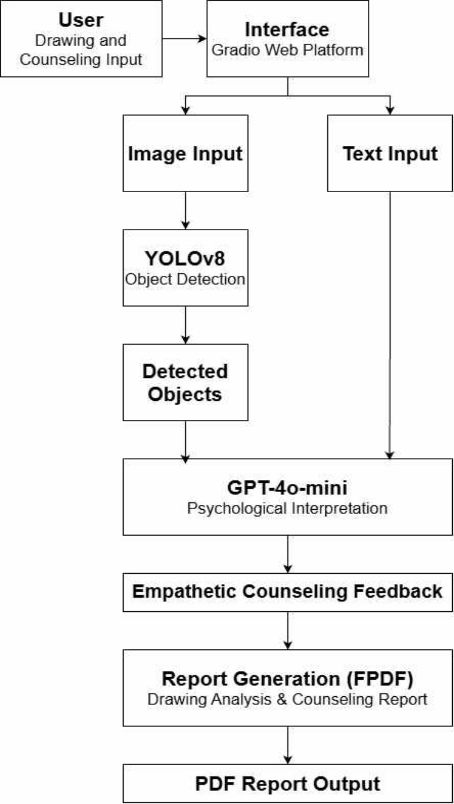
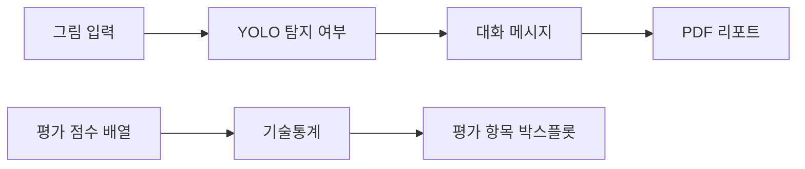

# Art-Therapy-Dialogue-Project — LEVEL 1 - Beginner

**읽기 수준 선택** · **LEVEL 1 - Beginner** · [LEVEL 2 - Explorer](%EB%A0%88%EB%B2%A82.md) · [LEVEL 3 - Practitioner](%EB%A0%88%EB%B2%A83.md) · [LEVEL 4 - Advanced](%EB%A0%88%EB%B2%A84.md) · [LEVEL 5 - Expert](%EB%A0%88%EB%B2%A85.md)

[같은 수준 프로필](https://github.com/PUVKID/PUVKID/blob/main/docs/읽기안내/레벨1.md) · [저장소 첫 화면](../../README.md)

**논문 읽기:** 곽윤석·김남기의 논문은 Journal of KIIT 24(10), 77–84쪽, 2026-10-31에 게재되었습니다. 전체 8쪽 게재본은 [공식 DOI 페이지](https://doi.org/10.14801/jkiit.2026.24.10.77)에서 읽을 수 있습니다. **HWP는 기존 투고 원고**입니다. 게재본 PDF는 저장소에 첨부하지 않습니다. 과거 차수의 파일 구성도·해시·쪽수는 해당 투고 자료의 이력으로 읽어 주세요.

<a id="guide-intro"></a>

## 프로젝트 소개

그림을 올려 객체가 탐지됐는지 확인하고, 그 요약을 바탕으로 공감형 메시지와 PDF 보고서를 만드는 연구입니다. 여기서 PDF 보고서는 앱의 출력이며 논문 파일과 다릅니다. **현재 게재 논문은 공식 DOI로 읽고 GitHub에 게재PDF를 다시 올리지 않습니다.**

<a id="guide-problem"></a>

## 문제와 주요 기능

그림을 계기로 사용자가 질문과 코멘트를 받아보도록 연결합니다. 물체를 찾는 모델과 문장을 만드는 모델의 역할이 다릅니다. 자연스러운 문장이 나와도 심리 상태를 맞췄거나 치료가 됐다는 뜻은 아닙니다.

<a id="guide-flow"></a>

## 입력·처리·출력

그림을 저장하고 탐지가 됐는지 요약한 뒤 문장을 요청합니다. 그림·요약·문장을 보고서로 묶습니다. 오른쪽 질문 버튼은 별도 질문 한 건을 보내며 이전 그림과 대화가 자동으로 이어지는 구조는 아닙니다.

<a id="guide-practice"></a>

## 실험과 사용 흐름

공식 논문에서 그림과 방법을 읽고 앱 노트북에서 버튼별 동작을 확인합니다. API 키·가중치·입력 폴더·폰트가 필요합니다. 점수 그림 노트북은 앱 실행과 다른 목적입니다.

<a id="guide-results"></a>

## 관측 결과와 해석

원고는 mAP50 약0.92·mAP50-95 약0.78을 보고합니다. mAP는 물체 상자를 얼마나 잘 찾는지 보는 값입니다. 이 값은 이미 학습한 자료로 확인한 적합도이며 새로운 사용자 그림이나 치료 효과의 정확도가 아닙니다.

<a id="guide-architecture"></a>

## 구현과 핵심 파일

앱 노트북은 그림·질문·보고서를 연결하고 평가 노트북은 점수 분포를 그립니다. 각각 입력이 다릅니다. 앱에서 생성한 보고서PDF와 공식 논문은 구분합니다.

<a id="guide-paper"></a>

## 실제 논문과 원고

「객체 검출과 생성형 언어모델을 결합한 상호작용 기반 그림 심리분석 시스템의 설계 및 구현」은 곽윤석·김남기의 게재 논문입니다. Journal of KIIT24권10호77–84쪽,2026-10-31의8쪽 게재본입니다. 현재는 공식 DOI에서 안내합니다.

<a id="guide-limits"></a>

## 조건·실패·미검증 한계

문장이 친절해도 진단이나 치료 효과가 확인된 것은 아닙니다. 실제 사용자 원그림과 의료 원데이터는 공개하지 않습니다. **점수 그림·탐지 지표·임상 효과를 구분합니다.**

## 전체 차수

차수는 아래의 실제 자료 구분을 따릅니다. 설명은 현재 선택한 수준으로 열리며, 자료 폴더와 당시 전체 비교도 함께 확인할 수 있습니다.

| 차수·단계 | 같은 수준 설명 | 자료 폴더 | 직전 비교·구성 |
| --- | --- | --- | --- |
| 1차 원고 | [LEVEL 1 - Beginner](../revisions/paper-1.md#reading-level-1) | [자료](../../%EB%85%BC%EB%AC%B8/1%EC%B0%A8) | [전체 비교](../revision-diffs/paper-1.diff) |
| 2차 원고 | [LEVEL 1 - Beginner](../revisions/paper-2.md#reading-level-1) | [자료](../../%EB%85%BC%EB%AC%B8/2%EC%B0%A8) | [전체 비교](../revision-diffs/paper-2.diff) |
| 3차 원고 | [LEVEL 1 - Beginner](../revisions/paper-3.md#reading-level-1) | [자료](../../%EB%85%BC%EB%AC%B8/3%EC%B0%A8) | [전체 비교](../revision-diffs/paper-3.diff) |
| 4차 | [LEVEL 1 - Beginner](../revisions/paper-4.md#reading-level-1) | [자료](../../4%EC%B0%A8) | [전체 비교](../revision-diffs/paper-4.diff) |
| 5차 · 최종 수정 원고 | [LEVEL 1 - Beginner](../revisions/paper-5.md#reading-level-1) | [자료](../../%EB%85%BC%EB%AC%B8) | [전체 비교](../revision-diffs/paper-5.diff) |
| 그림 자료 · 기본 앱 | [LEVEL 1 - Beginner](../revisions/app.md#reading-level-1) | [자료](../../%EA%B7%B8%EB%A6%BC%20%EC%9E%90%EB%A3%8C) | [전체 비교](../revision-diffs/app.diff) |

## 첫 화면의 모든 설명과 공통 근거

아래는 기존 첫 화면의 실질 구성 전체입니다. 각 항목의 개념은 이 페이지의 풀이와 연결하고, 실제 표·코드·그림·상세 조건은 원문 공통 근거에서 확인합니다. 기존 전체 비교는 문장·주석·파일 단위의 작은 변화까지 보존하는 자료입니다.

| 첫 화면 구성 | 이 수준의 풀이 | 원문 공통 근거 |
| --- | --- | --- |
| 연구 요약 | [프로젝트 소개](#guide-intro) | [전체 설명·표·그림](../../README.md#-%EC%97%B0%EA%B5%AC-%ED%95%B5%EC%8B%AC) |
| 입력·처리·출력 | [입력·처리·출력](#guide-flow) | [전체 설명·표·그림](../../README.md#-%EC%9E%85%EB%A0%A5%EC%B2%98%EB%A6%AC%EC%B6%9C%EB%A0%A5) |
| 논문과 최신 자료 | [실제 논문과 원고](#guide-paper) | [전체 설명·표·그림](../../README.md#-%EB%85%BC%EB%AC%B8%EA%B3%BC-%EC%B5%9C%EC%8B%A0-%EC%9E%90%EB%A3%8C) |
| 전체 차수 | [문제와 주요 기능](#guide-problem) | [전체 설명·표·그림](../../README.md#%EF%B8%8F-%EC%B0%A8%EC%88%98%EB%B3%84-%ED%94%84%EB%A1%9C%EC%A0%9D%ED%8A%B8-%EC%95%88%EB%82%B4) |
| 연구 방법 | [프로젝트 소개](#guide-intro) | [전체 설명·표·그림](../../README.md#-%ED%94%84%EB%A1%9C%EC%A0%9D%ED%8A%B8-%EC%86%8C%EA%B0%9C) |
| 저장소 구성 | [구현과 핵심 파일](#guide-architecture) | [전체 설명·표·그림](../../README.md#-%EC%A0%80%EC%9E%A5%EC%86%8C-%EA%B5%AC%EC%84%B1) |
| 주요 기술 | [프로젝트 소개](#guide-intro) | [전체 설명·표·그림](../../README.md#-%EC%A3%BC%EC%9A%94-%EA%B8%B0%EC%88%A0) |
| 빠른 시작 | [실험과 사용 흐름](#guide-practice) | [전체 설명·표·그림](../../README.md#-%EB%B9%A0%EB%A5%B8-%EC%8B%9C%EC%9E%91) |
| 데이터 구성과 평가 항목 | [구현과 핵심 파일](#guide-architecture) | [전체 설명·표·그림](../../README.md#-%EB%8D%B0%EC%9D%B4%ED%84%B0-%EA%B5%AC%EC%84%B1%EA%B3%BC-%ED%8F%89%EA%B0%80-%ED%95%AD%EB%AA%A9) |
| 문제 해결 | [조건·실패·미검증 한계](#guide-limits) | [전체 설명·표·그림](../../README.md#%EF%B8%8F-%EB%AC%B8%EC%A0%9C-%ED%95%B4%EA%B2%B0) |
| 최신 문서와 변경 이력 | [실제 논문과 원고](#guide-paper) | [전체 설명·표·그림](../../README.md#-%ED%98%84%EC%9E%AC-%EC%B2%A8%EB%B6%80-%EB%AC%B8%EC%84%9C) |
| 차수별 방법과 조건 | [문제와 주요 기능](#guide-problem) | [전체 설명·표·그림](../../README.md#-%EC%97%B0%EA%B5%AC%EA%B5%AC%ED%98%84%EC%9D%98-%EC%84%B8%EB%B6%80-%ED%9D%90%EB%A6%84) |

## 이어 읽기

같은 난이도로 다른 프로젝트를 찾으려면 [프로필의 LEVEL 1 - Beginner](https://github.com/PUVKID/PUVKID/blob/main/docs/읽기안내/레벨1.md)를 엽니다. 이 저장소 안에서는 위 전체 차수 표의 같은 수준 설명으로 이동하세요. 단계별 선택표에서 깊이를 바꿀 수 있으며, LEVEL 5 아래에는 기존 상세 전체가 보존되어 있습니다.

## LEVEL 1 · 조건과 결과를 자세히 읽기

아래 조건은 원고·공개 노트북에 있는 값입니다. 차수별 상세는 각 단계의 기록이며, 최신 원고의 설정을 이전 차수에서 새로 얻은 결과로 소급하지 않습니다.

### LEVEL 1 · 연구와 앱의 네 단계

**실제 조건:** 그림 입력 → 객체 탐지 → 대화 메시지 → PDF 보고서. 앱의 그림 분석과 텍스트 질문은 별도 요청입니다.

그림을 올리면 먼저 작은 탐지기가 대상을 찾습니다. 그러나 다음 대화 모델에 그림 자체가 전달되는 것은 아닙니다. 그림 분석 버튼과 질문 버튼은 서로 다른 길이므로, 질문창에서 앞의 그림 분석을 기억한다고 생각하면 안 됩니다.

### LEVEL 1 · 합성 자료와 학습 횟수

**실제 조건:** 33클래스 × 클래스당 10,000장 = 330,000장. 중앙의 단일 객체와 색상 변형. 원고: YOLOv8n, 50 epoch × 100단계. 연결된 학습 코드는 30단계이며 resume_flag를 호출에 넘기지 않습니다.

클래스는 그림 속 대상의 종류입니다. 종류마다 1만 장을 만들어 모두 33만 장을 준비한 설정입니다. epoch는 학습 자료를 한 번 훑는 단위여서 50번씩 100단계라는 원고 설명을 곱하면 5,000회차가 됩니다. 이는 원고가 설명한 구성이고 여기서 새로 실행한 횟수가 아닙니다. 연결된 코드의 30단계 설정은 이 설명과 다릅니다.

### LEVEL 1 · 손실과 탐지 지표

**실제 조건:** 원고 보고값: box loss 0.38 / classification loss 0.28 / DFL 0.81 / mAP50 0.92 / mAP50–95 0.78. 학습·검증 자료가 같습니다.

손실은 배우는 과정에서 위치·종류·경계 표현의 오차를 줄이기 위해 쓰는 값입니다. 0.38·0.28·0.81을 같은 단위의 점수처럼 합치지 않습니다. mAP는 여러 탐지 조건에서 성능을 모아 본 지표이고, 더 엄격한 위치 조건까지 보는 mAP50–95가 0.78입니다. 학습한 자료로 확인한 결과이므로 처음 보는 실제 그림에서도 그만큼 맞힌다는 뜻은 아닙니다.

### LEVEL 1 · 평가 배열과 기술통계

**실제 조건:** 각 32개: 정서 적절성 3점×2·4점×10·5점×20 / 자연스러움 3점×1·4점×5·5점×26 / 공감 3점×2·4점×12·5점×18. 평균·중앙값·표준편차 ddof=1·25/75 분위수.

세 배열은 질문에 대한 점수를 코드 안에 직접 적은 목록입니다. 정서 적절성은 2+10+20=32개이고 나머지 항목도 각각 32개입니다. 평균은 전체 점수의 중심을, 중앙값은 줄 세웠을 때 가운데를, 표준편차는 점수가 얼마나 흩어졌는지를 봅니다. ddof=1은 32가 아닌 31을 분모로 쓰는 표본 계산이며, 25·75 분위수는 점수 분포의 아래쪽과 위쪽 경계를 읽는 값입니다.

### LEVEL 1 · 이미지 저장과 탐지 입력

**실제 조건:** NumPy RGB → OpenCV BGR → input/temp.jpg. 추론 conf=0.05, imgsz=640. 상자 존재 여부와 분석 시각만 요약합니다.

화면에서 보이는 색 순서와 파일 저장 도구가 쓰는 색 순서가 달라 RGB를 BGR로 바꿉니다. conf=0.05는 탐지 후보를 남기는 문턱이고 프로그램 정확도가 5%라는 뜻이 아닙니다. 640은 추론 입력 크기 설정입니다. 대화에 보내는 것은 상세 물체 목록이 아니라 탐지 성공·실패와 시각입니다.

### LEVEL 1 · 언어모델과 실패 흐름

**실제 조건:** gpt-4o-mini에 system/user 두 메시지. 그림 분석은 10~15문장 요청. ask_gpt는 입력 질문만 별도 전송. API 예외는 오류 문자열로 반환, 그림 분석은 이어서 PDF 생성을 시도합니다.

말투를 정하는 system 메시지와 실제 요청인 user 메시지를 보냅니다. 10~15문장은 요청한 길이이지 실제 응답이 반드시 그 길이라는 보장이 아닙니다. API가 실패하면 답변 대신 오류 글이 생기며, 그 뒤 보고서 만들기를 계속 시도할 수 있습니다. 그림 저장이나 보고서 오류까지 모두 잡아 주는 구조는 아닙니다.

### LEVEL 1 · 실행 환경과 출력 파일

**실제 조건:** Gradio·Ultralytics·fpdf2·OpenAI·OpenCV. 모델·작업·폰트 경로 필요. 고정 result/report.pdf, A4·여백15mm·이미지 x10/w90mm·글자14/11/12. 평가 PNG 600dpi, Colab 폰트 설치·다운로드 셀.

앱에 필요한 도구를 설치해도 학습 모델과 폰트 파일이 없으면 실행할 수 없습니다. 입력 폴더는 준비해야 하고 보고서는 매번 같은 이름에 저장되므로 다음 그림을 분석하기 전에 필요한 결과를 복사해 둡니다. A4와 mm 값은 종이 배치 설정, 600dpi는 평가 그림을 저장할 때의 해상도이지 연구 정확도가 아닙니다.

<!-- complete-source-facts17:start -->

## 첫 화면의 세부 사실을 빠짐없이 읽기

위의 수준별 풀이에 대응하는 실제 세부 사실입니다. 입력·조건·수치·표·그림·문서 판본과 작은 변경까지 같은 페이지에서 확인하도록 기존 첫 화면의 내용을 함께 수록했습니다. 각 절은 해당 수준의 앞선 설명과 연결해 읽으며, 원래 실행 코드·전체 비교·원고는 원문 주소로 이어집니다.

<a id="facts-section-0"></a>

### LEVEL 1 · 첫 화면 기본 정보


그림 탐지 요약으로 대화를 구성하고 평가 결과를 시각화한 프로토타입입니다.

분야: 컴퓨터 비전·자연어 처리 › 검출·언어 모델 연결 › 그림 대화 원고·평가 시각화

`Python`
`Gradio`
`Matplotlib`

[빠른 시작](../../README.md#quick-start) · [저장소 구성](../../README.md#repository-structure) · [평가 데이터](../../README.md#data-settings)

[핵심 구성](../../README.md#input-processing-output)


<a id="facts-section-1"></a>

### LEVEL 1 · 연구 요약


객체 탐지·대화 연계 설계와 탐지 지표·사용자 평가를 정리한 8쪽 원고입니다.

학습·검증에 같은 자료를 사용했으며 mAP50 약 0.92와 mAP50-95 약 0.78을 기록했습니다. 앱의 그림 분석과 텍스트 질문은 별도 호출로 구성했습니다. 독립 자료와 임상 환경의 평가는 후속 과제입니다.

- 5쪽에는 동일 자료로 학습·검증한 mAP50 약 0.92와 mAP50-95 약 0.78을 정리했습니다.
- 6쪽의 대화 설계와 평가를 앱의 실제 두 호출 경로와 구분합니다. 4차 노트북은 이 연구의 평가 도표를 구성하는 별도 자료입니다.

**자료별 안내:** [기본 앱](../../docs/versions/base.md) · [4차](../../docs/versions/first.md) · [최종 원고](../../docs/versions/latest.md) · [전체 기록](../../docs/VERSIONS.md)




**논문 그림** — 공개 원고 3쪽 그림 1: 그림 입력·객체 탐지·대화·PDF 리포트를 연결한 연구 구조입니다.

[근거 파일 보기](https://doi.org/10.14801/jkiit.2026.24.10.77)


<a id="facts-section-2"></a>

### LEVEL 1 · 입력·처리·출력


| 구분 | 내용 |
| :--- | :--- |
| 문제 | 그림 탐지 요약을 상담형 대화와 보고서로 연결하는 방법을 다룹니다. |
| 입력 | 그림 이미지·텍스트 질문·코드의 점수 배열 |
| 처리 | YOLO 탐지 요약·LLM 대화·PDF, 점수 기술통계 |
| 출력 | 대화 앱·논문·평가 그래프 |

---


<a id="facts-section-3"></a>

### LEVEL 1 · 논문과 최신 자료


| 자료 | 원문 파일 |
|---|---|
| 최종 논문 · 그림 심리분석 | [공식 게재 페이지](https://doi.org/10.14801/jkiit.2026.24.10.77) |
| 최종 논문 · 그림 심리분석 | [HWP 다운로드](../../%EB%85%BC%EB%AC%B8/%EC%B5%9C%EC%A2%85_%EB%85%BC%EB%AC%B8.hwp) |

[자료별 설명](../../docs/PAPERS.md) · [코드 차수와 변경 이력](../../docs/REVISION_INDEX.md)


<a id="facts-section-4"></a>

### LEVEL 1 · 전체 차수


| 차수·단계 | 주요 내용 | 자료 | 직전 비교 |
| --- | --- | --- | --- |
| [1차 원고](../../docs/revisions/paper-1.md#reading-level-1) | [상세 설명](#layout18-table-5-row-1-field-1) | [폴더](../../%EB%85%BC%EB%AC%B8/1%EC%B0%A8) | [전체 비교](../../docs/revision-diffs/paper-1.diff) |
| [2차 원고](../../docs/revisions/paper-2.md#reading-level-1) | [상세 설명](#layout18-table-5-row-2-field-1) | [폴더](../../%EB%85%BC%EB%AC%B8/2%EC%B0%A8) | [전체 비교](../../docs/revision-diffs/paper-2.diff) |
| [3차 원고](../../docs/revisions/paper-3.md#reading-level-1) | [상세 설명](#layout18-table-5-row-3-field-1) | [폴더](../../%EB%85%BC%EB%AC%B8/3%EC%B0%A8) | [전체 비교](../../docs/revision-diffs/paper-3.diff) |
| [4차](../../docs/revisions/paper-4.md#reading-level-1) | [상세 설명](#layout18-table-5-row-4-field-1) | [폴더](../../4%EC%B0%A8) | [전체 비교](../../docs/revision-diffs/paper-4.diff) |
| [5차 · 최종 수정 원고](../../docs/revisions/paper-5.md#reading-level-1) | [상세 설명](#layout18-table-5-row-5-field-1) | [폴더](../../%EB%85%BC%EB%AC%B8) | [전체 비교](../../docs/revision-diffs/paper-5.diff) |
| [그림 자료 · 기본 앱](../../docs/revisions/app.md#reading-level-1) | [상세 설명](#layout18-table-5-row-6-field-1) | [폴더](../../%EA%B7%B8%EB%A6%BC%20%EC%9E%90%EB%A3%8C) | [전체 비교](../../docs/revision-diffs/app.diff) |

<a id="layout18-table-5-row-1-field-1"></a>

**[1차 원고](../../docs/revisions/paper-1.md#reading-level-1)**

**주요 내용**

우울증 환자 대상 미술치료라는 초기 연구 질문에서 그림 입력·객체 탐지·언어 모델·PDF의 네 모듈을 연결한 4쪽 원고 단계입니다.

<a id="layout18-table-5-row-2-field-1"></a>

**[2차 원고](../../docs/revisions/paper-2.md#reading-level-1)**

**주요 내용**

1차의 시스템 구조를 유지하면서 초록·기여·각 모듈 설명을 다듬고 평가 항목과 결과표를 구체화한 4쪽 원고 단계입니다.

<a id="layout18-table-5-row-3-field-1"></a>

**[3차 원고](../../docs/revisions/paper-3.md#reading-level-1)**

**주요 내용**

제목을 객체 검출·생성형 언어모델 기반 그림 심리분석 시스템으로 바꾸고 데이터·대화·보고서 구조를 확장한 6쪽 원고 단계입니다.

<a id="layout18-table-5-row-4-field-1"></a>

**[4차](../../docs/revisions/paper-4.md#reading-level-1)**

**주요 내용**

정서적 적절성·언어 자연스러움·공감의 32개 점수 배열을 기술통계와 박스플롯으로 정리한 평가 시각화 단계입니다. 8쪽 원고의 탐지 지표 해석과 구현 경로도 구체화합니다.

<a id="layout18-table-5-row-5-field-1"></a>

**[5차 · 최종 수정 원고](../../docs/revisions/paper-5.md#reading-level-1)**

**주요 내용**

객체 검출·생성형 언어모델 기반 그림 심리분석의 연구 본문을 유지하면서 소속·서지·저자소개를 정리한 8쪽 최종 수정 원고입니다.

<a id="layout18-table-5-row-6-field-1"></a>

**[그림 자료 · 기본 앱](../../docs/revisions/app.md#reading-level-1)**

**주요 내용**

그림 업로드→YOLO 탐지 여부→상담형 메시지→PDF를 Gradio 화면에서 연결하는 노트북 앱입니다. 텍스트 질문 버튼은 별도 요청을 처리합니다.


<a id="facts-section-5"></a>

### LEVEL 1 · 연구 방법


앱은 그림 입력, 탐지 여부 요약, 대화형 메시지, 공식 게재 페이지를 연결합니다. 평가 노트북은 정서 적절성·언어 자연스러움·공감 항목의 값과 분포를 계산합니다.

| 기능 | 구현 내용 |
| :--- | :--- |
| 그림 입력 | Gradio에서 이미지를 받아 YOLO 추론 |
| 대화형 메시지 | 탐지 여부 요약을 언어 모델에 전달 |
| PDF 리포트 | 입력 그림·분석 요약·생성 메시지 저장 |
| 평가 통계 | 평균·중앙값·표본 표준편차·사분위수 계산 |
| 평가 시각화 | 세 평가 항목의 박스플롯과 PNG 출력 |




<a id="facts-section-6"></a>

### LEVEL 1 · 저장소 구성


```text
.
├── 그림 자료/
│   └── app.ipynb
├── 4차/
│   └── 그림 5.ipynb
├── docs/
│   ├── VERSIONS.md
│   └── SANITIZATION.md
└── CHANGELOG.md
```

- [그림 분석 앱](../../%EA%B7%B8%EB%A6%BC%20%EC%9E%90%EB%A3%8C/app.ipynb): YOLO·Gradio·PDF·대화 처리.
- [평가 그림](../../4%EC%B0%A8/%EA%B7%B8%EB%A6%BC%205.ipynb): 점수 분포와 통계·그래프 생성.
- [버전 기록](../../docs/VERSIONS.md): 포함 코드의 차수별 구성.


#### LEVEL 1 · 최종 논문

현재 게재본은 공식 DOI 페이지로 안내하고, 기존 HWP는 투고 원고로 보존합니다. 이전 원고의 변화는 차수별 설명과 비교 이력에서 확인할 수 있습니다.

현재 원문은 본문·도표·저자소개·전화·사진을 보존합니다. 논문에 실린 연구 그림과 별개로 사용자 원본 자료·의료 원데이터 폴더는 포함하지 않습니다.


#### LEVEL 1 · 논문과 구현의 관계

[Python 구현 저장소](https://github.com/PUVKID/Drawing-Analysis-Project)에는 그림 생성·학습·미세조정·API 진입점을 보관합니다. 이 저장소는 최종 원고와 대화 앱·점수 시각화 노트북을 함께 읽는 구성입니다.

최종 8쪽 원고는 YOLO 객체 탐지와 대화·리포트의 연결을 설명합니다. 학습·검증을 같은 자료로 수행한 적합도 지표(mAP50 약 0.92·mAP50-95 약 0.78)를 제시합니다. 독립된 사용자 그림과 임상 효과에 대한 평가는 후속 과제입니다.

이전 4쪽 원고는 정성평가를, 최종 원고는 모델·프롬프트 구성을 구체적으로 설명합니다.

원고 제목은 <strong>「객체 검출과 생성형 언어모델을 결합한 상호작용 기반 그림 심리분석 시스템의 설계 및 구현」</strong>이며 저자는 곽윤석·김남기입니다.

이전 4차에는 권·호·접수일 자리표시자가 남지만 5차에는 구체 날짜와 권 24·호 10 표기가 있습니다. 이 원고 표기와 공식 게재 URL 확인은 구분합니다.

<a id="layout18-table-7-row-1"></a>

**데이터**

**원고의 학습 구성**

데이터

**내용**

중앙에 단일 객체를 놓고 색상을 바꾼 33개 클래스, 클래스당 10,000장, 총 330,000장의 합성 이미지

<a id="layout18-table-7-row-2"></a>

**모델·학습**

**원고의 학습 구성**

모델·학습

**내용**

YOLOv8n 사전학습 가중치, 50 epoch × 100단계의 누적 학습으로 기술

<a id="layout18-table-7-row-3"></a>

**보고 지표**

**원고의 학습 구성**

보고 지표

**내용**

box loss 0.38, classification loss 0.28, distribution focal loss 0.81, mAP50 0.92, mAP50-95 0.78

<a id="layout18-table-7-row-4"></a>

**평가 범위**

**원고의 학습 구성**

평가 범위

**내용**

학습 자료에 대한 적합도이며 실제 사용자 그림·임상 효과의 독립 검증은 후속 과제


연결된 Python 저장소의 `train_yolo_dataset.py`는 30단계로 설정되어 있고, 계산한 `resume_flag`를 학습 호출에 전달하지 않습니다. 원고의 100단계 누적 학습과는 학습 단계와 재개 연결이 다릅니다.

실제 앱의 언어 모델 입력은 탐지 성공·실패와 시각을 요약한 텍스트입니다. 객체의 상세 좌표·공간 관계나 원본 그림 바이트를 보내는 멀티모달 분석으로 설명하지 않습니다.

`그림 5.ipynb`의 32개 점수 배열은 원응답 파일과 연결되지 않은 코드 입력이므로 치료 효과의 근거로 확대하지 않습니다.


<a id="facts-section-7"></a>

### LEVEL 1 · 주요 기술


앱은 `analyze_and_suggest()`에서 입력을 저장하고 YOLO를 호출합니다. 언어 모델로 전달하는 요약은 분석 시각과 탐지 성공·실패이며, 상세 객체 좌표나 그림 자체를 전송하는 구성은 아닙니다. `ask_gpt()`는 텍스트 질문에 대한 별도 호출을 담당합니다.

원고 6쪽은 탐지 요약과 사용자 상담 입력을 한 요청에 묶는 설계를 설명하지만, 공개 앱은 그림 분석 버튼과 텍스트 질문 버튼의 요청을 따로 보냅니다. 이전 대화 이력도 자동으로 전달하지 않습니다.

평가 노트북은 NumPy와 Matplotlib를 사용하고, `ddof=1`의 표본 표준편차를 계산합니다. Google Colab의 폰트 설치·파일 다운로드 기능을 사용하므로 일반 로컬 Jupyter에서는 해당 셀의 실행 환경을 따로 맞춰야 합니다.


<a id="facts-section-8"></a>

### LEVEL 1 · 빠른 시작


저장소 루트에서 노트북을 엽니다.

```powershell
python -m pip install jupyterlab
python -m jupyter lab
```

1. 평가 그림만 확인하려면 `4차/그림 5.ipynb`를 Google Colab에서 엽니다. 폰트 설치 셀부터 순서대로 실행합니다.
2. 앱을 실행하려면 `그림 자료/app.ipynb`의 패키지 설치 셀을 확인하고, `OPENAI_API_KEY`를 자신의 실행 환경에 준비합니다.
3. `YOLO_MODEL_PATH`, `PROJECT_DIR`, `FONT_PATH`를 실제 모델·작업·폰트 경로에 맞춥니다.
4. 입력 폴더를 준비한 뒤 앱 초기화와 Gradio 셀을 실행합니다.

입력 그림과 리포트는 `input/temp.jpg`, `result/report.pdf`에 저장됩니다. 다음 실행에서 같은 파일을 사용하므로 보관할 결과는 따로 저장하세요.

학습 가중치, 사용자 원본 그림과 개별 평가 응답지는 공개 사본에 포함하지 않습니다. API 사용은 실행자의 서비스 설정과 이용 조건에 따릅니다.


<a id="facts-section-9"></a>

### LEVEL 1 · 데이터 구성과 평가 항목


| 배열 | 평가 항목 | 코드의 데이터 구성 |
| :--- | :--- | :--- |
| `emotional_appropriateness` | 정서 적절성 | 3점 2개, 4점 10개, 5점 20개 |
| `language_naturalness` | 언어 자연스러움 | 3점 1개, 4점 5개, 5점 26개 |
| `empathy` | 공감 | 3점 2개, 4점 12개, 5점 18개 |

각 배열에는 32개의 점수를 직접 구성해 그래프와 기술통계를 계산합니다. 개인별 원응답 파일을 읽는 구조는 아니며, 치료 효과의 평가에는 수집·평가 절차와 원응답 자료가 필요합니다.


<a id="facts-section-10"></a>

### LEVEL 1 · 문제 해결


| 증상 | 확인할 내용 |
| :--- | :--- |
| `google.colab`을 찾지 못함 | 평가 노트북은 Colab 전용 다운로드 기능을 사용함 |
| 한글 그래프가 깨짐 | 나눔고딕 설치 셀과 폰트 경로 |
| 앱 초기화 실패 | API 환경변수와 YOLO 가중치 경로 |
| PDF 생성 실패 | 입력 폴더·출력 폴더·한글 폰트 파일 |
| 평가 수치 해석이 불명확함 | 코드의 점수 배열과 실제 연구 수집 절차를 구분 |

---

대화형 프로토타입과 평가 자료를 함께 살펴봅니다.


<a id="facts-section-11"></a>

### LEVEL 1 · 최신 문서와 변경 이력


현재 제공하는 원문과 직전 공개본의 비교입니다. 이전 원고·발표와 코드는 전체 차수 표에서 확인할 수 있습니다.

| 문서 | 자료 폴더 | 상세 | 직전 공개본 전체 비교 |
|---|---|---|---|
| 최종 논문 · 그림 심리분석 | [폴더](../../%EB%85%BC%EB%AC%B8) | [설명](../../docs/latest/art-interactive-drawing-system.md) | [전체 비교](../../docs/changes/2026-11-02-%EC%B5%9C%EC%8B%A0%EB%AC%B8%EC%84%9C-%EC%A0%84%EC%B2%B4%EB%B9%84%EA%B5%90.md) |

[최신 문서 구성 변경](../../docs/changes/2026-11-02-%EC%B5%9C%EC%8B%A0%EB%AC%B8%EC%84%9C.md)


<a id="facts-section-12"></a>

### LEVEL 1 · 차수별 방법과 조건


차수별 입력, 처리 방법, 실행 조건과 결과를 정리했습니다.


<details>
<summary>1차 원고 · 그림 탐지와 상담형 대화의 설계</summary>

#### LEVEL 1 · 1차 원고 · 그림 탐지와 상담형 대화의 설계

우울증 환자 대상 미술치료라는 초기 연구 질문에서 그림 입력·객체 탐지·언어 모델·PDF의 네 모듈을 연결한 4쪽 원고 단계입니다.

| 구성 | 처리 내용 |
| --- | --- |
| 네 모듈 구조 | 입력·객체 탐지·메시지 생성·보고서가 연결되는 전체 구조를 제시합니다. |
| 합성 학습 구상 | 합성 그림으로 탐지 모델을 준비하고 상담형 메시지로 이어지는 방법을 서술합니다. |
| 평가의 출발점 | 시뮬레이션과 정성 평가로 시스템의 출력 특성을 살피는 초기 구성입니다. |
| 그림 입력 | 그림 객체를 탐지하고 결과를 텍스트로 요약하는 경로를 설명합니다. |
| 대화 생성 | YOLO 요약을 GPT-4o-mini 요청의 문맥으로 이용합니다. |

| 입력·실행 조건 | 내용 |
| --- | --- |
| 자료 역할 | 설계·구현·평가를 설명하는 연구 원고 |
| 구현 대응 | Gradio 앱의 그림 분석·질문 두 호출 |
| 데이터 해석 | 합성 객체의 탐지 지표와 대화 평가를 구분 |

원고는 객체 탐지와 언어 모델을 연결하는 시스템을 설명합니다. 실제 그림을 언어 모델이 직접 보는 것과 탐지 요약을 텍스트로 전달하는 것은 구분해 읽습니다.

평가의 의미는 각 단계의 서술 범위에 따릅니다. 최종 원고의 지표를 이전 단계에서 독립적으로 새로 얻은 결과처럼 소급하지 않습니다.

| 제약 | 확인할 내용 |
| --- | --- |
| 탐지 지표 | 학습 자료와 검증 자료가 같은 구성에서 얻은 적합도 지표이며 독립 사용자 그림의 성능과 구분합니다. |
| 구현과 원고 | 공개 앱의 그림 분석과 텍스트 질문은 별도 호출이며 원고의 통합 대화 설계와 구분합니다. |
| 효과 평가 | 점수·시뮬레이션 평가를 실제 임상 치료 효과로 확대하지 않습니다. |

[파일 구성·핵심 정의·사용 순서](../../docs/revisions/paper-1.md#reading-level-1) · [이 단계 전체 비교](../../docs/revision-diffs/paper-1.diff)


</details>

<details>
<summary>2차 원고 · 대화 평가 항목과 결과표 정리</summary>

#### LEVEL 1 · 2차 원고 · 대화 평가 항목과 결과표 정리

1차의 시스템 구조를 유지하면서 초록·기여·각 모듈 설명을 다듬고 평가 항목과 결과표를 구체화한 4쪽 원고 단계입니다.

| 구성 | 처리 내용 |
| --- | --- |
| 세 평가 항목 | 정서적 적절성·언어 자연스러움·공감을 구분합니다. |
| 원고의 평가 서술 | 성인 32명과 세 항목 평균 4.6·4.8·4.5를 원고에 명시합니다. |
| 문헌과 기여 | 참고문헌과 시스템 기여의 서술을 확장합니다. |
| 그림 입력 | 그림 객체를 탐지하고 결과를 텍스트로 요약하는 경로를 설명합니다. |
| 대화 생성 | YOLO 요약을 GPT-4o-mini 요청의 문맥으로 이용합니다. |

| 입력·실행 조건 | 내용 |
| --- | --- |
| 자료 역할 | 설계·구현·평가를 설명하는 연구 원고 |
| 구현 대응 | Gradio 앱의 그림 분석·질문 두 호출 |
| 데이터 해석 | 합성 객체의 탐지 지표와 대화 평가를 구분 |

원고는 객체 탐지와 언어 모델을 연결하는 시스템을 설명합니다. 실제 그림을 언어 모델이 직접 보는 것과 탐지 요약을 텍스트로 전달하는 것은 구분해 읽습니다.

평가의 의미는 각 단계의 서술 범위에 따릅니다. 최종 원고의 지표를 이전 단계에서 독립적으로 새로 얻은 결과처럼 소급하지 않습니다.

| 제약 | 확인할 내용 |
| --- | --- |
| 탐지 지표 | 학습 자료와 검증 자료가 같은 구성에서 얻은 적합도 지표이며 독립 사용자 그림의 성능과 구분합니다. |
| 구현과 원고 | 공개 앱의 그림 분석과 텍스트 질문은 별도 호출이며 원고의 통합 대화 설계와 구분합니다. |
| 효과 평가 | 점수·시뮬레이션 평가를 실제 임상 치료 효과로 확대하지 않습니다. |

[파일 구성·핵심 정의·사용 순서](../../docs/revisions/paper-2.md#reading-level-1) · [이 단계 전체 비교](../../docs/revision-diffs/paper-2.diff)


</details>

<details>
<summary>3차 원고 · 객체 검출 기반 그림 심리분석 시스템</summary>

#### LEVEL 1 · 3차 원고 · 객체 검출 기반 그림 심리분석 시스템

제목을 객체 검출·생성형 언어모델 기반 그림 심리분석 시스템으로 바꾸고 데이터·대화·보고서 구조를 확장한 6쪽 원고 단계입니다.

| 구성 | 처리 내용 |
| --- | --- |
| 연구 질문 정리 | 우울증 대상 표현에서 그림 심리분석 시스템의 설계·구현으로 제목과 범위를 정리합니다. |
| 합성 데이터 | 33개 클래스·클래스당 10000장, 총 330000장 구성을 서술합니다. |
| 설명 확장 | 성인 32명 시뮬레이션 평가와 관련 연구·PDF 보고서의 설명을 확장합니다. |
| 그림 입력 | 그림 객체를 탐지하고 결과를 텍스트로 요약하는 경로를 설명합니다. |
| 대화 생성 | YOLO 요약을 GPT-4o-mini 요청의 문맥으로 이용합니다. |

| 입력·실행 조건 | 내용 |
| --- | --- |
| 자료 역할 | 설계·구현·평가를 설명하는 연구 원고 |
| 구현 대응 | Gradio 앱의 그림 분석·질문 두 호출 |
| 데이터 해석 | 합성 객체의 탐지 지표와 대화 평가를 구분 |

원고는 객체 탐지와 언어 모델을 연결하는 시스템을 설명합니다. 실제 그림을 언어 모델이 직접 보는 것과 탐지 요약을 텍스트로 전달하는 것은 구분해 읽습니다.

평가의 의미는 각 단계의 서술 범위에 따릅니다. 최종 원고의 지표를 이전 단계에서 독립적으로 새로 얻은 결과처럼 소급하지 않습니다.

| 제약 | 확인할 내용 |
| --- | --- |
| 탐지 지표 | 학습 자료와 검증 자료가 같은 구성에서 얻은 적합도 지표이며 독립 사용자 그림의 성능과 구분합니다. |
| 구현과 원고 | 공개 앱의 그림 분석과 텍스트 질문은 별도 호출이며 원고의 통합 대화 설계와 구분합니다. |
| 효과 평가 | 점수·시뮬레이션 평가를 실제 임상 치료 효과로 확대하지 않습니다. |

[파일 구성·핵심 정의·사용 순서](../../docs/revisions/paper-3.md#reading-level-1) · [이 단계 전체 비교](../../docs/revision-diffs/paper-3.diff)


</details>

<details>
<summary>4차 · 평가 점수와 그림 5 시각화</summary>

#### LEVEL 1 · 4차 · 평가 점수와 그림 5 시각화

정서적 적절성·언어 자연스러움·공감의 32개 점수 배열을 기술통계와 박스플롯으로 정리한 평가 시각화 단계입니다.

8쪽 원고의 탐지 지표 해석과 구현 경로도 구체화합니다.

<a id="layout18-table-20-row-1"></a>

**점수 배열**

**구성**

점수 배열

**처리 내용**

정서적 적절성 3점 2·4점 10·5점 20명, 언어 자연스러움 3점 1·4점 5·5점 26명, 공감 3점 2·4점 12·5점 18명으로 구성합니다.

<a id="layout18-table-20-row-2"></a>

**기술통계**

**구성**

기술통계

**처리 내용**

평균·중앙값·ddof=1 표준편차·25/75백분위수를 출력합니다.

<a id="layout18-table-20-row-3"></a>

**박스플롯**

**구성**

박스플롯

**처리 내용**

세 평가 항목의 중앙값·사분위수·이상값을 같은 축에서 표시합니다.

<a id="layout18-table-20-row-4"></a>

**그림 저장**

**구성**

그림 저장

**처리 내용**

나눔고딕 Bold 축과 600dpi PNG·Colab 다운로드를 구성합니다.


| 입력·실행 조건 | 내용 |
| --- | --- |
| 환경 | NumPy·Matplotlib와 Colab의 files |
| 글꼴 | fonts-nanum 설치 셀과 나눔고딕 Bold 파일 |
| 출력 | user_evaluation_boxplot_skyblue.png |
| 통계 | 각 배열 32개·표본 표준편차 ddof=1 |

이 배열의 평균은 반올림하면 약 4.6·4.8·4.5입니다. 그림의 점수 분포와 통계는 코드에 입력한 배열에서 나옵니다.

보관된 점수표의 개별 행과 하단 분포·요약에는 일치하지 않는 부분이 있습니다. 코드 배열을 응답자별로 확인된 원응답이나 임상 효과로 간주하지 않습니다.

<a id="layout18-table-22-row-1"></a>

**원응답 대응**

**제약**

원응답 대응

**확인할 내용**

코드에 직접 작성한 배열이며 응답자별 원자료 파일을 읽지 않습니다.

<a id="layout18-table-22-row-2"></a>

**실행 환경**

**제약**

실행 환경

**확인할 내용**

apt·google.colab 파일 다운로드는 Colab용입니다. 로컬에서는 폰트와 저장 경로를 맞춥니다.

<a id="layout18-table-22-row-3"></a>

**평가 해석**

**제약**

평가 해석

**확인할 내용**

박스플롯은 정성 점수의 분포이며 독립 임상시험 결과가 아닙니다.


[파일 구성·핵심 정의·사용 순서](../../docs/revisions/paper-4.md#reading-level-1) · [이 단계 전체 비교](../../docs/revision-diffs/paper-4.diff)


</details>

<details>
<summary>5차 · 연구 본문과 서지 표기를 마무리한 최종 원고</summary>

#### LEVEL 1 · 5차 · 연구 본문과 서지 표기를 마무리한 최종 원고

객체 검출·생성형 언어모델 기반 그림 심리분석의 연구 본문을 유지하면서 소속·서지·저자소개를 정리한 8쪽 최종 수정 원고입니다.

<a id="layout18-table-23-row-1"></a>

**최종 연구 본문**

**구성**

최종 연구 본문

**처리 내용**

33클래스 330000장 합성 객체와 YOLOv8n·대화·보고서 설계를 설명합니다.

<a id="layout18-table-23-row-2"></a>

**지표와 한계**

**구성**

지표와 한계

**처리 내용**

mAP50 약 0.92·mAP50-95 약 0.78은 학습 자료 기준 탐지 지표입니다.

<a id="layout18-table-23-row-3"></a>

**최종 수정**

**구성**

최종 수정

**처리 내용**

접수 2026-09-03·수정 09-23·채택 09-26, 권 24·호 10·2026-10-31 표기와 소속·소개 문구를 정리합니다.

<a id="layout18-table-23-row-4"></a>

**그림 입력**

**구성**

그림 입력

**처리 내용**

그림 객체를 탐지하고 결과를 텍스트로 요약하는 경로를 설명합니다.

<a id="layout18-table-23-row-5"></a>

**대화 생성**

**구성**

대화 생성

**처리 내용**

YOLO 요약을 GPT-4o-mini 요청의 문맥으로 이용합니다.


| 입력·실행 조건 | 내용 |
| --- | --- |
| 자료 역할 | 설계·구현·평가를 설명하는 연구 원고 |
| 구현 대응 | Gradio 앱의 그림 분석·질문 두 호출 |
| 데이터 해석 | 합성 객체의 탐지 지표와 대화 평가를 구분 |

원고는 객체 탐지와 언어 모델을 연결하는 시스템을 설명합니다. 실제 그림을 언어 모델이 직접 보는 것과 탐지 요약을 텍스트로 전달하는 것은 구분해 읽습니다.

평가의 의미는 각 단계의 서술 범위에 따릅니다. 최종 원고의 지표를 이전 단계에서 독립적으로 새로 얻은 결과처럼 소급하지 않습니다.

| 제약 | 확인할 내용 |
| --- | --- |
| 탐지 지표 | 학습 자료와 검증 자료가 같은 구성에서 얻은 적합도 지표이며 독립 사용자 그림의 성능과 구분합니다. |
| 구현과 원고 | 공개 앱의 그림 분석과 텍스트 질문은 별도 호출이며 원고의 통합 대화 설계와 구분합니다. |
| 효과 평가 | 점수·시뮬레이션 평가를 실제 임상 치료 효과로 확대하지 않습니다. |

[파일 구성·핵심 정의·사용 순서](../../docs/revisions/paper-5.md#reading-level-1) · [이 단계 전체 비교](../../docs/revision-diffs/paper-5.diff)


</details>

<details>
<summary>그림 자료 · 대화와 PDF를 연결하는 기본 앱</summary>

#### LEVEL 1 · 그림 자료 · 대화와 PDF를 연결하는 기본 앱

그림 업로드→YOLO 탐지 여부→상담형 메시지→PDF를 Gradio 화면에서 연결하는 노트북 앱입니다. 텍스트 질문 버튼은 별도 요청을 처리합니다.

| 구성 | 처리 내용 |
| --- | --- |
| 그림 분석 | analyze_and_suggest가 RGB를 BGR로 바꾸어 저장하고 YOLO를 호출합니다. |
| 탐지 조건 | conf0.05·imgsz640으로 검출한 상자의 존재를 요약합니다. |
| 별도 질문 | ask_gpt는 질문 한 건만 보내며 이전 그림·대화 이력을 자동결합하지 않습니다. |
| PDF | build_pdf가 분석 요약·생성 메시지·입력 그림을 A4에 저장합니다. |

| 입력·실행 조건 | 내용 |
| --- | --- |
| 패키지 | Gradio·Ultralytics·FPDF2·OpenAI·OpenCV |
| 경로 | YOLO_MODEL_PATH·PROJECT_DIR·FONT_PATH |
| 인증 | 본인 환경의 OPENAI_API_KEY |
| 입출력 | input/temp.jpg·result/report.pdf |

화면의 탐지 성공은 검출 상자가 한 개 이상 있다는 뜻입니다. 그림 전체에 대한 이해나 심리 진단 정확도를 의미하지 않습니다.

출력 이미지는 상자를 새로 그린 것이 아니라 입력 RGB입니다. API 예외 문자열이 메시지와 PDF에 들어갈 수 있으므로 정상 응답인지 확인합니다.

| 제약 | 확인할 내용 |
| --- | --- |
| 고정 파일명 | 여러 요청의 그림·PDF 저장이 분리돼 있지 않습니다. |
| 초기화 | API 키·가중치·입력 폴더·폰트가 필요합니다. |
| 연구범위 | 원고의 통합 상담 설계와 실제 두 호출 구성을 구분하며 치료 효과로 판정하지 않습니다. |

[파일 구성·핵심 정의·사용 순서](../../docs/revisions/app.md#reading-level-1) · [이 단계 전체 비교](../../docs/revision-diffs/app.diff)

[차수별 안내 변경](../../docs/changes/2026-11-03-%EC%B0%A8%EC%88%98%EB%B3%84%ED%94%84%EB%A1%9C%EC%A0%9D%ED%8A%B8%EC%95%88%EB%82%B4.md)

</details>


<!-- complete-source-facts17:end -->
