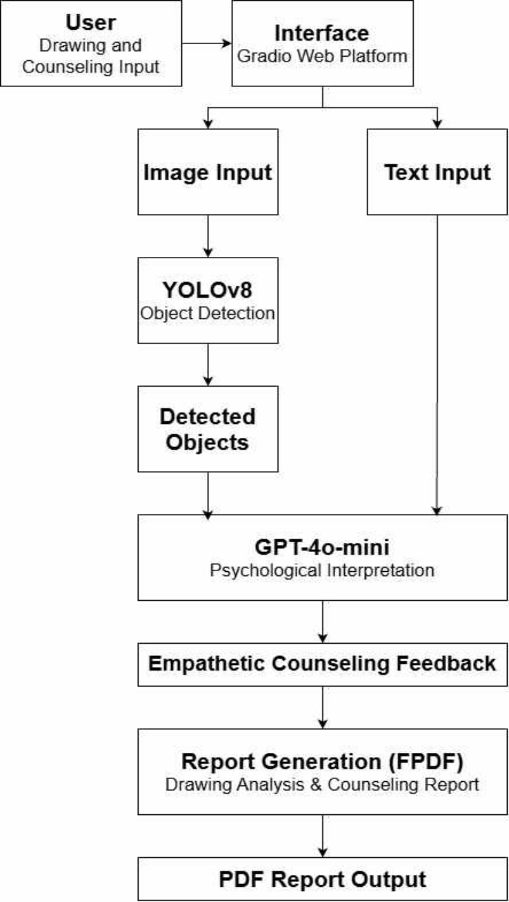
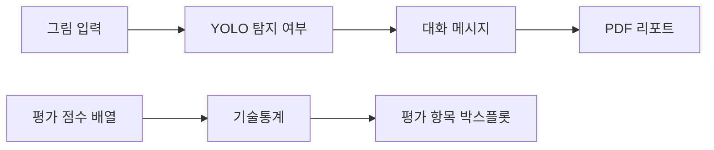

# Art-Therapy-Dialogue-Project — LEVEL 5 - Expert

**읽기 수준 선택** · [LEVEL 1 - Beginner](%EB%A0%88%EB%B2%A81.md) · [LEVEL 2 - Explorer](%EB%A0%88%EB%B2%A82.md) · [LEVEL 3 - Practitioner](%EB%A0%88%EB%B2%A83.md) · [LEVEL 4 - Advanced](%EB%A0%88%EB%B2%A84.md) · **LEVEL 5 - Expert**

[같은 수준 프로필](https://github.com/PUVKID/PUVKID/blob/main/docs/읽기안내/레벨5.md) · [저장소 첫 화면](../../README.md)

**논문 읽기:** 곽윤석·김남기의 논문은 Journal of KIIT 24(10), 77–84쪽, 2026-10-31에 게재되었습니다. 전체 8쪽 게재본은 [공식 DOI 페이지](https://doi.org/10.14801/jkiit.2026.24.10.77)에서 읽을 수 있습니다. **HWP는 기존 투고 원고**입니다. 게재본 PDF는 저장소에 첨부하지 않습니다. 과거 차수의 파일 구성도·해시·쪽수는 해당 투고 자료의 이력으로 읽어 주세요.

<a id="guide-intro"></a>

## 프로젝트 소개

검토 축은 탐지 적합도·언어 모델 입력 범위·점수 원응답 계보·임상 검증 부재·문헌 판본입니다. 같은 합성 자료를 학습·검증에 사용한 mAP를 독립 일반화 성능으로 볼 수 없습니다. 공식 게재 확인과 방법 검증의 수준도 나눕니다.

<a id="guide-problem"></a>

## 문제와 주요 기능

적합도·생성 적절성·임상 효능은 서로 다른 구성개념입니다. 시뮬레이션·직접 작성한 점수 배열과 독립 임상 원응답의 증거 수준을 구분합니다. 원고의 목적을 검증 완료된 치료 효과로 재분류하지 않습니다.

<a id="guide-flow"></a>

## 입력·처리·출력

게재본은 탐지 성공 여부 요약과 사용자 감정·상황 입력의 결합 설계를 설명합니다. 공개 앱은 그림 분석·텍스트 질문을 독립 호출하며 이력도 자동 전달하지 않습니다. 설계·구현 대응과 정보 전달의 실제 경계를 구분해 검토합니다.

<a id="guide-practice"></a>

## 실험과 사용 흐름

재현에는 합성 데이터 계보·동일자료검증·누적학습·원응답 대응이 필요합니다. 게재본5쪽은 독립 검증 대신 학습 세트를 사용했음을 명시합니다. 원응답과 연결되지 않은 점수 배열을 검증된 임상 평가 데이터로 승격하지 않습니다.

<a id="guide-results"></a>

## 관측 결과와 해석

게재본1·5쪽의 mAP와 학습자료검증 고지를 함께 인용합니다. 원고의 성인32명 서술과 공개 점수 배열의 원응답 미연결을 별도 근거로 봅니다. 통계·박스플롯의 계산 가능성이 임상 효능·인과 효과를 보장하지 않습니다.

<a id="guide-architecture"></a>

## 구현과 핵심 파일

계산 가능한 기술통계와 관측 자료의 출처 검증을 나눕니다. 입력 요약·API 실패·보고서·분포 배열의 계보가 검토 대상입니다. 공개하지 않은 사용자 원본·의료 데이터·가중치를 제공된 평가 자료처럼 세지 않습니다.

<a id="guide-paper"></a>

## 실제 논문과 원고

현재 출판 상태는 공식 DOI·Crossref와 게재본을 근거로 설명합니다. 저자·권호·인쇄쪽수·제목을 보존하며 과거 원고의 미확인 게재URL 문구는 당시 맥락으로 둡니다. DOI 확인이 실험·임상 검증의 추가 완료를 뜻하지 않습니다.

<a id="guide-limits"></a>

## 조건·실패·미검증 한계

학습자료 적합도·시뮬레이션·원응답 미연결의 한계를 보존합니다. 게재가 방법의 모든 타당성·임상 효과를 독립 확인한 뜻은 아닙니다. 사용자 원자료·의료 원영상·비공개 운영 기록을 새 공개 근거로 추가하지 않습니다.

## 전체 차수

차수는 아래의 실제 자료 구분을 따릅니다. 설명은 현재 선택한 수준으로 열리며, 자료 폴더와 당시 전체 비교도 함께 확인할 수 있습니다.

| 차수·단계 | 같은 수준 설명 | 자료 폴더 | 직전 비교·구성 |
| --- | --- | --- | --- |
| 1차 원고 | [LEVEL 5 - Expert](../revisions/paper-1.md#reading-level-5) | [자료](../../%EB%85%BC%EB%AC%B8/1%EC%B0%A8) | [전체 비교](../revision-diffs/paper-1.diff) |
| 2차 원고 | [LEVEL 5 - Expert](../revisions/paper-2.md#reading-level-5) | [자료](../../%EB%85%BC%EB%AC%B8/2%EC%B0%A8) | [전체 비교](../revision-diffs/paper-2.diff) |
| 3차 원고 | [LEVEL 5 - Expert](../revisions/paper-3.md#reading-level-5) | [자료](../../%EB%85%BC%EB%AC%B8/3%EC%B0%A8) | [전체 비교](../revision-diffs/paper-3.diff) |
| 4차 | [LEVEL 5 - Expert](../revisions/paper-4.md#reading-level-5) | [자료](../../4%EC%B0%A8) | [전체 비교](../revision-diffs/paper-4.diff) |
| 5차 · 최종 수정 원고 | [LEVEL 5 - Expert](../revisions/paper-5.md#reading-level-5) | [자료](../../%EB%85%BC%EB%AC%B8) | [전체 비교](../revision-diffs/paper-5.diff) |
| 그림 자료 · 기본 앱 | [LEVEL 5 - Expert](../revisions/app.md#reading-level-5) | [자료](../../%EA%B7%B8%EB%A6%BC%20%EC%9E%90%EB%A3%8C) | [전체 비교](../revision-diffs/app.diff) |

## 첫 화면의 모든 설명과 공통 근거

아래는 기존 첫 화면의 실질 구성 전체입니다. 각 항목의 개념은 이 페이지의 풀이와 연결하고, 실제 표·코드·그림·상세 조건은 원문 공통 근거에서 확인합니다. 기존 전체 비교는 문장·주석·파일 단위의 작은 변화까지 보존하는 자료입니다.

| 첫 화면 구성 | 이 수준의 풀이 | 원문 공통 근거 |
| --- | --- | --- |
| 연구 요약 | [프로젝트 소개](#guide-intro) | [전체 설명·표·그림](../../README.md#-%EC%97%B0%EA%B5%AC-%ED%95%B5%EC%8B%AC) |
| 입력·처리·출력 | [입력·처리·출력](#guide-flow) | [전체 설명·표·그림](../../README.md#-%EC%9E%85%EB%A0%A5%EC%B2%98%EB%A6%AC%EC%B6%9C%EB%A0%A5) |
| 논문과 최신 자료 | [실제 논문과 원고](#guide-paper) | [전체 설명·표·그림](../../README.md#-%EB%85%BC%EB%AC%B8%EA%B3%BC-%EC%B5%9C%EC%8B%A0-%EC%9E%90%EB%A3%8C) |
| 전체 차수 | [문제와 주요 기능](#guide-problem) | [전체 설명·표·그림](../../README.md#%EF%B8%8F-%EC%B0%A8%EC%88%98%EB%B3%84-%ED%94%84%EB%A1%9C%EC%A0%9D%ED%8A%B8-%EC%95%88%EB%82%B4) |
| 연구 방법 | [프로젝트 소개](#guide-intro) | [전체 설명·표·그림](../../README.md#-%ED%94%84%EB%A1%9C%EC%A0%9D%ED%8A%B8-%EC%86%8C%EA%B0%9C) |
| 저장소 구성 | [구현과 핵심 파일](#guide-architecture) | [전체 설명·표·그림](../../README.md#-%EC%A0%80%EC%9E%A5%EC%86%8C-%EA%B5%AC%EC%84%B1) |
| 주요 기술 | [프로젝트 소개](#guide-intro) | [전체 설명·표·그림](../../README.md#-%EC%A3%BC%EC%9A%94-%EA%B8%B0%EC%88%A0) |
| 빠른 시작 | [실험과 사용 흐름](#guide-practice) | [전체 설명·표·그림](../../README.md#-%EB%B9%A0%EB%A5%B8-%EC%8B%9C%EC%9E%91) |
| 데이터 구성과 평가 항목 | [구현과 핵심 파일](#guide-architecture) | [전체 설명·표·그림](../../README.md#-%EB%8D%B0%EC%9D%B4%ED%84%B0-%EA%B5%AC%EC%84%B1%EA%B3%BC-%ED%8F%89%EA%B0%80-%ED%95%AD%EB%AA%A9) |
| 문제 해결 | [조건·실패·미검증 한계](#guide-limits) | [전체 설명·표·그림](../../README.md#%EF%B8%8F-%EB%AC%B8%EC%A0%9C-%ED%95%B4%EA%B2%B0) |
| 최신 문서와 변경 이력 | [실제 논문과 원고](#guide-paper) | [전체 설명·표·그림](../../README.md#-%ED%98%84%EC%9E%AC-%EC%B2%A8%EB%B6%80-%EB%AC%B8%EC%84%9C) |
| 차수별 방법과 조건 | [문제와 주요 기능](#guide-problem) | [전체 설명·표·그림](../../README.md#-%EC%97%B0%EA%B5%AC%EA%B5%AC%ED%98%84%EC%9D%98-%EC%84%B8%EB%B6%80-%ED%9D%90%EB%A6%84) |

## 이어 읽기

같은 난이도로 다른 프로젝트를 찾으려면 [프로필의 LEVEL 5 - Expert](https://github.com/PUVKID/PUVKID/blob/main/docs/읽기안내/레벨5.md)를 엽니다. 이 저장소 안에서는 위 전체 차수 표의 같은 수준 설명으로 이동하세요. 단계별 선택표에서 깊이를 바꿀 수 있으며, LEVEL 5 아래에는 기존 상세 전체가 보존되어 있습니다.

## LEVEL 5 · 조건과 결과를 자세히 읽기

아래 조건은 원고·공개 노트북에 있는 값입니다. 차수별 상세는 각 단계의 기록이며, 최신 원고의 설정을 이전 차수에서 새로 얻은 결과로 소급하지 않습니다.

### LEVEL 5 · 연구와 앱의 네 단계

**실제 조건:** 그림 입력 → 객체 탐지 → 대화 메시지 → PDF 보고서. 앱의 그림 분석과 텍스트 질문은 별도 요청입니다.

원고의 제안 아키텍처, 공개 노트북의 두 독립 요청 경로, 평가 노트북의 정적 입력을 서로 다른 증거로 취급합니다. 연결된 Drawing Analysis 저장소의 기능도 이 앱의 구현으로 자동 합산하지 않습니다.

### LEVEL 5 · 합성 자료와 학습 횟수

**실제 조건:** 33클래스 × 클래스당 10,000장 = 330,000장. 중앙의 단일 객체와 색상 변형. 원고: YOLOv8n, 50 epoch × 100단계. 연결된 학습 코드는 30단계이며 resume_flag를 호출에 넘기지 않습니다.

33×10,000의 합성 표본 구성, 공간 배치·색상 변형, 사전학습 YOLOv8n, 누적 학습 서술을 재현 계약으로 분리합니다. 공개된 30단계 설정 및 resume 인자 미연결은 100단계 누적 학습 주장과의 명시적 구현 차이이며 새로운 실행 결과로 보정하지 않습니다.

### LEVEL 5 · 손실과 탐지 지표

**실제 조건:** 원고 보고값: box loss 0.38 / classification loss 0.28 / DFL 0.81 / mAP50 0.92 / mAP50–95 0.78. 학습·검증 자료가 같습니다.

원고의 다목적 탐지 손실과 IoU 기반 AP 집계를 각각 읽습니다. 학습·검증 동일 자료라는 프로토콜 한계를 유지하며 외부 검증·신뢰구간·반복 변동이 없는 보고값에 새로운 통계적 확신을 부여하지 않습니다.

### LEVEL 5 · 평가 배열과 기술통계

**실제 조건:** 각 32개: 정서 적절성 3점×2·4점×10·5점×20 / 자연스러움 3점×1·4점×5·5점×26 / 공감 3점×2·4점×12·5점×18. 평균·중앙값·표준편차 ddof=1·25/75 분위수.

정적 배열의 지지점 {3,4,5}와 항목별 빈도, n=32, 표본 표준편차의 자유도 보정 및 백분위 계산을 재현합니다. 원응답과의 추적 가능성이 없으므로 응답자 수준의 독립성·반복측정·추론통계에 필요한 가정을 추가하지 않습니다.

### LEVEL 5 · 이미지 저장과 탐지 입력

**실제 조건:** NumPy RGB → OpenCV BGR → input/temp.jpg. 추론 conf=0.05, imgsz=640. 상자 존재 여부와 분석 시각만 요약합니다.

RGB/BGR 변환, 파일 기반 추론의 conf/imgsz 인자, results[0].boxes.data의 존재 여부 집계, 시각 요약을 소스 수준에서 추적합니다. 객체 라벨·좌표·공간 관계를 전달하지 않는 정보 축약과 고정 경로의 동시성·무결성 한계를 평가합니다.

### LEVEL 5 · 언어모델과 실패 흐름

**실제 조건:** gpt-4o-mini에 system/user 두 메시지. 그림 분석은 10~15문장 요청. ask_gpt는 입력 질문만 별도 전송. API 예외는 오류 문자열로 반환, 그림 분석은 이어서 PDF 생성을 시도합니다.

요청별 messages·모델 ID·프롬프트 길이 요구와 예외 범위를 검토합니다. catch 후 report 생성으로 진행하는 제어 흐름, 비상태형 ask_gpt, 초기화 시 환경변수 직접 접근에 따른 실패를 구분하며 오류 문자열을 정상 임상 출력으로 집계하지 않습니다.

### LEVEL 5 · 실행 환경과 출력 파일

**실제 조건:** Gradio·Ultralytics·fpdf2·OpenAI·OpenCV. 모델·작업·폰트 경로 필요. 고정 result/report.pdf, A4·여백15mm·이미지 x10/w90mm·글자14/11/12. 평가 PNG 600dpi, Colab 폰트 설치·다운로드 셀.

의존 패키지·환경변수·모델·입출력·폰트의 초기화 계약, 고정 파일 경로, FPDF 단위·자동 페이지 여백·텍스트 크기·이미지 배치와 600dpi 그림 출력을 소스와 대조합니다. 사용자 그림·가중치·개별 응답지는 저장소 제공 범위 밖이며 재현 입력을 임의로 만들지 않습니다.

<!-- complete-source-facts17:start -->

## 첫 화면의 세부 사실을 빠짐없이 읽기

위의 수준별 풀이에 대응하는 실제 세부 사실입니다. 입력·조건·수치·표·그림·문서 판본과 작은 변경까지 같은 페이지에서 확인하도록 기존 첫 화면의 내용을 함께 수록했습니다. 각 절은 해당 수준의 앞선 설명과 연결해 읽으며, 원래 실행 코드·전체 비교·원고는 원문 주소로 이어집니다.

<a id="facts-section-0"></a>

### LEVEL 5 · 첫 화면 기본 정보


그림 탐지 요약으로 대화를 구성하고 평가 결과를 시각화한 프로토타입입니다.

분야: 컴퓨터 비전·자연어 처리 › 검출·언어 모델 연결 › 그림 대화 원고·평가 시각화

`Python`
`Gradio`
`Matplotlib`

[빠른 시작](../../README.md#quick-start) · [저장소 구성](../../README.md#repository-structure) · [평가 데이터](../../README.md#data-settings)

[핵심 구성](../../README.md#input-processing-output)


<a id="facts-section-1"></a>

### LEVEL 5 · 연구 요약


객체 탐지·대화 연계 설계와 탐지 지표·사용자 평가를 정리한 8쪽 원고입니다.

학습·검증에 같은 자료를 사용했으며 mAP50 약 0.92와 mAP50-95 약 0.78을 기록했습니다. 앱의 그림 분석과 텍스트 질문은 별도 호출로 구성했습니다. 독립 자료와 임상 환경의 평가는 후속 과제입니다.

- 5쪽에는 동일 자료로 학습·검증한 mAP50 약 0.92와 mAP50-95 약 0.78을 정리했습니다.
- 6쪽의 대화 설계와 평가를 앱의 실제 두 호출 경로와 구분합니다. 4차 노트북은 이 연구의 평가 도표를 구성하는 별도 자료입니다.

**자료별 안내:** [기본 앱](../../docs/versions/base.md) · [4차](../../docs/versions/first.md) · [최종 원고](../../docs/versions/latest.md) · [전체 기록](../../docs/VERSIONS.md)




**논문 그림** — 공개 원고 3쪽 그림 1: 그림 입력·객체 탐지·대화·PDF 리포트를 연결한 연구 구조입니다.

[근거 파일 보기](https://doi.org/10.14801/jkiit.2026.24.10.77)


<a id="facts-section-2"></a>

### LEVEL 5 · 입력·처리·출력


| 구분 | 내용 |
| :--- | :--- |
| 문제 | 그림 탐지 요약을 상담형 대화와 보고서로 연결하는 방법을 다룹니다. |
| 입력 | 그림 이미지·텍스트 질문·코드의 점수 배열 |
| 처리 | YOLO 탐지 요약·LLM 대화·PDF, 점수 기술통계 |
| 출력 | 대화 앱·논문·평가 그래프 |

---


<a id="facts-section-3"></a>

### LEVEL 5 · 논문과 최신 자료


| 자료 | 원문 파일 |
|---|---|
| 최종 논문 · 그림 심리분석 | [공식 게재 페이지](https://doi.org/10.14801/jkiit.2026.24.10.77) |
| 최종 논문 · 그림 심리분석 | [HWP 다운로드](../../%EB%85%BC%EB%AC%B8/%EC%B5%9C%EC%A2%85_%EB%85%BC%EB%AC%B8.hwp) |

[자료별 설명](../../docs/PAPERS.md) · [코드 차수와 변경 이력](../../docs/REVISION_INDEX.md)


<a id="facts-section-4"></a>

### LEVEL 5 · 전체 차수


| 차수·단계 | 주요 내용 | 자료 | 직전 비교 |
| --- | --- | --- | --- |
| [1차 원고](../../docs/revisions/paper-1.md#reading-level-5) | 우울증 환자 대상 미술치료라는 초기 연구 질문에서 그림 입력·객체 탐지·언어 모델·PDF의 네 모듈을 연결한 4쪽 원고 단계입니다. | [폴더](../../%EB%85%BC%EB%AC%B8/1%EC%B0%A8) | [전체 비교](../../docs/revision-diffs/paper-1.diff) |
| [2차 원고](../../docs/revisions/paper-2.md#reading-level-5) | 1차의 시스템 구조를 유지하면서 초록·기여·각 모듈 설명을 다듬고 평가 항목과 결과표를 구체화한 4쪽 원고 단계입니다. | [폴더](../../%EB%85%BC%EB%AC%B8/2%EC%B0%A8) | [전체 비교](../../docs/revision-diffs/paper-2.diff) |
| [3차 원고](../../docs/revisions/paper-3.md#reading-level-5) | 제목을 객체 검출·생성형 언어모델 기반 그림 심리분석 시스템으로 바꾸고 데이터·대화·보고서 구조를 확장한 6쪽 원고 단계입니다. | [폴더](../../%EB%85%BC%EB%AC%B8/3%EC%B0%A8) | [전체 비교](../../docs/revision-diffs/paper-3.diff) |
| [4차](../../docs/revisions/paper-4.md#reading-level-5) | 정서적 적절성·언어 자연스러움·공감의 32개 점수 배열을 기술통계와 박스플롯으로 정리한 평가 시각화 단계입니다. 8쪽 원고의 탐지 지표 해석과 구현 경로도 구체화합니다. | [폴더](../../4%EC%B0%A8) | [전체 비교](../../docs/revision-diffs/paper-4.diff) |
| [5차 · 최종 수정 원고](../../docs/revisions/paper-5.md#reading-level-5) | 객체 검출·생성형 언어모델 기반 그림 심리분석의 연구 본문을 유지하면서 소속·서지·저자소개를 정리한 8쪽 최종 수정 원고입니다. | [폴더](../../%EB%85%BC%EB%AC%B8) | [전체 비교](../../docs/revision-diffs/paper-5.diff) |
| [그림 자료 · 기본 앱](../../docs/revisions/app.md#reading-level-5) | 그림 업로드→YOLO 탐지 여부→상담형 메시지→PDF를 Gradio 화면에서 연결하는 노트북 앱입니다. 텍스트 질문 버튼은 별도 요청을 처리합니다. | [폴더](../../%EA%B7%B8%EB%A6%BC%20%EC%9E%90%EB%A3%8C) | [전체 비교](../../docs/revision-diffs/app.diff) |


<a id="facts-section-5"></a>

### LEVEL 5 · 연구 방법


앱은 그림 입력, 탐지 여부 요약, 대화형 메시지, 공식 게재 페이지를 연결합니다. 평가 노트북은 정서 적절성·언어 자연스러움·공감 항목의 값과 분포를 계산합니다.

| 기능 | 구현 내용 |
| :--- | :--- |
| 그림 입력 | Gradio에서 이미지를 받아 YOLO 추론 |
| 대화형 메시지 | 탐지 여부 요약을 언어 모델에 전달 |
| PDF 리포트 | 입력 그림·분석 요약·생성 메시지 저장 |
| 평가 통계 | 평균·중앙값·표본 표준편차·사분위수 계산 |
| 평가 시각화 | 세 평가 항목의 박스플롯과 PNG 출력 |




<a id="facts-section-6"></a>

### LEVEL 5 · 저장소 구성


```text
.
├── 그림 자료/
│   └── app.ipynb
├── 4차/
│   └── 그림 5.ipynb
├── docs/
│   ├── VERSIONS.md
│   └── SANITIZATION.md
└── CHANGELOG.md
```

- [그림 분석 앱](../../%EA%B7%B8%EB%A6%BC%20%EC%9E%90%EB%A3%8C/app.ipynb): YOLO·Gradio·PDF·대화 처리.
- [평가 그림](../../4%EC%B0%A8/%EA%B7%B8%EB%A6%BC%205.ipynb): 점수 분포와 통계·그래프 생성.
- [버전 기록](../../docs/VERSIONS.md): 포함 코드의 차수별 구성.


#### LEVEL 5 · 최종 논문

현재 게재본은 공식 DOI 페이지로 안내하고, 기존 HWP는 투고 원고로 보존합니다. 이전 원고의 변화는 차수별 설명과 비교 이력에서 확인할 수 있습니다.

현재 원문은 본문·도표·저자소개·전화·사진을 보존합니다. 논문에 실린 연구 그림과 별개로 사용자 원본 자료·의료 원데이터 폴더는 포함하지 않습니다.


#### LEVEL 5 · 논문과 구현의 관계

[Python 구현 저장소](https://github.com/PUVKID/Drawing-Analysis-Project)에는 그림 생성·학습·미세조정·API 진입점을 보관합니다. 이 저장소는 최종 원고와 대화 앱·점수 시각화 노트북을 함께 읽는 구성입니다.

최종 8쪽 원고는 YOLO 객체 탐지와 대화·리포트의 연결을 설명합니다. 학습·검증을 같은 자료로 수행한 적합도 지표(mAP50 약 0.92·mAP50-95 약 0.78)를 제시합니다. 독립된 사용자 그림과 임상 효과에 대한 평가는 후속 과제입니다.

이전 4쪽 원고는 정성평가를, 최종 원고는 모델·프롬프트 구성을 구체적으로 설명합니다.

원고 제목은 <strong>「객체 검출과 생성형 언어모델을 결합한 상호작용 기반 그림 심리분석 시스템의 설계 및 구현」</strong>이며 저자는 곽윤석·김남기입니다.

이전 4차에는 권·호·접수일 자리표시자가 남지만 5차에는 구체 날짜와 권 24·호 10 표기가 있습니다. 이 원고 표기와 공식 게재 URL 확인은 구분합니다.

| 원고의 학습 구성 | 내용 |
| :--- | :--- |
| 데이터 | 중앙에 단일 객체를 놓고 색상을 바꾼 33개 클래스, 클래스당 10,000장, 총 330,000장의 합성 이미지 |
| 모델·학습 | YOLOv8n 사전학습 가중치, 50 epoch × 100단계의 누적 학습으로 기술 |
| 보고 지표 | box loss 0.38, classification loss 0.28, distribution focal loss 0.81, mAP50 0.92, mAP50-95 0.78 |
| 평가 범위 | 학습 자료에 대한 적합도이며 실제 사용자 그림·임상 효과의 독립 검증은 후속 과제 |

연결된 Python 저장소의 `train_yolo_dataset.py`는 30단계로 설정되어 있고, 계산한 `resume_flag`를 학습 호출에 전달하지 않습니다. 원고의 100단계 누적 학습과는 학습 단계와 재개 연결이 다릅니다.

실제 앱의 언어 모델 입력은 탐지 성공·실패와 시각을 요약한 텍스트입니다. 객체의 상세 좌표·공간 관계나 원본 그림 바이트를 보내는 멀티모달 분석으로 설명하지 않습니다.

`그림 5.ipynb`의 32개 점수 배열은 원응답 파일과 연결되지 않은 코드 입력이므로 치료 효과의 근거로 확대하지 않습니다.


<a id="facts-section-7"></a>

### LEVEL 5 · 주요 기술


앱은 `analyze_and_suggest()`에서 입력을 저장하고 YOLO를 호출합니다. 언어 모델로 전달하는 요약은 분석 시각과 탐지 성공·실패이며, 상세 객체 좌표나 그림 자체를 전송하는 구성은 아닙니다. `ask_gpt()`는 텍스트 질문에 대한 별도 호출을 담당합니다.

원고 6쪽은 탐지 요약과 사용자 상담 입력을 한 요청에 묶는 설계를 설명하지만, 공개 앱은 그림 분석 버튼과 텍스트 질문 버튼의 요청을 따로 보냅니다. 이전 대화 이력도 자동으로 전달하지 않습니다.

평가 노트북은 NumPy와 Matplotlib를 사용하고, `ddof=1`의 표본 표준편차를 계산합니다. Google Colab의 폰트 설치·파일 다운로드 기능을 사용하므로 일반 로컬 Jupyter에서는 해당 셀의 실행 환경을 따로 맞춰야 합니다.


<a id="facts-section-8"></a>

### LEVEL 5 · 빠른 시작


저장소 루트에서 노트북을 엽니다.

```powershell
python -m pip install jupyterlab
python -m jupyter lab
```

1. 평가 그림만 확인하려면 `4차/그림 5.ipynb`를 Google Colab에서 엽니다. 폰트 설치 셀부터 순서대로 실행합니다.
2. 앱을 실행하려면 `그림 자료/app.ipynb`의 패키지 설치 셀을 확인하고, `OPENAI_API_KEY`를 자신의 실행 환경에 준비합니다.
3. `YOLO_MODEL_PATH`, `PROJECT_DIR`, `FONT_PATH`를 실제 모델·작업·폰트 경로에 맞춥니다.
4. 입력 폴더를 준비한 뒤 앱 초기화와 Gradio 셀을 실행합니다.

입력 그림과 리포트는 `input/temp.jpg`, `result/report.pdf`에 저장됩니다. 다음 실행에서 같은 파일을 사용하므로 보관할 결과는 따로 저장하세요.

학습 가중치, 사용자 원본 그림과 개별 평가 응답지는 공개 사본에 포함하지 않습니다. API 사용은 실행자의 서비스 설정과 이용 조건에 따릅니다.


<a id="facts-section-9"></a>

### LEVEL 5 · 데이터 구성과 평가 항목


| 배열 | 평가 항목 | 코드의 데이터 구성 |
| :--- | :--- | :--- |
| `emotional_appropriateness` | 정서 적절성 | 3점 2개, 4점 10개, 5점 20개 |
| `language_naturalness` | 언어 자연스러움 | 3점 1개, 4점 5개, 5점 26개 |
| `empathy` | 공감 | 3점 2개, 4점 12개, 5점 18개 |

각 배열에는 32개의 점수를 직접 구성해 그래프와 기술통계를 계산합니다. 개인별 원응답 파일을 읽는 구조는 아니며, 치료 효과의 평가에는 수집·평가 절차와 원응답 자료가 필요합니다.


<a id="facts-section-10"></a>

### LEVEL 5 · 문제 해결


| 증상 | 확인할 내용 |
| :--- | :--- |
| `google.colab`을 찾지 못함 | 평가 노트북은 Colab 전용 다운로드 기능을 사용함 |
| 한글 그래프가 깨짐 | 나눔고딕 설치 셀과 폰트 경로 |
| 앱 초기화 실패 | API 환경변수와 YOLO 가중치 경로 |
| PDF 생성 실패 | 입력 폴더·출력 폴더·한글 폰트 파일 |
| 평가 수치 해석이 불명확함 | 코드의 점수 배열과 실제 연구 수집 절차를 구분 |

---

대화형 프로토타입과 평가 자료를 함께 살펴봅니다.


<a id="facts-section-11"></a>

### LEVEL 5 · 최신 문서와 변경 이력


현재 제공하는 원문과 직전 공개본의 비교입니다. 이전 원고·발표와 코드는 전체 차수 표에서 확인할 수 있습니다.

| 문서 | 자료 폴더 | 상세 | 직전 공개본 전체 비교 |
|---|---|---|---|
| 최종 논문 · 그림 심리분석 | [폴더](../../%EB%85%BC%EB%AC%B8) | [설명](../../docs/latest/art-interactive-drawing-system.md) | [전체 비교](../../docs/changes/2026-11-02-%EC%B5%9C%EC%8B%A0%EB%AC%B8%EC%84%9C-%EC%A0%84%EC%B2%B4%EB%B9%84%EA%B5%90.md) |

[최신 문서 구성 변경](../../docs/changes/2026-11-02-%EC%B5%9C%EC%8B%A0%EB%AC%B8%EC%84%9C.md)


<a id="facts-section-12"></a>

### LEVEL 5 · 차수별 방법과 조건


차수별 입력, 처리 방법, 실행 조건과 결과를 정리했습니다.


<details>
<summary>1차 원고 · 그림 탐지와 상담형 대화의 설계</summary>

#### LEVEL 5 · 1차 원고 · 그림 탐지와 상담형 대화의 설계

우울증 환자 대상 미술치료라는 초기 연구 질문에서 그림 입력·객체 탐지·언어 모델·PDF의 네 모듈을 연결한 4쪽 원고 단계입니다.

| 구성 | 처리 내용 |
| --- | --- |
| 네 모듈 구조 | 입력·객체 탐지·메시지 생성·보고서가 연결되는 전체 구조를 제시합니다. |
| 합성 학습 구상 | 합성 그림으로 탐지 모델을 준비하고 상담형 메시지로 이어지는 방법을 서술합니다. |
| 평가의 출발점 | 시뮬레이션과 정성 평가로 시스템의 출력 특성을 살피는 초기 구성입니다. |
| 그림 입력 | 그림 객체를 탐지하고 결과를 텍스트로 요약하는 경로를 설명합니다. |
| 대화 생성 | YOLO 요약을 GPT-4o-mini 요청의 문맥으로 이용합니다. |

| 입력·실행 조건 | 내용 |
| --- | --- |
| 자료 역할 | 설계·구현·평가를 설명하는 연구 원고 |
| 구현 대응 | Gradio 앱의 그림 분석·질문 두 호출 |
| 데이터 해석 | 합성 객체의 탐지 지표와 대화 평가를 구분 |

원고는 객체 탐지와 언어 모델을 연결하는 시스템을 설명합니다. 실제 그림을 언어 모델이 직접 보는 것과 탐지 요약을 텍스트로 전달하는 것은 구분해 읽습니다.

평가의 의미는 각 단계의 서술 범위에 따릅니다. 최종 원고의 지표를 이전 단계에서 독립적으로 새로 얻은 결과처럼 소급하지 않습니다.

| 제약 | 확인할 내용 |
| --- | --- |
| 탐지 지표 | 학습 자료와 검증 자료가 같은 구성에서 얻은 적합도 지표이며 독립 사용자 그림의 성능과 구분합니다. |
| 구현과 원고 | 공개 앱의 그림 분석과 텍스트 질문은 별도 호출이며 원고의 통합 대화 설계와 구분합니다. |
| 효과 평가 | 점수·시뮬레이션 평가를 실제 임상 치료 효과로 확대하지 않습니다. |

[파일 구성·핵심 정의·사용 순서](../../docs/revisions/paper-1.md#reading-level-5) · [이 단계 전체 비교](../../docs/revision-diffs/paper-1.diff)


</details>

<details>
<summary>2차 원고 · 대화 평가 항목과 결과표 정리</summary>

#### LEVEL 5 · 2차 원고 · 대화 평가 항목과 결과표 정리

1차의 시스템 구조를 유지하면서 초록·기여·각 모듈 설명을 다듬고 평가 항목과 결과표를 구체화한 4쪽 원고 단계입니다.

| 구성 | 처리 내용 |
| --- | --- |
| 세 평가 항목 | 정서적 적절성·언어 자연스러움·공감을 구분합니다. |
| 원고의 평가 서술 | 성인 32명과 세 항목 평균 4.6·4.8·4.5를 원고에 명시합니다. |
| 문헌과 기여 | 참고문헌과 시스템 기여의 서술을 확장합니다. |
| 그림 입력 | 그림 객체를 탐지하고 결과를 텍스트로 요약하는 경로를 설명합니다. |
| 대화 생성 | YOLO 요약을 GPT-4o-mini 요청의 문맥으로 이용합니다. |

| 입력·실행 조건 | 내용 |
| --- | --- |
| 자료 역할 | 설계·구현·평가를 설명하는 연구 원고 |
| 구현 대응 | Gradio 앱의 그림 분석·질문 두 호출 |
| 데이터 해석 | 합성 객체의 탐지 지표와 대화 평가를 구분 |

원고는 객체 탐지와 언어 모델을 연결하는 시스템을 설명합니다. 실제 그림을 언어 모델이 직접 보는 것과 탐지 요약을 텍스트로 전달하는 것은 구분해 읽습니다.

평가의 의미는 각 단계의 서술 범위에 따릅니다. 최종 원고의 지표를 이전 단계에서 독립적으로 새로 얻은 결과처럼 소급하지 않습니다.

| 제약 | 확인할 내용 |
| --- | --- |
| 탐지 지표 | 학습 자료와 검증 자료가 같은 구성에서 얻은 적합도 지표이며 독립 사용자 그림의 성능과 구분합니다. |
| 구현과 원고 | 공개 앱의 그림 분석과 텍스트 질문은 별도 호출이며 원고의 통합 대화 설계와 구분합니다. |
| 효과 평가 | 점수·시뮬레이션 평가를 실제 임상 치료 효과로 확대하지 않습니다. |

[파일 구성·핵심 정의·사용 순서](../../docs/revisions/paper-2.md#reading-level-5) · [이 단계 전체 비교](../../docs/revision-diffs/paper-2.diff)


</details>

<details>
<summary>3차 원고 · 객체 검출 기반 그림 심리분석 시스템</summary>

#### LEVEL 5 · 3차 원고 · 객체 검출 기반 그림 심리분석 시스템

제목을 객체 검출·생성형 언어모델 기반 그림 심리분석 시스템으로 바꾸고 데이터·대화·보고서 구조를 확장한 6쪽 원고 단계입니다.

| 구성 | 처리 내용 |
| --- | --- |
| 연구 질문 정리 | 우울증 대상 표현에서 그림 심리분석 시스템의 설계·구현으로 제목과 범위를 정리합니다. |
| 합성 데이터 | 33개 클래스·클래스당 10000장, 총 330000장 구성을 서술합니다. |
| 설명 확장 | 성인 32명 시뮬레이션 평가와 관련 연구·PDF 보고서의 설명을 확장합니다. |
| 그림 입력 | 그림 객체를 탐지하고 결과를 텍스트로 요약하는 경로를 설명합니다. |
| 대화 생성 | YOLO 요약을 GPT-4o-mini 요청의 문맥으로 이용합니다. |

| 입력·실행 조건 | 내용 |
| --- | --- |
| 자료 역할 | 설계·구현·평가를 설명하는 연구 원고 |
| 구현 대응 | Gradio 앱의 그림 분석·질문 두 호출 |
| 데이터 해석 | 합성 객체의 탐지 지표와 대화 평가를 구분 |

원고는 객체 탐지와 언어 모델을 연결하는 시스템을 설명합니다. 실제 그림을 언어 모델이 직접 보는 것과 탐지 요약을 텍스트로 전달하는 것은 구분해 읽습니다.

평가의 의미는 각 단계의 서술 범위에 따릅니다. 최종 원고의 지표를 이전 단계에서 독립적으로 새로 얻은 결과처럼 소급하지 않습니다.

| 제약 | 확인할 내용 |
| --- | --- |
| 탐지 지표 | 학습 자료와 검증 자료가 같은 구성에서 얻은 적합도 지표이며 독립 사용자 그림의 성능과 구분합니다. |
| 구현과 원고 | 공개 앱의 그림 분석과 텍스트 질문은 별도 호출이며 원고의 통합 대화 설계와 구분합니다. |
| 효과 평가 | 점수·시뮬레이션 평가를 실제 임상 치료 효과로 확대하지 않습니다. |

[파일 구성·핵심 정의·사용 순서](../../docs/revisions/paper-3.md#reading-level-5) · [이 단계 전체 비교](../../docs/revision-diffs/paper-3.diff)


</details>

<details>
<summary>4차 · 평가 점수와 그림 5 시각화</summary>

#### LEVEL 5 · 4차 · 평가 점수와 그림 5 시각화

정서적 적절성·언어 자연스러움·공감의 32개 점수 배열을 기술통계와 박스플롯으로 정리한 평가 시각화 단계입니다.

8쪽 원고의 탐지 지표 해석과 구현 경로도 구체화합니다.

| 구성 | 처리 내용 |
| --- | --- |
| 점수 배열 | 정서적 적절성 3점 2·4점 10·5점 20명, 언어 자연스러움 3점 1·4점 5·5점 26명, 공감 3점 2·4점 12·5점 18명으로 구성합니다. |
| 기술통계 | 평균·중앙값·ddof=1 표준편차·25/75백분위수를 출력합니다. |
| 박스플롯 | 세 평가 항목의 중앙값·사분위수·이상값을 같은 축에서 표시합니다. |
| 그림 저장 | 나눔고딕 Bold 축과 600dpi PNG·Colab 다운로드를 구성합니다. |

| 입력·실행 조건 | 내용 |
| --- | --- |
| 환경 | NumPy·Matplotlib와 Colab의 files |
| 글꼴 | fonts-nanum 설치 셀과 나눔고딕 Bold 파일 |
| 출력 | user_evaluation_boxplot_skyblue.png |
| 통계 | 각 배열 32개·표본 표준편차 ddof=1 |

이 배열의 평균은 반올림하면 약 4.6·4.8·4.5입니다. 그림의 점수 분포와 통계는 코드에 입력한 배열에서 나옵니다.

보관된 점수표의 개별 행과 하단 분포·요약에는 일치하지 않는 부분이 있습니다. 코드 배열을 응답자별로 확인된 원응답이나 임상 효과로 간주하지 않습니다.

| 제약 | 확인할 내용 |
| --- | --- |
| 원응답 대응 | 코드에 직접 작성한 배열이며 응답자별 원자료 파일을 읽지 않습니다. |
| 실행 환경 | apt·google.colab 파일 다운로드는 Colab용입니다. 로컬에서는 폰트와 저장 경로를 맞춥니다. |
| 평가 해석 | 박스플롯은 정성 점수의 분포이며 독립 임상시험 결과가 아닙니다. |

[파일 구성·핵심 정의·사용 순서](../../docs/revisions/paper-4.md#reading-level-5) · [이 단계 전체 비교](../../docs/revision-diffs/paper-4.diff)


</details>

<details>
<summary>5차 · 연구 본문과 서지 표기를 마무리한 최종 원고</summary>

#### LEVEL 5 · 5차 · 연구 본문과 서지 표기를 마무리한 최종 원고

객체 검출·생성형 언어모델 기반 그림 심리분석의 연구 본문을 유지하면서 소속·서지·저자소개를 정리한 8쪽 최종 수정 원고입니다.

| 구성 | 처리 내용 |
| --- | --- |
| 최종 연구 본문 | 33클래스 330000장 합성 객체와 YOLOv8n·대화·보고서 설계를 설명합니다. |
| 지표와 한계 | mAP50 약 0.92·mAP50-95 약 0.78은 학습 자료 기준 탐지 지표입니다. |
| 최종 수정 | 접수 2026-09-03·수정 09-23·채택 09-26, 권 24·호 10·2026-10-31 표기와 소속·소개 문구를 정리합니다. |
| 그림 입력 | 그림 객체를 탐지하고 결과를 텍스트로 요약하는 경로를 설명합니다. |
| 대화 생성 | YOLO 요약을 GPT-4o-mini 요청의 문맥으로 이용합니다. |

| 입력·실행 조건 | 내용 |
| --- | --- |
| 자료 역할 | 설계·구현·평가를 설명하는 연구 원고 |
| 구현 대응 | Gradio 앱의 그림 분석·질문 두 호출 |
| 데이터 해석 | 합성 객체의 탐지 지표와 대화 평가를 구분 |

원고는 객체 탐지와 언어 모델을 연결하는 시스템을 설명합니다. 실제 그림을 언어 모델이 직접 보는 것과 탐지 요약을 텍스트로 전달하는 것은 구분해 읽습니다.

평가의 의미는 각 단계의 서술 범위에 따릅니다. 최종 원고의 지표를 이전 단계에서 독립적으로 새로 얻은 결과처럼 소급하지 않습니다.

| 제약 | 확인할 내용 |
| --- | --- |
| 탐지 지표 | 학습 자료와 검증 자료가 같은 구성에서 얻은 적합도 지표이며 독립 사용자 그림의 성능과 구분합니다. |
| 구현과 원고 | 공개 앱의 그림 분석과 텍스트 질문은 별도 호출이며 원고의 통합 대화 설계와 구분합니다. |
| 효과 평가 | 점수·시뮬레이션 평가를 실제 임상 치료 효과로 확대하지 않습니다. |

[파일 구성·핵심 정의·사용 순서](../../docs/revisions/paper-5.md#reading-level-5) · [이 단계 전체 비교](../../docs/revision-diffs/paper-5.diff)


</details>

<details>
<summary>그림 자료 · 대화와 PDF를 연결하는 기본 앱</summary>

#### LEVEL 5 · 그림 자료 · 대화와 PDF를 연결하는 기본 앱

그림 업로드→YOLO 탐지 여부→상담형 메시지→PDF를 Gradio 화면에서 연결하는 노트북 앱입니다. 텍스트 질문 버튼은 별도 요청을 처리합니다.

| 구성 | 처리 내용 |
| --- | --- |
| 그림 분석 | analyze_and_suggest가 RGB를 BGR로 바꾸어 저장하고 YOLO를 호출합니다. |
| 탐지 조건 | conf0.05·imgsz640으로 검출한 상자의 존재를 요약합니다. |
| 별도 질문 | ask_gpt는 질문 한 건만 보내며 이전 그림·대화 이력을 자동결합하지 않습니다. |
| PDF | build_pdf가 분석 요약·생성 메시지·입력 그림을 A4에 저장합니다. |

| 입력·실행 조건 | 내용 |
| --- | --- |
| 패키지 | Gradio·Ultralytics·FPDF2·OpenAI·OpenCV |
| 경로 | YOLO_MODEL_PATH·PROJECT_DIR·FONT_PATH |
| 인증 | 본인 환경의 OPENAI_API_KEY |
| 입출력 | input/temp.jpg·result/report.pdf |

화면의 탐지 성공은 검출 상자가 한 개 이상 있다는 뜻입니다. 그림 전체에 대한 이해나 심리 진단 정확도를 의미하지 않습니다.

출력 이미지는 상자를 새로 그린 것이 아니라 입력 RGB입니다. API 예외 문자열이 메시지와 PDF에 들어갈 수 있으므로 정상 응답인지 확인합니다.

| 제약 | 확인할 내용 |
| --- | --- |
| 고정 파일명 | 여러 요청의 그림·PDF 저장이 분리돼 있지 않습니다. |
| 초기화 | API 키·가중치·입력 폴더·폰트가 필요합니다. |
| 연구범위 | 원고의 통합 상담 설계와 실제 두 호출 구성을 구분하며 치료 효과로 판정하지 않습니다. |

[파일 구성·핵심 정의·사용 순서](../../docs/revisions/app.md#reading-level-5) · [이 단계 전체 비교](../../docs/revision-diffs/app.diff)

[차수별 안내 변경](../../docs/changes/2026-11-03-%EC%B0%A8%EC%88%98%EB%B3%84%ED%94%84%EB%A1%9C%EC%A0%9D%ED%8A%B8%EC%95%88%EB%82%B4.md)

</details>


<!-- complete-source-facts17:end -->
