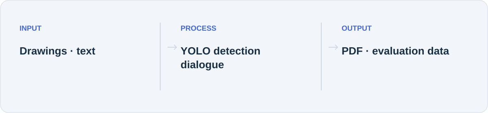
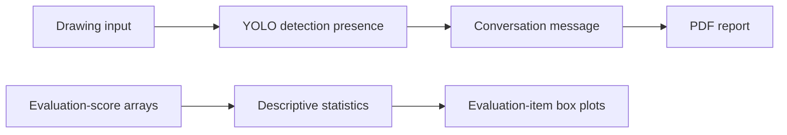

<a name="그림-객체-탐지와-미술치료-대화-프로토타입"></a>
<a name="yolo-탐지-요약--gpt-4o-mini-대화--pdf-리포트"></a>

<a id="️-art-therapy-dialogue-project"></a>

<!-- readme-header32:start -->
<a name="art-therapy-dialogue-project"></a>
<p align="center"></p>
<h1 align="center" id="project-title">Art Therapy Dialogue Project</h1>
<p align="center">A research tool connecting drawings and dialogue</p>
<p align="center">
  <a href="../README.md"></a>
  <a href="README.md"></a>
</p>
<p align="center">
  <a href="../docs/%EC%9D%BD%EA%B8%B0%EC%95%88%EB%82%B4/%EB%A0%88%EB%B2%A81.md"></a>
  <a href="../docs/%EC%9D%BD%EA%B8%B0%EC%95%88%EB%82%B4/%EB%A0%88%EB%B2%A82.md"></a>
  <a href="../docs/%EC%9D%BD%EA%B8%B0%EC%95%88%EB%82%B4/%EB%A0%88%EB%B2%A83.md"></a>
  <a href="../docs/%EC%9D%BD%EA%B8%B0%EC%95%88%EB%82%B4/%EB%A0%88%EB%B2%A84.md"></a>
  <a href="../docs/%EC%9D%BD%EA%B8%B0%EC%95%88%EB%82%B4/%EB%A0%88%EB%B2%A85.md"></a>
</p>
<p align="center"><small>LEVEL links open the Korean source at the same reading level.</small></p>
<picture>
  <source media="(max-width: 600px) and (prefers-color-scheme: dark)" srcset="../assets/readme/flow-en-dark-mobile.svg" />
  <source media="(max-width: 600px)" srcset="../assets/readme/flow-en-light-mobile.svg" />
  <source media="(prefers-color-scheme: dark)" srcset="../assets/readme/flow-en-dark.svg" />
  <source media="(prefers-color-scheme: light)" srcset="../assets/readme/flow-en-light.svg" />
  
</picture>
<!-- readme-header32:end -->


A prototype that builds conversations from drawing-detection summaries and visualizes evaluation results.

<!-- reading-levels17:start -->
| Reading level | What the guide covers |
| --- | --- |
| [LEVEL 1 - Beginner (Korean source)](../docs/%EC%9D%BD%EA%B8%B0%EC%95%88%EB%82%B4/%EB%A0%88%EB%B2%A81.md) | Unfamiliar terms and concrete examples from input to result |
| [LEVEL 2 - Explorer (Korean source)](../docs/%EC%9D%BD%EA%B8%B0%EC%95%88%EB%82%B4/%EB%A0%88%EB%B2%A82.md) | The relationships between key concepts and processing steps |
| [LEVEL 3 - Practitioner (Korean source)](../docs/%EC%9D%BD%EA%B8%B0%EC%95%88%EB%82%B4/%EB%A0%88%EB%B2%A83.md) | Experiment and usage procedures, and how to interpret results |
| [LEVEL 4 - Advanced (Korean source)](../docs/%EC%9D%BD%EA%B8%B0%EC%95%88%EB%82%B4/%EB%A0%88%EB%B2%A84.md) | Code structure, settings, design choices, and constraints |
| [LEVEL 5 - Expert (Korean source)](../docs/%EC%9D%BD%EA%B8%B0%EC%95%88%EB%82%B4/%EB%A0%88%EB%B2%A85.md) | Papers, protocols, denominators, leakage, and unverified scope |

**Read the published paper:** The paper by 곽윤석·김남기 was published in Journal of KIIT 24(10), pages 77–84, on 2026-10-31.

Read the complete 8-page published version through the [official DOI page](https://doi.org/10.14801/jkiit.2026.24.10.77).

**The HWP is the earlier submission manuscript.**

The published PDF is not attached to this repository.

File-structure diagrams, hashes, and page counts in earlier revisions describe those historical submission materials.
<!-- reading-levels17:end -->

Field: Computer vision and NLP › Connecting detection with language models › Drawing-dialogue manuscript and evaluation visualization

`Python`
`Gradio`
`Matplotlib`

[Quick start](#quick-start) · [Repository structure](#repository-structure) · [Evaluation data](#data-settings)

[Core components](#input-processing-output)

<a id="-연구-핵심"></a>

## Research overview

An 8-page manuscript describing an object-detection/conversation design, detection metrics, and user evaluation.

The same materials were used for training and validation, yielding approximately 0.92 mAP50 and 0.78 mAP50-95. Drawing analysis and text questions use separate app calls. Evaluation on independent materials and in clinical settings remains future work.

- Page 5 summarizes approximately 0.92 mAP50 and 0.78 mAP50-95 obtained with the same training/validation materials.
- The dialogue design and evaluation on page 6 are distinguished from the app's two actual request paths. The Revision 4 notebook separately creates this study's evaluation figures.

**Materials:** [Base app (Korean source)](../docs/versions/base.md) · [Revision 4 (Korean source)](../docs/versions/first.md) · [Final manuscript (Korean source)](../docs/versions/latest.md) · [Complete history (Korean source)](../docs/VERSIONS.md)

<a name="preview"></a>


**Original research diagram** — System architecture connecting drawing input, object detection, conversation, and PDF reports.

[Open the source](https://doi.org/10.14801/jkiit.2026.24.10.77)

<a name="input-processing-output"></a>

<a id="-입력처리출력"></a>

## Input, processing, and output

| Component | Description |
| --- | --- |
| Problem | Connect drawing-detection summaries with counseling-style conversations and reports. |
| Input | Drawing images, text questions, and score arrays in code |
| Processing | YOLO detection summaries, LLM conversation, PDF generation, and descriptive score statistics |
| Output | A conversational app, paper, and evaluation graphs |

---

<a id="-논문과-최신-자료"></a>

## Paper and current materials

| Material | Original source |
| --- | --- |
| Final paper · Drawing psychological analysis | [Official publication page](https://doi.org/10.14801/jkiit.2026.24.10.77) |

[Material descriptions (Korean source)](../docs/PAPERS.md) · [Code revisions and change history (Korean source)](../docs/REVISION_INDEX.md)

<a id="️-차수별-프로젝트-안내"></a>

## All revisions

| Revision or stage | Main content | Materials and comparison with the previous version |
| --- | --- | --- |
| [Revision 1 manuscript (Korean source)](../docs/revisions/paper-1.md) | <a id="layout18-table-4-row-1-field-1"></a>A 4-page manuscript stage connecting four modules—drawing input, object detection, language model, and PDF—from an initial research question about art therapy for patients with depression. | [Folder](../%EB%85%BC%EB%AC%B8/1%EC%B0%A8)<br>[Full comparison](../docs/revision-diffs/paper-1.diff) |
| [Revision 2 manuscript (Korean source)](../docs/revisions/paper-2.md) | <a id="layout18-table-4-row-2-field-1"></a>A 4-page stage retaining the Revision 1 architecture while refining the abstract, contributions, and module descriptions and specifying evaluation items and result tables. | [Folder](../%EB%85%BC%EB%AC%B8/2%EC%B0%A8)<br>[Full comparison](../docs/revision-diffs/paper-2.diff) |
| [Revision 3 manuscript (Korean source)](../docs/revisions/paper-3.md) | <a id="layout18-table-4-row-3-field-1"></a>A 6-page stage changing the title to an object-detection/generative-language-model drawing psychological-analysis system and expanding data, conversation, and report structure. | [Folder](../%EB%85%BC%EB%AC%B8/3%EC%B0%A8)<br>[Full comparison](../docs/revision-diffs/paper-3.diff) |
| [Revision 4 (Korean source)](../docs/revisions/paper-4.md) | <a id="layout18-table-4-row-4-field-1"></a>An evaluation-visualization stage presenting 32-score arrays for emotional appropriateness, language naturalness, and empathy through descriptive statistics and box plots. It also clarifies detection-metric interpretation and implementation paths in the 8-page manuscript. | [Folder](../4%EC%B0%A8)<br>[Full comparison](../docs/revision-diffs/paper-4.diff) |
| [Revision 5 · Final revised manuscript (Korean source)](../docs/revisions/paper-5.md) | <a id="layout18-table-4-row-5-field-1"></a>An 8-page final revision retaining the research text on drawing psychological analysis using object detection and generative language models while revising affiliations, bibliographic details, and author biographies. | [Folder](../%EB%85%BC%EB%AC%B8)<br>[Full comparison](../docs/revision-diffs/paper-5.diff) |
| [Drawing materials · Base app (Korean source)](../docs/revisions/app.md) | <a id="layout18-table-4-row-6-field-1"></a>A notebook app connecting drawing upload → YOLO detection presence → counseling-style message → PDF in Gradio.<br>The text-question button handles a separate request. | [Folder](../%EA%B7%B8%EB%A6%BC%20%EC%9E%90%EB%A3%8C)<br>[Full comparison](../docs/revision-diffs/app.diff) |


<a name="introduction"></a>

<a id="-프로젝트-소개"></a>

## Research method

The app connects drawing input, a detection-presence summary, and conversational messages, then generates a PDF report. The evaluation notebook calculates values and distributions for emotional appropriateness, language naturalness, and empathy.

| Feature | Implementation |
| --- | --- |
| Drawing input | Receive an image through Gradio and run YOLO |
| Conversational messages | Pass the detection-presence summary to a language model |
| PDF report | Save the input drawing, analysis summary, and generated message |
| Evaluation statistics | Calculate mean, median, sample standard deviation, and quartiles |
| Evaluation visualization | Box plots for three evaluation items and PNG output |



<a name="repository-structure"></a>

<a id="-저장소-구성"></a>

## Repository structure

```text
.
├── 그림 자료/
│   └── app.ipynb
├── 4차/
│   └── 그림 5.ipynb
├── docs/
│   ├── VERSIONS.md
│   └── SANITIZATION.md
└── CHANGELOG.md
```

- [Drawing-analysis app](../%EA%B7%B8%EB%A6%BC%20%EC%9E%90%EB%A3%8C/app.ipynb): YOLO, Gradio, PDF, and conversation handling.
- [Evaluation figure](../4%EC%B0%A8/%EA%B7%B8%EB%A6%BC%205.ipynb): Score distributions, statistics, and graphs.
- [Version history (Korean source)](../docs/VERSIONS.md): Revision-specific structure of the included code.

<a name="최종-논문"></a>

<a id="-최종-논문"></a>

### Final paper

The current published version is linked through its official DOI page; the earlier HWP is preserved as a submission manuscript. Changes between earlier manuscripts remain in revision descriptions and comparison history.

The current original preserves text, figures, author biographies, telephone information, and photos. User originals and medical raw-data folders are not included; they are distinct from the research figures in the paper.

<a name="논문과-구현의-관계"></a>

<a id="-논문과-구현의-관계"></a>

### Relationship between the paper and implementation

The [Python implementation repository](https://github.com/PUVKID/Drawing-Analysis-Project) preserves drawing generation, training, fine-tuning, and API entry points. This repository groups the final manuscript, conversation app, and score-visualization notebook.

The final 8-page manuscript explains the connection between YOLO object detection, conversation, and reports. It reports fit metrics from training and validating on the same materials (approximately 0.92 mAP50·0.78 mAP50-95). Independent evaluation on actual user drawings and clinical effects remains future work.

Earlier 4-page manuscripts describe qualitative evaluation; the final manuscript provides more specific model and prompt configurations.

The manuscript title is <strong>“객체 검출과 생성형 언어모델을 결합한 상호작용 기반 그림 심리분석 시스템의 설계 및 구현”</strong> (design and implementation of an interactive drawing psychological-analysis system combining object detection and generative language models), by 곽윤석·김남기.

Revision 4 retains volume, issue, and receipt-date placeholders, while Revision 5 supplies specific dates and volume 24·issue 10. Manuscript statements are distinct from verification through an official publication URL.

| Manuscript training configuration | Description |
| --- | --- |
| <a id="layout18-table-6-row-1"></a> Data | 33 classes of centered single objects with varied colors, 10,000 images per class, 330,000 synthetic images overall |
| <a id="layout18-table-6-row-2"></a> Model and training | Pretrained YOLOv8n weights; described as cumulative training over 50 epochs × 100 stages |
| <a id="layout18-table-6-row-3"></a> Reported metrics | box loss 0.38, classification loss 0.28, distribution focal loss 0.81, mAP50 0.92, mAP50-95 0.78 |
| <a id="layout18-table-6-row-4"></a> Evaluation scope | Fit to training materials; independent validation on actual user drawings and clinical effects remains future work |


The linked Python repository's `train_yolo_dataset.py` is configured for 30 stages and does not pass its calculated `resume_flag` to training. Its stage count and resumption connection therefore differ from the manuscript's 100-stage cumulative training description.

The actual app sends a text summary of detection success/failure and time to the language model. It is not multimodal analysis that sends detailed object coordinates, spatial relationships, or original drawing bytes.

The 32-score arrays in `그림 5.ipynb` are code inputs not linked to original response files and should not be treated as evidence of treatment effects.

<a name="implementation"></a>

<a id="-주요-기술"></a>

## Main technologies

The app saves inputs and calls YOLO in `analyze_and_suggest()`. The summary sent to the language model contains analysis time and detection success/failure, not detailed coordinates or the drawing itself. `ask_gpt()` makes a separate call for text questions.

Page 6 describes combining the detection summary and user counseling input in one request, but the public app sends separate requests from the drawing-analysis and text-question buttons. Earlier conversation history is not sent automatically either.

The evaluation notebook uses NumPy and Matplotlib and calculates sample standard deviation with `ddof=1`. Its font-installation and file-download features depend on Google Colab; configure those cells separately for ordinary local Jupyter.

<a name="quick-start"></a>

<a id="-빠른-시작"></a>

## Quick start

Open notebooks from the repository root.

```powershell
python -m pip install jupyterlab
python -m jupyter lab
```

1. To inspect evaluation figures only, open `4차/그림 5.ipynb` in Google Colab and run cells in order from font installation.
2. To run the app, review installation cells in `그림 자료/app.ipynb` and prepare `OPENAI_API_KEY` in your own execution environment.
3. Set `YOLO_MODEL_PATH`, `PROJECT_DIR`, and `FONT_PATH` to actual model, working, and font paths.
4. Prepare the input folder, then run app-initialization and Gradio cells.

Input drawings and reports use `input/temp.jpg` and `result/report.pdf`. Subsequent runs reuse these files, so save needed outputs separately.

Training weights, original user drawings, and individual evaluation-response sheets are not included in the public copy. API use follows the executor's service configuration and usage terms.

<a name="data-settings"></a>

<a id="-데이터-구성과-평가-항목"></a>

## Data and evaluation items

| Array | Evaluation item and code data |
| --- | --- |
| `emotional_appropriateness` | **Emotional appropriateness**<br>2 scores of 3, 10 scores of 4, 20 scores of 5 |
| `language_naturalness` | **Language naturalness**<br>1 score of 3, 5 scores of 4, 26 scores of 5 |
| `empathy` | **Empathy**<br>2 scores of 3, 12 scores of 4, 18 scores of 5 |

Each array directly specifies 32 scores for calculating graphs and descriptive statistics. The notebook does not load individual original-response files; evaluating treatment effects requires collection/evaluation procedures and original responses.

<a name="troubleshooting"></a>

<a id="️-문제-해결"></a>

## Troubleshooting

| Symptom | What to check |
| --- | --- |
| `google.colab` not found | The evaluation notebook uses Colab-specific downloads |
| Korean graph text is garbled | Nanum Gothic installation cells and font path |
| App initialization fails | API environment variable and YOLO weights path |
| PDF generation fails | Input/output folders and Korean font file |
| Evaluation values are unclear | Distinguish code score arrays from actual research collection procedures |

---

Explore the conversational prototype alongside its evaluation materials.

<a id="-현재-첨부-문서"></a>

## Current documents and change history

These are the current originals and their comparison with the previous public version. Earlier manuscripts, presentations, and code can be found in the all-revisions table.

| Document | Material folder | Details and full comparison with the previous public version |
| --- | --- | --- |
| Final paper · Drawing psychological analysis | [Folder](../%EB%85%BC%EB%AC%B8) | [Description (Korean source)](../docs/latest/art-interactive-drawing-system.md)<br>[Full comparison (Korean source)](../docs/changes/2026-11-02-%EC%B5%9C%EC%8B%A0%EB%AC%B8%EC%84%9C-%EC%A0%84%EC%B2%B4%EB%B9%84%EA%B5%90.md) |

[Changes to the current document structure (Korean source)](../docs/changes/2026-11-02-%EC%B5%9C%EC%8B%A0%EB%AC%B8%EC%84%9C.md)

<a name="research-details"></a>

<a id="-연구구현의-세부-흐름"></a>

## Methods and conditions by revision

Inputs, processing methods, execution conditions, and results are organized by revision.

<a id="️-1차-원고--그림-탐지와-상담형-대화의-설계"></a>

<details>
<summary>Revision 1 manuscript · Designing drawing detection and counseling-style conversation</summary>

<a id="1차-원고그림-탐지와-상담형-대화의-설계"></a>

A 4-page manuscript stage connecting four modules—drawing input, object detection, language model, and PDF—from an initial research question about art therapy for patients with depression.

| Component | Content |
| --- | --- |
| Four-module architecture | Present the overall connection between input, object detection, message generation, and reports. |
| Synthetic-training concept | Describe preparing a detector with synthetic drawings and connecting it to counseling-style messages. |
| Initial evaluation | An initial configuration examining system-output characteristics through simulation and qualitative evaluation. |
| Drawing input | Describe detecting objects and summarizing results as text. |
| Conversation generation | Use YOLO summaries as context for GPT-4o-mini requests. |

| Input or execution condition (Setting) | Description |
| --- | --- |
| Material role | Research manuscript explaining design, implementation, and evaluation |
| Corresponding implementation | Two Gradio calls for drawing analysis and questions |
| Data interpretation | Distinguish synthetic-object detection metrics from conversation evaluation |

The manuscript describes a system connecting object detection and language models. Distinguish a model directly seeing an actual drawing from receiving a detection summary as text.

Evaluation meaning follows each stage's stated scope. Do not retroactively present final-manuscript metrics as new independent results obtained in earlier stages.

| Constraint | What to check |
| --- | --- |
| Detection metrics | Fit metrics obtained with the same training and validation materials, distinct from performance on independent user drawings. |
| Implementation versus manuscript | Public-app drawing analysis and text questions are separate calls, distinct from the manuscript's integrated-dialogue design. |
| Effect evaluation | Scores and simulation evaluations do not establish actual clinical treatment effects. |

[Files, key definitions, and reading order (Korean source)](../docs/revisions/paper-1.md) · [Full comparison for this stage](../docs/revision-diffs/paper-1.diff)

<a id="️-2차-원고--대화-평가-항목과-결과표-정리"></a>

</details>

<details>
<summary>Revision 2 manuscript · Dialogue-evaluation items and result tables</summary>

<a id="2차-원고대화-평가-항목과-결과-표-정리"></a>

A 4-page stage retaining the Revision 1 architecture while refining the abstract, contributions, and module descriptions and specifying evaluation items and result tables.

| Component | Content |
| --- | --- |
| Three evaluation items | Distinguish emotional appropriateness, language naturalness, and empathy. |
| Manuscript evaluation | State 32 adults and item means of 4.6·4.8·4.5. |
| Literature and contributions | Expand references and the description of system contributions. |
| Drawing input | Describe detecting objects and summarizing results as text. |
| Conversation generation | Use YOLO summaries as context for GPT-4o-mini requests. |

| Input or execution condition (Setting) | Description |
| --- | --- |
| Material role | Research manuscript explaining design, implementation, and evaluation |
| Corresponding implementation | Two Gradio calls for drawing analysis and questions |
| Data interpretation | Distinguish synthetic-object detection metrics from conversation evaluation |

The manuscript describes a system connecting object detection and language models. Distinguish a model directly seeing an actual drawing from receiving a detection summary as text.

Evaluation meaning follows each stage's stated scope. Do not retroactively present final-manuscript metrics as new independent results obtained in earlier stages.

| Constraint | What to check |
| --- | --- |
| Detection metrics | Fit metrics obtained with the same training and validation materials, distinct from performance on independent user drawings. |
| Implementation versus manuscript | Public-app drawing analysis and text questions are separate calls, distinct from the manuscript's integrated-dialogue design. |
| Effect evaluation | Scores and simulation evaluations do not establish actual clinical treatment effects. |

[Files, key definitions, and reading order (Korean source)](../docs/revisions/paper-2.md) · [Full comparison for this stage](../docs/revision-diffs/paper-2.diff)

<a id="️-3차-원고--객체-검출-기반-그림-심리분석-시스템"></a>

</details>

<details>
<summary>Revision 3 manuscript · Object-detection-based drawing psychological-analysis system</summary>

<a id="3차-원고객체-검출-기반-그림-심리-분석-시스템"></a>

A 6-page stage changing the title to an object-detection/generative-language-model drawing psychological-analysis system and expanding data, conversation, and report structure.

| Component | Content |
| --- | --- |
| Research question | Shift title and scope from depression-focused wording to design/implementation of a drawing psychological-analysis system. |
| Synthetic data | Describe 33 classes·10000 images per class·330000 images overall. |
| Expanded explanation | Expand the simulation evaluation involving 32 adults, related work, and PDF-report description. |
| Drawing input | Describe detecting objects and summarizing results as text. |
| Conversation generation | Use YOLO summaries as context for GPT-4o-mini requests. |

| Input or execution condition (Setting) | Description |
| --- | --- |
| Material role | Research manuscript explaining design, implementation, and evaluation |
| Corresponding implementation | Two Gradio calls for drawing analysis and questions |
| Data interpretation | Distinguish synthetic-object detection metrics from conversation evaluation |

The manuscript describes a system connecting object detection and language models. Distinguish a model directly seeing an actual drawing from receiving a detection summary as text.

Evaluation meaning follows each stage's stated scope. Do not retroactively present final-manuscript metrics as new independent results obtained in earlier stages.

| Constraint | What to check |
| --- | --- |
| Detection metrics | Fit metrics obtained with the same training and validation materials, distinct from performance on independent user drawings. |
| Implementation versus manuscript | Public-app drawing analysis and text questions are separate calls, distinct from the manuscript's integrated-dialogue design. |
| Effect evaluation | Scores and simulation evaluations do not establish actual clinical treatment effects. |

[Files, key definitions, and reading order (Korean source)](../docs/revisions/paper-3.md) · [Full comparison for this stage](../docs/revision-diffs/paper-3.diff)

<a id="-4차--평가-점수와-그림-5-시각화"></a>

</details>

<details>
<summary>Revision 4 · Evaluation scores and Figure 5 visualization</summary>

<a id="4차평가-점수와-그림-5-시각화"></a>

An evaluation-visualization stage presenting 32-score arrays for emotional appropriateness, language naturalness, and empathy through descriptive statistics and box plots.

It also clarifies detection-metric interpretation and implementation paths in the 8-page manuscript.

| Component | Processing |
| --- | --- |
| <a id="layout18-table-19-row-1"></a> Score arrays | Emotional appropriateness: score 3 for 2, 4 for 10, 5 for 20; language naturalness: 3 for 1, 4 for 5, 5 for 26; empathy: 3 for 2, 4 for 12, 5 for 18. |
| <a id="layout18-table-19-row-2"></a> Descriptive statistics | Output mean, median, standard deviation with ddof =1, and 25/75 percentiles. |
| <a id="layout18-table-19-row-3"></a> Box plots | Show medians, quartiles, and outliers for all three items on the same axes. |
| <a id="layout18-table-19-row-4"></a> Figure saving | Nanum Gothic Bold axes, 600dpi PNG, and Colab download. |


| Input or execution condition (Setting) | Description |
| --- | --- |
| Environment | NumPy, Matplotlib, and Colab files |
| Font | fonts-nanum installation cell and Nanum Gothic Bold file |
| Output | user_evaluation_boxplot_skyblue.png |
| Statistics | 32 values per array·sample standard deviation ddof =1 |

Rounded means are approximately 4.6·4.8·4.5. Figure distributions and statistics come from arrays entered in code.

Some individual rows in the preserved score sheet do not agree with its lower distribution/summary. The code arrays are not verified respondent-level original responses or clinical-effect evidence.

| Constraint | What to check |
| --- | --- |
| <a id="layout18-table-21-row-1"></a> Original-response correspondence | Arrays are authored directly in code; individual original-data files are not read. |
| <a id="layout18-table-21-row-2"></a> Execution environment | apt and google.colab file downloads are Colab-specific.<br>Set fonts and save paths for local execution. |
| <a id="layout18-table-21-row-3"></a> Evaluation meaning | Box plots show qualitative-score distributions, not independent clinical-trial results. |


[Files, key definitions, and reading order (Korean source)](../docs/revisions/paper-4.md) · [Full comparison for this stage](../docs/revision-diffs/paper-4.diff)

<a id="️-5차--연구-본문과-서지-표기를-마무리한-최종-원고"></a>

</details>

<details>
<summary>Revision 5 · Final manuscript completing research text and bibliographic details</summary>

<a id="5차연구-본문과-서지-표기를-마무리한-최종-원고"></a>

An 8-page final revision retaining the research text on drawing psychological analysis using object detection and generative language models while revising affiliations, bibliographic details, and author biographies.

| Component | Content |
| --- | --- |
| <a id="layout18-table-22-row-1"></a> Final research text | Explain 33 classes/330000 synthetic-object images, YOLOv8n, conversation, and report design. |
| <a id="layout18-table-22-row-2"></a> Metrics and limitations | Approximately 0.92 mAP50·0.78 mAP50-95 are detection metrics on training materials. |
| <a id="layout18-table-22-row-3"></a> Final revision | Record receipt 2026-09-03·revision 09-23·acceptance 09-26, volume 24·issue 10·2026-10-31, and revise affiliation/biography wording. |
| <a id="layout18-table-22-row-4"></a> Drawing input | Describe detecting objects and summarizing results as text. |
| <a id="layout18-table-22-row-5"></a> Conversation generation | Use YOLO summaries as context for GPT-4o-mini requests. |


| Input or execution condition (Setting) | Description |
| --- | --- |
| Material role | Research manuscript explaining design, implementation, and evaluation |
| Corresponding implementation | Two Gradio calls for drawing analysis and questions |
| Data interpretation | Distinguish synthetic-object detection metrics from conversation evaluation |

The manuscript describes a system connecting object detection and language models. Distinguish a model directly seeing an actual drawing from receiving a detection summary as text.

Evaluation meaning follows each stage's stated scope. Do not retroactively present final-manuscript metrics as new independent results obtained in earlier stages.

| Constraint | What to check |
| --- | --- |
| Detection metrics | Fit metrics obtained with the same training and validation materials, distinct from performance on independent user drawings. |
| Implementation versus manuscript | Public-app drawing analysis and text questions are separate calls, distinct from the manuscript's integrated-dialogue design. |
| Effect evaluation | Scores and simulation evaluations do not establish actual clinical treatment effects. |

[Files, key definitions, and reading order (Korean source)](../docs/revisions/paper-5.md) · [Full comparison for this stage](../docs/revision-diffs/paper-5.diff)

<a id="-그림-자료--대화와-pdf를-연결하는-기본-앱"></a>

</details>

<details>
<summary>Drawing materials · Base app connecting conversation and PDF</summary>

<a id="그림-자료대화와-pdf를-연결하는-기본-앱"></a>

A notebook app connecting drawing upload → YOLO detection presence → counseling-style message → PDF in Gradio. The text-question button handles a separate request.

| Component | Processing |
| --- | --- |
| Drawing analysis | analyze_and_suggest converts RGB to BGR, saves it, and calls YOLO. |
| Detection conditions | Summarize the presence of boxes detected at conf0.05·imgsz640. |
| Separate question | ask_gpt sends one question without automatically combining earlier drawings or conversation history. |
| PDF | build_pdf saves the analysis summary, generated message, and input drawing on A4. |

| Input or execution condition (Setting) | Description |
| --- | --- |
| Packages | Gradio·Ultralytics·FPDF2·OpenAI·OpenCV |
| Paths | YOLO_MODEL_PATH·PROJECT_DIR·FONT_PATH |
| Authentication | OPENAI_API_KEY in your own environment |
| Input/output | input/temp.jpg·result/report.pdf |

Detection success in the interface means at least one box exists. It does not establish understanding of the whole drawing or psychological-diagnosis accuracy.

The output image is the input RGB image, not a newly annotated one. An API-exception string can enter the message and PDF, so check whether the response succeeded.

| Constraint | What to check |
| --- | --- |
| Fixed filenames | Drawings and PDFs are not stored separately for multiple requests. |
| Initialization | API key, weights, input folder, and font are required. |
| Research scope | Distinguish the manuscript's integrated-counseling design from the actual two-call implementation; do not interpret it as treatment efficacy. |

[Files, key definitions, and reading order (Korean source)](../docs/revisions/app.md) · [Full comparison for this stage](../docs/revision-diffs/app.diff)

[Changes to the revision guides (Korean source)](../docs/changes/2026-11-03-%EC%B0%A8%EC%88%98%EB%B3%84%ED%94%84%EB%A1%9C%EC%A0%9D%ED%8A%B8%EC%95%88%EB%82%B4.md)

</details>
